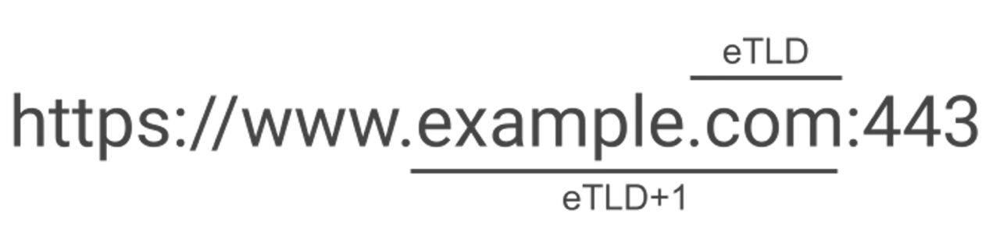

- SOP와 CORS

  SOP(Same-origin policy): 동일 출처 정책

  하나의 출처에서 로드된 자원이 호스트나 프로토콜, 포트번호가 일치하지 않는 자원과 상호작용 하지 못하도록 요청 발생을 제한하고, 동일 출처에서만 접근이 가능한 정책

  예를들어 https://www.naver.com을 기준이라 할 때

  `https://www.naver.com/news`는 프로토콜, 도메인, 포트가 모두 같아 접속이 가능하지만

  <u>`http</u>://www.naver.com, https://<u>m.</u>naver.com, https://<u>blog.</u>naver.com, https://www.naver.com<u>:8080</u>`  위 셋 중 다른 것이 있어 JavaScript로 응답을 읽을 수 없다.

  CORS(Cross-Origin Resource Sharing): 교차 출처 리소스 공유

  자신의 출처와 동일한 리소스만 불러올 수 있으며, 출처에서 올바른 CORS 헤더를 포함한 응답을 반환하면 다른 출처의 리소스를 불러올 수 있다.

  CORS 이슈 해결 : SOP에 의해 다른 출처의 리소스 사용 또는 상호작용하지 못하는 것을 CORS를 통해 해결하는 것이다.

  CORS 이슈 해결법

    - ”Access-Control-Allow-Origin: * “ 헤더를 추가하여 서버에서 모든 클라이언트에 요청에 대한 cross-origin HTTP 요청을 허가해준다.

  즉, SOP가 기본 차단 규칙이고 CORS는 서버가 명시적으로 예외를 허용하는 방법

  이외에도  CORP(Cross-Origin Resource Policy)가 있다.

  메모리 로드 자체를 차단하여 정보를 보호

  CORP는 리소스의 로드 및 포함 자체를 제어하며 메모리 가반의 정보 유출을 방지하는 정책이다.

  위의 CORS는 스크립트의 응답 데이터 접근을 제어하고 SOP의 제약을 해제하여 API 통신을 허용해준다.

- Same-Origin과 Same-Site의 차이

  Same-Origin

  origin이 같다 → 프로토콜, 호스트, 포트가 같다.

  → 프로토콜, 호스트, 포트가 모두 동일한 경우

  origin이 다른 경우 → Cross-Origin

  도메인이 다른 경우

  서브 도메인이 다른 경우

  포트가 다른 경우

  프로토콜이 다른 경우

  Same-Site

  site란?

  eTLD(effective TLD), SLD(Second Level Domain)의 조합
  

  !SLD: example / eTLD: .com

  SLD: example / eTLD: .com

  같은 대표 도메인 계열인지

  ex) https://www.naver.com과 https://m.naver.com 는 Same-Site이지만 Same-Origin은 아니다.

- 쿠키의 SameSite 속성

  퍼스트파티 쿠키: 현재 접속해있는 페이지와 같은 도메인으로 전송되는 쿠기

  서드파티 쿠키: 현재 페이지에서 타 사이트 링크를 클릭했을 경우 즉, 다른 도메인으로 전송되는 쿠키

  SameSite 쿠키: 보안상의 문제로 만들어 졌다

  쿠키의 SameSite 옵션

    - Strict: 같은 도메인에서만 사용(퍼스트파티 쿠키만 전송)
    - Lax: 같은 도메인에서만 가능 + 유저가 링크 클릭시 다른 도메인 사용 가능(예외를 제외하곤 서트파티 쿠키 전송 X)
        - 예외: 안전한 HTTP method → GET 일때만 쿠키 전송 → 사용자가 직접 주소창에 입력할 때
    - None: 다른 도메인에서도 사용 사능(Secure 옵션 사용시) (퍼스트파티 + 서드파티 쿠키 전송)
- 복합 UNIQUE 제약을 사용하는 이유는?

  중복 데이터 저장을 방지하기 위한 제약 조건

  예를 들면 같은 영화를 여러번 즐겨찾기 하는 경우에 사용할 수 있다.

    ```jsx
    CREATE TABLE favorite (
        favorite_id BIGINT AUTO_INCREMENT PRIMARY KEY,
        member_id BIGINT NOT NULL,
        movie_id BIGINT NOT NULL,
    
        UNIQUE KEY uk_favorite_member_movie (member_id, movie_id)
    );
    ```

  위와 같이 UNIQUE KEY 제약 후 같은 member_id와 movie_id가 가리키는 행은 하나만 존재할 수 있다.

- 외부 Open API 연동 시 API Key를 프론트/백엔드 중 어디에 두어야 안전한가?

  프론트엔드는 사용자의 브라우저에서 실행되기 때문에 코드와 요청 내용을 사용자가 확인 가능 → 키 노출 가능

  따라서 백엔드에 API KEY를 두는게 안전하다.

  백엔드는 서버에서 실행되어 API Key를 환경 변수 또는 Secret로 관리 가능 → 사용자는 키를 볼 수 없음

  프론트가 필요한 요청을 백엔드에 보내고 백엔드가 API Key를 붙여 외부 Open API를 호출한 결과를 돌려주는 구조가 안전하다.