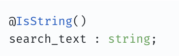
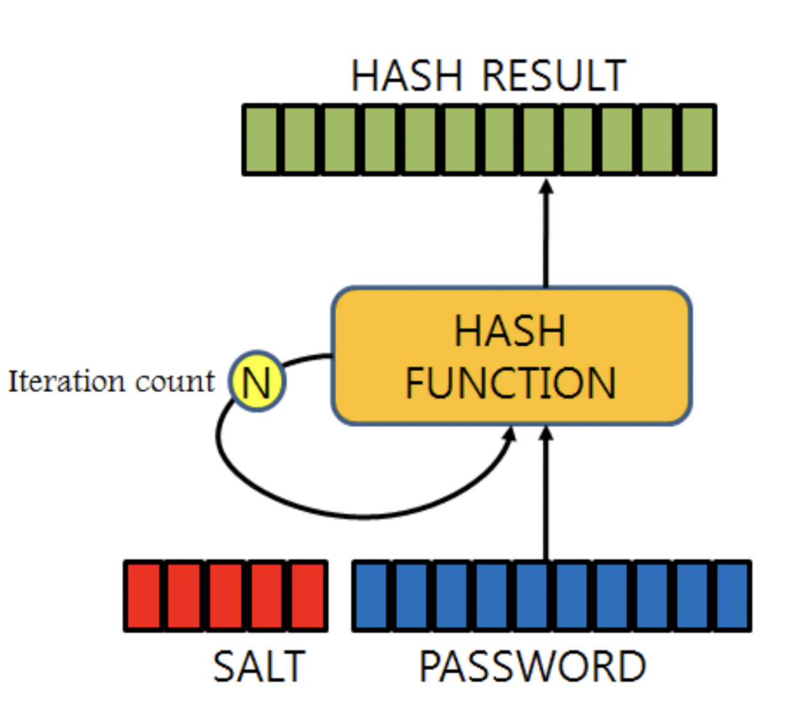
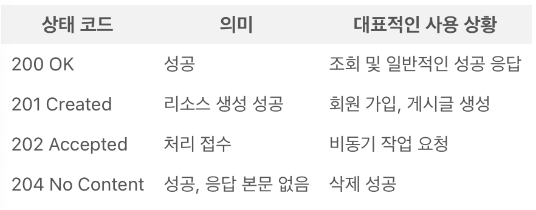
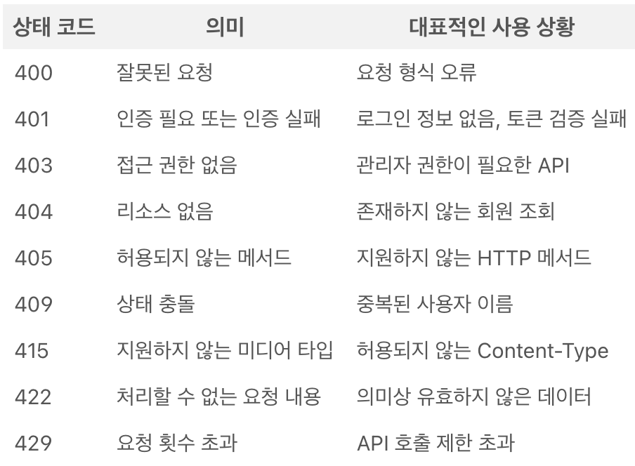
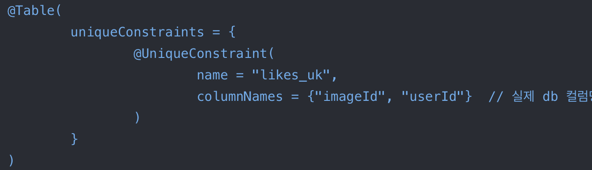

- Bean Validation과 @Valid

  JavaBean : 정보를 표현할 때 사용하는 클래스

    - 반드시 클래스는 패키지화 되어야 함
    - 멤버변수는 property라 부른다
    - 멤버변수는 private
    - 외부 접근은 get, set
    - 멤버변수가 boolean이면 is가능

  Bean Validation : 위 JavaBean 유효성 검증을 위한 메타데이터 모델과 API에 대한 정의 (유효성 검증 로직을 구현하기 위한 표준)

  필요성

    - validatioin 로직, 클래스를 만드는 과정의 번거로움
    - validator의 모든 로직을 개발자가 작성해야함

  @ 어노테이션으로 제약조건을 줄 수 있다.

  @NotNull

  @NotEmpty

  @NotBlank

  @email  등이 있다.

  @Valid : 검증을 실행하라 지정하는 어노테이션

  검증할 대상 앞에 @RequestBody, @Valid를 붙여 유효성을 검증한다.

  유효성 검증 실패시 → MethodArgumentNotValidException 반환

  컨트롤러에서만 동작하며 다른 계층에선 검증되지 않는다 → 다른 계층에서 파라미터 검증시 @Validated와 결합하여야 한다.

- class-validator와 ValidationPipe

  class-validator: joi의 TypeScript버전, 데코레이터를 이용하여 편리하게 검증할 수 있는 라이브러리 → 유효성을 검증하는 도구

  joi: 요청 데이터가 올바른지 검증하는 라이브러리

  데코레이터 : @IsEmail() 같은 규칙이나 기능, Bean Validation 이랑 비슷하지만 다른거

  @IsString()

  @IsInt()

  @MaxLength()

  @Min 등



  ValidationPipe를 이용하여 class-validator를 등록 (규칙을 실제로 실행)

  **검증 옵션**

    - skipMissingProperties : class-validator은 @IsOptional이 붙어있지 않으면 오류를 내지만  skipMissingProperties로 에러나지 않게 해줌
    - forbidUnknownValues : 검증 규칙이 정의되어 있지 않은 인스턴스나 오브젝스 검증 시 오류나게 한다.
    - whitelist : 규칙이 정의되어 있지 않은 입력 값을 모두 제거해줌
    - forbidNonWhiteListed : 검증시 정의되지 않은 입력 값들이 들어올 시 에러
    - disableErrorMessages : 상세 에러메세지 비활성화


- bcrypt와 salt round

  암호화 종류

    - SHA-2
    - PBKDF2
    - **Bcrypt**(가장 추천되는 방법)
    - Scrypt

  Bcrypt :  키(key) 방식의 대칭형 블록 암호에 기반을 둔 암호화 해시 함수 → 단방향 암호화

  **단방향 암호화** : 암호화만 가능하고 암호화된 문자를 원래 평문으로 복호화는 불가능 → 무결성 보장


  동일한 평문에 항상 동일한 해시값을 가짐 → 해시 함수의 해시 값들을 정리한 테이블 → 레인보우 테이블

  레인보우 테이블을 이용한 정보 해킹 → 레인보우 공격

  Bcrypt는 레인보우 공격을 막기 위해 Salting, Key Stretching 적용

  Salting : 단방향 해시 함수 암호화를 진행할 때 본래 데이터에 추가적으로 랜덤한 데이터를 더하는 방식

  Key Stretching : 단방향 해시값 계산 후 나온 해시값을 다시 해시를 반복하는 방식



  salting round: 기존 Salting 결과 해시에 다시 동일한 Salt 적용 반복 → 반복 횟수 = salting round

  DB에는 salt값과 salting round를 반복한 최종 결과 저장

- HTTP 201 Created / 204 No Content / 409 Conflict

  HTTP 상태코드에 200번대는 **요청이 성공적으로 처리된 상태**를 뜻한다.

  201 Created : 요청이 성공적으로 처리되어 새로운 리소스 생성됨

  주로 POST를 이용하여 리소스가 생성된다.

  ex) 회원가입 성공, 평점 등록 성공

  204 No Content : 요청이 성공적으로 처리되었지만 본문이 없음

  본문이 없으므로 주로 삭제 요청이 성공했을 때 사용.

  ex) 평점 삭제 성공



  400번대는 클라이언트 오류로 요청에 문제가 있어 서버가 요청을 정상적으로  처리할 수 없는 상황을 뜻한다.

  409 Conflict : 요청이 서버의 현재 상태와 충돌할 때 사용

  이미 존재하는 사용자 다시 등록시

  ex) 이미 가입된 이메일, 이름, 같은 영화에 평점 두 번 등록



- UNIQUE 제약 조건과 동시성

  중복 데이터가 쌓이는 것을 막기 위해 UNIQUE 제약조건을 걸어야 한다.

  북마크 버튼을 두 번 눌렀을 때 중복 데이타가 아닌 기존 북마크가 취소되어야 함

  중복 unique 키 제약조건 생성

  @Table → uniqueConstraints 속성

  @UniqueConstraints

  columnNames



  **동시성 이슈**

  아이디를 동시에 중복 체크하게 되면 중복 생성이 가능해질 수 있다.(두 개 이상의 트랜잭셕이 동시에 진행)

  → UNIQUE 제약 조건 → 중복 생성X

- @RestControllerAdvice / Exception Filter

  @RestControllerAdvice : @RestController이 붙은 컨트롤러에서 발생하는 예외를 AOP를 적용해 예외를 전역적으로 처리할 수 있는 어노테이션

  AOP: 관점 지향 프로그래밍, 여러 기능에 공통으로 반복되는 코드를 한 곳에 모아 적용하는 방식

  @RestControllerAdvice = @ControllerAdvice + @RequestBody

  @ControllerAdvice : 모든 @Controller 클래스가 공유하는 공통 로직 정의

  @RequestBody : HTTP요청의 Body에 들어 있는 JSON 데이터를 Java 객체로 변환해 받는 어노테이션

  중복 감소 및 유지보수성 향상시킬 수 있다.

    - 패키지 단위 적용
    - 클래스 단위 적용
    - Exception 별로 핸들링

  Exception Filter: Controller, Service 등에서 발생하는 예외를 커스터마이징하여 응답으로 처리하는 역할 (에러 캐치, 에러 커스텀)

  @Catch()

    ```jsx
    export declare function Catch(
      ...exceptions: Array<Type<any> | Abstract<any>>
    ): ClassDecorator;
    ```

    - 기본적으론 HttpException 클래스 제공
    - 커스텀 Exception Filter

      @Catch(HttpException) 데코레이터로 대상 예외 지정

      응답 포맥 커스터마이징 가능

    - 특정 Controller에만 적용(@UseFilters())
    - 전역 Exception Filter

      어플리케이션 전역에서 일관된 에러 처리 가능