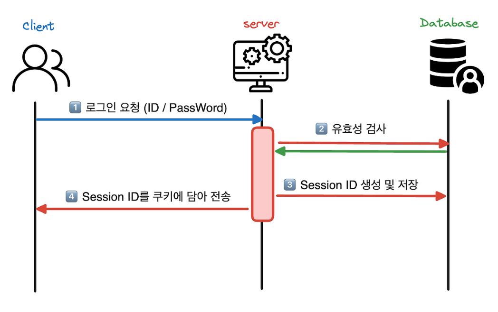
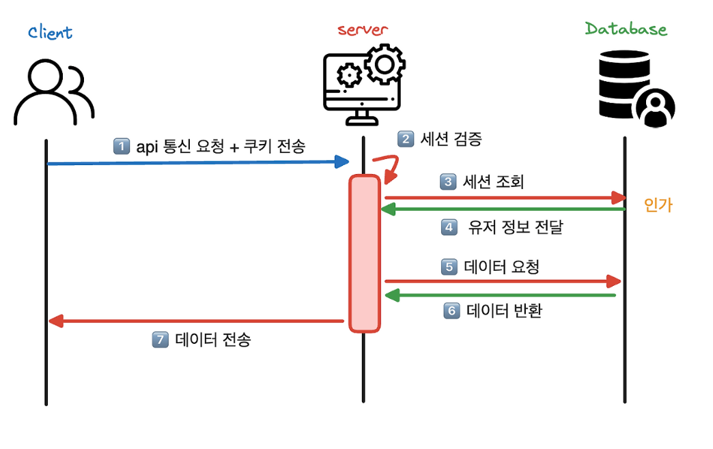
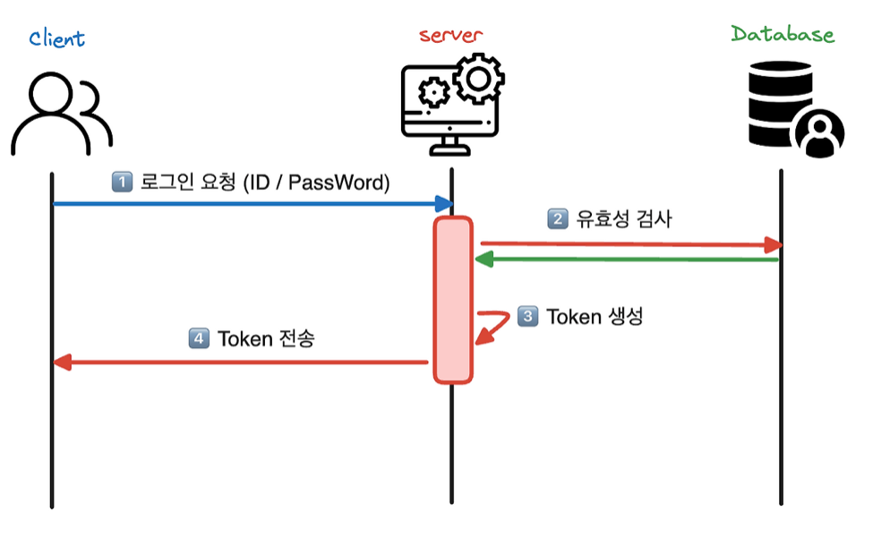
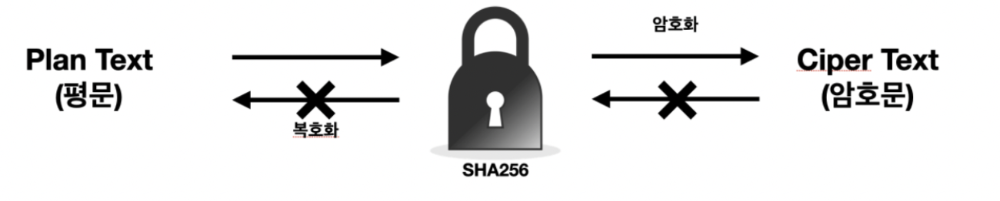
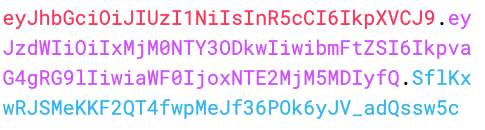
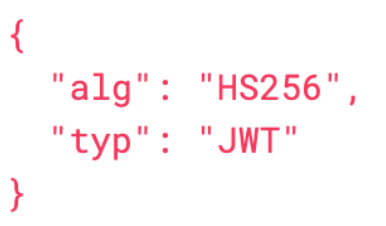

- 인증(Authentication)과 인가(Authorization)

  인증(Authentication) : 신원을 확인하는 과정 (토큰이 유효한지 확인하는 과정)

  유저가 서비스에 자신의 신원을 확인 및 증명하는 과정

  서비스의 중요한 데이터나 리소스 보호 및 불법적인 액세스 방어

  인증된 유저는 리소스 및 기능에 대한 액세스 권한을 받을 자격이 생김

  →서비스의 보안성 유지, 사용자의 개인 정보 보호에 중요한 역할

  인가(Authorization) : 접근을 허가 또는 거절하는 과정

  인증 → 인가 : 인증은 인가로 이어지지만 ~~인가 → 인증~~은 아니다


  인증된 유저의 정보 저장 방법 session, token

  **Session**

  인증 정보를 관리하는 주체가 서버 메모리 or DB

  인증 완료시 서버에서 session ID를 만들어 DB에 저장 또는 메모리에서 관리



  인증



  인가

  인가가 필요할 때 HTTP Cookie 헤더에 세션 ID를 같이 전송

  **Token**

  필요한 정보를 클라이언트에서 관리 → 탈취의 위험성이 있어 민감한 정보는 X



  인증


  인가

- 해시와 salt, bcrypt

  해시: 임의의 크기를 가진 데이터(key)를 고정된 크기의 Value로 변화시켜 저장하는 것

    - 같은 문장은 같은 결과 → 무작위X
    - 원래의 값으로 되돌릴 수 없다 → 복호화 불가능 → 단방향 암호화

  충돌 : 해시테이블에서 충돌이 일어날 수 있다.

  해결법

    - Chaining : 충돌이 일어날 경우 데이터들을 포인터를 이용해 체인 형태로 연결하는 것 (→ 자료구조에서 Dictionary 때 나옴)

      충돌 허용

    - Open Addressing : 모든 데이터를 테이블에 저장

  Bcrypt :  키(key) 방식의 대칭형 블록 암호에 기반을 둔 암호화 해시 함수 → 단방향 암호화

  **단방향 암호화** : 암호화만 가능하고 암호화된 문자를 원래 평문으로 복호화는 불가능 → 무결성 보장



  동일한 평문에 항상 동일한 해시값을 가짐 → 해시 함수의 해시 값들을 정리한 테이블 → 레인보우 테이블

  레인보우 테이블을 이용한 정보 해킹 → 레인보우 공격

  Bcrypt는 레인보우 공격을 막기 위해 Salting, Key Stretching 적용

  Salting : 단방향 해시 함수 암호화를 진행할 때 본래 데이터에 추가적으로 랜덤한 데이터를 더하는 방식

  Key Stretching : 단방향 해시값 계산 후 나온 해시값을 다시 해시를 반복하는 방식


- JWT (Header / Payload / Signature, Claim)

  JWT(Json Web Token) : JSON 객체로 안전하게 전송하는 간결하고 자체 포함 형식을 정의한 개방형 표준

  자체적으로 필요한 정보를 내부에 포함하여 인가에 필요한 추가적인 DB 조회 없이 정보 조회가 가능하다.

  header, payload, signature으로 나누어져있고 “.”으로 구분한다.



  header : JWT의 타입(토큰 유형) 및 서명 알고리즘에 대한 메타데이터



  payload : 토큰에 포함되는 클레임으로 토큰의 실질적인 정보를 담으며 3가지로 분류된다.

    - Registreed claims

      미리 정의된 클레임의 집합

      iss(발행자), exp(만료 시간), sub(주제), aud(청중)으로 구성된다.

    - Public claims

      개발자가 자유롭게 정의하는 클레임

      충돌을 피하기 위해 IANA JSON Web Token 레지스트리에 정의되거나 충돌 방지가 가능한 네임스페이스를 포함하는 URI로 정의되어야 한다.

    - Private claims

      등록 및 공개되지 않는 클레임, 합의된 당사자들끼리 정보를 공유하기 위해 만들어진 사용자 정의 클레임

      주로 유저의 역할(관리자, 일반 사용자) 정보 포함


    signature : 토큰의 **무결성 보장**, **메시지가 변경되지 않았음**을 확인하는 핵심 구성요소


- Bearer 인증과 Authorization 헤더

  Bearer 인증 : OAuth 2.0 프레임워크에서 사용하는 **토큰 인증 방식**

  발급받은 토큰을 전달하여 서버가 JWT를 검증한다.

  이때 토큰은 Authorization 헤더에 담아 보냄

  검증 과정

    - 토큰이 변조되었는지
    - 토큰이 만료되었는지
    - 사용자 정보가 유효한지
    - API에 접근할 권한이 있는지

  검증 → 인증된 요청 처리

  토큰 **만료 시간**, **권한** 정보를 가진다는 장점이 있다

    ```jsx
    Authorization: Bearer <토큰>
    ```

  Authorization 헤더 : 인증 정보를 전달하는 HTTP 헤더

  인증방식과 인증 정보를 같이 전달하는 구조

  토큰뿐 아닌 인증 정보를 어떻게 해석해야 하는지도 함께 전달한다.

  장점

    - 표준화 → 대부분의 라이브러리와 프레임워크에서 기본으로 지원
    - 보안이 좋다 → 토큰이 헤더에 포함 → 민감한 데이터와 혼합되지 않음
    - 민감한 데이터가 캐시되는 것 방지
- HandlerInterceptor / Guard

  Interceptor: HTTP 요청을 처리 중에 요청 및 응답에 대한 처리를 제어하고 변경할 수 있는 방법을 제공하는 스프링 MVC의 기능

  즉, 컨트롤러가 요청을 처리하기 전후로  보안, 로깅, 권한 등의 기능을 처리하는 기능

  **메소드**

        - preHandle(): 컨트롤러가 요청을 처리하기 전에 수행, 반환값은 논리값으로 반환
    
        - postHandle(): 컨트롤러가 요청 처리 후 수행, ModelAndView, 데이터 추가 가능
    
        - afterCompletion: 요청 처리 완료 후,컨트롤러와 인터셉터의 예외시 호출된다

  **장점**

        - 요청, 응답 처리를 중앙에서 가능
    
        - 보안 등을 처리하는 코드를 중복X
    
        - Interceptor chain을 통해 기능 모듈화, 재사용성 향상
    
        Interceptor chain: 여러개의 Interceptor를 연결해 요청과 응답을 순서대로 처리

  Guard(Nest.js): 요청 처리 전 실행, 권한 부여 로직 → 런타임에

  요청이 리소스에 접근할 자격이 있는지 확인 → 판단하여 인가

- 401 Unauthorized와 403 Forbidden의 차이

  401(Unauthorized): 클라이언트가 인증되지 않았거나, 인증 정보가 부족하여 요청 거부

  → 클라이언트가 인증되지 않았다

  → 요청한 사용자가 누구인지 확인할 수 없을 때

  Authorization 헤더에 토큰이 없을때, 토큰 형식이 잘못되었을 때, 토큰 서명이 틀렸을 때, 만료됐을 때

  → 인증 실패 상태

  ex) 로그인 안되는 경우

  403(Forbidden): 클라이언트가 요청을 이해했지만 권한이 없는 상태

  → 사용자가 누구인지 확인은 되었지만, 기능이나 데이터에 접근 권한이 없는 상태

  → 해당 요청에 대한 자원 부족

  인증은 성공, 인가는 실패

  ex) 사용자가 권한 없는 요청