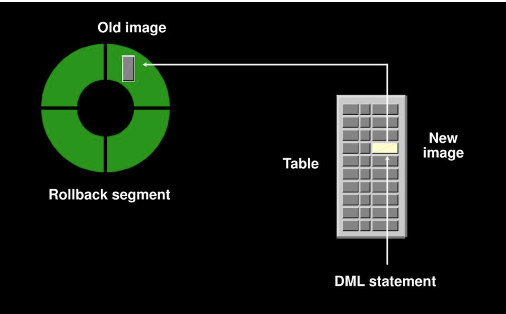
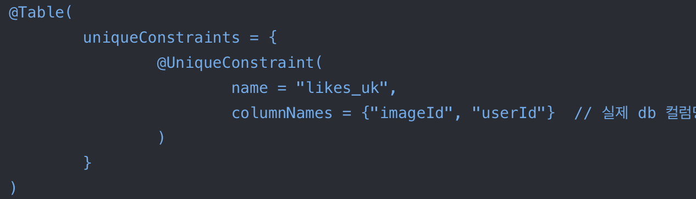
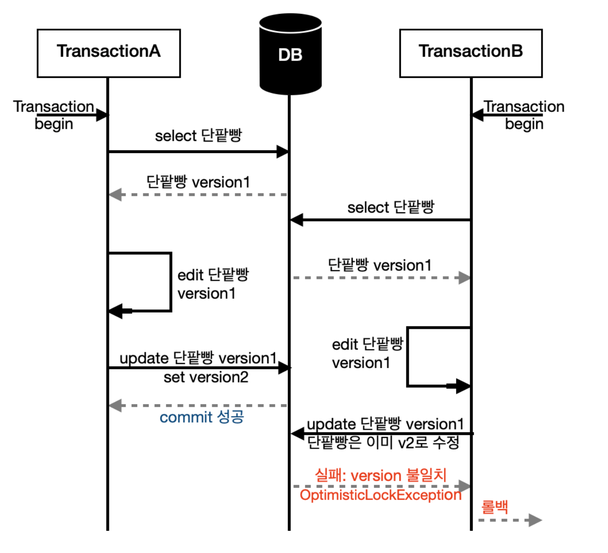

- 트랜잭션(Transaction)

  트랜잭션 : 원자성, 일관성, 고립성, 지속성 속성을 가진 작업 그룹 → ACID

  개발 프로세스 간소화

  데이터의 신뢰성과 안전성을 보장하는 핵심 장치

  원자성 : 작업 그룹에서 모든 작업이 성공하거나 모두 취소(롤백)

  일관성 : 트랜잭션 후 데이터가 일관된다

  고립성 : 진행 중인 트랜잭션의 효과는 다른 모든 트랜잭션에서 숨겨짐 → 어떤 트랜잭션이든 다른 트랜잭션 연산에 끼어들 수 없다.

  지속성 : 트랜잭션이 완료되면 결과는 지속된다.

- commit / rollback

  commit : 하나의 트랜잭션이 성공적으로 끝난 후 DB가 일관성 있는 상태에 있을 때 트랜잭션이 끝났다는 것을 알려주는 연산

  rollback : 하나의 트랜잭션 처리가 비정상적으로 종료→ 원자성 깨짐 → 처음부터 다시 시작 or 부분적으로 결과 취소

  rollback을 위한 별도의 임시 저장소 : Rollback Segment

  SavePoint : 중간 저장 지점

  특정 세이브 포인트까지만 작업을 부분 복구 가능 → 트랜잭션이 길어지면 확실히 성공한 부분까지 다시 수행해야 하는 비효율을 줄여준다. → 원자성 유지

- 원자성(Atomicity)

  원자성(Atomicity) : 트랜잭션은 모두 수행되거나 전혀 수쟁되지 않아야 한다.

- ACID

  데이터베이스 트랜잭션이 안전하게 수행된다는 것을 보장하기 위한 성질

  원자성(**A**tomicity)

  일관성(**C**onsistency)

  독립성(**I**solation)

  지속성(**D**urability)

- UNIQUE 제약 조건

  중복 데이터가 쌓이는 것을 막기 위해 UNIQUE 제약조건을 걸어야 한다.

  북마크 버튼을 두 번 눌렀을 때 중복 데이터가 아닌 기존 북마크가 취소되어야 함

  중복 unique 키 제약조건 생성

  @Table → uniqueConstraints 속성

  @UniqueConstraints

  columnNames

- 낙관적 잠금(Optimistic Locking)

  여러 트랜잭션이 동시에 진행되면 동시성 이슈가 발생할 수 있다 → Optimistic lock사용

  Optimistic Lock

    - 트랜잭션이 충돌할 가능성이 낮다고 가정
    - 추가적인 데이터로 다른 사람이 동일한 조건으로 값 수정 금지
    - 수정 시점에 충돌이 발생했는지 확인

  두 트랜잭션이 같은 데이터를 수정하려할 때

    1. A 트랜잭션 먼저 버전 정보가 일치하면 처리
    2. B 트랜잭션 또한 버전정보가 일치하면 처리
    3. 일치하지 않으면 수정 불가 → 롤백

