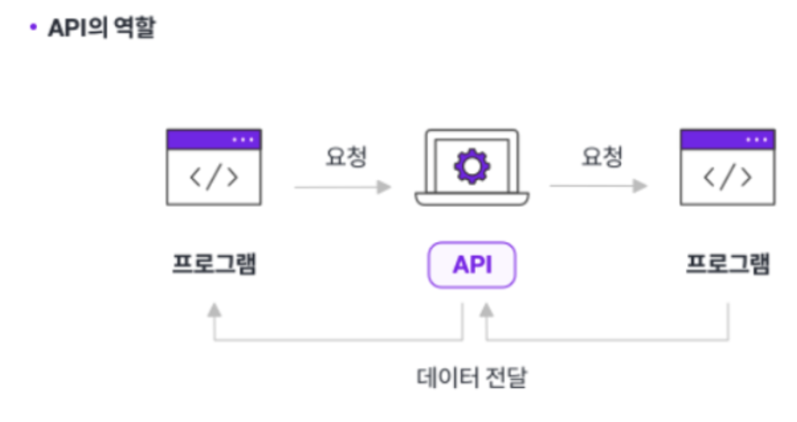
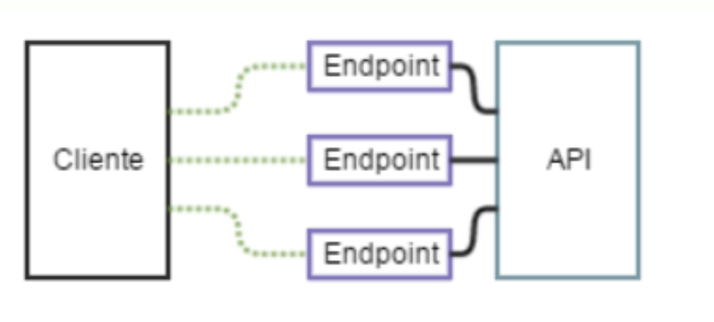
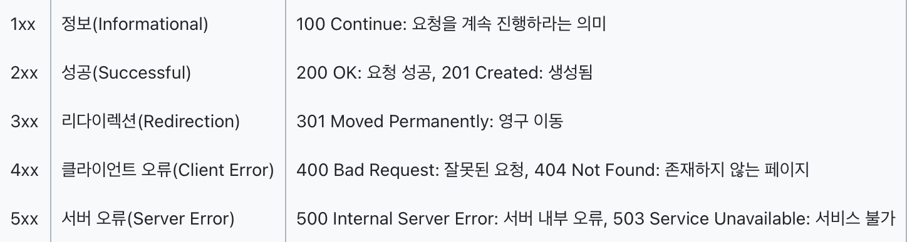
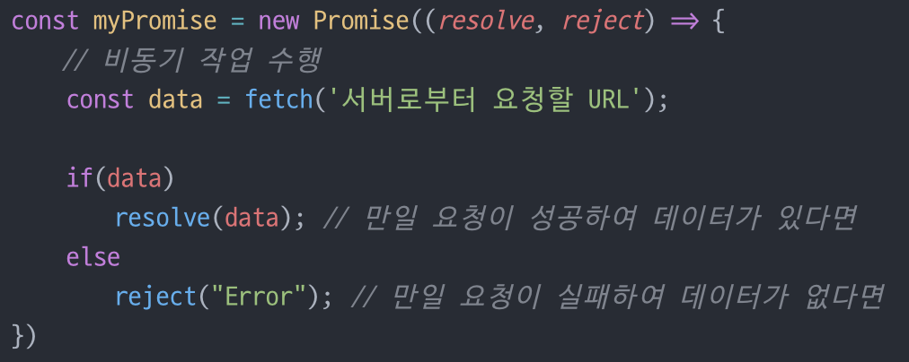
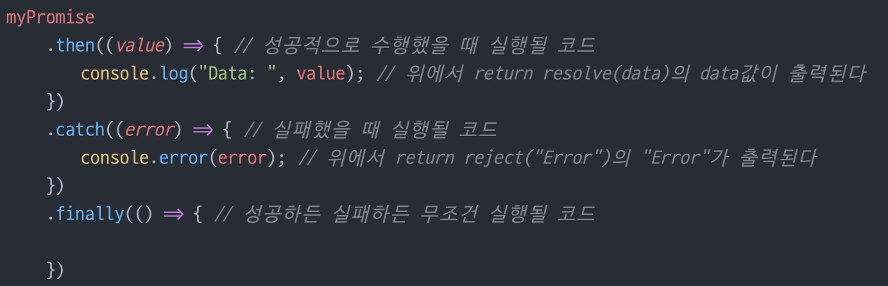
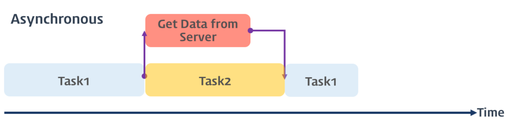

- HTTP와 API
    - API, endpoint, HTTP method와 status code는 요청과 응답에서 각각 어떤 역할을 할까요?

  HTTP: 클라이언트가 서버에게 어떤 행동을 원하는지 나타내는 명령어

  주요 메서드

    - GET : 리소스 조회(query 파라미터를 통해 데이터 전달)
    - POST : 리소스 등록(서버로 요청 데이터 전달, 서버는 요청 데이터 처리)
    - PUT : 리소스 완전 대체(리소스가 있으면 대체, 없으면 생성)
    - PATCH : 리소스 부분 변경(데이터 일부만 변경하고 싶을 때)
    - DELETE : 리소스 제거

  API: 프론트엔드와 서버가 데이터를 주고받기 위한 약속.

  ex) 구매자가 결제 버튼 클릭 →  API 호출 → 웹서버로 전송 및 처리 →응답 반환


  endpoint: 특정 기능을 요청하는 URL(API가 서버에서 리소스에 접근할 수 있도록 가능하게 하는 URL)

  ex) GET /movies



  status code: 서버가 요청을 처리한 결과의 숫자(성공 실패 여부, 원인)



  200 OK: 요청 정상 처리

  201 Created: 요청이 성공적으로 처리되어 리소스가 새로 생성됨

  301 Moved Permanently: 요청한 리소스가 영구적으로 다른 위치로 이동

  400 Bad Request: 잘못된 문법 등으로 서버가 요청을 이해할 수 없음

  401 Unauthorized: 인증이 필요하거나 인증 실패

  403 Forbidden: 서버가 요청을 이해했지만 권한 부족 등으로 거부

  404 Not Found: 요청한 리소스(페이지 등)를 찾을 수 없음

  500 Internal Server Error: 서버 내부 오류로 요청 처리 실패

  502 Bad Gateway: 게이트웨이/프록시 서버가 잘못된 응답을 받음

  503 Service Unavailable: 서버가 일시적으로 요청을 처리할 수 없음 (과부하, 점검 등)

    - 브라우저와 API 서버의 origin이 다를 때 CORS는 어떤 역할을 할까요?

  브라우저와 API 서버의 origin이 다르면 브라우저 SOP때문에 API응답을 바로 읽지 못함 →  CORS가 API 서버거 응답 헤더로 특정 origin 요청을 허용한다고 알려준다

  즉, 서버 API 응답을 읽어도 되는지 통제한다.

- Promise와 비동기 처리
    - Promise의 pending, fulfilled와 rejected 상태는 각각 무엇을 의미할까요?

      Promise: 비동기 작업의 최종 완료 또는 실패를 나타내는 객체(비동기 처리의 추상화 제공 객체)

      결과를 기다리는 것이 아닌 결과를 제공하겠다는 <u>**약속**</u>


      작업 결과에 따라 후속 처리를 진행한다

      성공시 resolve(data) 호출, 실패시 reject(”Error”) 호출



      후에 성공시 then, 실패시 catch로 이어지게 된다.

      Promise 상태

        - Pending(대기): 처리 진행중
        - Fulfilled(이행): 처리 성공
        - Ejected(거부): 처리 실패

      비동기 처리 : 작업을 시작한 뒤 결과를 기다리지 않고 다른 작업을 동시에 수행할 수 있는 방식


               병렬적으로 태스크 수행

      요청 후 응답 여부에 상관 없이 다음 태스크 동작

      태스크가 완료된 후엔 콜백 함수가 호출된다.

      콜백함수가 여러개 중첩되면 복잡도가 높아져 **콜백 헬**이 발생된다.

        - `.then().catch()`와 `async/await`는 같은 비동기 흐름을 어떻게 다르게 표현하나요?
        - `await`를 사용해도 브라우저 전체가 멈추지 않는 이유는 무엇일까요?


            ```jsx
            getMovies()
              .then((movies) => console.log(movies))
              .catch((error) => console.error(error))
            ```
            
            .then().catch()는 성공(.then), 실패(.catch) 처리 함수를 연결한다.
            
            ```jsx
            async function loadMovies() {
              try {
                const movies = await getMovies()
                console.log(movies)
              } catch (error) {
                console.error(error)
              }
            }
            
            loadMovies()
            ```
            
            await은 브라우저 전체를 멈추기 않고 현재 async 안의 다음 코드만 결과가 나올 때까지 잠시 멈추고 브라우저의 JavaScript 작업은 계속 진행된다.

- fetch와 HTTP 요청 라이브러리

  fetch 함수 : HTTP resopnse 객체를 래핑한 Promise 객체를 반환하여 then을 사용한 resolve 객체를 받을 수 있다(비동기 통신으로 요청을 발행하고 해당 응답을 취득하는 함수)

  → 서버로 원하는 데이터를 요청하고 response를 기다리면서 다른 처리도 할 수 있다.

  HTTP 요청 라이브러리 : 웹 애플리케이션이 서버와 통신할 때 사용되는 도구

    - Axios: 요청과 응답을 가로채서 처리 → 헤더 추가, 응답 에러 처리 등 가능
    - Fetch API : 기본으로 내장된 HTTP요청 기능으로 오류 처리를 직접 해야한다.
    - React Query : 서버에서 가져온 데이터를 화면에서 관리

    - `fetch`에서 네트워크 오류와 HTTP 오류를 따로 처리해야 하는 이유는 무엇일까요?

      fetch는 네트워크 자체가 실패했을 때만 Promise를 reject한다.

      404, 401, 500처럼 서버가 HTTP응답을 보냈을 땐 fetch Promise는 성공처리 될 수있어 response.ok, response.status를 따로 확인하여 HTTP 오류를 확인해야 한다.

    - 순수 `fetch`로 여러 API 함수를 작성하면 어떤 설정과 처리가 반복될까요?

      API 기본 주소 → Authorization 같은 공통 헤더 → 쿼리 파라미터 생성 → response.ok 검사 → response.json() 호출 → 오류 메시지, 예외 처리

      위 순서가 반복되게 된다.

    - ky와 Axios는 JSON 응답을 읽고 공통 요청 처리를 추가하는 방식이 어떻게 다를까요?

      ky는 ky.create()에 prefixUrl, 공통 headers 설정 훙 .json<T>()으로 응답을 읽는다.

      HTTP오류도 try/catch로 처리 가능

      Axios는 HTTP 라이브러리로 axios.create()로 공통 설정을 만들고 response.data에서 JSON응답을 읽는다.

- 비동기 데이터의 UI 상태
    - 서버 데이터를 보여 주는 화면에서 로딩, 오류, 빈 결과와 성공 상태를 구분해야 하는 이유는 무엇일까요?

      구분하지 않으면 사용자는 화면이 멈춘건지, 문제가 생긴건지, 데이터가 없는건지 구분 불가하다.

        ```jsx
        const [movies, setMovies] = useState<Movie[]>([])
        const [isLoading, setIsLoading] = useState(true)
        const [errorMessage, setErrorMessage] = useState<string | null>(null)
        
        if (isLoading) {
          return <p>영화 목록을 불러오는 중이에요.</p>
        }
        
        if (errorMessage) {
          return <p>{errorMessage}</p>
        }
        
        if (movies.length === 0) {
          return <p>조건에 맞는 영화가 없어요.</p>
        }
        
        return <MovieGrid movies={movies} />
        ```

      따라서 보통 이렇게 배열을 만들어 상태를 구분하고 빈 배열은 따로 구분한다.

    - 각 상태를 사용자가 이해할 수 있게 표현하려면 어떤 정보와 동작이 필요할까요?

      화면에 현재 어떤 상태인지 표시해주어야 한다.

      로딩: “~를 불러오는 중이다.”, 중복 요청 비활성화

      오류: “~ 실패했다.” , 원인, 다시 시도 버튼

      빈 결과: “조건에 맞는 결과가 없다.”, 조건 수정

      성공: 원하는 정보 출력

    - API 응답 타입과 화면에서 사용하는 타입을 분리하면 어떤 상황에서 도움이 될까요?

      서버의 필드명이나 응답 구조가 바뀌어도 화면 전체를 고치지 않고 변환 코드만 수정하여 해결 가능하다.

      API 필드 명이 바꼈을 때

      화면에 필요한 값이 API에 없을 때

      화면에 필요 없는 API 값이 많을 때

      여러 API의 데이터를 같은 UI에 보여줄 때

      외부 API를 나중에 교체할 때

      전체 코드가 아닌 일부만 바꾸면 된다.