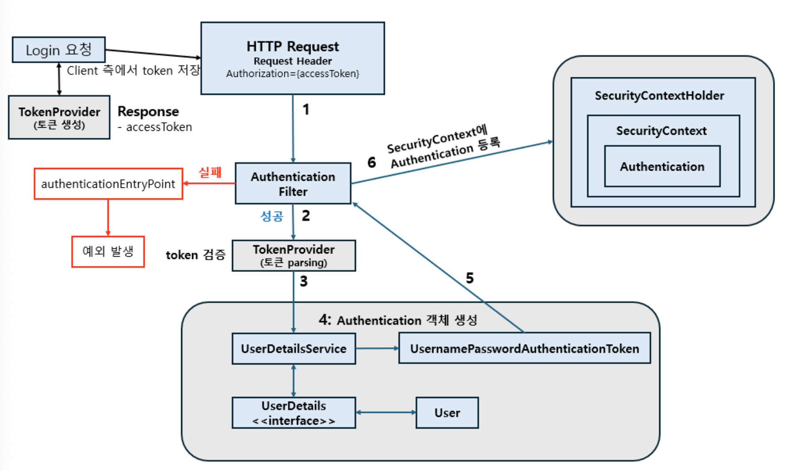
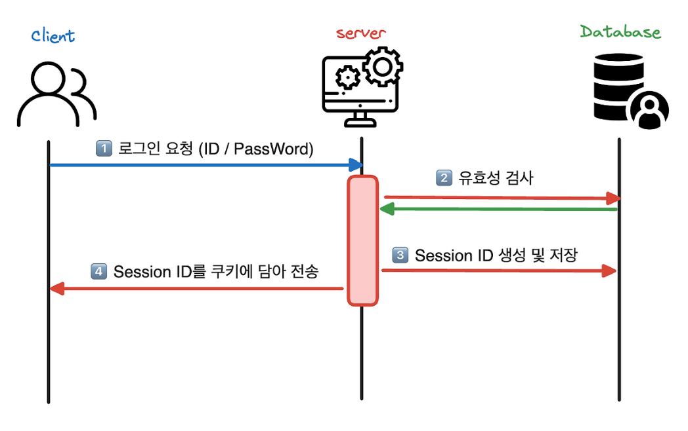
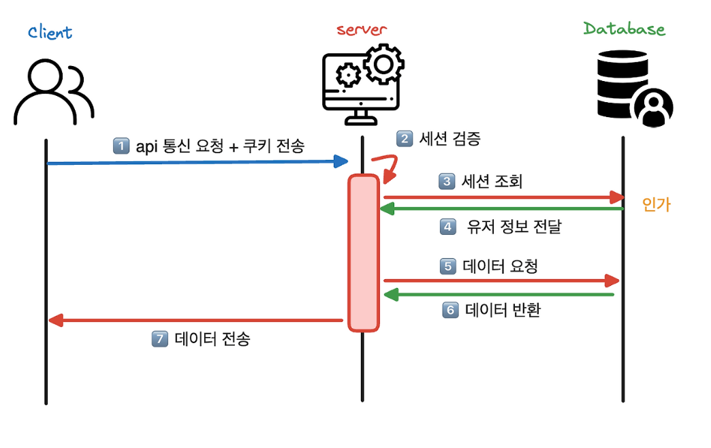
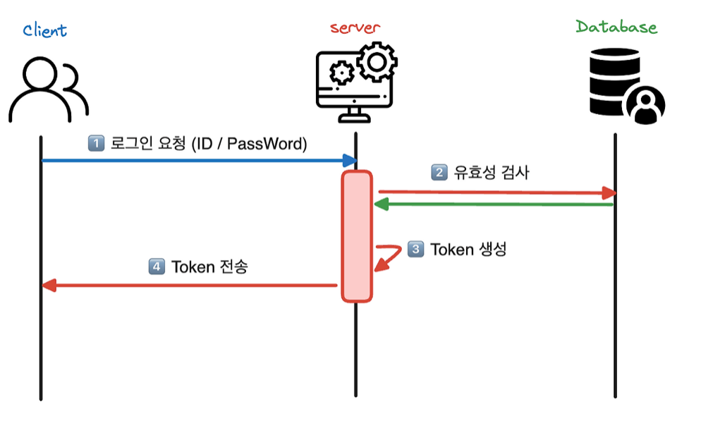
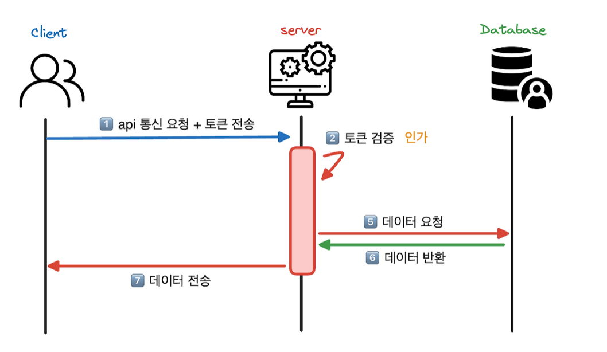
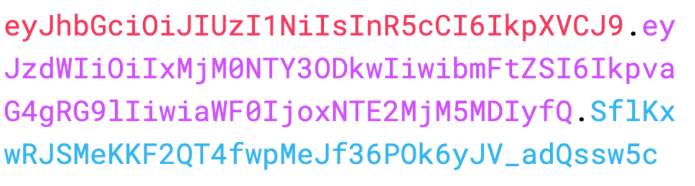
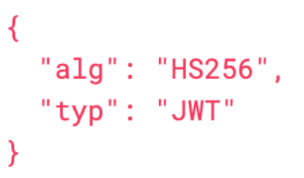
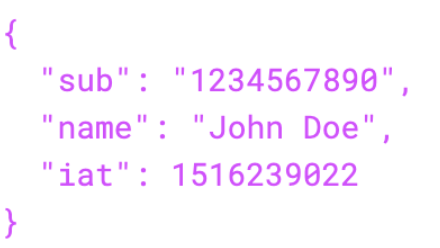
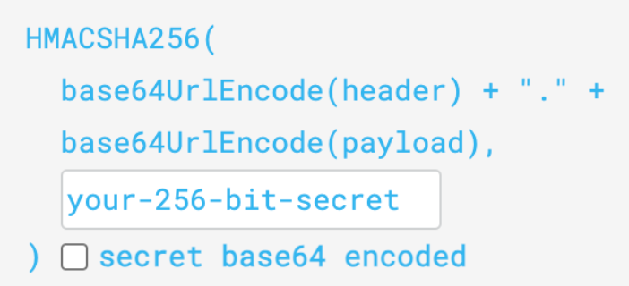

- 인증(Authentication)과 인가(Authorization)

  인증(Authentication) : 신원을 확인하는 과정 (토큰이 유효한지 확인하는 과정)

  유저가 서비스에 자신의 신원을 확인 및 증명하는 과정

  서비스의 중요한 데이터나 리소스 보호 및 불법적인 액세스 방어

  인증된 유저는 리소스 및 기능에 대한 액세스 권한을 받을 자격이 생김

  →서비스의 보안성 유지, 사용자의 개인 정보 보호에 중요한 역할

  인가(Authorization) : 접근을 허가 또는 거절하는 과정

  인증 → 인가 : 인증은 인가로 이어지지만 ~~인가 → 인증~~은 아니다

인증된 유저의 정보 저장 방법 session, token

**Session**

인증 정보를 관리하는 주체가 서버 메모리 or DB

인증 완료시 서버에서 session ID를 만들어 DB에 저장 또는 메모리에서 관리

인증

인가

인가가 필요할 때 HTTP Cookie 헤더에 세션 ID를 같이 전송

**Token**

필요한 정보를 클라이언트에서 관리 → 탈취의 위험성이 있어 민감한 정보는 X

인증

인가
- 로그인한 사용자도 특정 기능을 이용하지 못할 수 있는 이유는 무엇인가요?

  로그인은 **인증**이 된 것일 뿐이고 특정 기능을 사용하는 것은 **인가**에 달려있어 특정 기능에 인가되지 않았다면 이용하지 못할 수 있다.

- JWT

    - JWT (Header / Payload / Signature, Claim)

  JWT(Json Web Token) : JSON 객체로 안전하게 전송하는 간결하고 자체 포함 형식을 정의한 개방형 표준

  자체적으로 필요한 정보를 내부에 포함하여 인가에 필요한 추가적인 DB 조회 없이 정보 조회가 가능하다.

  header, payload, signature으로 나누어져있고 “.”으로 구분한다.

header : JWT의 타입(토큰 유형) 및 서명 알고리즘에 대한 메타데이터

payload : 토큰에 포함되는 클레임으로 토큰의 실질적인 정보를 담으며 3가지로 분류된다.

    - Registreed claims

      미리 정의된 클레임의 집합

      iss(발행자), exp(만료 시간), sub(주제), aud(청중)으로 구성된다.

    - Public claims

      개발자가 자유롭게 정의하는 클레임

      충돌을 피하기 위해 IANA JSON Web Token 레지스트리에 정의되거나 충돌 방지가 가능한 네임스페이스를 포함하는 URI로 정의되어야 한다.

    - Private claims

      등록 및 공개되지 않는 클레임, 합의된 당사자들끼리 정보를 공유하기 위해 만들어진 사용자 정의 클레임

      주로 유저의 역할(관리자, 일반 사용자) 정보 포함

    signature : 토큰의 **무결성 보장**, **메시지가 변경되지 않았음**을 확인하는 핵심 구성요소

- JWT를 디코딩하는 것과 서명을 검증하는 것은 어떻게 다른가요?

  JWT 디코딩 : 토큰 안의 내용을 읽는것 → 조작한 토큰도 읽힐 수 있다.

  서명 검증 : 토큰의 유효성 확인, 내용이 바뀌지 않았는지 확인 + exp(만료시간) 확인 → 조작되면 거부

- payload에 비밀번호를 담으면 안 되는 이유는 무엇인가요?

  payload의 내용은 Base64Url 인코딩일 뿐 암호화된 것이 아님 → 누구나 디코딩해서 볼 수 있다. →비밀번호를 넣을 시 토큰이 유출됐을 때 비밀번호도 그대로 유출된다.