# Backend Chapter05

## 미션 기록

## 실제 화면에서 확인하기

CORS를 설정한 뒤, 실제 웹 화면에서 아래 API들을 호출해 정상 응답을 받는 것까지 확인했습니다.

### API 목록

| API | 설명 | 응답 |
| --- | --- | --- |
| `GET /members/nickname/{nickname}` | 닉네임 중복 확인 | `{"available": true/false}` |
| `GET /members/email/{email}` | 이메일 중복 확인 | `{"available": true/false}` |
| `GET /members/{memberId}/ratings` | 회원의 평점 목록 | `RatingResponse[]`, 없는 회원은 404 (연결 시 제외) |

### CORS 설정

브라우저에서 다른 포트(5173)의 프론트 서버가 백엔드(8080)를 호출하기 때문에 CORS 설정이 필요합니다.

```tsx
// WebConfig
registry.addMapping("/**")
        .allowedOrigins("http://localhost:5173")
        .allowedMethods("GET", "POST", "PATCH", "DELETE")
        .allowedHeaders("*");
```

포트가 다르면 브라우저가 응답을 막습니다. `5173` 출처만 허용해서 프론트 호출이 가능하도록 했습니다.

### Controller

요청을 받아 Service에 넘깁니다. URL의 `{email}`을 꺼내서 Service에 전달하고, 결과를 그대로 반환합니다.

```tsx
// MemberController
@GetMapping("/email/{email}")
public EmailCheckResponse checkEmail(@PathVariable String email) {
    return memberService.checkEmail(email);
}
```

### Service

중복 판단 로직입니다. DB에 있으면 사용 불가이므로 `!exists`를 `available`로 돌려줍니다.

```tsx
// MemberService
boolean exists = memberRepository.existsByEmail(email);
return new EmailCheckResponse(!exists);
```

### Repository

메서드 이름으로 쿼리가 자동 생성됩니다.

```tsx
// MemberRepository
boolean existsByEmail(String email);
```

### DTO

JSON으로 변환되어 `{"available": true}`가 프론트에 전달됩니다. 중복이어도 에러가 아니라 200 응답의 `false`입니다.

### Postman 검증

**1. 닉네임: 이미 있는 값 → `available: false`**

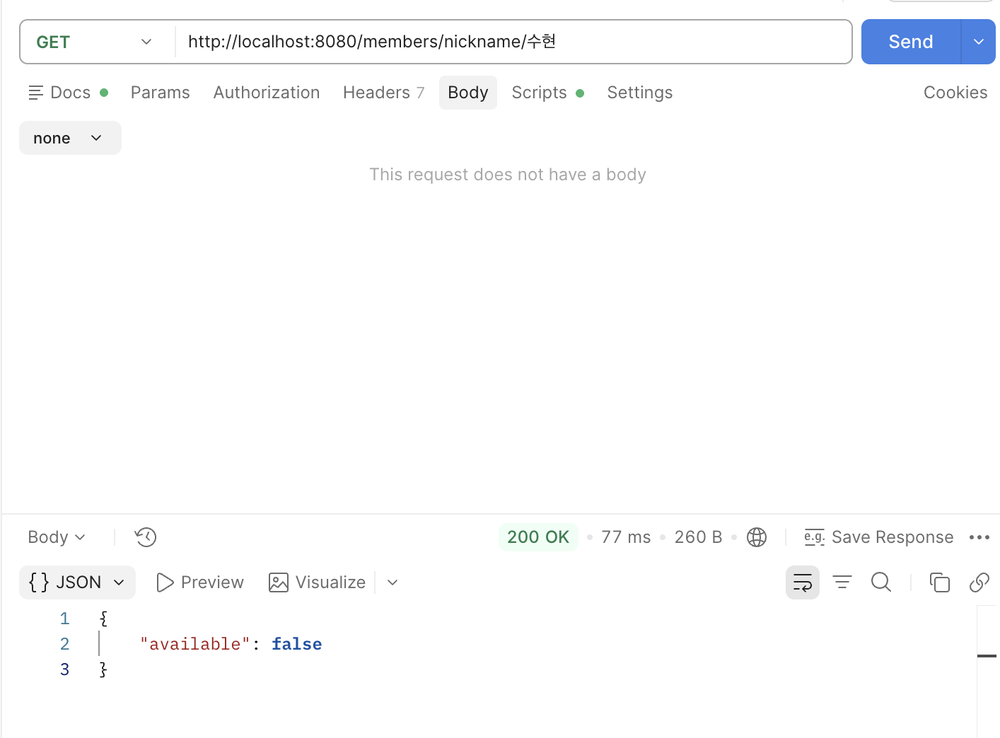

**2. 닉네임: 없는 값 → `available: true`**

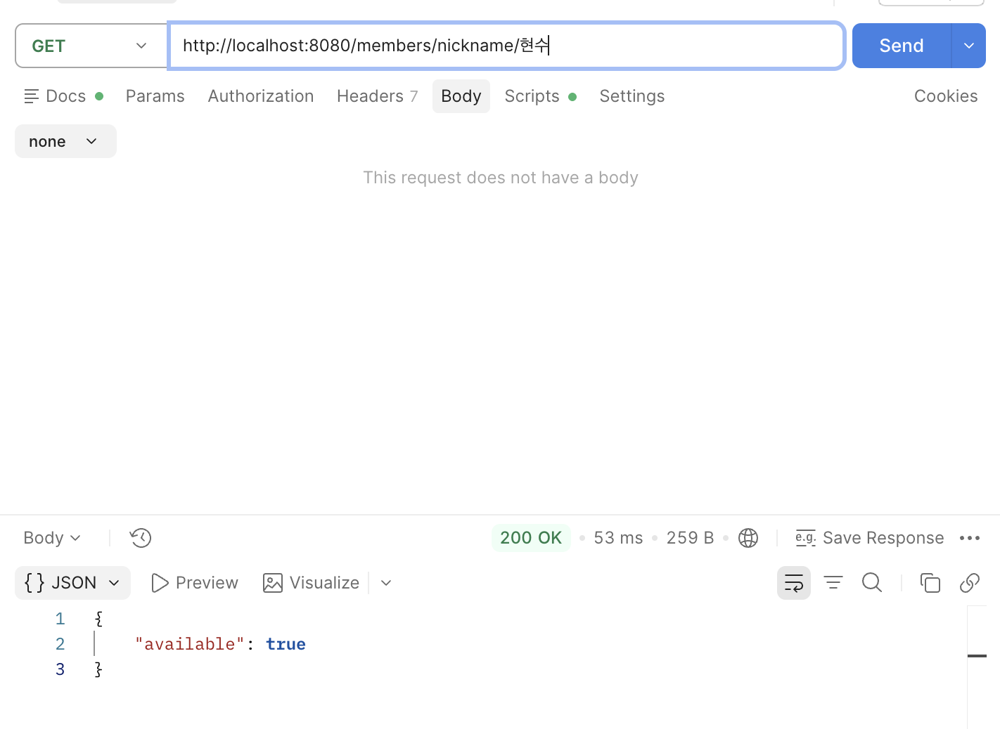

**3. 이메일: 이미 있는 값 → `available: false`**

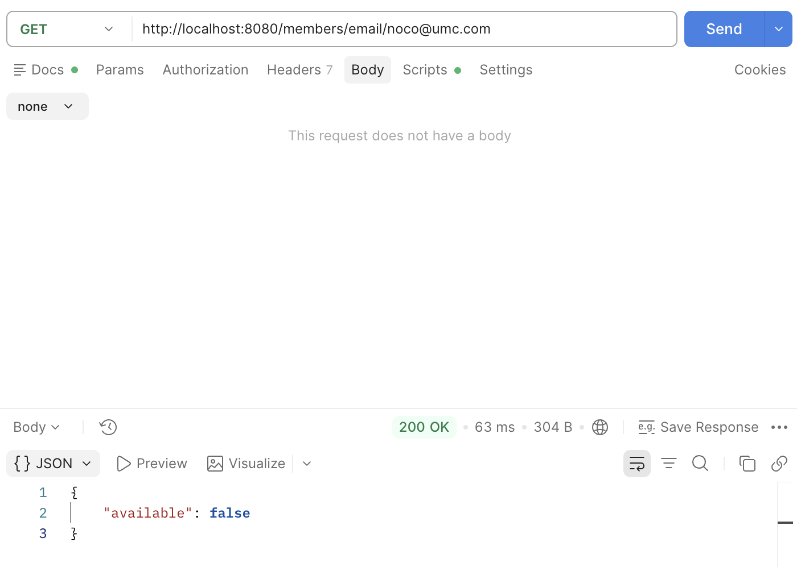

**4. 이메일: 없는 값 → `available: true`**

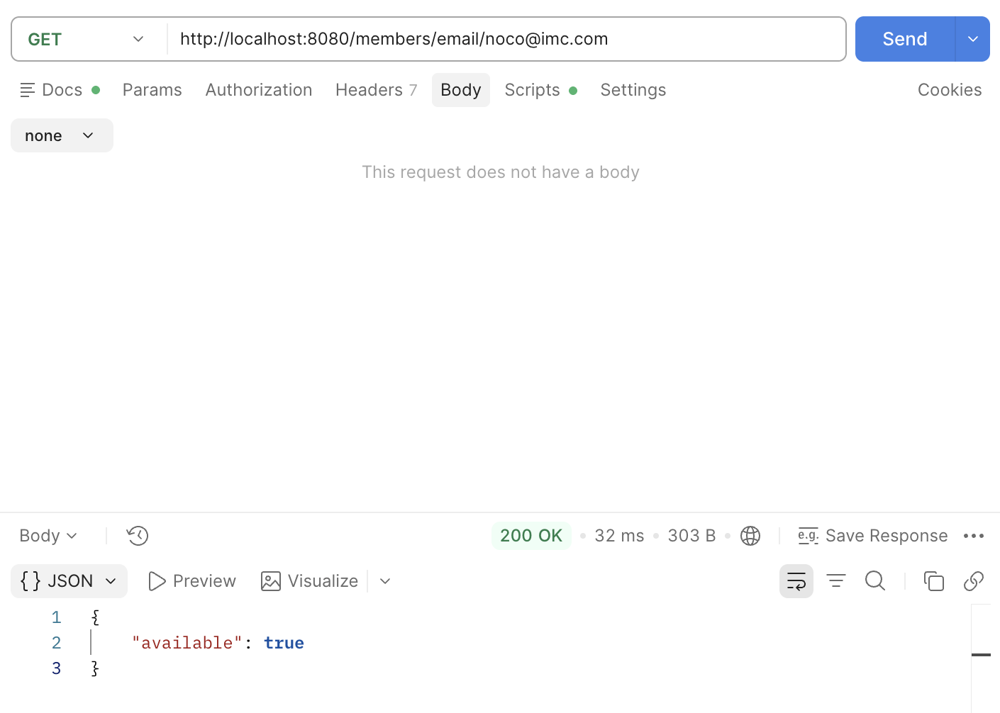

**5. 평점 목록: 평점이 있는 회원 → 최신순 배열 (`ratingId`가 큰 것부터)**

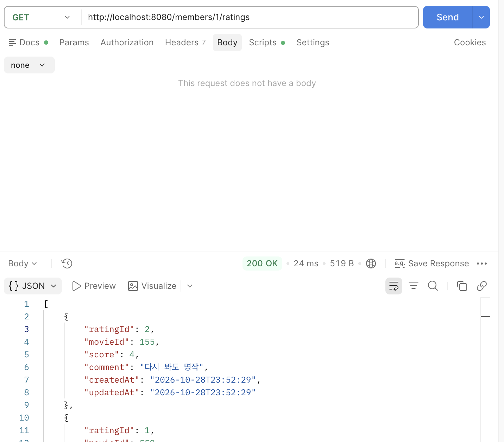

**6. 없는 memberId → 404**

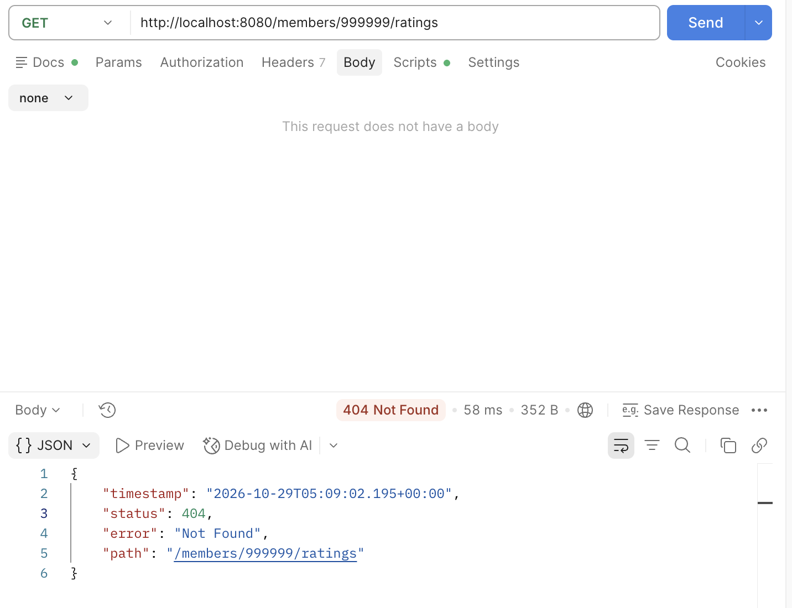

## 구현한 API를 실제 화면에 연결하기

현재 구현한 모든 API를 프론트엔드 화면에 연결해 확인했습니다.

### 1. `/signup`에서 이메일 중복 확인

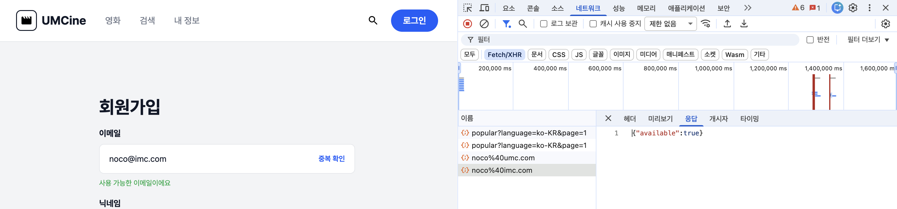

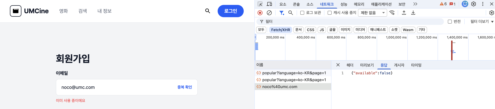

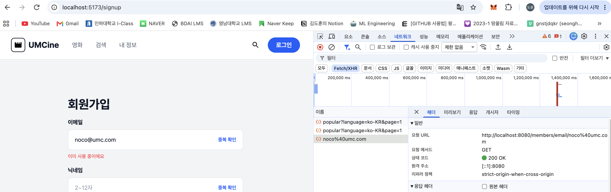

### 2. `/signup`에서 닉네임 중복 확인

사용 가능과 이미 사용 중, 각 1장씩 확인했습니다.

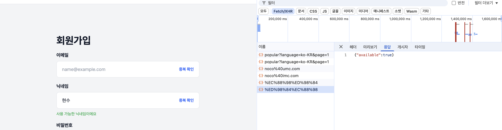

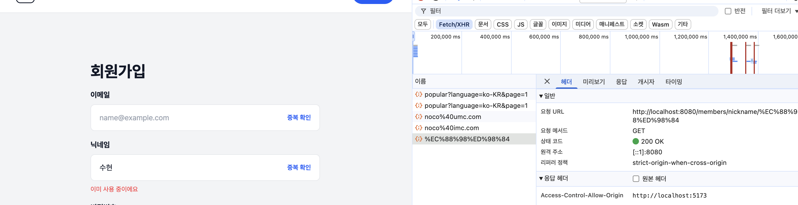

### 3. `/me`에서 평점 목록이 표시된 화면

아직 로그인 기능을 구현하지 않아 내 정보(`/me`)를 누르면 자동으로 고정 아이디 값으로 평점을 불러오도록 설정했습니다.

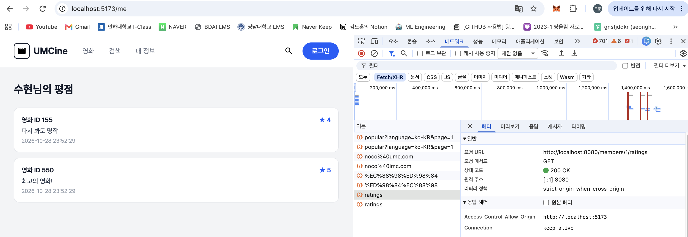

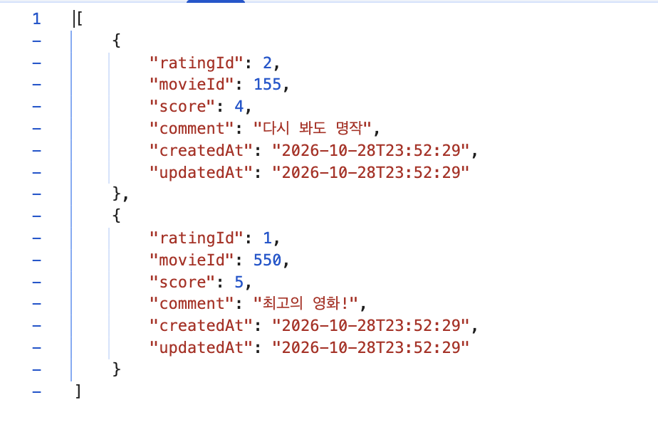

## FE 주요 발췌 코드

**Spring 서버 전용 클라이언트:** TMDB와 주소와 인증이 달라 분리했습니다.

```tsx
// api/spring-client.ts
export const springClient = ky.create({
  baseUrl: `${env.apiBaseUrl}/`,
});
```

**API 호출 함수**

```tsx
// api/members/check-email.ts
function checkEmail(email: string) {
  return springClient
    .get(`members/email/${encodeURIComponent(email)}`)
    .json<CheckEmailResponse>();
}
```

**화면 로직:** 중복은 `available` 값으로 분기하고, `catch`는 연결 실패에만 사용합니다.

```tsx
// pages/auth/signup-page.tsx
const response = await checkEmail(requestedEmail);
if (latestEmail.current !== requestedEmail) return;
setEmailStatus(response.available ? "available" : "taken");
} catch {
  setEmailStatus("error");
}
```

**평점 목록:** 현재 `MEMBER_ID = 1`로 고정돼 있습니다.

```tsx
// pages/me/my-page.tsx
getMemberRatings(MEMBER_ID); // GET /members/1/ratings
```
