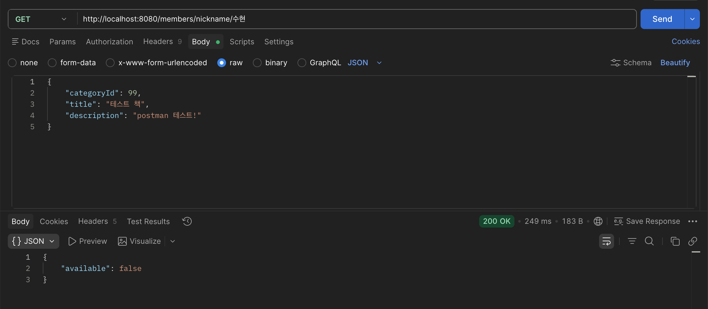
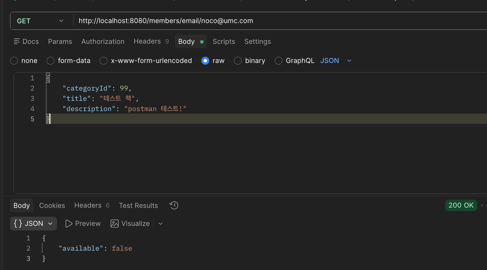
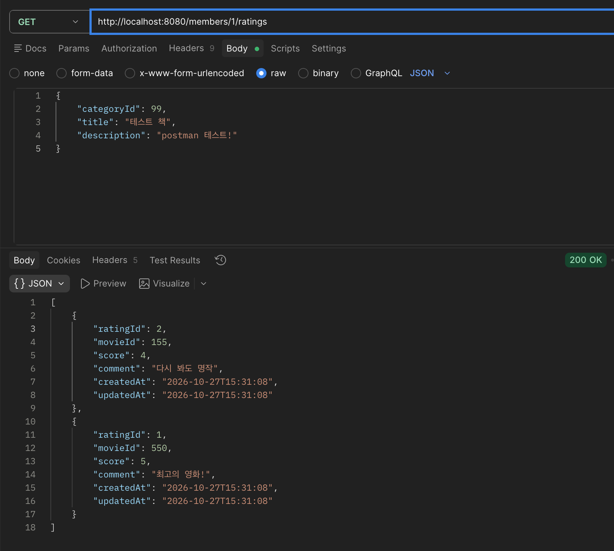
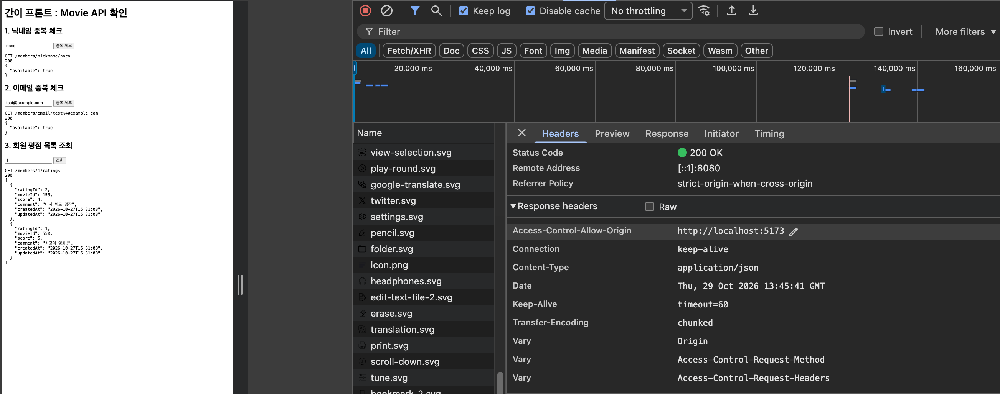

- **미션 기록**
    
    ## 1. 코드
    
    ### 1-1. Entity
    
    ```java
    @Getter
    @MappedSuperclass
    public abstract class BaseTimeEntity {
    
        @CreationTimestamp
        @Column(name = "created_at", nullable = false, updatable = false)
        private LocalDateTime createdAt;
    
        @UpdateTimestamp
        @Column(name = "updated_at", nullable = false)
        private LocalDateTime updatedAt;
    }
    ```
    
    ```java
    @Entity
    @Table(name = "member")
    @Getter
    @NoArgsConstructor(access = AccessLevel.PROTECTED)
    public class Member extends BaseTimeEntity {
    
        @Id
        @GeneratedValue(strategy = GenerationType.IDENTITY)
        @Column(name = "member_id")
        private Long memberId;
    
        @Column(nullable = false, unique = true, length = 254)
        private String email;
    
        @Column(nullable = false, length = 60)
        private String password;
    
        @Column(nullable = false, unique = true, length = 50)
        private String nickname;
    
        public Member(String email, String password, String nickname) {
            this.email = email;
            this.password = password;
            this.nickname = nickname;
        }
    }
    ```
    
    ```java
    @Entity
    @Table(name = "rating", uniqueConstraints = @UniqueConstraint(columnNames = {"member_id", "movie_id"}))
    @Getter
    @NoArgsConstructor(access = AccessLevel.PROTECTED)
    public class Rating extends BaseTimeEntity {
    
        @Id
        @GeneratedValue(strategy = GenerationType.IDENTITY)
        @Column(name = "rating_id")
        private Long ratingId;
    
        @ManyToOne(fetch = FetchType.LAZY)
        @JoinColumn(name = "member_id", nullable = false)
        private Member member;
    
        @Column(name = "movie_id", nullable = false)
        private Long movieId;
    
        @Column(nullable = false, columnDefinition = "TINYINT")
        private Integer score;
    
        @Column(columnDefinition = "TEXT")
        private String comment;
    }
    ```
    
    ### 1-2. DTO
    
    ```java
    public record NicknameCheckResponse(boolean available) {
    }
    
    public record EmailCheckResponse(boolean available) {
    }
    
    public record RatingResponse(
            Long ratingId,
            Long movieId,
            Integer score,
            String comment,
            LocalDateTime createdAt,
            LocalDateTime updatedAt
    ) {
        public static RatingResponse from(Rating rating) {
            return new RatingResponse(
                    rating.getRatingId(),
                    rating.getMovieId(),
                    rating.getScore(),
                    rating.getComment(),
                    rating.getCreatedAt(),
                    rating.getUpdatedAt()
            );
        }
    }
    ```
    
    ### 1-3. Repository
    
    ```java
    public interface MemberRepository extends JpaRepository<Member, Long> {
        boolean existsByNickname(String nickname);
        boolean existsByEmail(String email);
    }
    
    public interface RatingRepository extends JpaRepository<Rating, Long> {
        List<Rating> findByMember_MemberIdOrderByRatingIdDesc(Long memberId);
    }
    ```
    
    ### 1-4. Service
    
    ```java
    @Service
    @RequiredArgsConstructor
    public class MemberService {
    
        private final MemberRepository memberRepository;
    
        @Transactional(readOnly = true)
        public NicknameCheckResponse checkNickname(String nickname) {
            boolean exists = memberRepository.existsByNickname(nickname);
            return new NicknameCheckResponse(!exists);
        }
    
        @Transactional(readOnly = true)
        public EmailCheckResponse checkEmail(String email) {
            boolean exists = memberRepository.existsByEmail(email);
            return new EmailCheckResponse(!exists);
        }
    }
    ```
    
    ```java
    @Service
    @RequiredArgsConstructor
    public class RatingService {
    
        private final RatingRepository ratingRepository;
        private final MemberRepository memberRepository;
    
        @Transactional(readOnly = true)
        public List<RatingResponse> getRatingsByMember(Long memberId) {
            if (!memberRepository.existsById(memberId)) {
                throw new ResponseStatusException(HttpStatus.NOT_FOUND, "존재하지 않는 유저입니다.");
            }
    
            return ratingRepository.findByMember_MemberIdOrderByRatingIdDesc(memberId).stream()
                    .map(RatingResponse::from)
                    .toList();
        }
    }
    ```
    
    ### 1-5. Controller
    
    ```java
    @RestController
    @RequiredArgsConstructor
    @RequestMapping("/members")
    public class MemberController {
        private final MemberService memberService;
    
        @GetMapping("/nickname/{nickname}")
        public NicknameCheckResponse checkNickname(@PathVariable String nickname) {
            return memberService.checkNickname(nickname);
        }
    
        @GetMapping("/email/{email}")
        public EmailCheckResponse checkEmail(@PathVariable String email) {
            return memberService.checkEmail(email);
        }
    }
    
    @RestController
    @RequiredArgsConstructor
    @RequestMapping("/members")
    public class RatingController {
    
        private final RatingService ratingService;
    
        @GetMapping("/{memberId}/ratings")
        public List<RatingResponse> getMemberRatings(@PathVariable Long memberId) {
            return ratingService.getRatingsByMember(memberId);
        }
    }
    ```
    
    ### 1-6. CORS 설정
    
    ```java
    @Configuration
    public class WebConfig implements WebMvcConfigurer {
    
        @Override
        public void addCorsMappings(CorsRegistry registry) {
            registry.addMapping("/**")
                    .allowedOrigins("<http://localhost:5173>")
                    .allowedMethods("GET", "POST", "PATCH", "DELETE")
                    .allowedHeaders("*");
        }
    }
    ```
    
    ## 2. Postman 요청/응답 캡처
    
    ### 2-1. 닉네임 중복 확인
    
    
    
    ### 2-2. 이메일 중복 확인
    
    
    
    ### 2-3. 회원 평점 목록 조회
    
    `GET <http://localhost:8080/members/1/ratings`
    
    
    
    ## 3. 실제 화면에서 API 호출
    
    ### 호출 코드
    
    ```jsx
    const BASE_URL = "<http://localhost:8080>";
    
    async function request(path, resultId) {
      const el = document.getElementById(resultId);
      try {
        const res = await fetch(BASE_URL + path);
        const data = await res.json();
        el.innerText = `GET ${path}\n${res.status}\n` + JSON.stringify(data, null, 2);
      } catch (e) {
        el.innerText = `GET ${path}\n요청 실패: ${e.message}`;
      }
    }
    
    function checkNickname() {
      const nickname = document.getElementById("nickname").value;
      request(`/members/nickname/${encodeURIComponent(nickname)}`, "nickname-result");
    }
    
    function checkEmail() {
      const email = document.getElementById("email").value;
      request(`/members/email/${encodeURIComponent(email)}`, "email-result");
    }
    
    function getRatings() {
      const memberId = document.getElementById("memberId").value;
      request(`/members/${memberId}/ratings`, "ratings-result");
    }
    ```
    
    ### 호출 결과
    
    