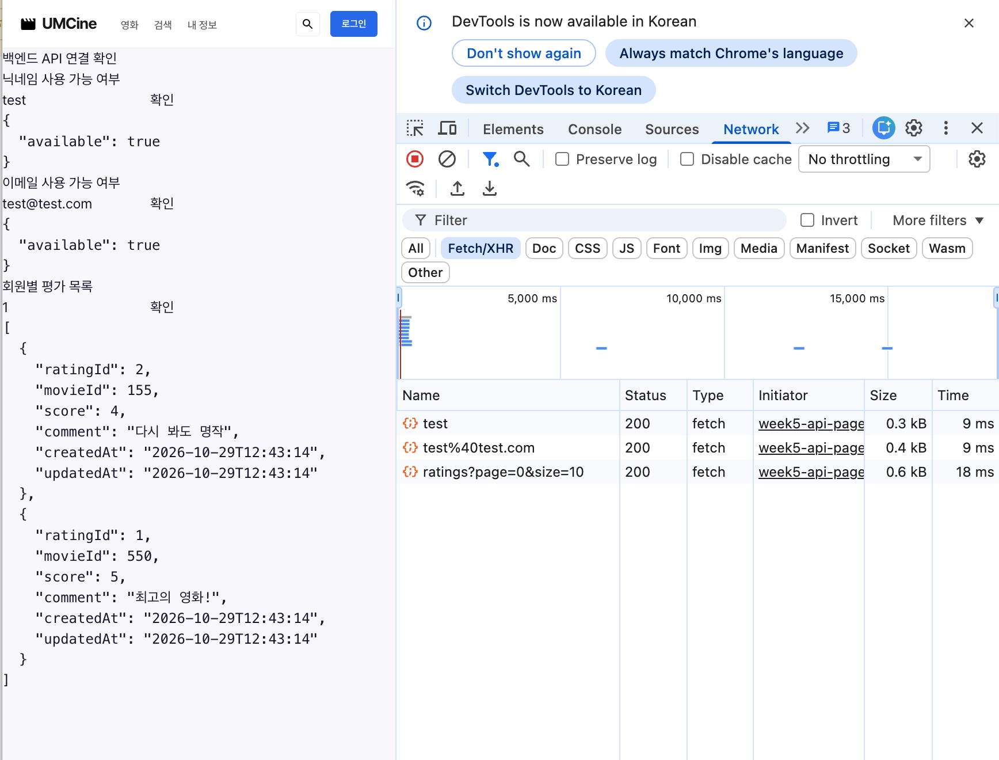

- **미션 기록**

  **실제 프론트 화면에서 API 연결**

    - UMCine의 `/api` 화면에서 닉네임·이메일 중복 확인, 회원별 평점 조회 API 연결.
    - 입력값 → Spring 서버 요청 → JSON 응답을 화면에 표시하는 흐름으로 구성.
    - 영화 목록·상세·검색은 기존 TMDB API 사용, 회원 정보와 사용자가 남긴 평점은 직접 만든 백엔드에서 조회.

  **프론트 요청과 결과 표시**

    ```tsx
    export const backendClient = ky.create({
      baseUrl: "http://localhost:8080/",
    });
    ```

    ```tsx
    const response = await backendClient
      .get(getPath(input), { retry: 0 })
      .json<unknown>();
    
    setResult(JSON.stringify(response, null, 2));
    ```

    ```tsx
    <button
      type="button"
      onClick={handleClick}
      disabled={isLoading}
    >
      {isLoading ? "요청 중..." : "확인"}
    </button>
    
    <pre aria-live="polite">{result}</pre>
    ```

    - 백엔드 요청용 클라이언트를 분리하고, 공통 `ApiCheck` 컴포넌트에 기능별 요청 경로를 전달하는 방식.
    - 닉네임·이메일 등 경로 변수는 `encodeURIComponent()`로 인코딩해서 요청.
    - 요청 중에는 버튼 비활성화, 성공 시 JSON 표시, 실패 시 오류 메시지 표시.

  **브라우저 요청을 위한 CORS 설정**

    ```java
    @Configuration
    public class WebConfig implements WebMvcConfigurer {
    
        @Override
        public void addCorsMappings(CorsRegistry registry) {
            registry.addMapping("/**")
                    .allowedOrigins(
                            "http://localhost:5173",
                            "http://127.0.0.1:5173"
                    )
                    .allowedMethods("GET", "POST", "PATCH", "DELETE")
                    .allowedHeaders("*");
        }
    }
    ```

    - 프론트와 백엔드의 포트가 달라 교차 출처 요청에 해당 → 프론트 개발 서버의 출처 허용.
    - `@Configuration`으로 설정 클래스를 등록하고 서버 재시작 후 적용.
    - UMCine 화면에서 세 API의 응답 표시 확인. 정상 GET 응답에 `Access-Control-Allow-Origin: http://localhost:5173`이 포함되는 것도 확인.

  **화면 연동 확인**

  

  ### 1. 닉네임·이메일 형식 유효성 검증

    ```java
    @GetMapping("/nickname/{nickname}")
    public NicknameCheckResponse checkNickname(
            @PathVariable @Size(min = 2, max = 12) String nickname
    ) {
        return memberService.checkNickname(nickname);
    }
    
    @GetMapping("/email/{email}")
    public EmailCheckResponse checkEmail(
            @PathVariable @Email String email
    ) {
        return memberService.checkEmail(email);
    }
    ```

    - 닉네임은 2~12자, 이메일은 이메일 형식으로 입력 범위 제한.
    - 경로 변수에 검증 조건을 직접 선언. 조건을 만족하지 않으면 Service의 중복 확인 로직에 들어가기 전에 `400` 응답.
    - 닉네임 `a`, 이메일 `not-an-email` 요청에서 `400` 확인. 정상 형식의 입력은 `200`과 사용 가능 여부 응답 확인.

  ### 2. 평점 목록 페이지네이션

    ```java
    @GetMapping("/{memberId}/ratings")
    public List<RatingResponse> getMemberRatings(
            @PathVariable Long memberId,
            @RequestParam(defaultValue = "0") @Min(0) int page,
            @RequestParam(defaultValue = "10") @Min(1) int size
    ) {
        return ratingService.getRatingsByMember(memberId, page, size);
    }
    ```

    - `page`, `size`를 Query Parameter로 받아 조회 범위 지정.
    - 생략하면 `page=0`, `size=10`. 페이지 번호는 0부터 시작, `@Min`으로 음수 페이지와 0 이하의 크기 제한.

    ```java
    Page<Rating> findByMember_MemberIdOrderByRatingIdDesc(
            Long memberId,
            Pageable pageable
    );
    ```

    ```java
    Pageable pageable = PageRequest.of(page, size);
    
    return ratingRepository.findByMember_MemberIdOrderByRatingIdDesc(memberId, pageable).stream()
            .map(RatingResponse::from)
            .toList();
    ```

    - `PageRequest`를 Repository에 전달해 DB 조회 단계에서 페이지 적용. 기존 `ratingId` 내림차순 정렬 유지.
    - `page × size`만큼 건너뛰고 `size`개를 조회하는 오프셋 페이징 방식.
    - 조회된 페이지의 내용을 `RatingResponse` 리스트로 변환 → 프론트에는 기존처럼 배열 형태로 응답.
    - 기존의 회원 존재 여부 확인과, 존재하지 않는 회원에 대한 `404` 처리 유지.

  **조회 결과 확인**

  | 요청 조건 | 응답의 ratingId |
      | --- | --- |
  | `memberId=1&page=0&size=1` | `[2]` |
  | `memberId=1&page=1&size=1` | `[1]` |
  | `memberId=1&page=0&size=2` | `[2, 1]` |
    - 페이지를 바꾸면 다음 평점으로 이동하고, 크기를 바꾸면 응답 개수가 달라지는 것 확인.
    - `page=-1` 요청은 `400` 응답 확인.

  **확인 결과**

    - 백엔드 컴파일(`./gradlew classes`), 프론트 빌드(`pnpm build`) 정상 완료.