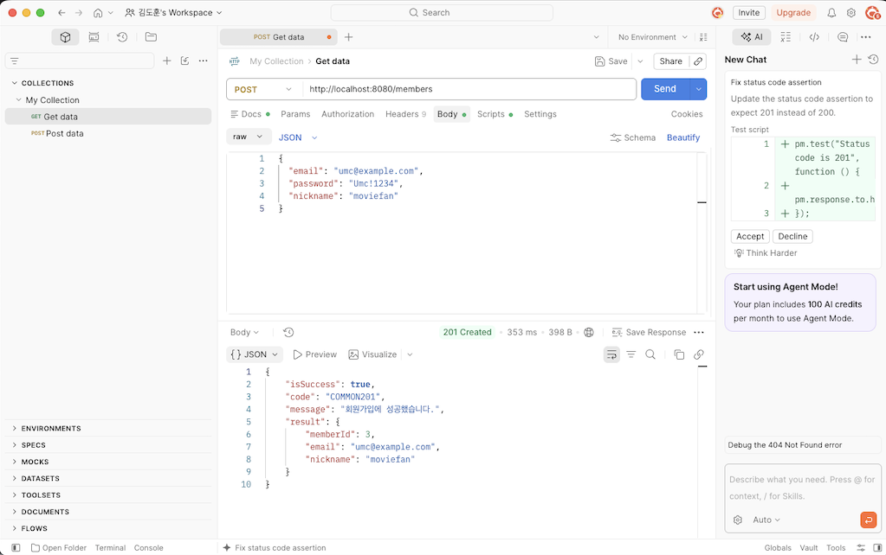
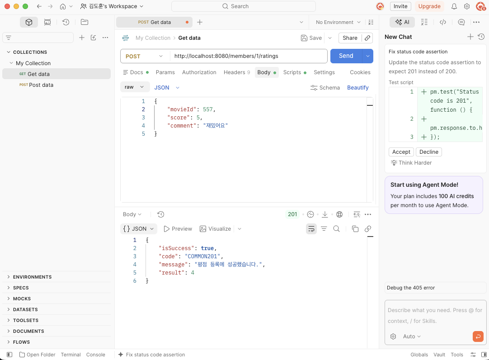
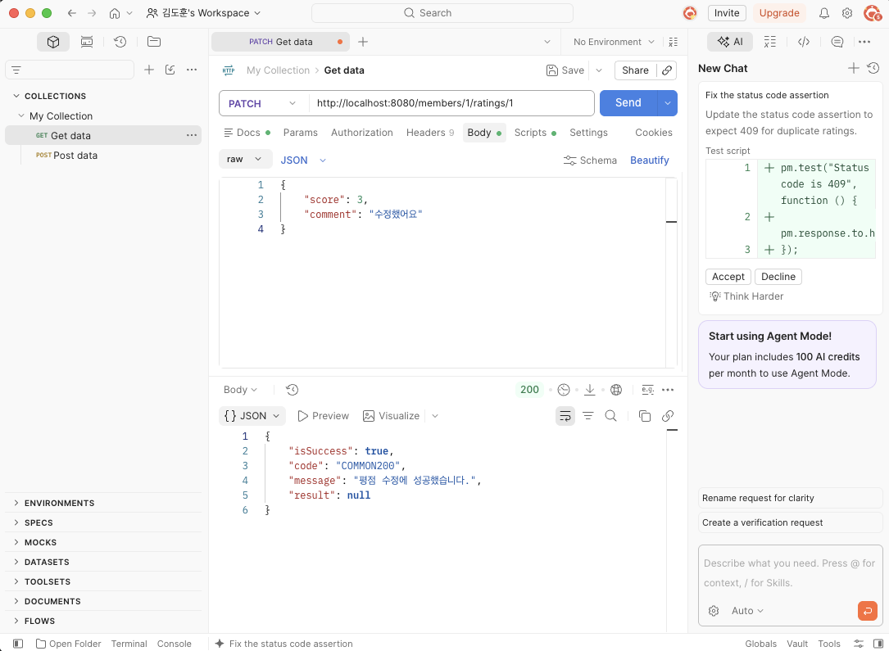
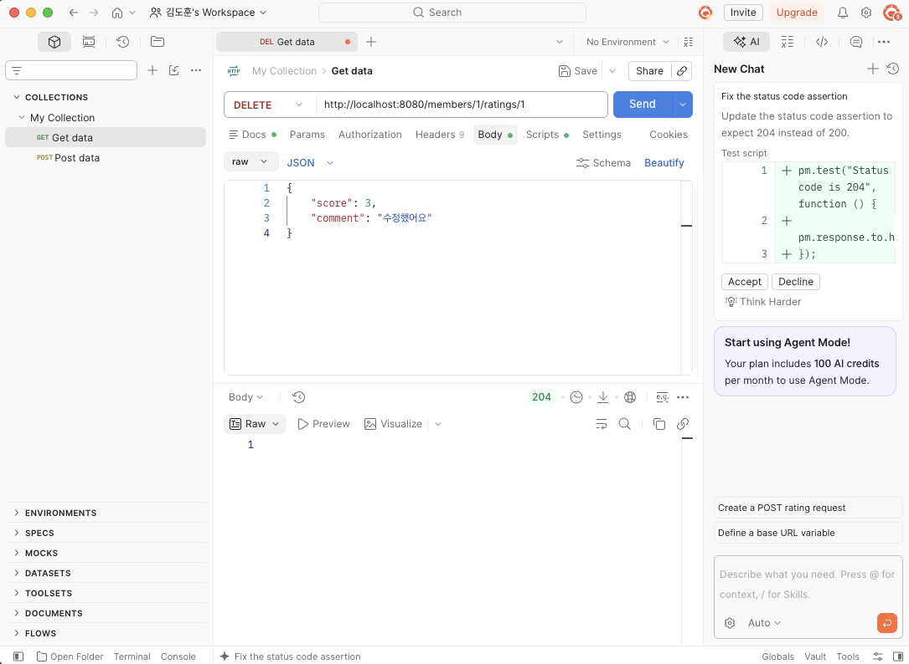
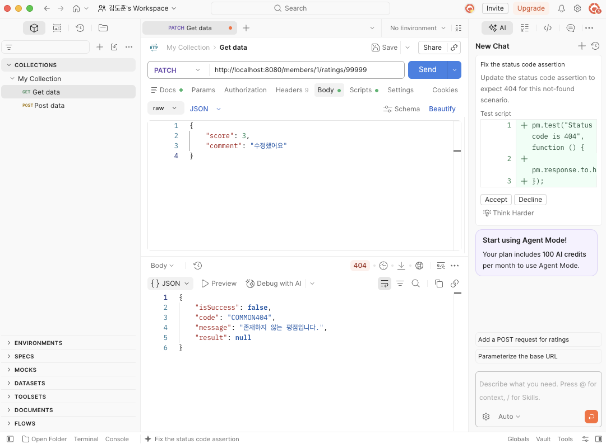
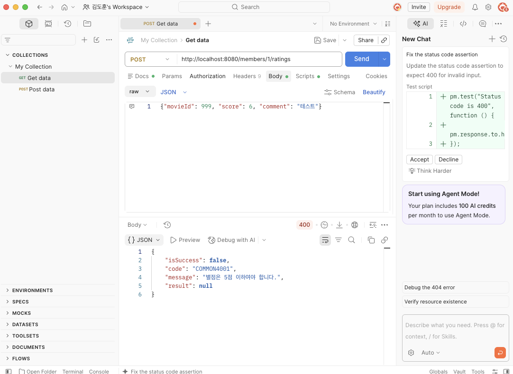
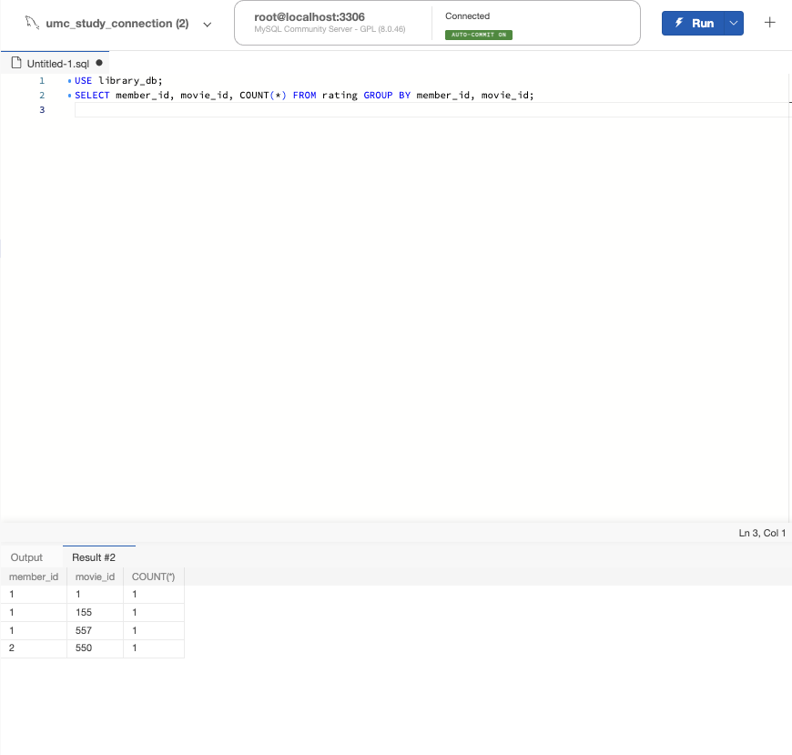
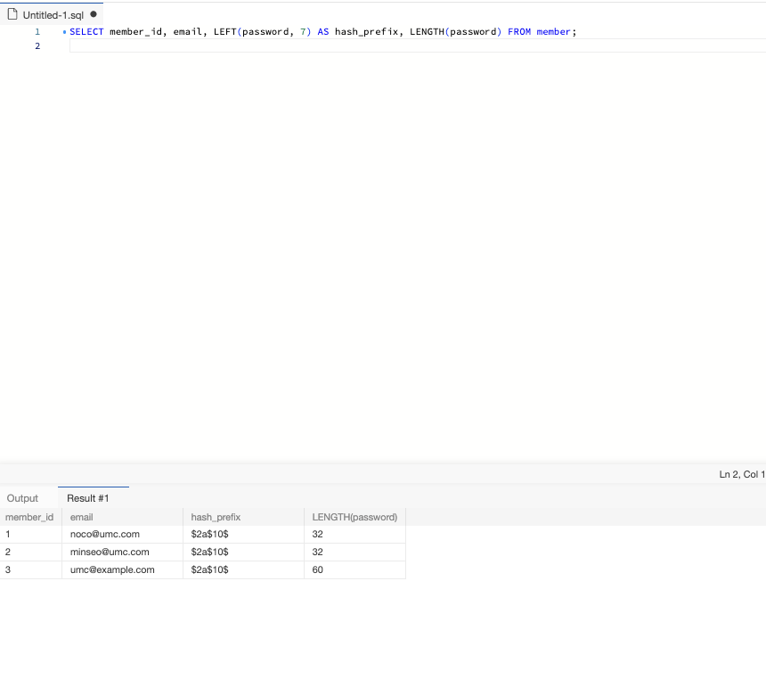

# Backend Chapter06

## 1. (필수) Standard Mission

영화 평점 서비스에 회원가입과 평점 등록/수정/삭제 API를 구현하세요.

- 회원가입: 이메일/닉네임/비밀번호 검증, bcrypt 저장, 201 응답
- 평점: 등록 POST, 수정 PATCH, 삭제 DELETE 구현
- 실패: 중복 이메일 또는 닉네임, 잘못된 별점, 중복 평점 중 2가지 이상을 일관된 오류 응답으로 처리하고, 다른 회원의 평점 수정 또는 삭제 요청은 403으로, 존재하지 않는 평점은 404로 처리

**제출물:** API 명세, Postman 또는 화면 요청/응답 캡처, 핵심 코드 링크, 트러블 슈팅 1건

**확인 포인트:** password가 응답에 없는가? 중복 평점이 DB에 저장되지 않는가? DELETE가 204로 응답하는가?

## Postman 검증

**1. 회원가입 201, password 없음**



**2. 평점 등록 201**



**3. 평점 수정 200**



**4. 평점 삭제 204**



**5. 중복 평점 409**


**6. 없는 평점 404**

존재하지 않는 평점 ID(`99999`)로 PATCH 요청을 보내 `COMMON404`, "존재하지 않는 평점입니다."를 확인했습니다.



**7. 잘못된 평점 400**



## 중복 평점 확인 (DB)

`rating` 테이블을 `member_id`, `movie_id`로 그룹화해 모든 조합의 `COUNT`가 1인 것을 확인했습니다. 중복 평점이 DB에 저장되지 않습니다.



## bcrypt 해시 저장 확인 (DB)

`member` 테이블의 `password` 컬럼을 조회해, 새로 가입한 회원(`umc@example.com`)의 비밀번호가 bcrypt 해시(`$2a$10$` 접두사, 길이 60)로 저장된 것을 확인했습니다.



## 핵심 코드

```java
// MemberService.signUp – 해시 후 저장, 응답에는 password 제외
Member.builder()
        .email(request.email())
        .password(passwordEncoder.encode(request.password()))
        .nickname(request.nickname())
        .build();

// RatingService.create – 같은 회원이 같은 영화에 이미 평점을 남겼는지 확인
if (ratingRepository.existsByMember_MemberIdAndMovieId(memberId, request.movieId())) {
    throw new IllegalArgumentException("이미 이 영화에 평점을 남기셨습니다.");
}

// RatingService.findOwnedRating – 없으면 404, 남의 것이면 403
if (!rating.getMember().getMemberId().equals(memberId)) {
    throw new ResponseStatusException(HttpStatus.FORBIDDEN, "본인이 작성한 평점만 수정하거나 삭제할 수 있습니다.");
}

// RatingController.delete – 204
return ResponseEntity.noContent().build();
```

## 트러블슈팅

- **이슈:** 평점 등록(`POST /members/1/ratings`)을 Postman으로 요청하자 `405 Method Not Allowed`가 응답됨
- **원인:** `/members/{memberId}/ratings` 주소는 GET으로 이미 등록돼 있었는데, `RatingController`에 `@PostMapping`, `@PatchMapping`, `@DeleteMapping`이 없었음. 그래서 서버가 "주소는 있지만 POST는 받지 않는다"는 의미로 405를 응답함
- **해결:** 워크북 코드로 컨트롤러에 POST, PATCH, DELETE를 다시 넣고 서버를 재시작하자 정상 응답으로 돌아옴
