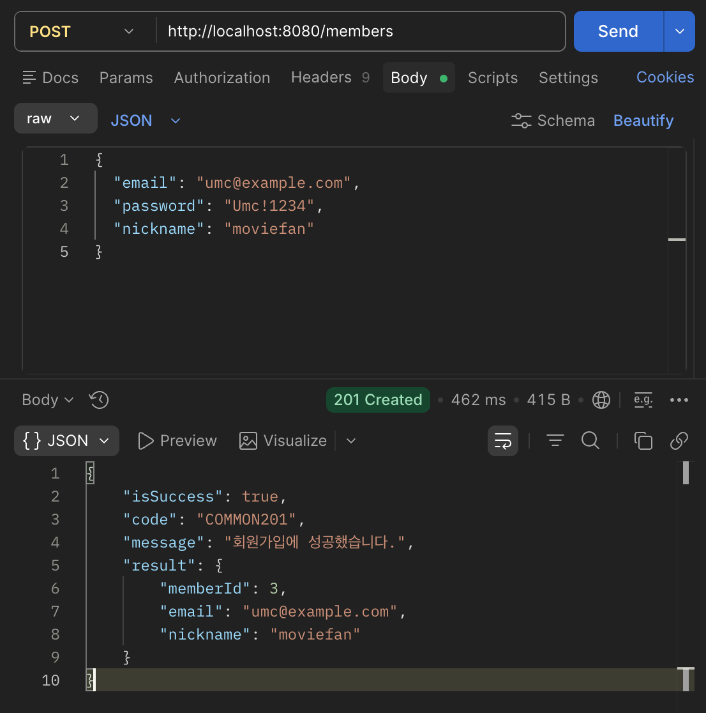
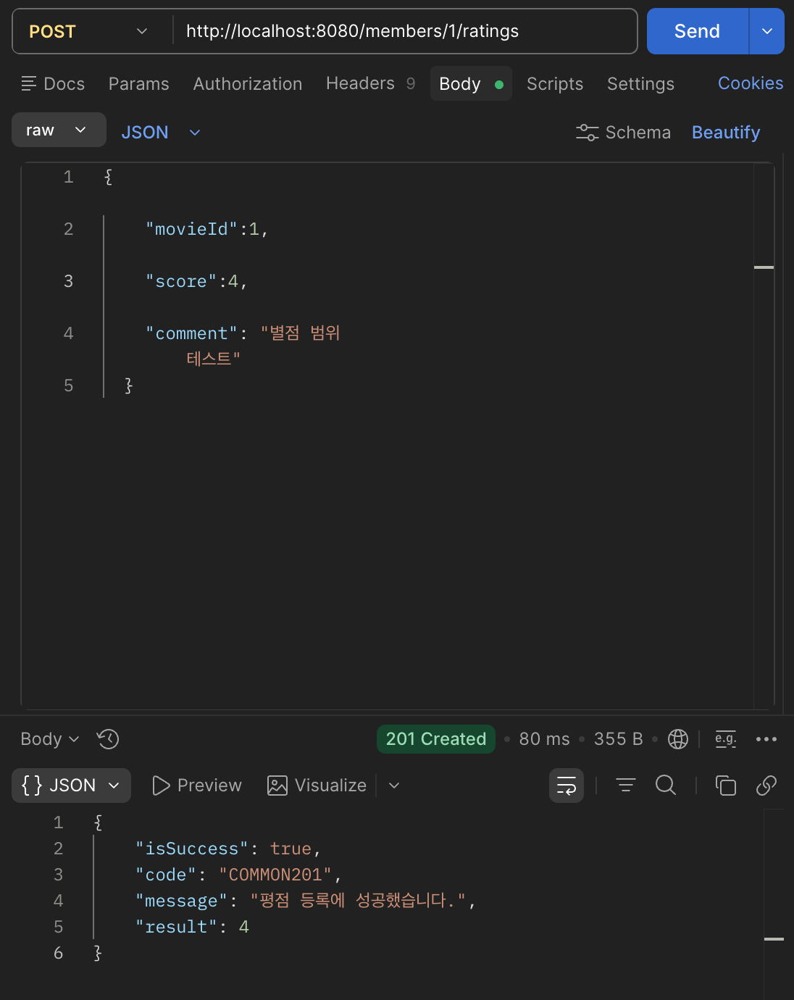
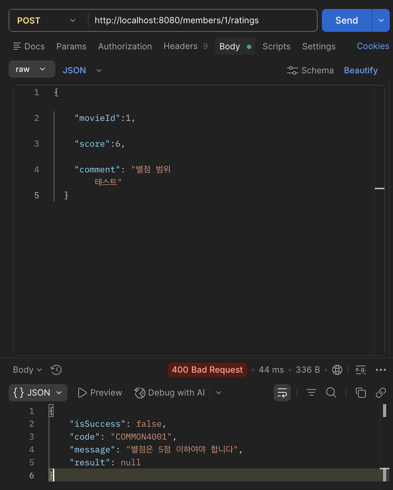
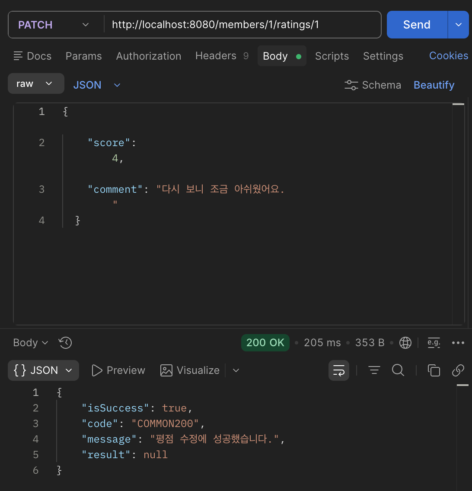
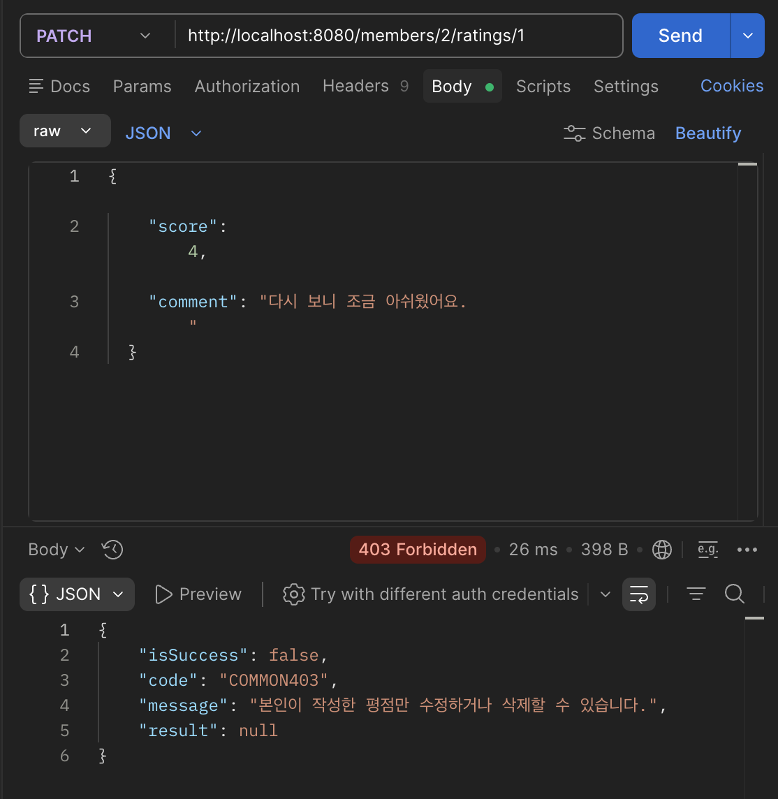
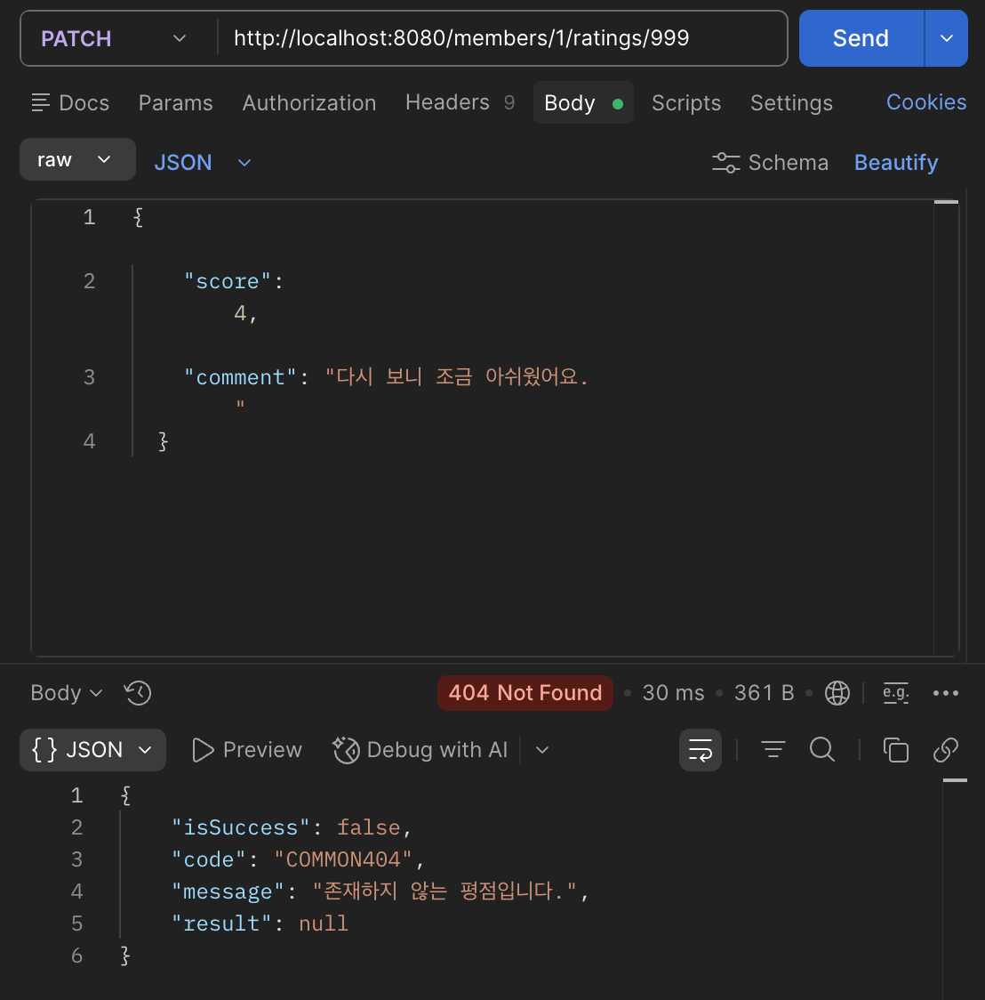
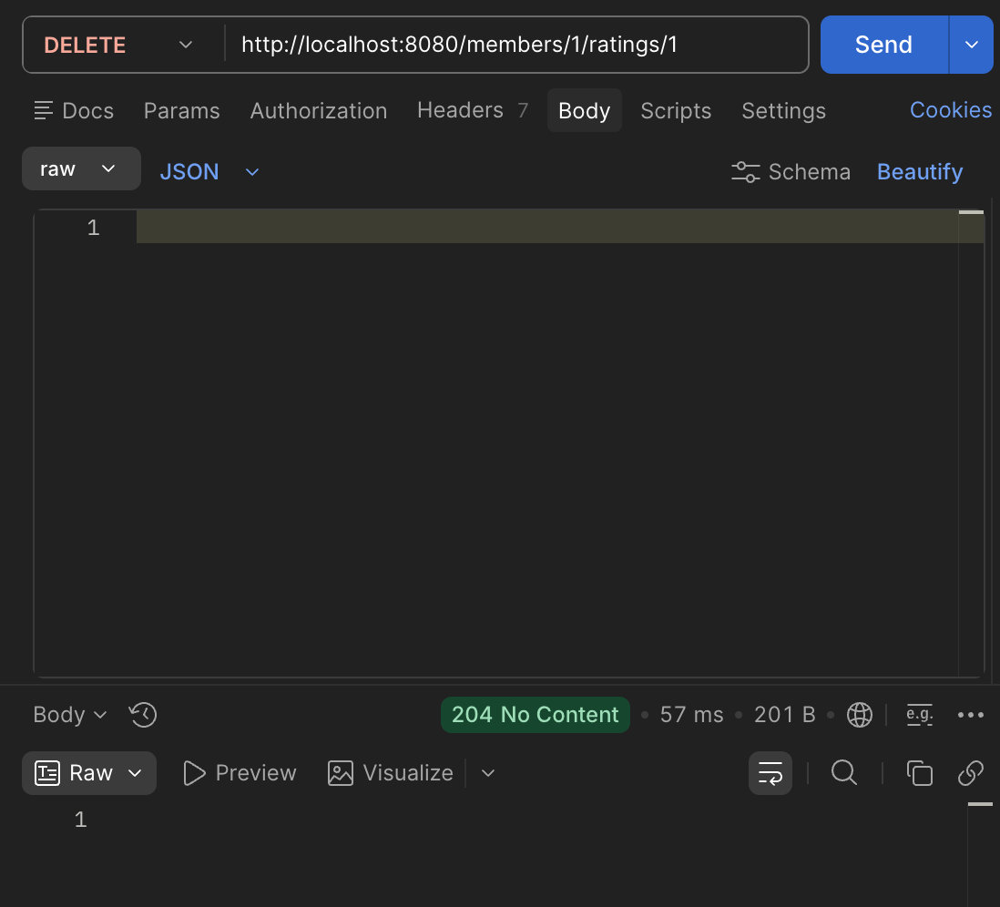

- **미션 기록**
    
    ## 1. 회원가입
    
    ```java
    // SignUpRequest
    @NotBlank @Email String email,
    @NotBlank @Pattern(regexp = "^(?=.*[a-z])(?=.*[A-Z])(?=.*\\d)(?=.*[!@#$%^&*]).{8,}$") String password,
    @NotBlank @Size(min = 2, max = 12) String nickname
    
    // MemberService.signUp
    Member member = Member.builder()
            .email(request.email())
            .password(passwordEncoder.encode(request.password()))  // bcrypt
            .nickname(request.nickname())
            .build();
    
    // MemberController.signUp
    return ResponseEntity.status(201)
            .body(ApiResponse.created("회원가입에 성공했습니다.", response));
    ```
    
    요청 DTO에서 이메일 형식, 비밀번호 규칙, 닉네임 길이를 검증하고 비밀번호는 bcrypt로 저장한다.
    
    - **결과** `POST /members` → 201
    
    
    
    ## 2. 실패 응답 (검증, 중복)
    
    ```java
    // GlobalExceptionHandler
    @ExceptionHandler(MethodArgumentNotValidException.class)   // 400 검증 실패
    @ExceptionHandler(IllegalArgumentException.class)          // 409 중복 이메일/닉네임/평점
    @ExceptionHandler(DataIntegrityViolationException.class)   // 409 DB 제약 위반
    @ExceptionHandler(ResponseStatusException.class)           // 403, 404
    ```
    
    모든 실패를 `ApiResponse.failure(code, message)` 하나의 형식으로 변환한다.
    
    ## 3. 평점 등록
    
    ```java
    // RatingService.create
    if (ratingRepository.existsByMember_MemberIdAndMovieId(memberId, request.movieId())) {
        throw new IllegalArgumentException("이미 이 영화에 평점을 남기셨습니다.");
    }
    Rating rating = Rating.builder().member(member).movieId(request.movieId())
            .score(request.score()).comment(request.comment()).build();
    return ratingRepository.save(rating).getRatingId();
    ```
    
    저장 전에 중복을 확인해 원하는 메시지로 응답하고, `@UniqueConstraint(member_id, movie_id)`로 DB에서도 한 번 더 막는다. 별점은 `@Min(1) @Max(5)`로 검증한다.
    
    - **결과** `POST /members/3/ratings` → 201
    
    
    
    - **결과** 같은 영화에 다시 등록 → 409 / 별점 6 → 400
    
        

    ## 4. 평점 수정
    
    ```java
    // RatingService.findOwnedRating
    Rating rating = ratingRepository.findById(ratingId)
            .orElseThrow(() -> new ResponseStatusException(HttpStatus.NOT_FOUND, "존재하지 않는 평점입니다."));
    if (!rating.getMember().getMemberId().equals(memberId)) {
        throw new ResponseStatusException(HttpStatus.FORBIDDEN, "본인이 작성한 평점만 수정하거나 삭제할 수 있습니다.");
    }
    ```
    
    평점을 먼저 찾고(없으면 404), 요청자의 평점인지 확인한다(아니면 403). 수정과 삭제가 이 메서드를 같이 쓴다.
    
    - **결과** `PATCH /members/3/ratings/5` → 200
    
    
    
    - **결과** 다른 회원의 평점 수정 → 403 / 없는 평점 → 404
    
    
    
    
    
    ## 5. 평점 삭제
    
    ```java
    // RatingController.delete
    ratingService.delete(ratingId, memberId);
    return ResponseEntity.noContent().build();
    ```
    
    삭제 성공 시 바디 없이 204 No Content로 응답한다.
    
    - **결과** `DELETE /members/3/ratings/5` → 204 (Body 없음)
    
    