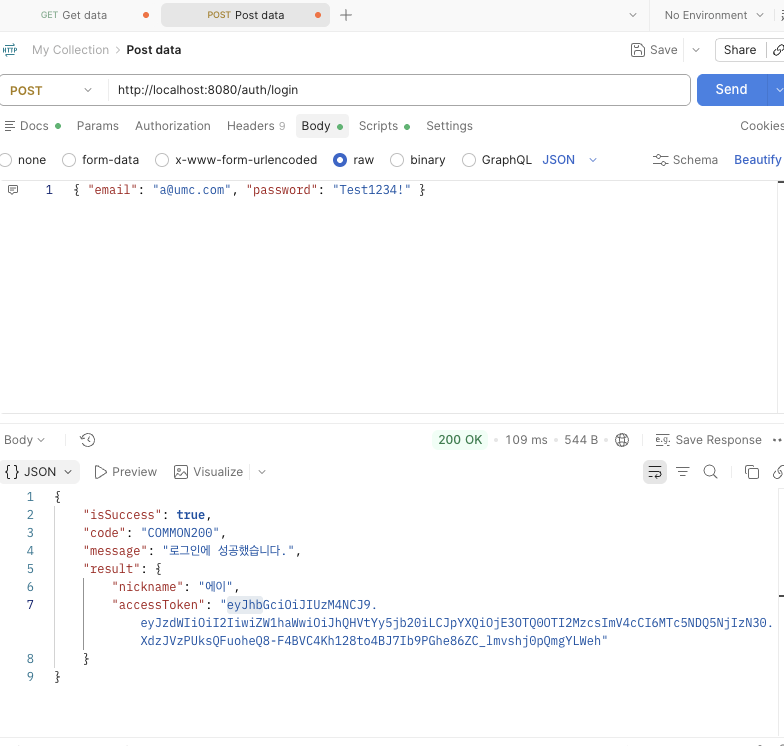
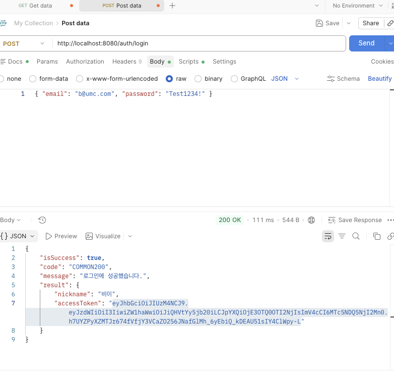
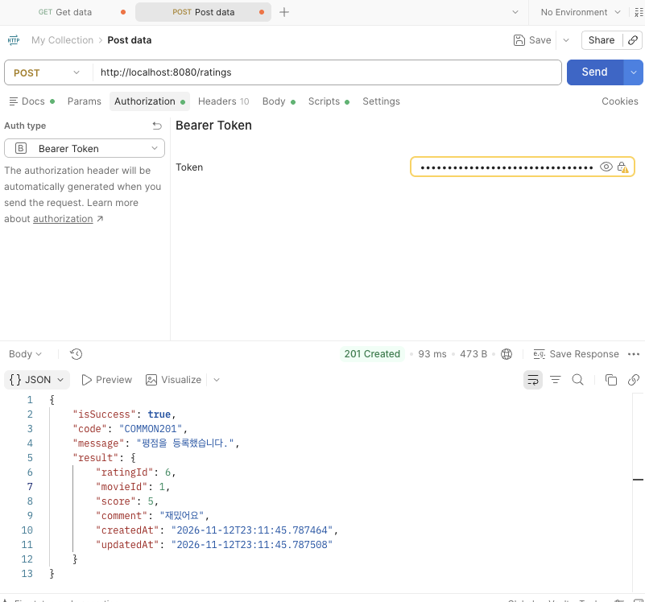
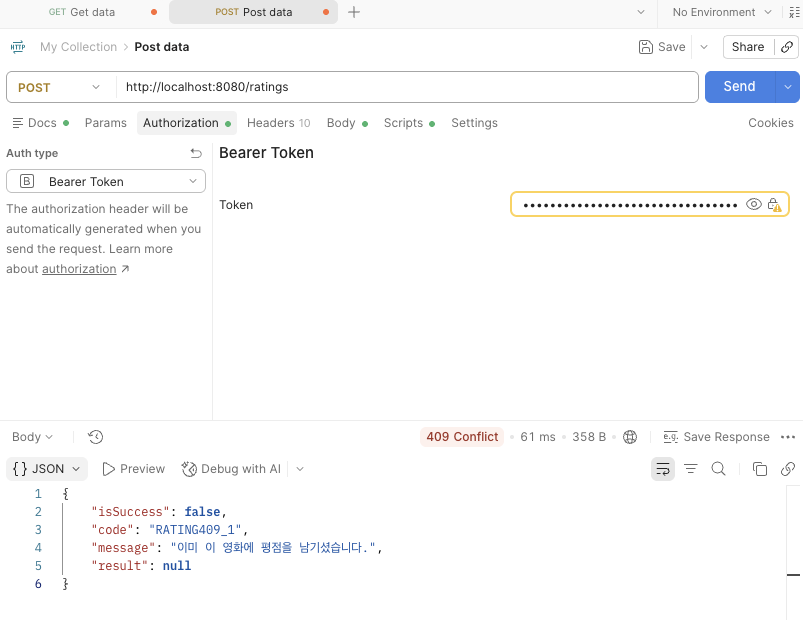
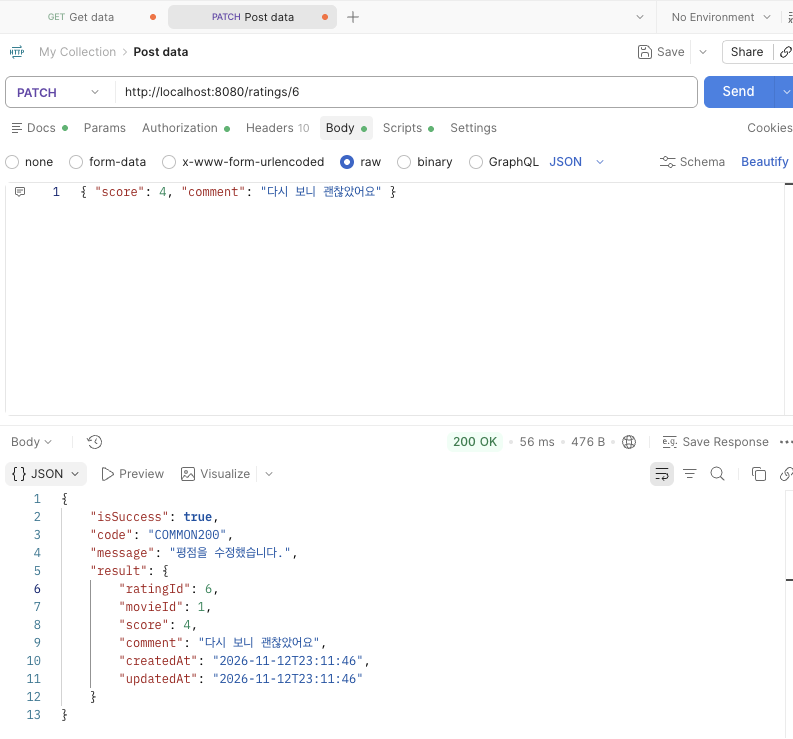
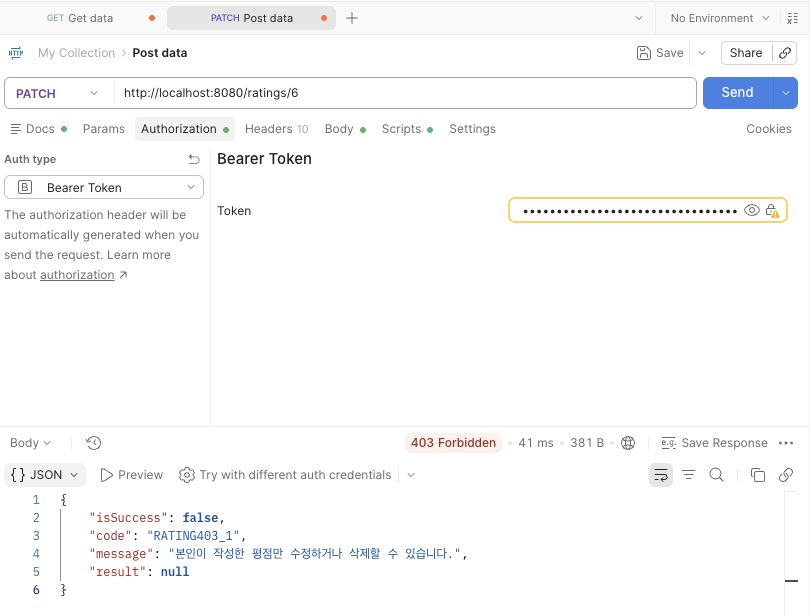
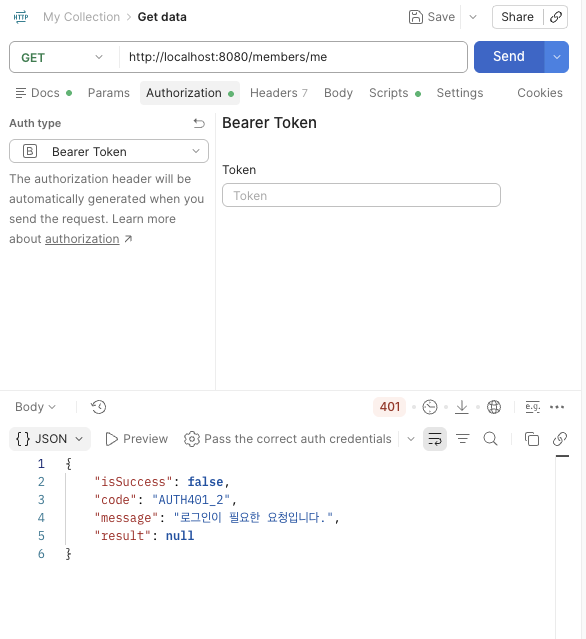
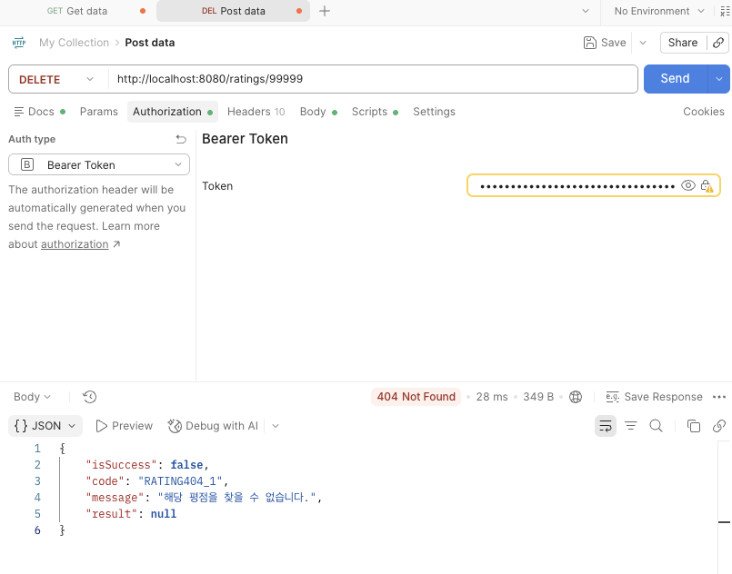
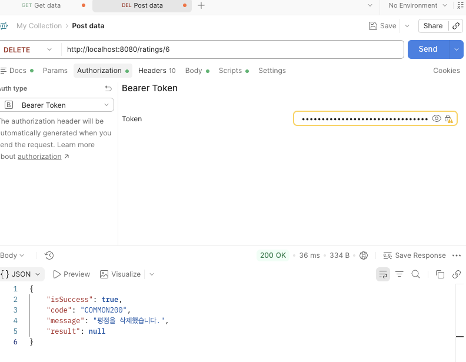

# Backend Chapter07

## 1. (필수) Standard Mission

본문 실습 1~6을 모두 완료하고, "9. Postman으로 전체 시나리오를 검증합시다"의 9단계를 순서대로 실행합니다.

**시나리오**

1. 준비: 6주차 회원가입 API로 A(a@umc.com), B(b@umc.com) 두 명을 가입
2. 로그인: A, B 각각 로그인해서 토큰 A, 토큰 B 확보
3. 등록: 토큰 A로 POST /ratings → 201, COMMON201
4. 중복 등록: 같은 movieId로 재등록 → 409, RATING409_1
5. 본인 수정: 토큰 A로 PATCH /ratings/{ratingId} → 200
6. 남의 것 수정: 토큰만 B로 바꿔서 동일 요청 → 403, RATING403_1
7. 토큰 없이: Authorization 헤더 제거 후 요청 → 401, AUTH401_2
8. 없는 평점: 토큰 A로 DELETE /ratings/99999 → 404, RATING404_1
9. 본인 삭제: 토큰 A로 3번의 평점을 삭제 → 200, COMMON200

**제출물**

1. 로그인 성공 응답 캡처 (accessToken이 보이도록)
2. 토큰 없이 GET /members/me 호출 시의 401 응답 캡처
3. 다른 회원의 토큰으로 평점 수정 시도 시의 403 응답 캡처
4. 본인 토큰으로 평점 등록에 성공한 201 응답 캡처

**확인 포인트**

- 평점 등록 요청 바디에 memberId가 없어야 한다.
- 401과 403 응답의 code 값이 서로 달라야 한다.

## Postman 검증

**1. 로그인 A**

**2. 로그인 B**

**3. 평점 등록 201**

**4. 중복 등록 409**

**5. 본인 수정 200**

**6. 남의 것 수정 403**

**7. 토큰 없이 요청 401**

**8. 없는 평점 404**

**9. 본인 삭제 200**

