- **미션 기록**
    - POST /auth/login 요청 결과
    
    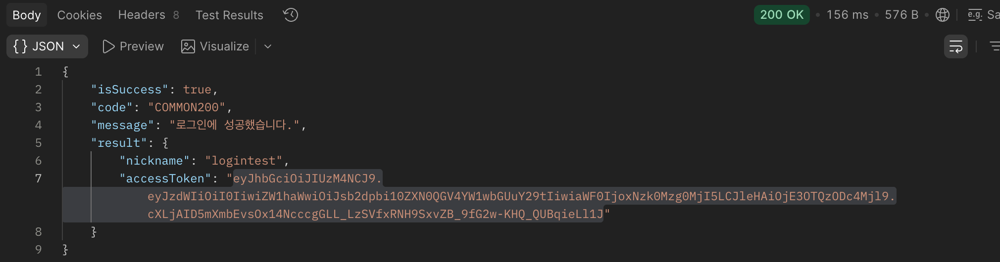
    
    - jwt.io 결과
    
    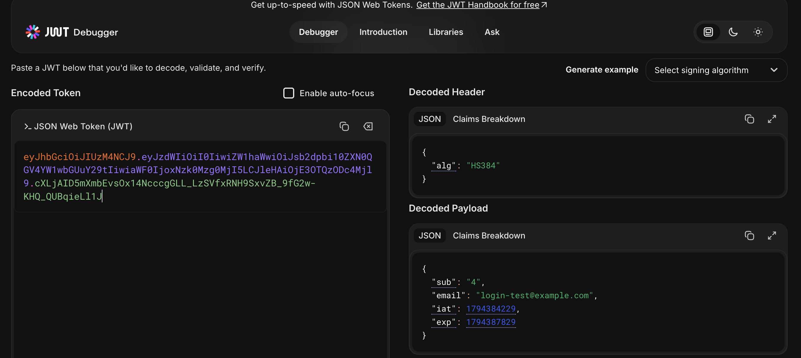

    
    - 존재하지 않는 이메일로 로그인 시도
    
    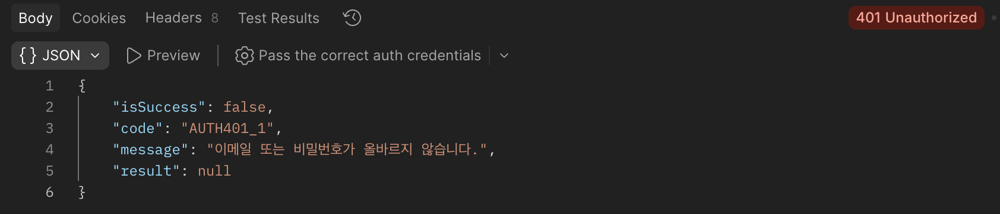
    
    - 헤더 없이 그냥 시도
    
    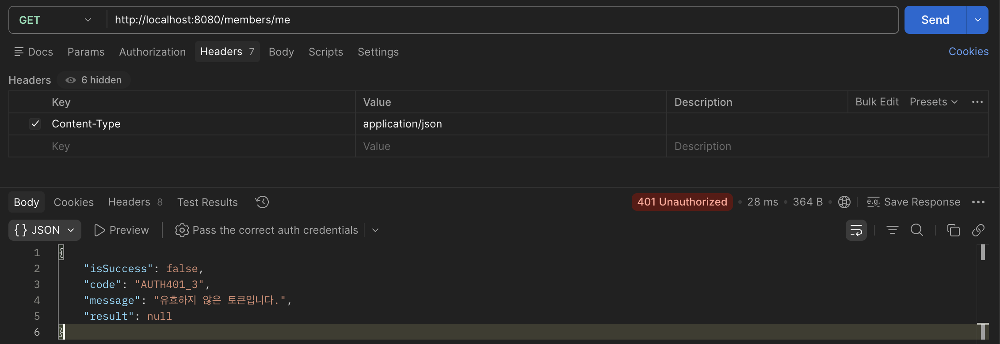
    
    - 유효한 토큰으로 내정보 조회
    
    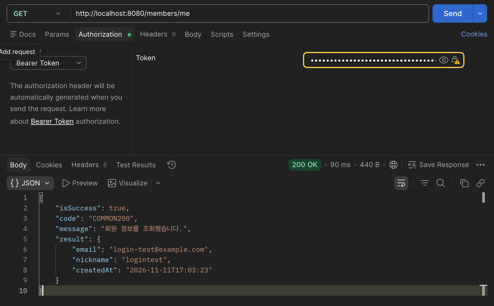
    
    - 토큰을 임의로 변경하고 내정보 조회
    
    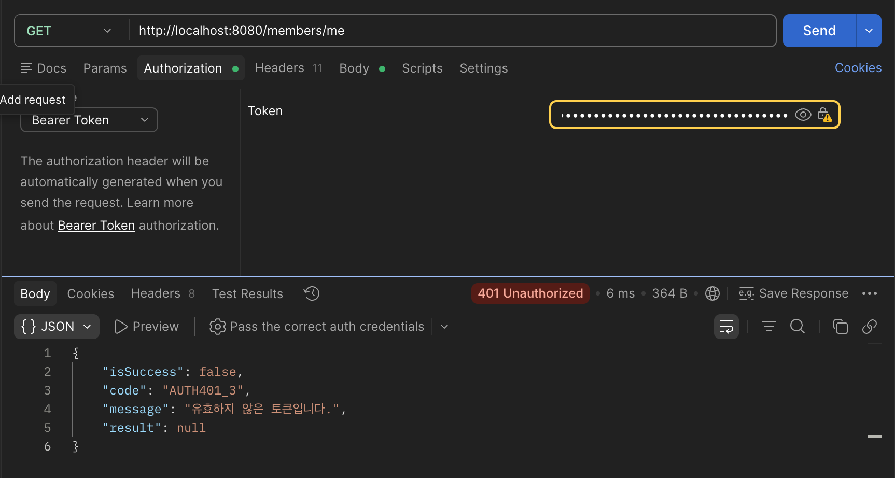
    
    - postman으로 전체 시나리오 검증하기
        - A가 리뷰 처음 등록(201)
            
            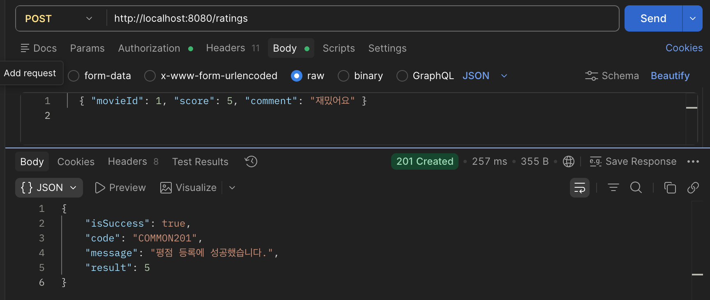
            
        - A가 같은 리뷰 중복 등록(409)
            
            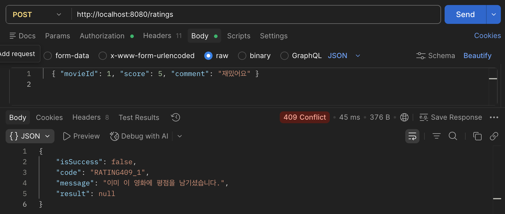
            
        - A가 리뷰 수정(200)
            
            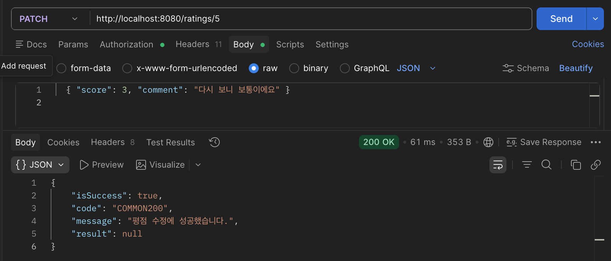
            
        - B가 남의 리뷰 수정(403)
            
            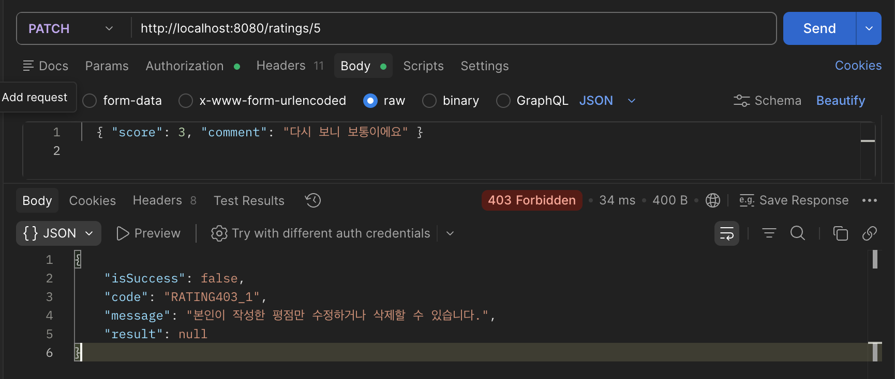
            
        - 토큰 없이 리뷰 수정(401)
            
            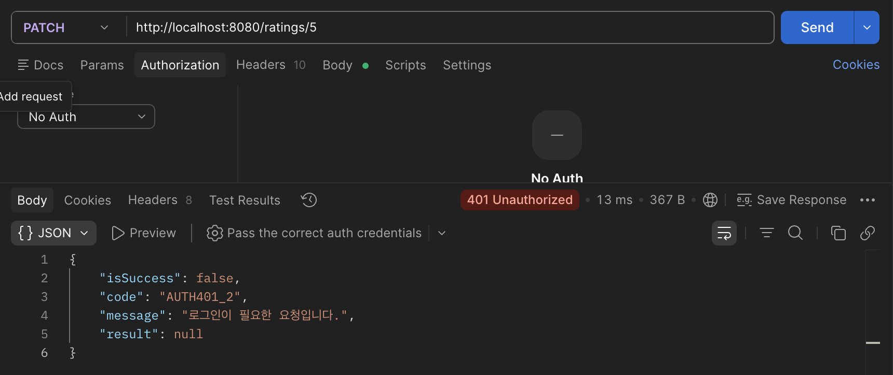
            
        - A가 없는 리뷰 삭제(404)
            
            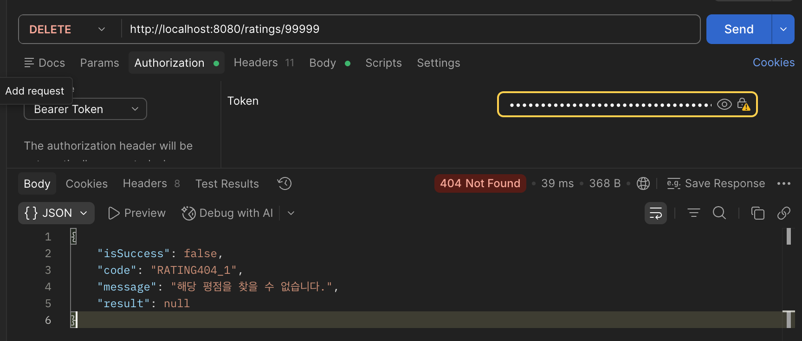
            
        - A가 자신의 리뷰 삭제(204)
            
            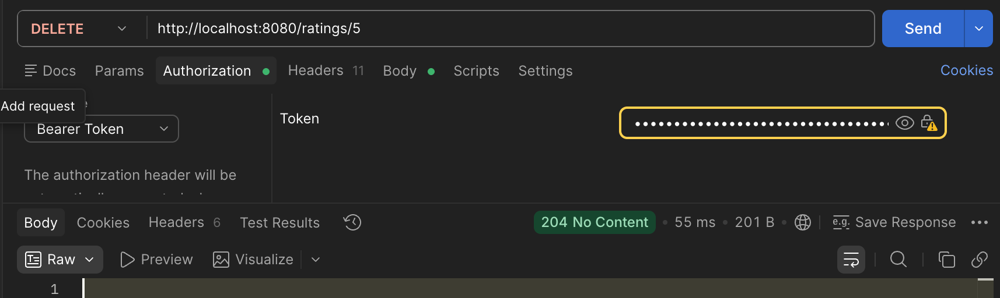
            
        
        + 워크북 코드랑 다르게 한 부분
        
        - `ErrorCode` enum 한 곳에 `HttpStatus`, `code`, `message`를 모아두고 이름으로 던짐
        
        ```java
        throw new ApiException(ErrorCode.TOKEN_MISSING);
        ```
        
        - `ApiException`에 `ErrorCode`를 받는 생성자 추가
        - `GlobalExceptionHandler`는 `ApiException` 하나만 처리하면 되므로 수정 불필요
        
        - 이렇게 한 이유
            - 같은 에러를 여러 곳에서 던져도 코드와 메시지를 한 곳에서 관리
            - 오타로 에러 코드가 서로 달라지는 일을 방지
            - 에러 목록을 한눈에 볼 수 있음