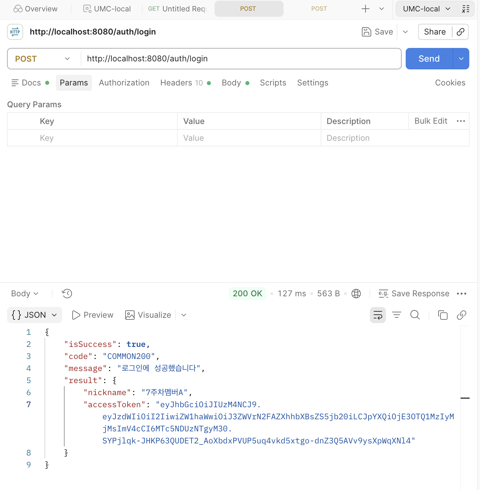
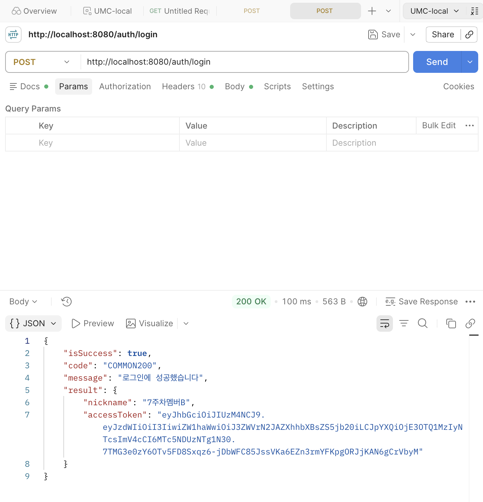
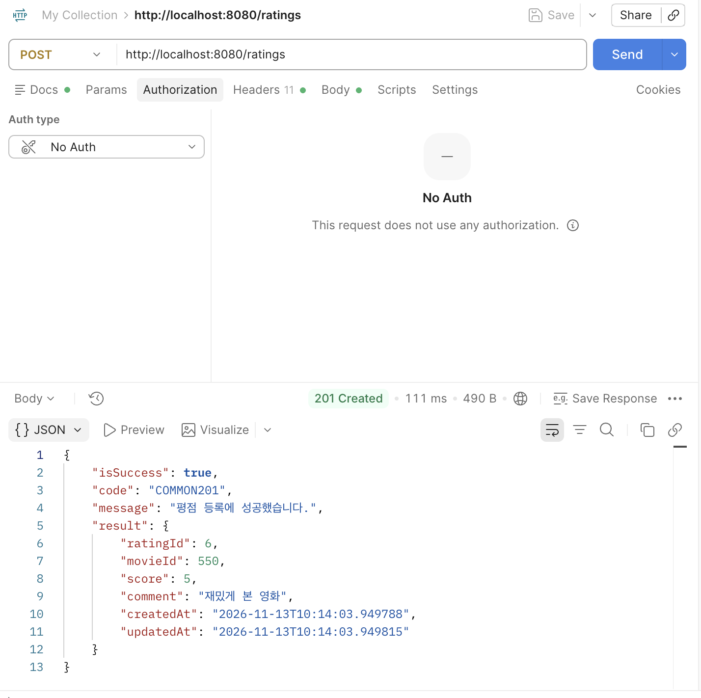
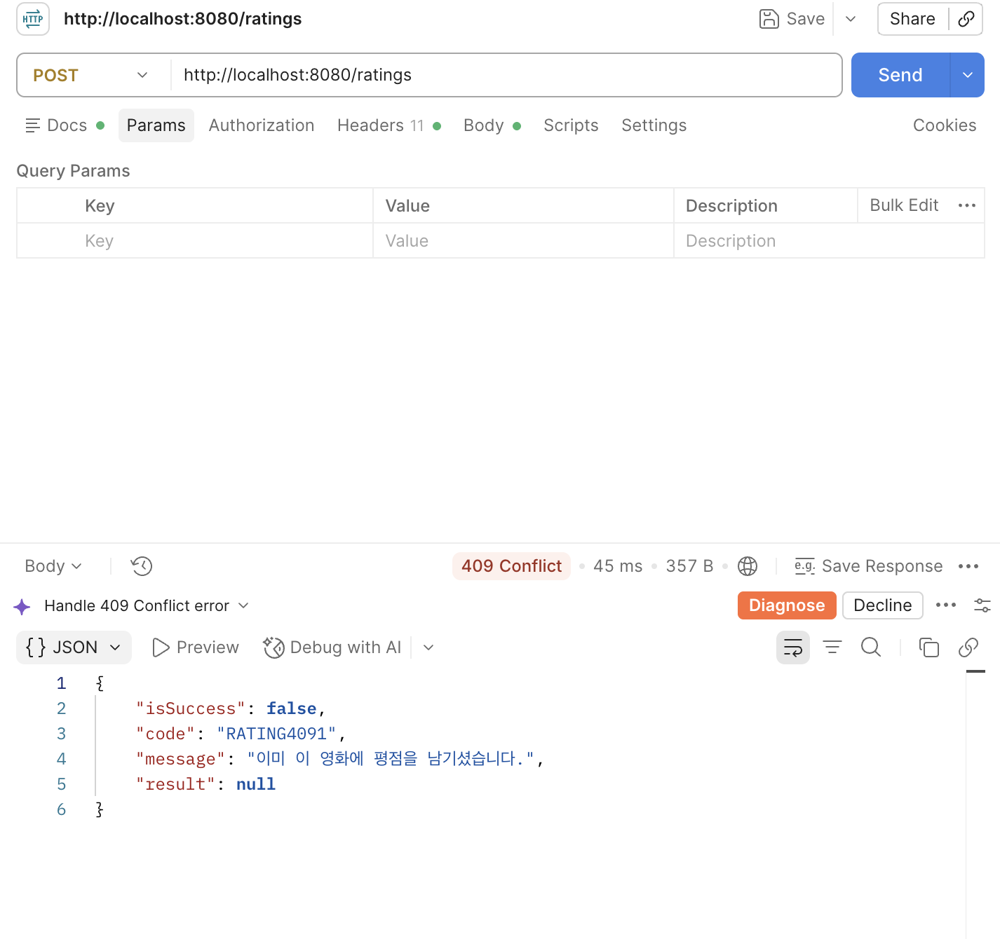
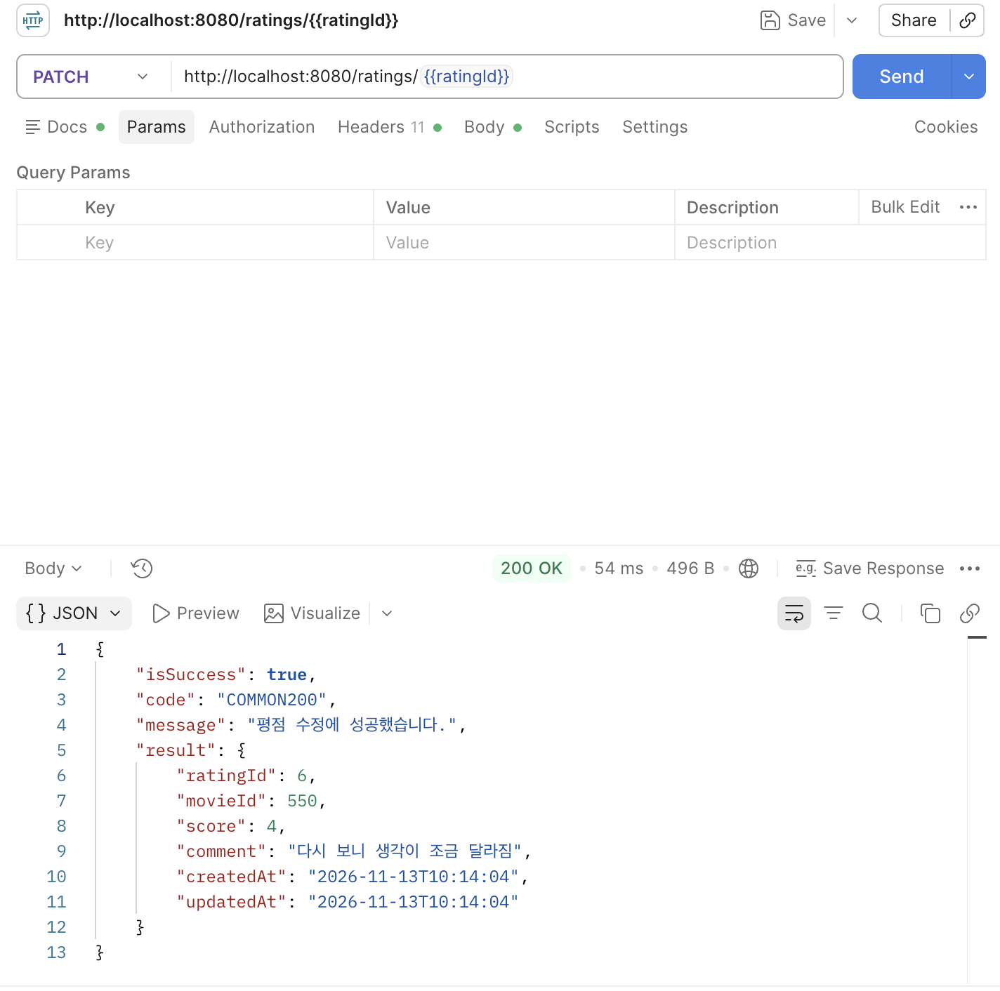
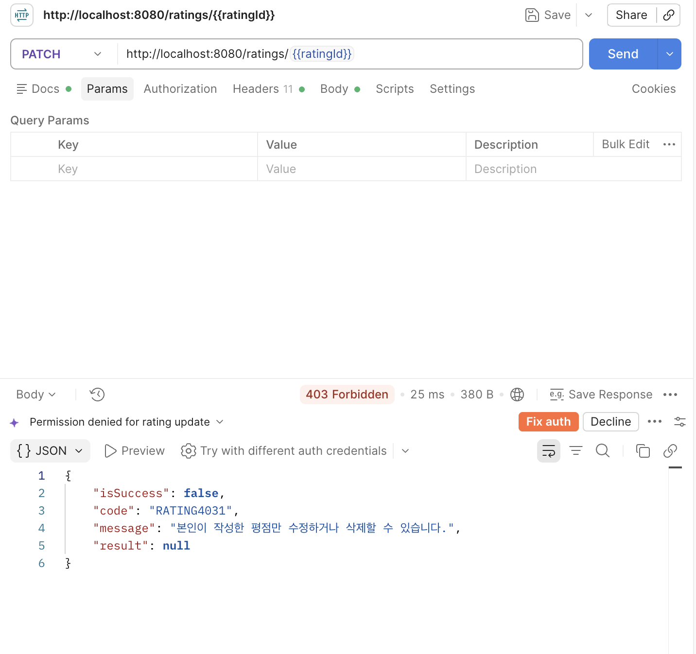
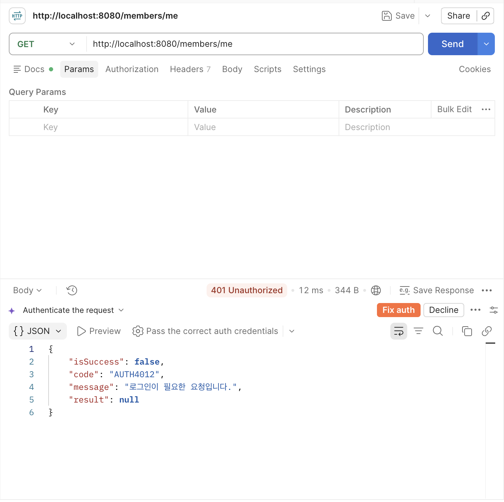
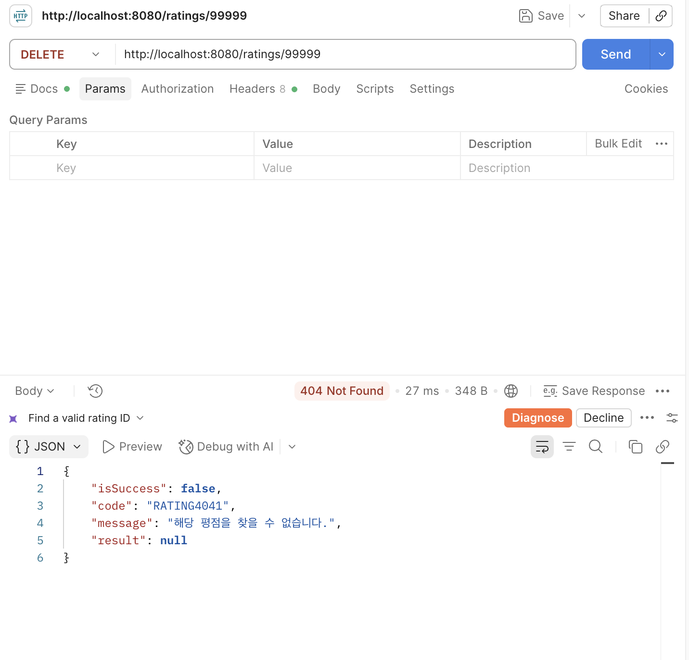

- **미션 기록**

  **구현 정리**

  **로그인 → JWT 발급**

  이메일로 회원 조회 후 `matches()`로 비밀번호 검증. 검증 통과 시 회원 ID와 이메일을 담은 토큰 발급.

    ```java
    if (!passwordEncoder.matches(request.password(), member.getPassword())) {
        throw new ProjectException(AuthErrorCode.INVALID_LOGIN_INFORMATION);
    }
    
    String accessToken = jwtUtil.createAccessToken(member.getMemberId(), member.getEmail());
    return new LoginResponse(member.getNickname(), accessToken);
    ```

  **토큰으로 요청자 확인**

  `AuthInterceptor`에서 Bearer 헤더 확인 후 JWT 검증. 검증한 회원 ID를 요청에 저장하고, 컨트롤러에서는 `@RequestAttribute`로 전달받는 구조 → 평점 등록·수정·삭제 시 클라이언트가 memberId를 지정할 필요 X.

    ```java
    if (header == null || !header.startsWith(BEARER_PREFIX)) {
        throw new ProjectException(AuthErrorCode.REQUEST_NEED_LOGIN);
    }
    
    Long memberId = jwtUtil.getMemberId(header.substring(BEARER_PREFIX.length()));
    request.setAttribute(MEMBER_ID, memberId);
    ```

  **본인 평점만 수정·삭제**

  평점 조회와 소유권 검증을 `findOwnedRating()`으로 묶어 수정·삭제에서 재사용. 없는 평점은 404, 다른 회원의 평점은 403으로 구분.

    ```java
    Rating rating = ratingRepository.findById(ratingId)
            .orElseThrow(() -> new ProjectException(RatingErrorCode.RATING_NOT_FOUND));
    
    if (!rating.getMember().getMemberId().equals(memberId)) {
        throw new ProjectException(RatingErrorCode.NOT_RATING_OWNER);
    }
    ```

  Postman으로 A·B 로그인, 평점 등록·중복 등록·수정·삭제 확인. 토큰 없는 요청은 `401 / AUTH4012`, 다른 회원의 수정 요청은 `403 / RATING4031`로 응답 구분 확인.

  

  회원 A 로그인 성공 → 200, accessToken 발급 확인.

  

  회원 B 로그인 성공 → 200, A와 다른 회원의 accessToken 발급 확인.

  

  회원 A 평점 등록 → 201, 생성된 ratingId와 평점 정보 반환.

  

  같은 영화에 평점 중복 등록 → 409, RATING4091 응답.

  

  회원 A가 본인 평점 수정 → 200, 별점 4점과 수정한 감상평 반환.

  

  회원 B가 A의 평점 수정 시도 → 403, RATING4031 응답.

  

  토큰 없이 GET /members/me 요청 → 401, AUTH4012 응답.

  

  존재하지 않는 평점 삭제 → 404, RATING4041 응답.

  

  회원 A가 본인 평점 삭제 → 200, result는 null로 반환.