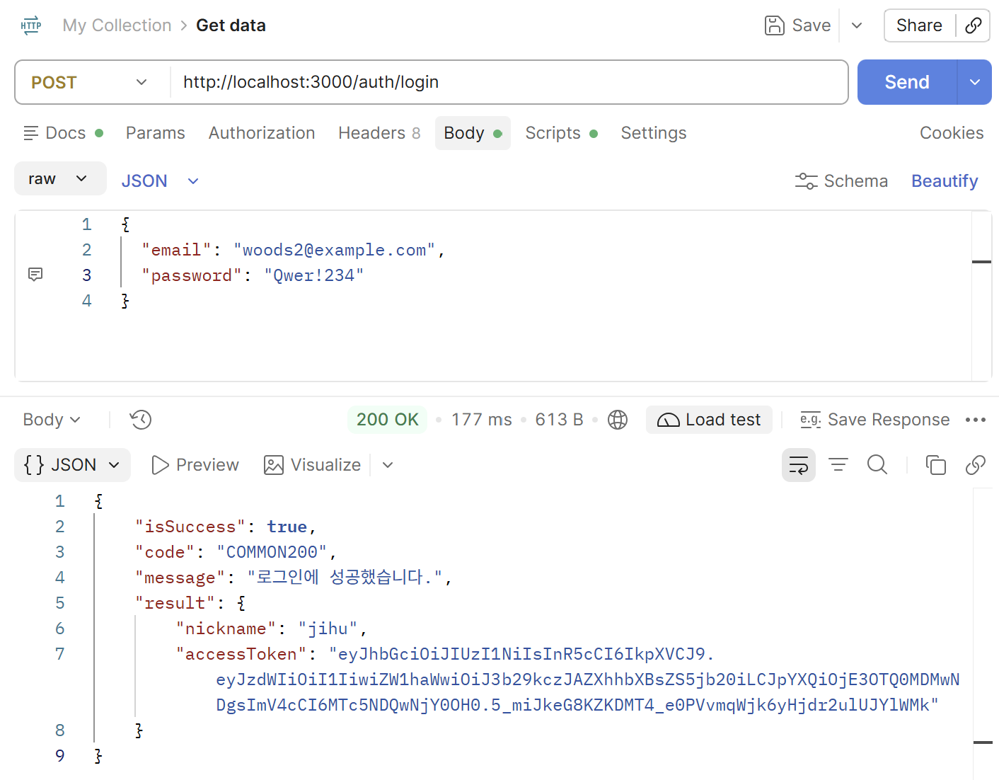
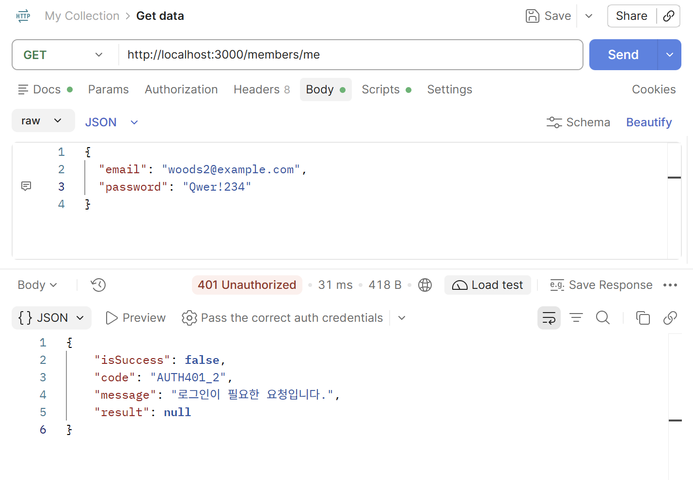
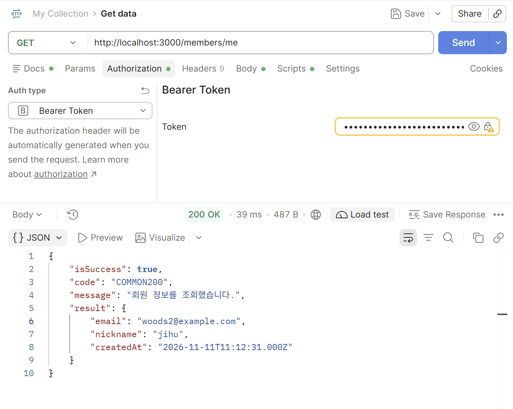
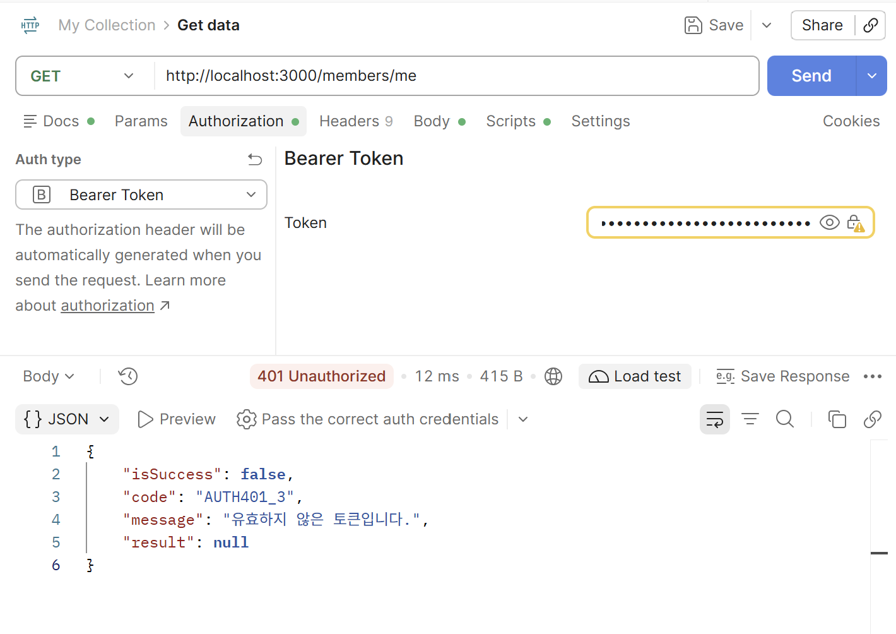
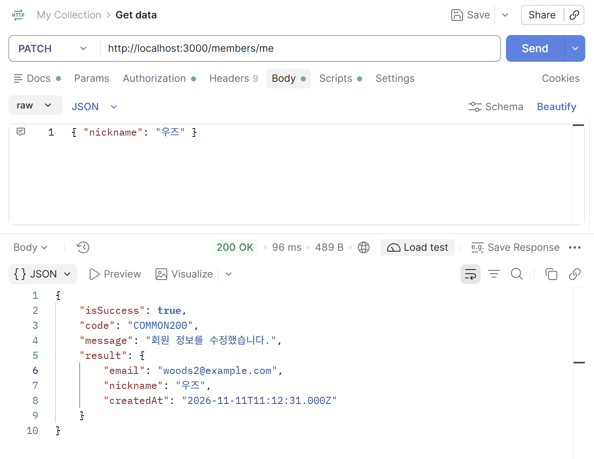
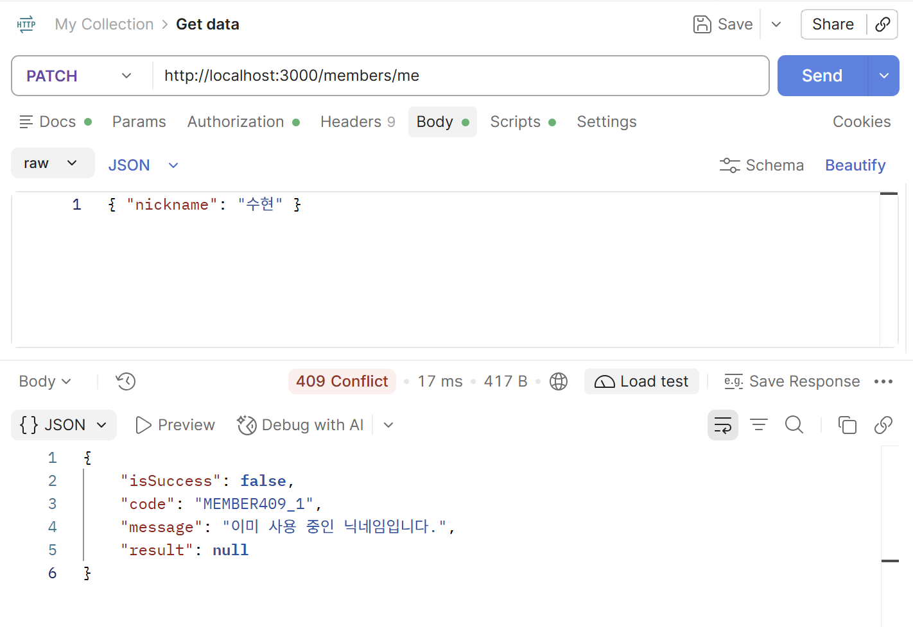
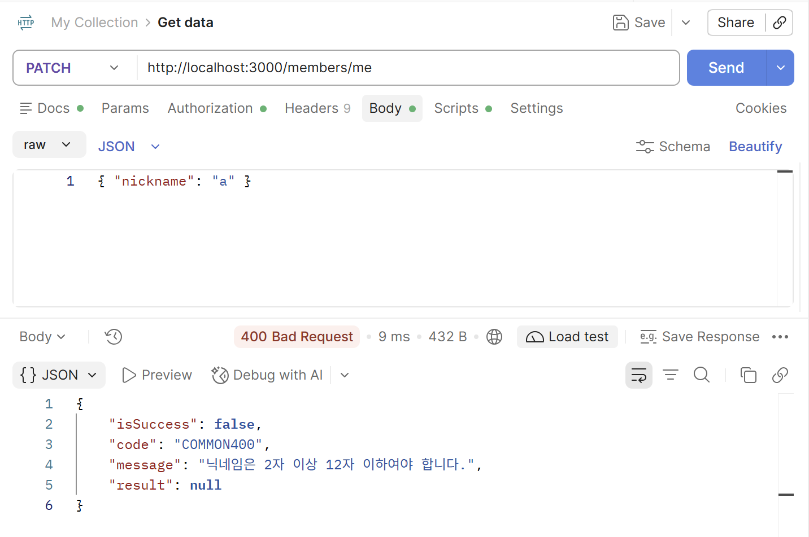

# 7주차 실습 — JWT 인증과 인가

> [!NOTE]
> UMC 11th 워크북 7주차 백엔드 실습 (NestJS)
> 로그인으로 토큰을 발급하고, 모든 요청에서 토큰을 검증해 요청자가 누구인지 서버가 직접 판단하도록 바꿈

## 1. 로그인 API (`POST /auth/login`)

이메일로 회원을 찾고, 입력한 비밀번호를 저장된 bcrypt 해시와 비교한 뒤, 통과하면 토큰을 발급한다.

```ts
const isPasswordMatched = await bcrypt.compare(dto.password, member.password);
```

해시는 되돌릴 수 없으므로 같은 방식으로 다시 해시해서 비교한다. salt가 해시 문자열 안에 함께 들어 있어서 `compare()` 하나로 처리된다.



`result.accessToken`이 점 두 개로 나뉜 JWT다. jwt.io에 넣어보면 `sub`, `email`, `exp`가 그대로 읽힌다. payload는 암호화가 아니라 인코딩이라 누구나 볼 수 있어서, 비밀번호 같은 값은 넣지 않았다.

이메일이 없을 때와 비밀번호가 틀렸을 때 같은 응답(`AUTH401_1`)을 준다. 둘을 구분해주면 공격자가 이메일을 하나씩 넣어보며 가입 여부를 알아낼 수 있기 때문이다.

## 2. 토큰 검사 관문 (Guard)

컨트롤러마다 검사 코드를 넣으면 하나만 빠뜨려도 그 API가 열린다. 그래서 컨트롤러 앞 길목에 Guard를 세우고 `@UseGuards(AuthGuard)`로 붙였다.

Guard가 하는 일은 세 가지다. 헤더에서 토큰을 꺼내고, 검증해서 `memberId`를 알아내고, 요청 객체에 담아둔다. 컨트롤러는 토큰을 모른 채 `request.memberId`만 쓰면 된다.

### 토큰이 없을 때 → 401 `AUTH401_2`



### 토큰이 있을 때 → 200



URL 어디에도 누구의 정보인지 적혀 있지 않다. 토큰이 알려준다. 응답에 `password`가 없는 것은 엔티티를 그대로 내보내지 않고 DTO로 옮겨 담았기 때문이다.

### 토큰을 위조했을 때 → 401 `AUTH401_3`



payload의 글자 하나만 바꿔도 서명이 맞지 않게 된다. 서버가 받은 header/payload를 비밀키로 다시 서명해 대조하기 때문에, 비밀키를 모르면 유효한 서명을 만들 수 없다.

같은 401이지만 `AUTH401_2`(없음)와 `AUTH401_3`(위조)로 코드가 갈린다. 프론트에서 대응이 달라서 구분이 필요하다.

## 3. 내 정보 수정 (`PATCH /members/me`)

```ts
// 나를 제외한 다른 회원이 그 닉네임을 쓰고 있는지 확인
const duplicated = await this.memberRepository.findOne({
  where: { nickname: dto.nickname, memberId: Not(memberId) },
});
```

`Not(memberId)`가 없으면 자기 자신이 중복으로 걸려서, 닉네임을 그대로 두고 저장할 때마다 409가 난다.

### 수정 성공 → 200



### 남이 쓰는 닉네임 → 409 `MEMBER409_1`



### 길이 검증 실패 → 400 `COMMON400`



검증 실패는 `ValidationPipe`가 잡아내므로 `ApiException`을 거치지 않는다. 그래서 6주차와 같은 `COMMON400`이 나온다.

## 4. 평점 CRUD를 토큰 기반으로

URL에서 `/members/{memberId}`를 걷어냈다.

| 구분 | 6주차 | 7주차 |
| --- | --- | --- |
| 등록 | `POST /members/{memberId}/ratings` | `POST /ratings` |
| 수정 | `PATCH /members/{memberId}/ratings/{ratingId}` | `PATCH /ratings/{ratingId}` |
| 삭제 | `DELETE /members/{memberId}/ratings/{ratingId}` | `DELETE /ratings/{ratingId}` |
