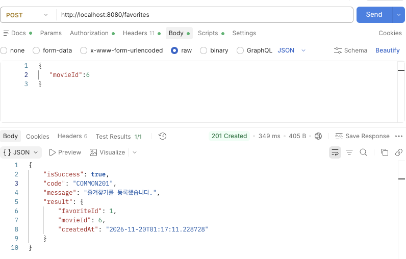
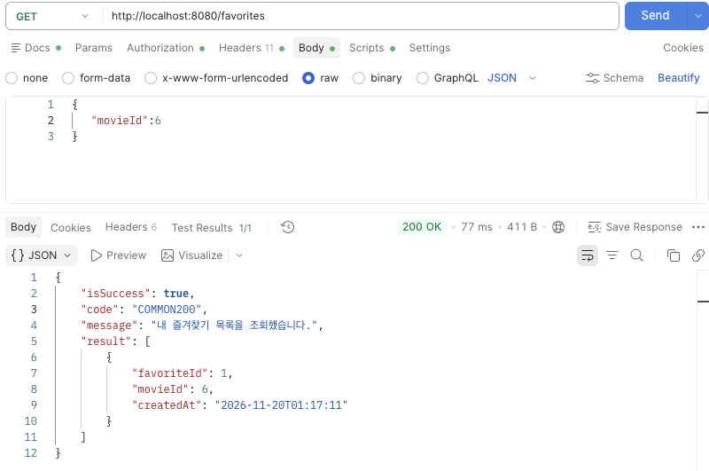
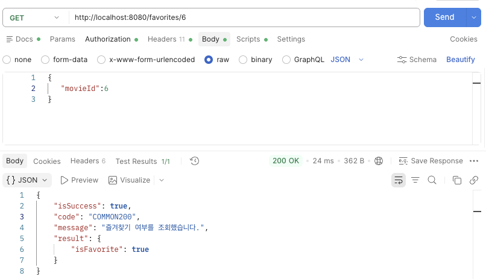
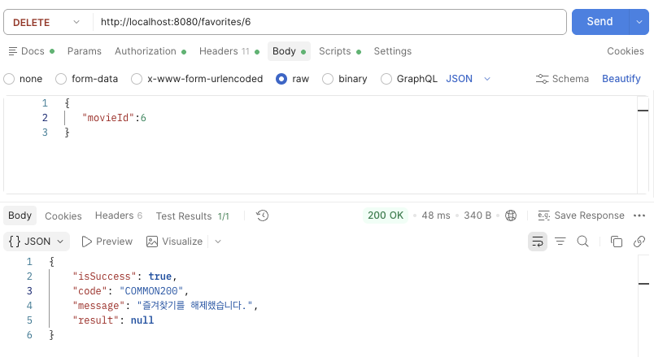
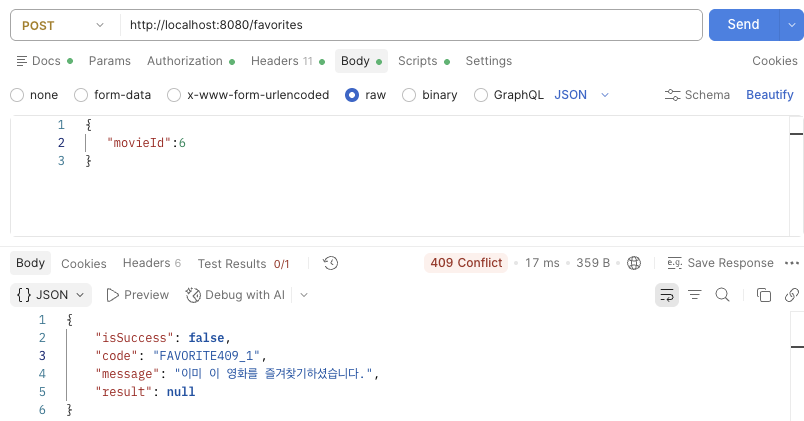
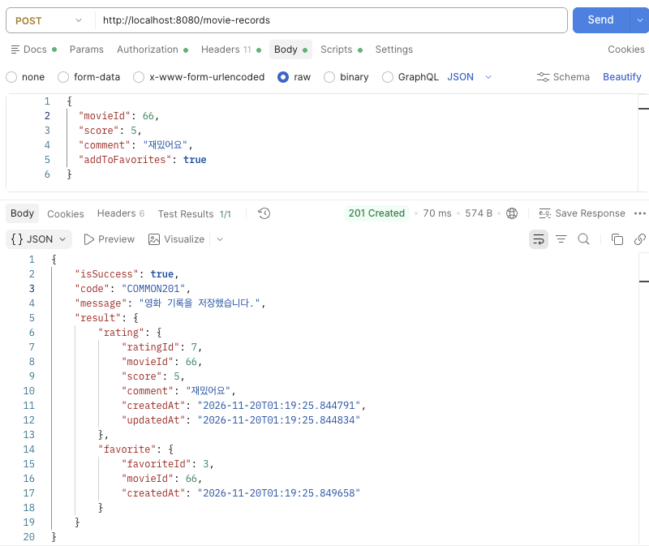

# Backend Chapter08

## Postman 검증

**즐겨찾기 등록 (POST /favorites) 201**

- 토큰만 보내고 바디에는 movieId만 포함

**즐겨찾기 목록 조회 (GET /favorites) 200**

**즐겨찾기 여부 조회 (GET /favorites/{movieId}) 200**

**즐겨찾기 해제 (DELETE /favorites/{movieId}) 200**

**중복 등록 시 FAVORITE409_1 409**

**영화 기록 저장 201**

- 응답의 result에 rating과 favorite이 모두 포함됨

