- **미션 기록**

  Postman에서 검증용 회원으로 로그인 후 확인. 회원 ID는 URL·바디·쿼리로 전달하지 않고 Bearer 토큰으로 식별.

  **즐겨찾기 API**

  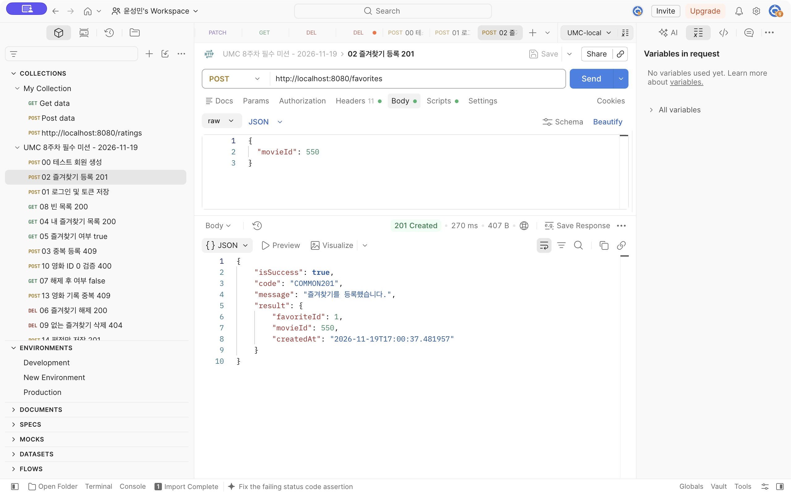

  `POST /favorites` → 201. 영화 550 즐겨찾기 등록.

  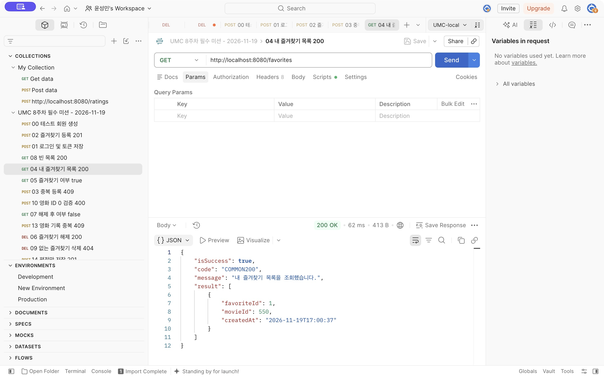

  `GET /favorites` → 200. 등록한 영화 550이 목록에 포함된 것 확인.

  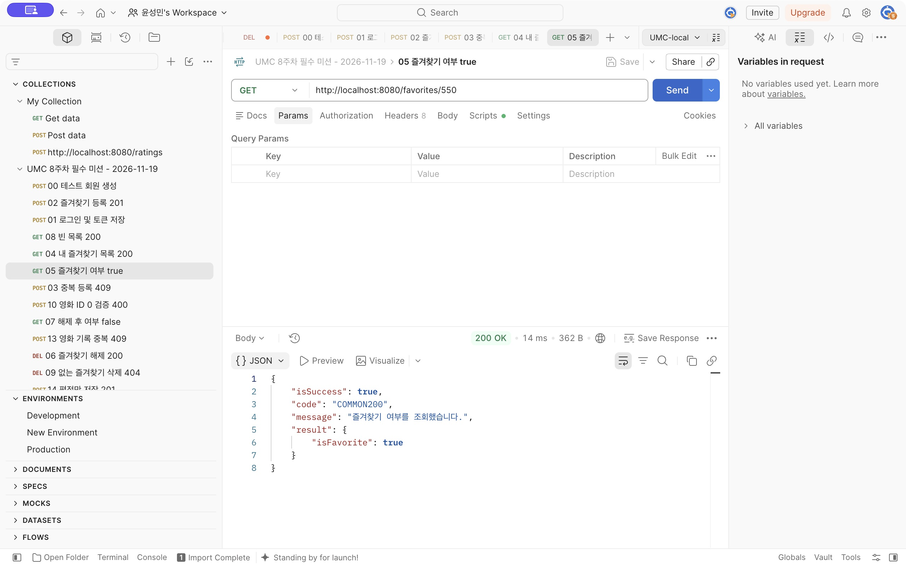

  `GET /favorites/550` → 200. 등록 후 `isFavorite: true`.

  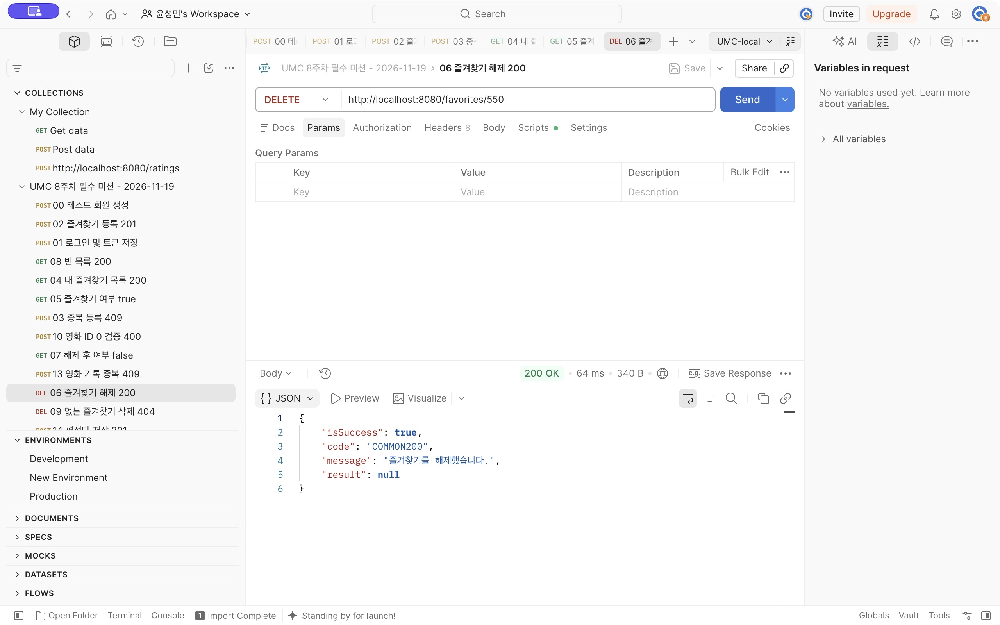

  `DELETE /favorites/550` → 200. 공통 응답 형식 유지, `result: null`.

  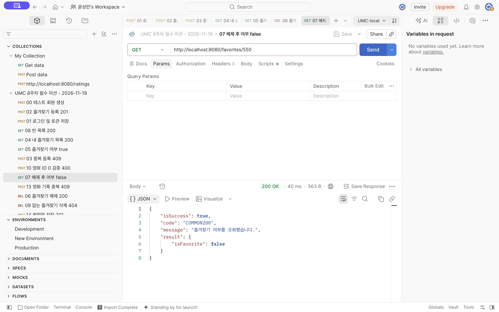

  해제 후 같은 영화 조회 → `isFavorite: false`.

  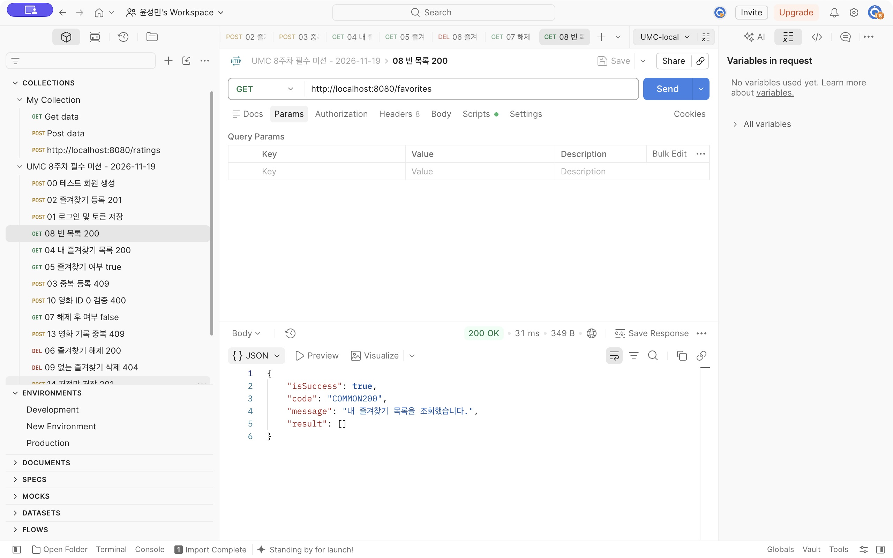

  등록된 즐겨찾기가 없는 상태에서 목록 조회 → 200, 빈 배열 `[]`.

  **오류 응답**

  

  같은 영화 재등록 → 409 `FAVORITE4091`. 중복 즐겨찾기 차단.

  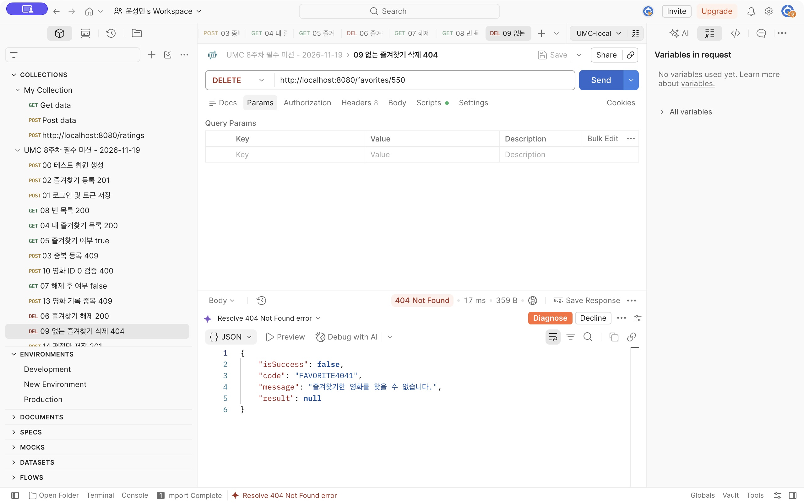

  이미 해제한 즐겨찾기 삭제 → 404 `FAVORITE4041`.

  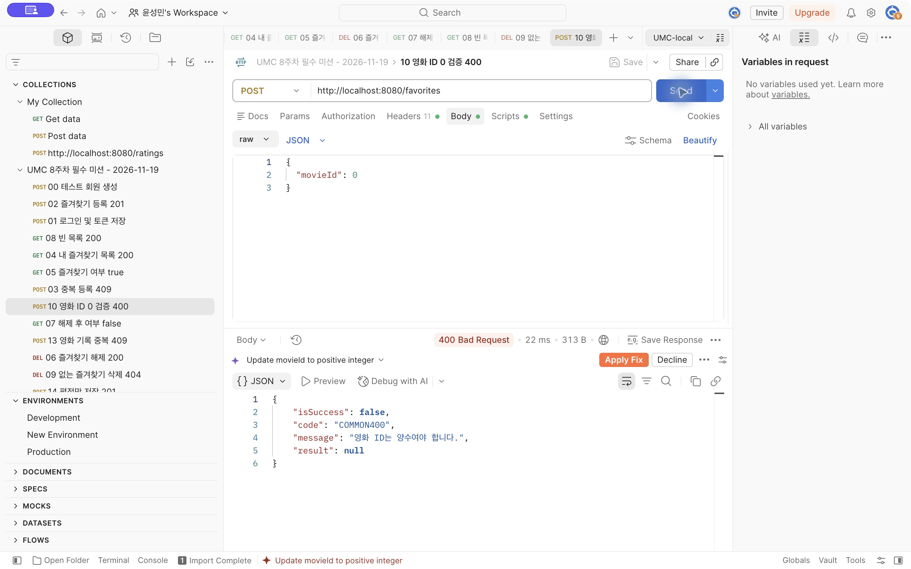

  `movieId: 0`으로 등록 요청 → 400 `COMMON400`. 양수 조건 검증.

  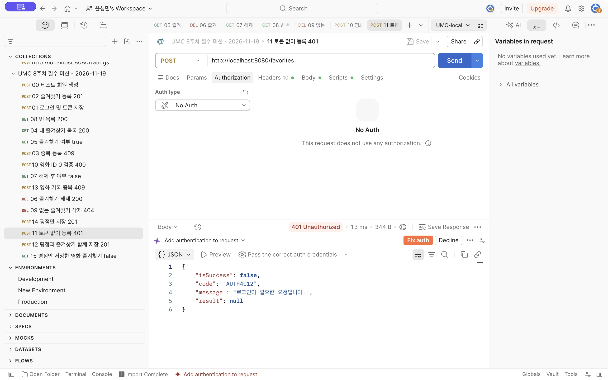

  Authorization을 `No Auth`로 설정해 요청 → 401 `AUTH4012`.

  **영화 기록 저장**

  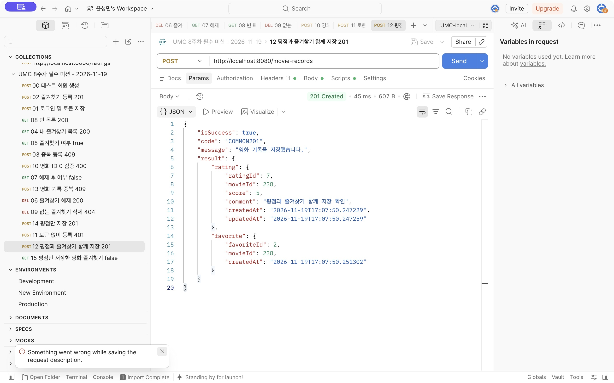

  `addToFavorites: true`로 영화 238 기록 저장 → 201. 응답에 `rating`과 `favorite` 함께 반환.

  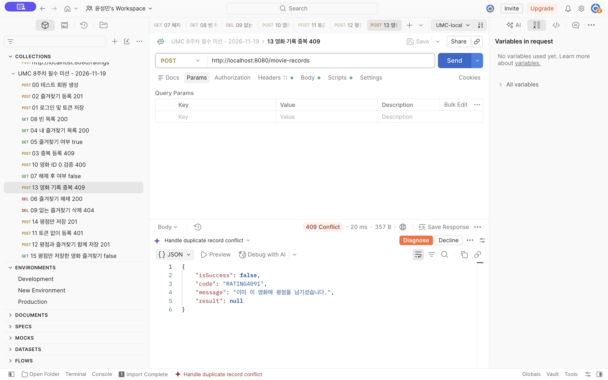

  같은 영화 기록 재요청 → 409 `RATING4091`. 이미 작성한 평점 중복 차단.

  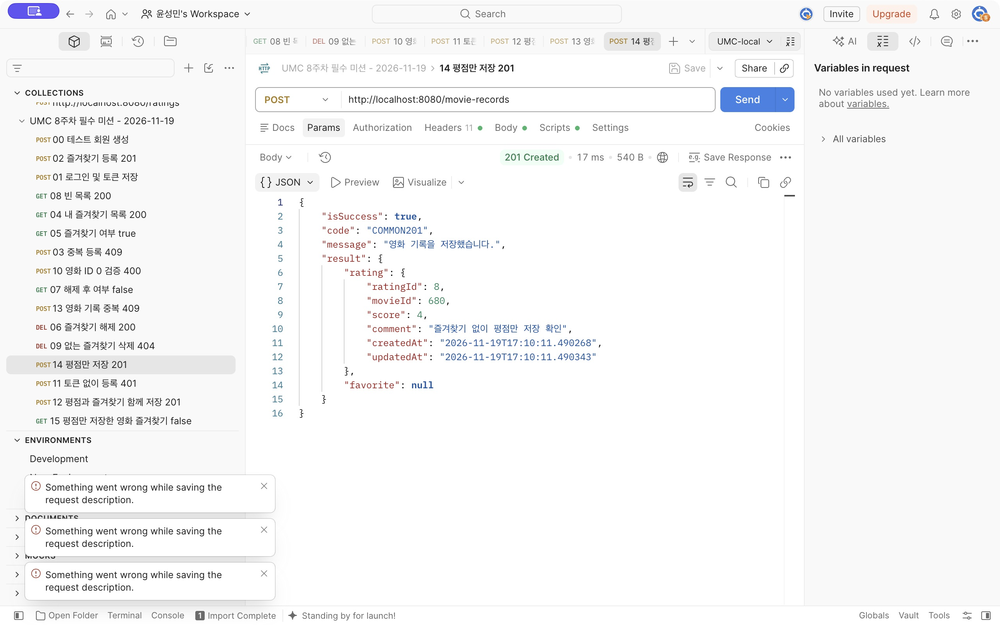

  `addToFavorites: false`로 영화 680 기록 저장 → 201. 평점만 반환, `favorite: null`.

  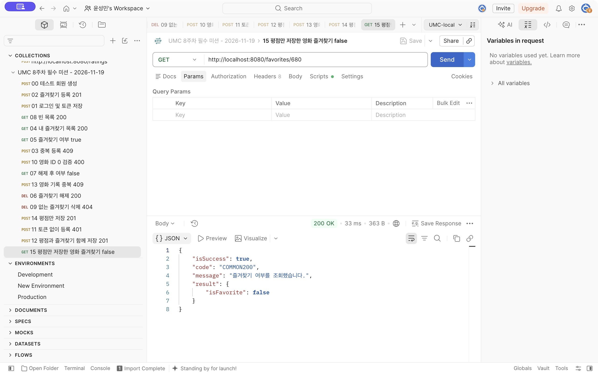

  평점만 저장한 영화 680의 즐겨찾기 여부 조회 → 200, `isFavorite: false`.

  **트랜잭션 적용**

  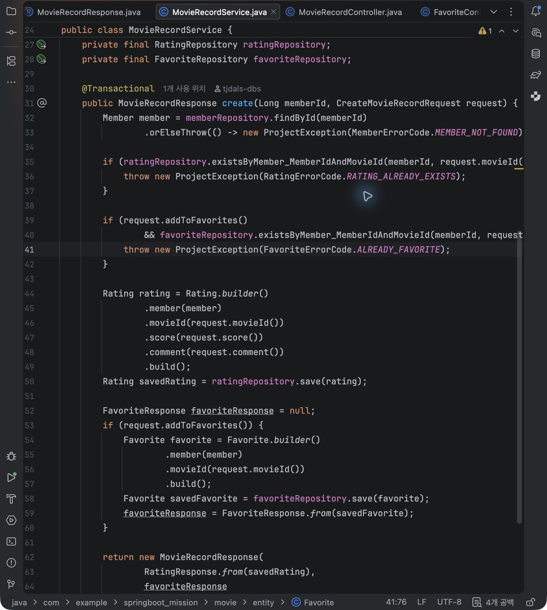

  `MovieRecordService.create()`에 `@Transactional` 적용. 평점·즐겨찾기가 둘 다 저장되거나, 중간에 실패하면 함께 취소되도록 두 저장을 하나의 트랜잭션으로 구성.