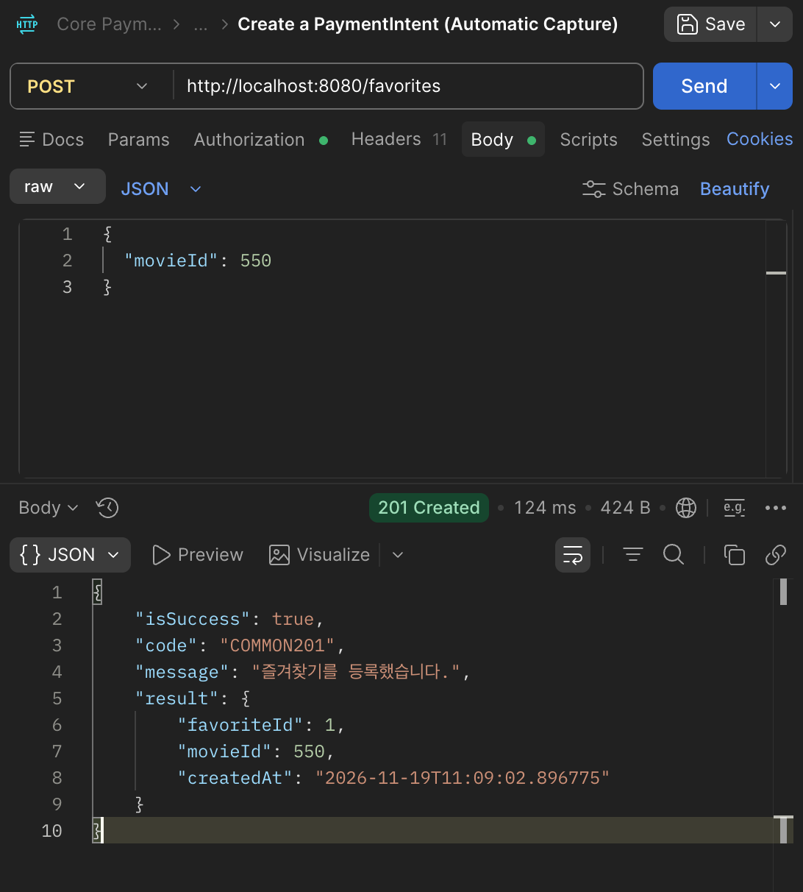
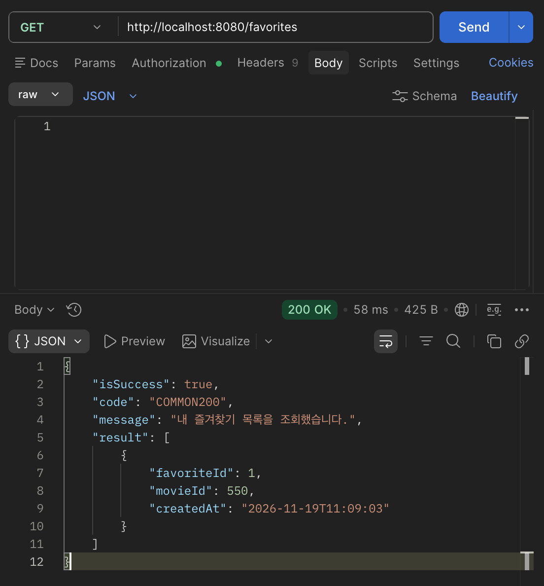
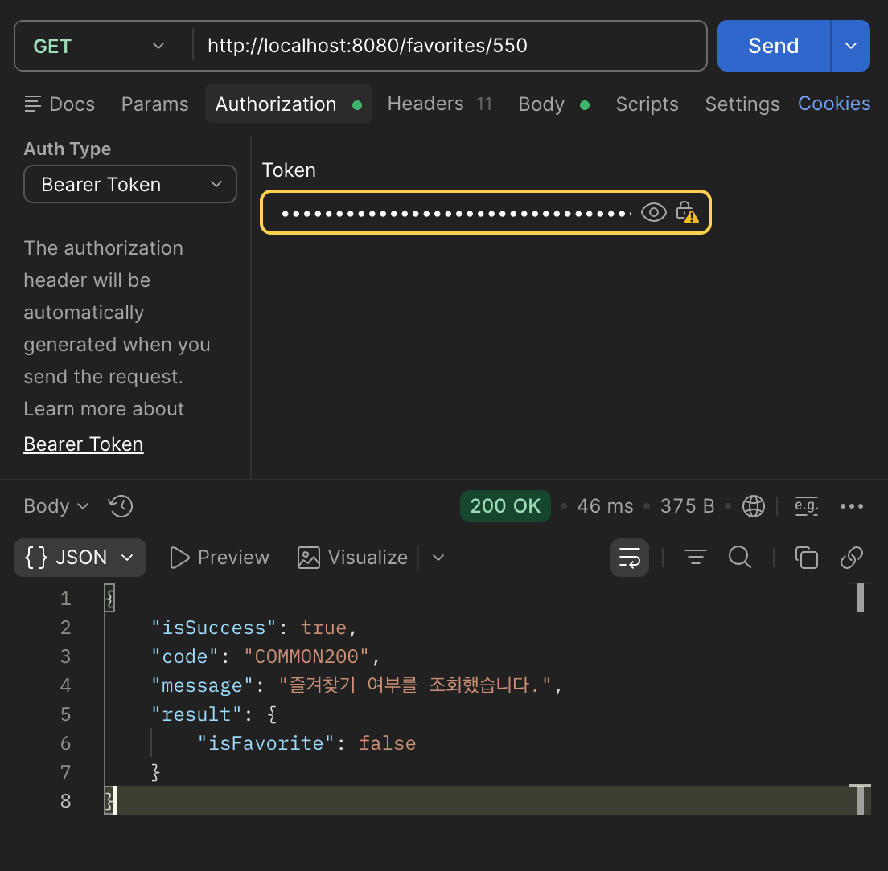
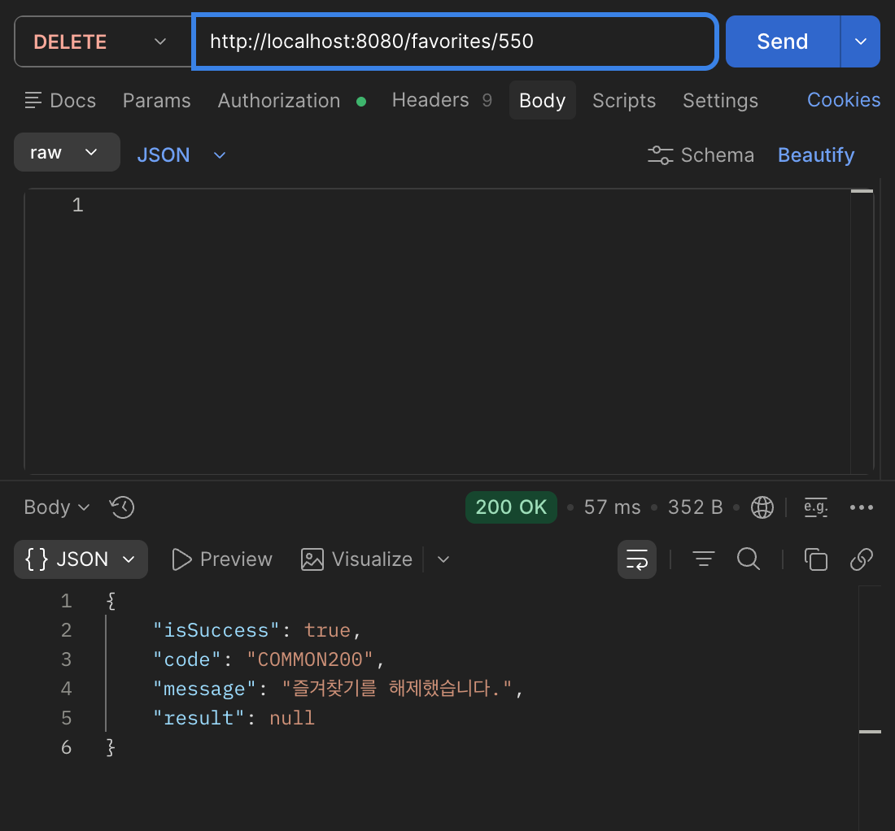
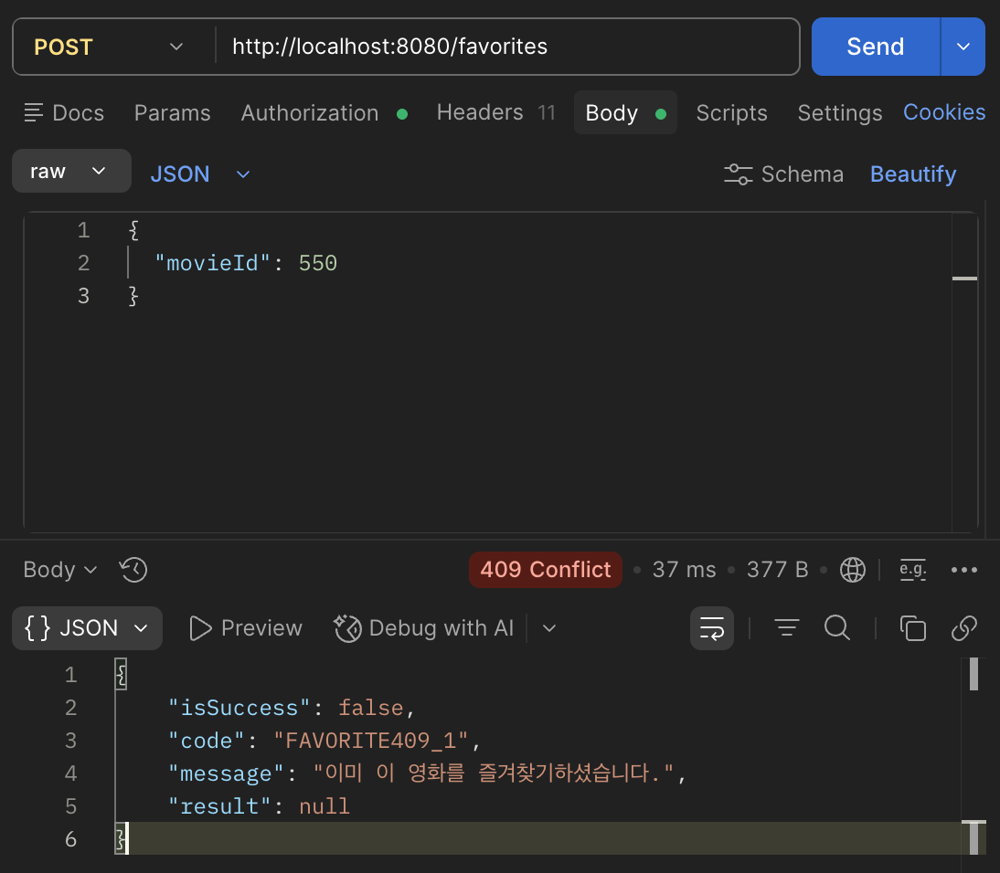
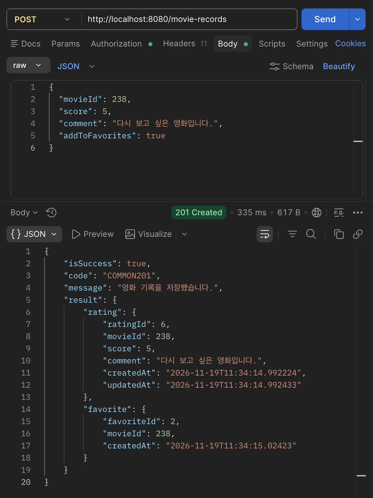

- **미션 기록**
    
    ## 구현한 API
    
    | API | 설명 |
    | --- | --- |
    | `POST /favorites` | 즐겨찾기를 등록한다. |
    | `GET /favorites` | 내 즐겨찾기 목록을 조회한다. |
    | `GET /favorites/{movieId}` | 즐겨찾기 여부를 확인한다. |
    | `DELETE /favorites/{movieId}` | 즐겨찾기를 해제한다. |
    | `POST /movie-records` | 평점과 즐겨찾기를 함께 저장한다. |
    
    ## 1. 즐겨찾기 등록 `POST /favorites`
    
    - 요청 Body는 `{ "movieId": 550 }`이다.
    - 성공하면 201과 `COMMON201`이 반환된다.
    
    > 
    > 
    > 
    > 
    > 
    
    ## 2. 내 즐겨찾기 목록 `GET /favorites`
    
    - 성공하면 200이 반환되고, 최신순(`favoriteId` 내림차순)으로 정렬된다.
    
    > 
    > 
    > 
    > 
    > 
    
    ## 3. 즐겨찾기 여부 `GET /favorites/{movieId}`
    
    - 성공하면 200이 반환되고, `result.isFavorite`로 여부를 알려 준다.
    
    > 
    > 
    > 
    > 
    > 
    
    ## 4. 즐겨찾기 해제 `DELETE /favorites/{movieId}`
    
    - 성공하면 200과 `COMMON200`이 반환된다.
    
    > 
    > 
    > 
    > 
    > 
    
    ## 5. 중복 등록 `FAVORITE409_1`
    
    - 같은 `movieId`로 한 번 더 등록하면 409가 반환된다.
    
    > 
    > 
    > 
    > 
    > 
    
    ## 6. 영화 기록 저장 `POST /movie-records`
    
    - 요청 Body는 `{ "movieId": 550, "score": 5, "comment": "재밌어요", "addToFavorites": true }`이다.
    - 성공하면 201이 반환되고, 응답에 `rating`과 `favorite`이 함께 내려온다.
    
    > 
    > 
    > 
    > 
    > 
    
    ## 확인 포인트
    
    **1. memberId는 토큰에서 식별한다.**
    
    - 요청의 URL, Body, 쿼리 어디에도 `memberId`가 없다.
    - `AuthInterceptor`가 토큰을 검증해 `memberId`를 요청 attribute에 담고, 컨트롤러가 `@RequestAttribute`로 꺼내 쓴다.
    
    **2. 두 저장이 하나의 트랜잭션으로 묶인다.**
    
    - `MovieRecordService.create`에 `@Transactional`을 붙였다.
    - 이게 없으면 `save()`마다 각자 트랜잭션이라 즐겨찾기 저장이 실패해도 평점만 남는다.
    - 붙이면 둘 중 하나가 실패할 때 함께 롤백되어 원자성이 보장된다.
    
    ## +
    
    - 평점과 즐겨찾기를 묶는 로직은 `member`가 아니라 별도의 `reaction` 패키지에 두었다. `member`에 두면 순환 의존이 생기기 때문이다.
    - 예외는 문자열 대신 `ErrorCode` enum으로 통일했다. `FAVORITE_NOT_FOUND`와 `FAVORITE_DUPLICATED`를 추가했다.