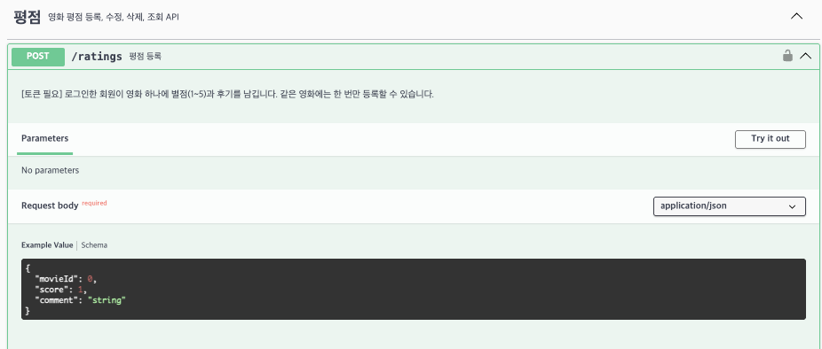
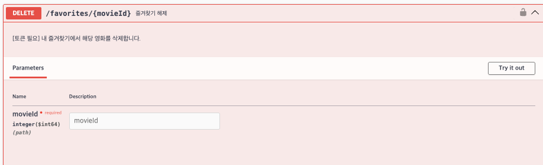
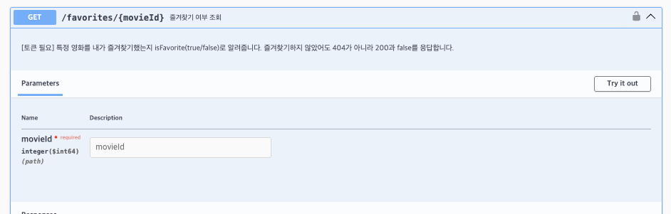
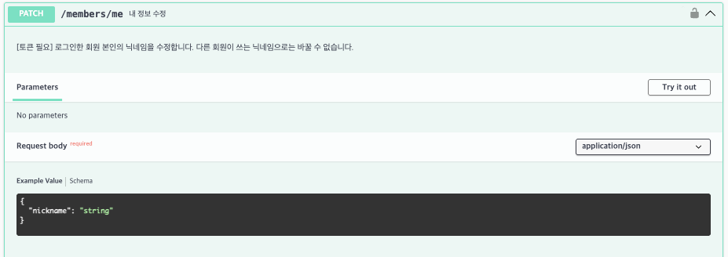
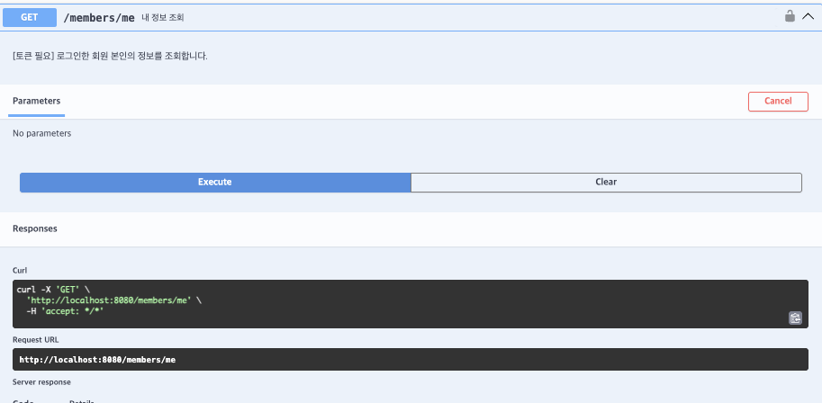
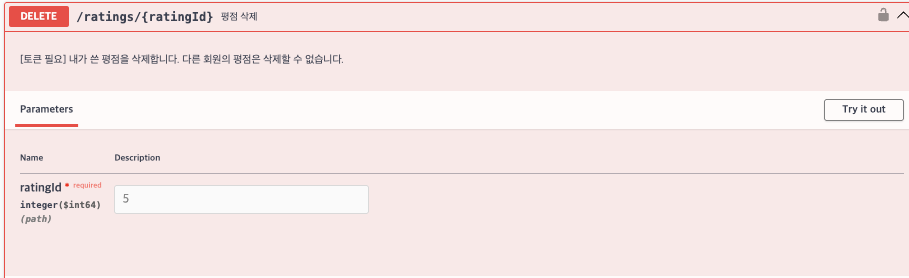
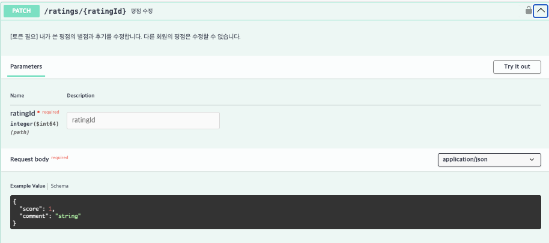
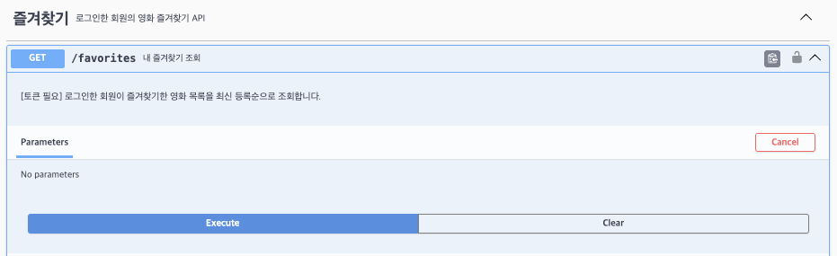
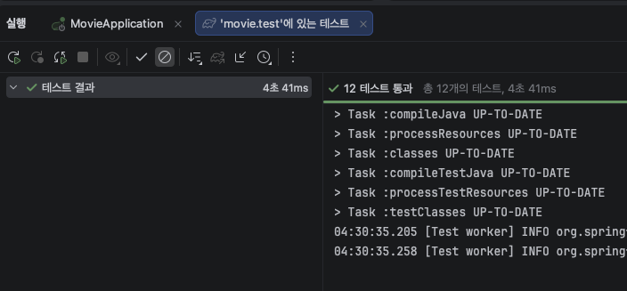

# Backend Chapter09

## 필수 미션

**제출물**: 문서화한 Swagger 화면 캡처, 평점 테스트 코드, 테스트 전체 통과 화면

### 토큰 관련 코드

| 상황 | code |
| --- | --- |
| 토큰 없음 | `AUTH401_2` |
| 유효하지 않은 토큰 | `AUTH401_3` |
| 만료된 토큰 | `AUTH401_4` |

### 요약표

| # | API | 한 줄 설명 | 토큰 | 실패 응답 |
| --- | --- | --- | --- | --- |
| 1 | `POST /ratings` | 영화에 별점과 후기를 등록합니다 | **필요** | 400 `COMMON4001`, 401 `AUTH401_2/3/4`, 409 `RATING409_1` |
| 2 | `PATCH /ratings/{ratingId}` | 내가 쓴 평점의 별점과 후기를 수정합니다 | **필요** | 400 `COMMON4001`, 401 `AUTH401_2/3/4`, 403 `RATING403_1`, 404 `RATING404_1` |
| 3 | `DELETE /ratings/{ratingId}` | 내가 쓴 평점을 삭제합니다 | **필요** | 401 `AUTH401_2/3/4`, 403 `RATING403_1`, 404 `RATING404_1` |
| 4 | `GET /members/{memberId}/ratings` | 특정 회원이 남긴 평점 목록을 최신순으로 조회합니다 | **불필요 (공개)** | 404 `MEMBER404_1` |
| 5 | `GET /members/me` | 내 회원 정보를 조회합니다 | **필요** | 401 `AUTH401_2/3/4`, 404 `MEMBER404_1` |
| 6 | `PATCH /members/me` | 내 닉네임을 수정합니다 | **필요** | 400 `COMMON4001`, 401 `AUTH401_2/3/4`, 404 `MEMBER404_1`, 409 `MEMBER409_1` |
| 7 | `GET /favorites` | 내 즐겨찾기 목록을 최신 등록순으로 조회합니다 | **필요** | 401 `AUTH401_2/3/4` |
| 8 | `GET /favorites/{movieId}` | 특정 영화를 내가 즐겨찾기했는지 조회합니다 | **필요** | 401 `AUTH401_2/3/4` |
| 9 | `DELETE /favorites/{movieId}` | 즐겨찾기를 해제합니다 | **필요** | 401 `AUTH401_2/3/4`, 404 `FAVORITE404_1` |

### Swagger 화면 캡처

1. `POST /ratings` — 평점 등록

    

2. `DELETE /favorites/{movieId}` — 즐겨찾기 해제

    

3. `GET /favorites/{movieId}` — 즐겨찾기 여부 조회

    

4. `PATCH /members/me` — 내 정보 수정

    

5. `GET /members/me` — 내 정보 조회

    

6. `DELETE /ratings/{ratingId}` — 평점 삭제

    

7. `PATCH /ratings/{ratingId}` — 평점 수정

    

8. `GET /favorites` — 내 즐겨찾기 조회

    

### 테스트 코드

**단위 테스트: RatingServiceTest**

**1. 중복 등록 → 409 RATING409_1**

같은 영화에 이미 평점을 남긴 회원이 다시 등록을 시도하면, 저장 전에 중복 여부를 확인해 `ApiException`(409, `RATING409_1`)을 던지고 `save`가 호출되지 않는지 검증합니다.

```java
@Test
@DisplayName("같은 영화에 평점을 중복 등록하면 409와 RATING409_1 예외를 던지고 저장하지 않는다")
void createRatingWhenDuplicated() {
    Member me = memberWithId(1L, "me@umc.com", "나");
    given(memberRepository.findById(1L)).willReturn(Optional.of(me));
    given(ratingRepository.existsByMember_MemberIdAndMovieId(1L, 550L)).willReturn(true);

    assertThatThrownBy(() -> ratingService.create(1L, new CreateRatingRequest(550L, 5, "또 남김")))
            .isInstanceOf(ApiException.class)
            .satisfies(exception -> {
                ApiException apiException = (ApiException) exception;
                assertThat(apiException.getStatus()).isEqualTo(HttpStatus.CONFLICT);
                assertThat(apiException.getCode()).isEqualTo("RATING409_1");
            });

    verify(ratingRepository, never()).save(any(Rating.class));
}
```

**2. 남의 평점 수정 → 403 RATING403_1**

다른 회원이 작성한 평점을 수정하려 하면 `ApiException`(403, `RATING403_1`)을 던지고 `saveAndFlush`가 호출되지 않는지 검증합니다.

```java
@Test
@DisplayName("남의 평점을 수정하려 하면 403과 RATING403_1 예외를 던진다")
void updateRatingOfOtherMember() {
    Member owner = memberWithId(2L, "owner@umc.com", "주인");
    Rating othersRating = Rating.builder().member(owner).movieId(550L).score(4).comment("남의 평점").build();
    given(ratingRepository.findById(10L)).willReturn(Optional.of(othersRating));

    assertThatThrownBy(() -> ratingService.update(1L, 10L, new UpdateRatingRequest(1, "가로채기")))
            .isInstanceOf(ApiException.class)
            .satisfies(exception -> {
                ApiException apiException = (ApiException) exception;
                assertThat(apiException.getStatus()).isEqualTo(HttpStatus.FORBIDDEN);
                assertThat(apiException.getCode()).isEqualTo("RATING403_1");
            });

    verify(ratingRepository, never()).saveAndFlush(any(Rating.class));
}
```

**보조 메서드**

`Member` 엔티티에 ID를 직접 지정할 setter가 없어서, `ReflectionTestUtils`로 private 필드(`memberId`)에 값을 강제로 넣어 테스트용 `Member`를 만듭니다.

```java
private Member memberWithId(Long memberId, String email, String nickname) {
    Member member = Member.builder().email(email).password("암호화된비밀번호").nickname(nickname).build();
    ReflectionTestUtils.setField(member, "memberId", memberId);
    return member;
}
```

**통합 테스트: RatingApiTest**

**준비: 회원 저장 + 토큰 발급**

각 테스트 전에 회원을 하나 저장하고, 그 회원의 ID와 이메일로 JWT 액세스 토큰을 발급해 `Authorization` 헤더 문자열을 미리 만들어 둡니다.

```java
@BeforeEach
void setUp() {
    Member member = memberRepository.save(Member.builder()
            .email("challenger@umc.com").password("$2a$10$abcdefghijklmnopqrstuv").nickname("영화조아").build());
    authorizationHeader = "Bearer " + jwtUtil.createAccessToken(member.getMemberId(), member.getEmail());
}
```

**3. 토큰 없음 → 401 AUTH401_2**

`Authorization` 헤더 없이 평점 등록을 요청하면 401과 코드 `AUTH401_2`가 응답되는지 확인합니다.

```java
@Test
@DisplayName("토큰 없이 평점을 등록하면 401과 AUTH401_2를 응답한다")
void createRatingWithoutToken() throws Exception {
    mockMvc.perform(post("/ratings")
                    .contentType(MediaType.APPLICATION_JSON)
                    .content(objectMapper.writeValueAsString(new CreateRatingRequest(550L, 5, "최고"))))
            .andExpect(status().isUnauthorized())
            .andExpect(jsonPath("$.isSuccess").value(false))
            .andExpect(jsonPath("$.code").value("AUTH401_2"));
}
```

**4. 토큰 있음 → 201**

정상 토큰을 담아 평점 등록을 요청하면 201 Created, 코드 `COMMON201`, 응답 바디의 `movieId`·`score` 값이 요청과 일치하는지 확인합니다.

```java
@Test
@DisplayName("토큰을 담아 평점을 등록하면 201과 저장된 평점을 응답한다")
void createRating() throws Exception {
    mockMvc.perform(post("/ratings")
                    .header(HttpHeaders.AUTHORIZATION, authorizationHeader)
                    .contentType(MediaType.APPLICATION_JSON)
                    .content(objectMapper.writeValueAsString(new CreateRatingRequest(550L, 5, "최고"))))
            .andExpect(status().isCreated())
            .andExpect(jsonPath("$.code").value("COMMON201"))
            .andExpect(jsonPath("$.result.movieId").value(550))
            .andExpect(jsonPath("$.result.score").value(5));
}
```

### 테스트 캡처


