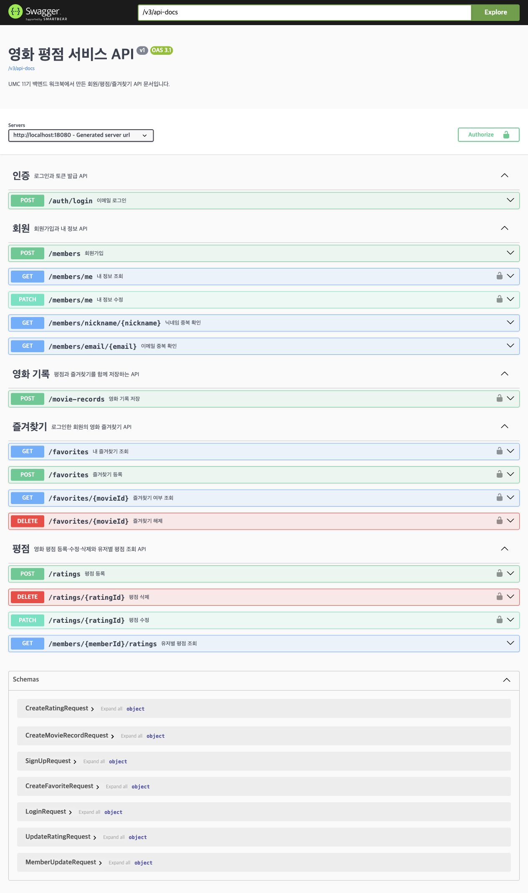
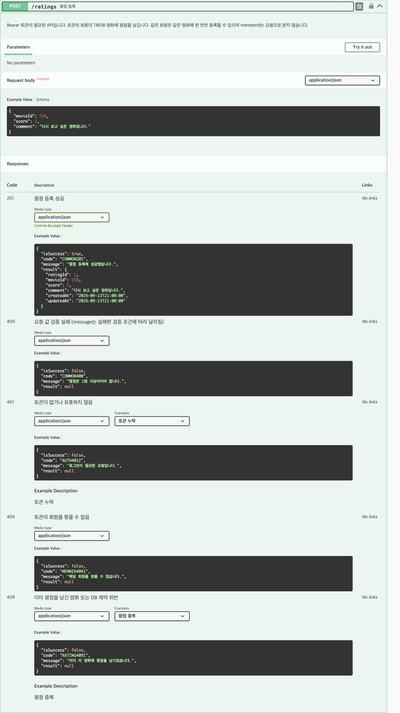
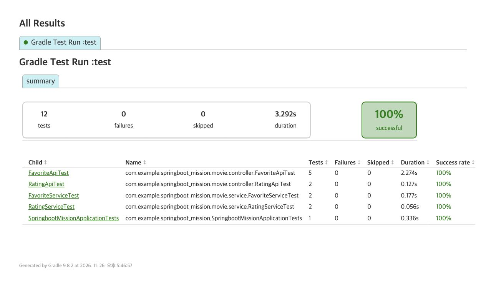

- **미션 기록**

  **Swagger 문서화**

    - 평점·내 정보·즐겨찾기 API의 설명과 토큰 필요 여부 정리.
    - `@Schema`로 요청 예시 추가, `@ApiResponses`로 성공·실패 상태 코드와 실제 오류 code·message 표시.

  

  공개 API와 인증 API를 구분한 Swagger 목록

  

  평점 등록 API

  **평점 테스트**

    - 단위 테스트 2개: 중복 등록 시 `RATING4091`, 남의 평점 수정 시 `RATING4031`. 예외 발생뿐 아니라 저장하지 않는 것까지 확인.

    ```java
    assertThatThrownBy(() -> ratingService.create(1L, new CreateRatingRequest(550L, 5, "좋은 영화")))
            .isInstanceOfSatisfying(ProjectException.class, exception -> {
                assertThat(exception.getErrorCode()).isEqualTo(RatingErrorCode.RATING_ALREADY_EXISTS);
                assertThat(exception.getErrorCode().getCode()).isEqualTo("RATING4091");
                assertThat(exception.getErrorCode().getHttpStatus()).isEqualTo(HttpStatus.CONFLICT);
            });
    
    verify(ratingRepository, never()).save(any(Rating.class));
    ```

    - 통합 테스트 2개: 토큰 없이 등록하면 401, 유효한 토큰이면 201. 응답의 평점 ID로 DB를 조회해 토큰의 회원에게 저장됐는지도 확인.

    ```java
    long ratingId = objectMapper.readTree(result.getResponse().getContentAsString())
            .path("result").path("ratingId").asLong();
    Rating savedRating = ratingRepository.findById(ratingId).orElseThrow();
    assertThat(savedRating.getMember().getMemberId()).isEqualTo(member.getMemberId());
    ```

  

  H2 테스트 DB에서 기존 실습 포함 전체 12개 통과. 실패·건너뛴 테스트 0개.