- **미션 기록**
    
    ## 1. Swagger 화면
    
    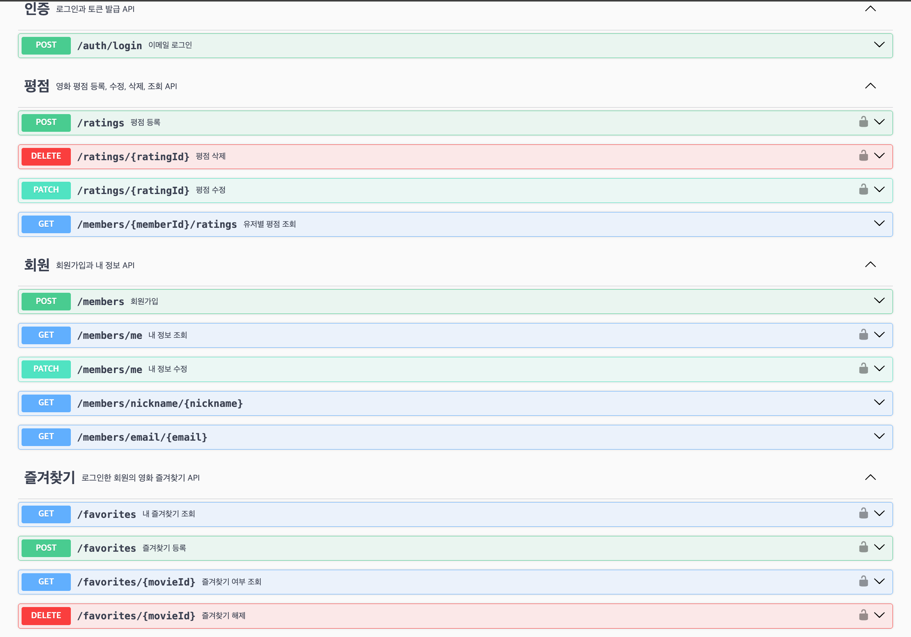
    
    ## 2. API 상세
    
    - 평점 등록/수정/삭제, 유저별 평점 조회
    
    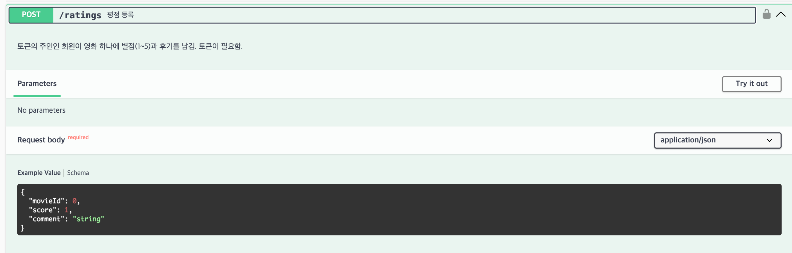
    
    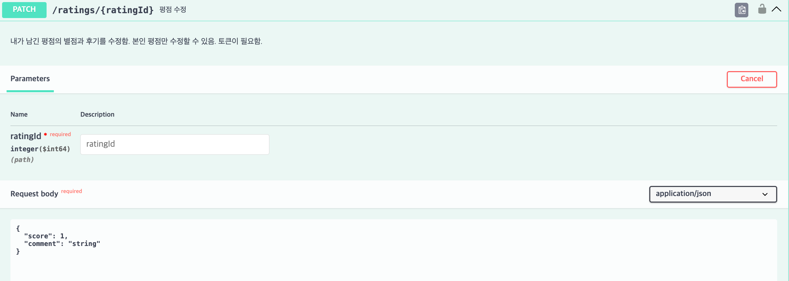

    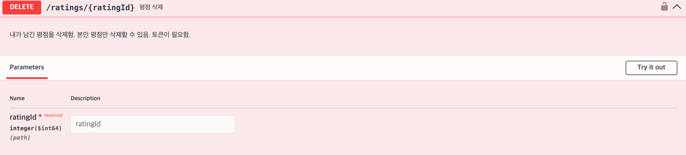
    
    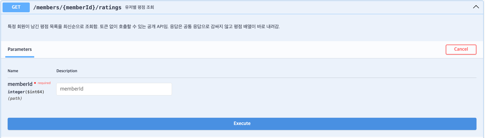
    
    - 내 정보 조회/수정
    
    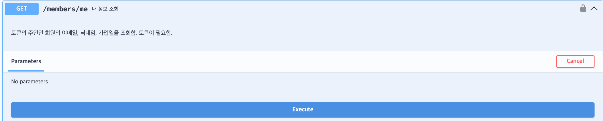
    
    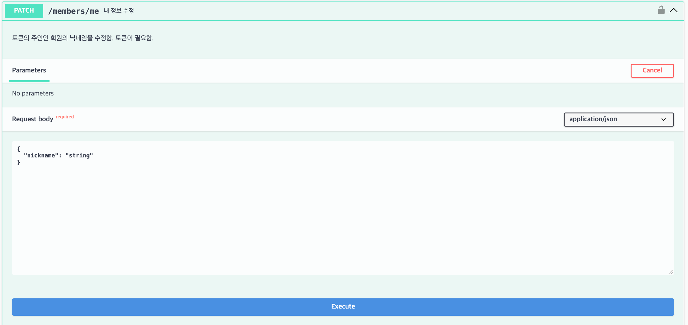
    
    - 내 즐겨찾기 조회, 즐겨찾기 여부 조회, 즐겨찾기 해제
    
    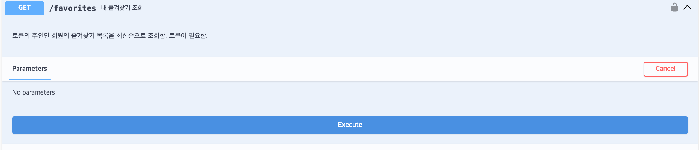
    
    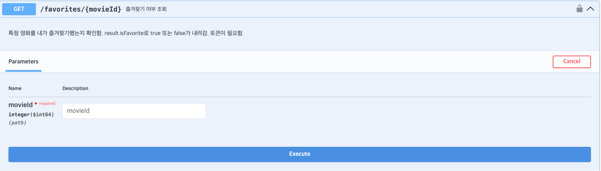
    
    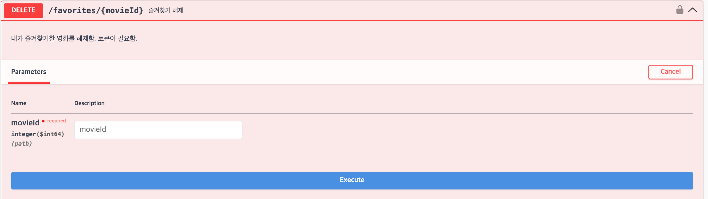
    
    ## 3. 테스트
    
    - 단위 테스트는 Service 클래스의 판단만 검증하고, 통합 테스트는 요청부터 DB 저장까지 API 전체 흐름을 검증한다.
    
    ### 1. 단위 테스트: 평점 등록
    
    ```java
    @ExtendWith(MockitoExtension.class)
    class RatingServiceTest {
    
        @Mock private RatingRepository ratingRepository;
        @Mock private MemberRepository memberRepository;
        @InjectMocks private RatingService ratingService;
    
        @Test
        @DisplayName("같은 영화에 평점을 중복 등록하면 409와 RATING409_1 예외를 던지고 저장하지 않는다")
        void createRatingWhenDuplicated() {
            // given: 회원은 존재하고, 이 영화에 이미 평점을 남긴 상황
            given(memberRepository.findById(1L)).willReturn(Optional.of(member));
            given(ratingRepository.existsByMember_MemberIdAndMovieId(1L, 550L)).willReturn(true);
    
            // when & then: 예외가 나고, 저장은 시도하지 않는다
            assertThatThrownBy(() -> ratingService.create(1L, new CreateRatingRequest(550L, 5, "재밌어요")))
                    .isInstanceOfSatisfying(ApiException.class, e -> {
                        assertThat(e.getStatus()).isEqualTo(HttpStatus.CONFLICT);
                        assertThat(e.getCode()).isEqualTo("RATING409_1");
                    });
    
            verify(ratingRepository, never()).save(any(Rating.class));
        }
    }
    ```
    
    - `@Mock`으로 Repository를 가짜로 만들고, `@InjectMocks`로 그 가짜를 주입받은 진짜 Service를 만든다.
    - `given(...).willReturn(...)`으로 "이미 평점이 있는 상황"을 만든다.
    - 예외의 상태 코드와 `code`를 함께 검증하고, `verify(..., never())`로 저장이 호출되지 않았는지도 확인한다.
    
    ### 2. 단위 테스트: 남의 평점 수정
    
    ```java
    @Test
    @DisplayName("남의 평점을 수정하려 하면 403과 RATING403_1 예외를 던지고 수정하지 않는다")
    void updateRatingOfOtherMember() {
        // given: 1번 회원의 평점을 2번 회원이 수정하려는 상황
        Member owner = memberWithId(1L, "owner@umc.com", "주인");
        Rating rating = Rating.builder().member(owner).movieId(550L).score(5).comment("재밌어요").build();
        given(ratingRepository.findById(10L)).willReturn(Optional.of(rating));
    
        // when & then
        assertThatThrownBy(() -> ratingService.update(10L, 2L, new UpdateRatingRequest(1, "별로예요")))
                .isInstanceOfSatisfying(ApiException.class, e -> {
                    assertThat(e.getStatus()).isEqualTo(HttpStatus.FORBIDDEN);
                    assertThat(e.getCode()).isEqualTo("RATING403_1");
                });
    
        verify(ratingRepository, never()).save(any(Rating.class));
        assertThat(rating.getScore()).isEqualTo(5); // 평점 내용도 그대로여야 한다
    }
    ```
    
    - 엔티티의 id는 DB가 채워 주므로, 단위 테스트에서는 `ReflectionTestUtils.setField`로 `memberId`를 직접 넣었다.
    - 수정이 막혔는지 확인하려고 저장 호출 여부와 평점 값이 그대로인지를 함께 검증한다.
    
    ### 3. 통합 테스트: 평점 등록 API
    
    ```java
    @SpringBootTest        // 진짜 서버를 띄우듯 모든 Bean을 올린다
    @AutoConfigureMockMvc  // HTTP 요청을 흉내 내는 MockMvc를 준비한다
    @Transactional         // 테스트가 끝나면 저장한 데이터를 되돌린다
    class RatingApiTest {
    
        @BeforeEach
        void setUp() {
            // 회원을 저장하고 로그인 API를 거치지 않고 토큰을 직접 발급한다
            Member member = memberRepository.save(Member.builder()
                    .email("challenger@umc.com").password("...").nickname("영화조아").build());
            authorizationHeader = "Bearer " + jwtUtil.createAccessToken(member.getMemberId(), member.getEmail());
        }
    
        @Test
        @DisplayName("토큰 없이 평점을 등록하면 401과 AUTH401_2를 응답한다")
        void createRatingWithoutToken() throws Exception {
            mockMvc.perform(post("/ratings")
                            .contentType(MediaType.APPLICATION_JSON)
                            .content(objectMapper.writeValueAsString(new CreateRatingRequest(550L, 5, "재밌어요"))))
                    .andExpect(status().isUnauthorized())
                    .andExpect(jsonPath("$.code").value("AUTH401_2"));
        }
    
        @Test
        @DisplayName("토큰을 담아 평점을 등록하면 201과 COMMON201을 응답한다")
        void createRatingWithToken() throws Exception {
            mockMvc.perform(post("/ratings")
                            .header(HttpHeaders.AUTHORIZATION, authorizationHeader)
                            .contentType(MediaType.APPLICATION_JSON)
                            .content(objectMapper.writeValueAsString(new CreateRatingRequest(550L, 5, "재밌어요"))))
                    .andExpect(status().isCreated())
                    .andExpect(jsonPath("$.code").value("COMMON201"))
                    .andExpect(jsonPath("$.result").isNumber());
        }
    }
    ```
    
    - `@SpringBootTest`와 `MockMvc`로 인터셉터, 검증, Service, JPA까지 실제 흐름을 그대로 태운다.
    - 테스트용 `application.yaml`이 H2 메모리 DB와 테스트용 `jwt.secret`을 제공해서 환경변수 없이 실행된다.
    - `@Transactional`을 붙여 테스트마다 데이터가 롤백되므로 서로 영향을 주지 않는다.
    - `JwtUtil`로 토큰을 바로 만들어서 로그인 API 없이도 인증이 필요한 API를 테스트한다.
    
    ## 4. 테스트 결과
    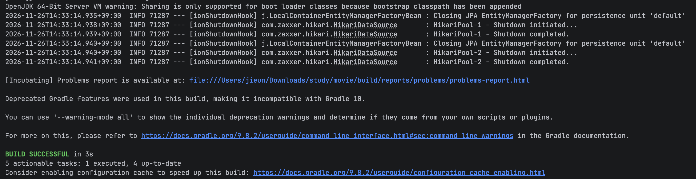