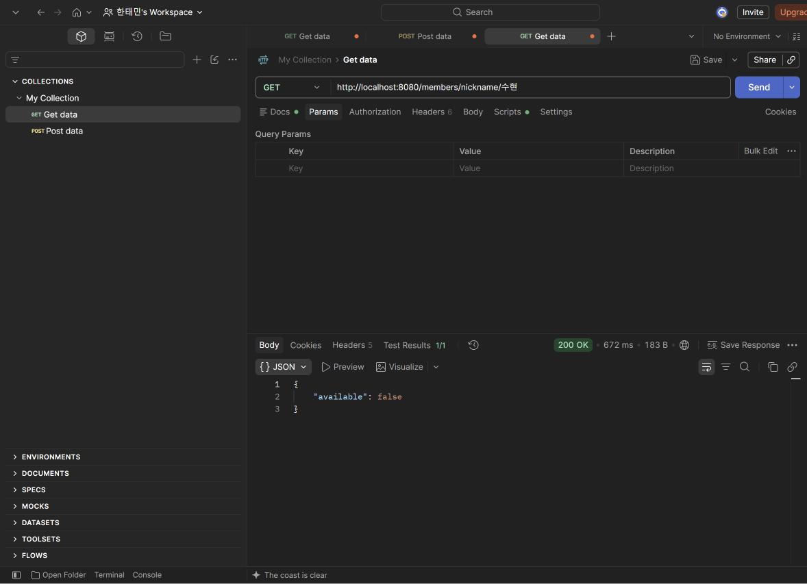
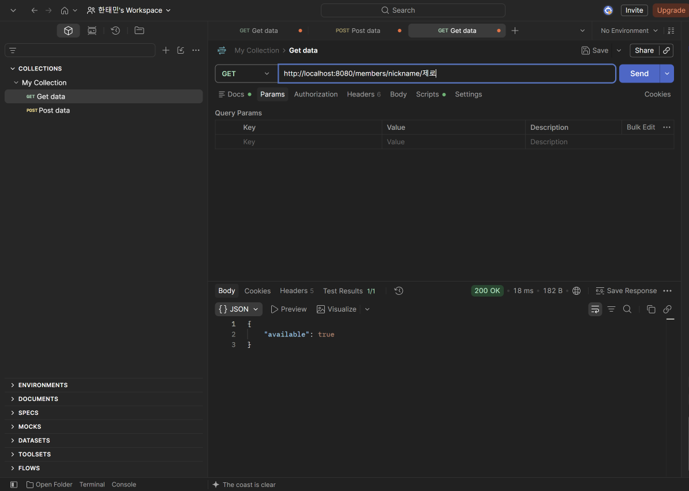
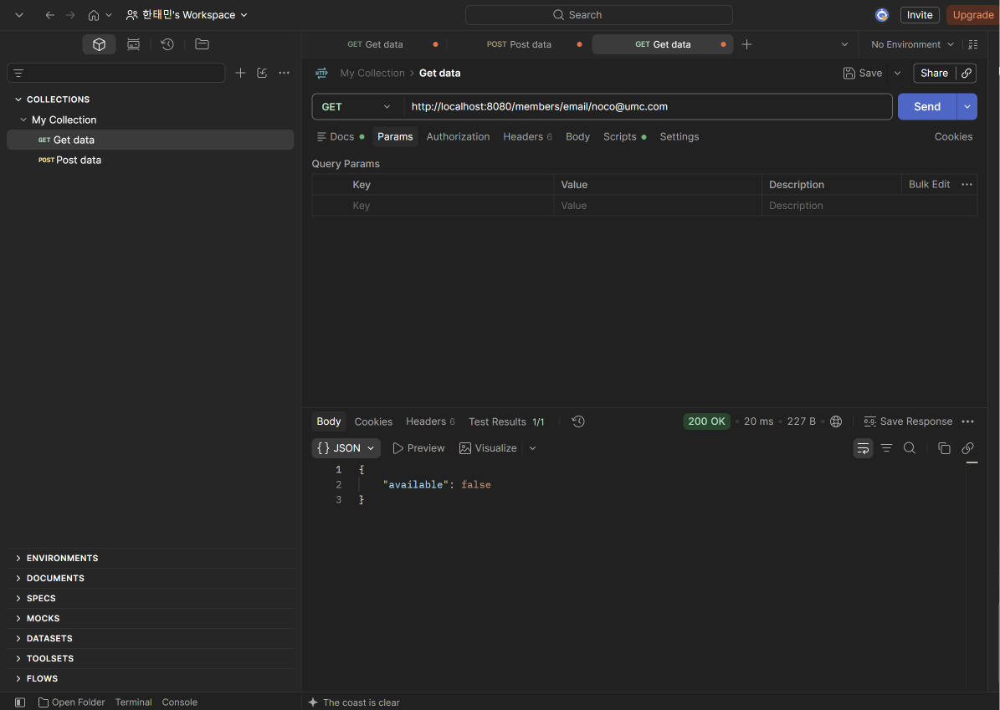
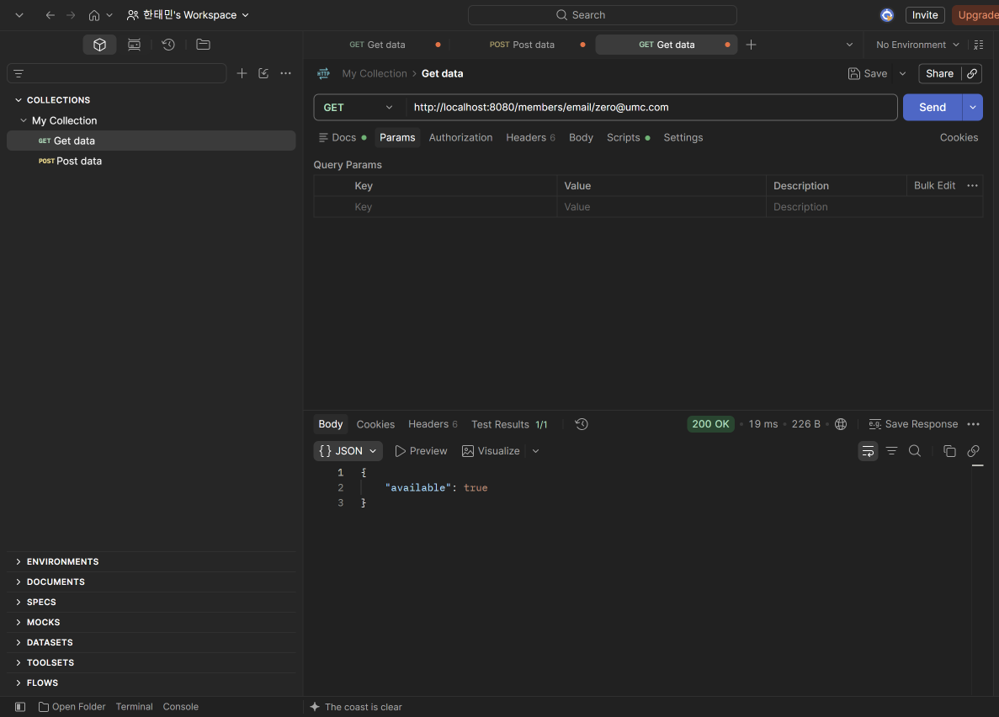
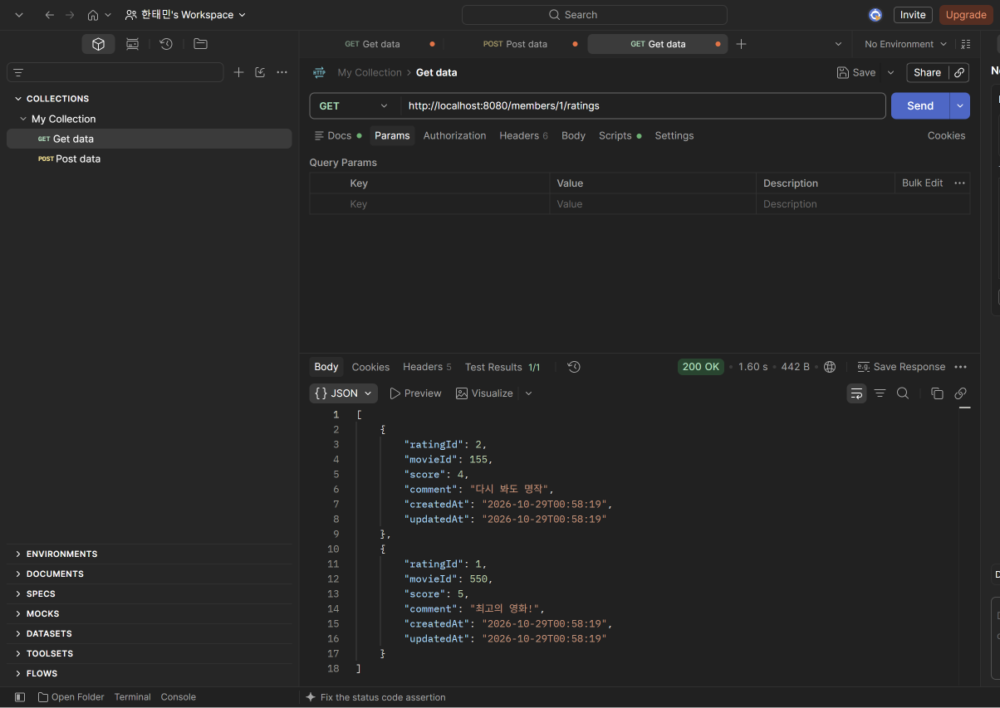
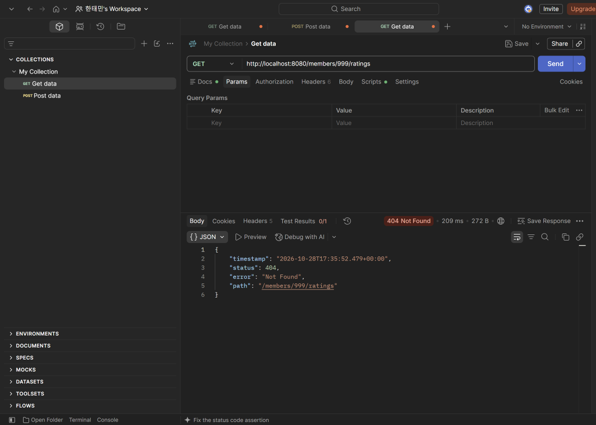
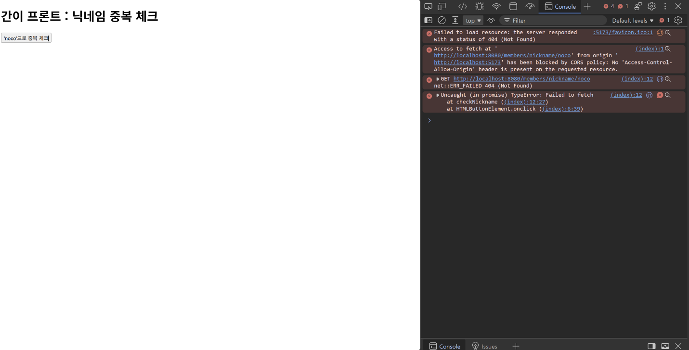
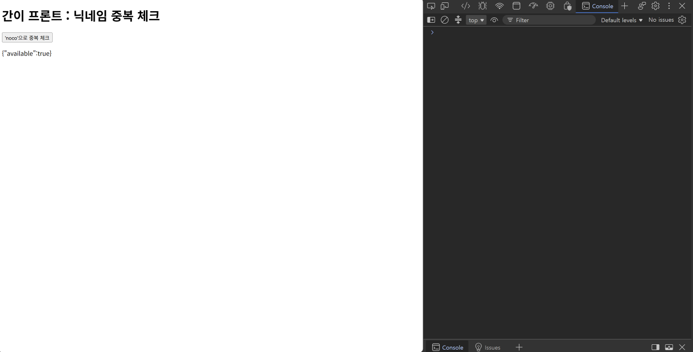
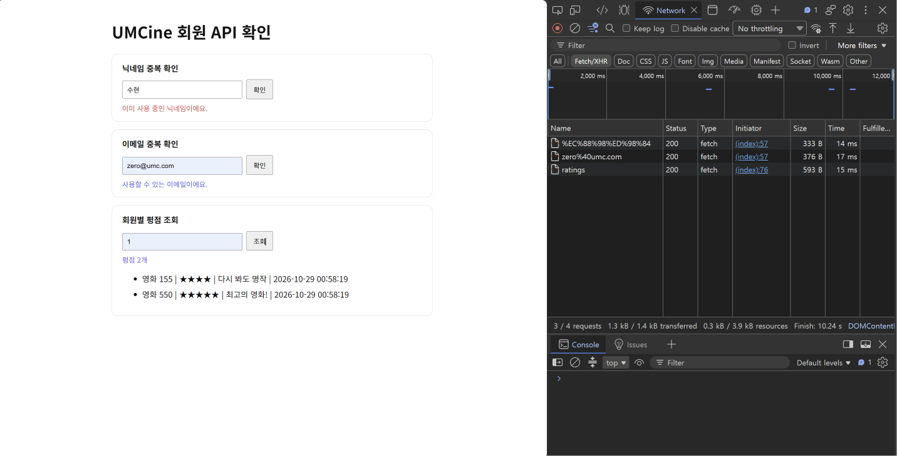
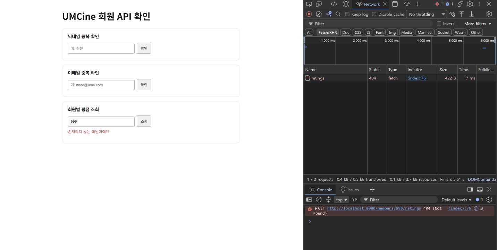

- **미션 기록**

  **Postman: 닉네임 중복 확인**

  닉네임 사용 중

  

  닉네임 사용 가능

  

    - /members/nickname/수현 → {"available": false},
      /members/nickname/제로 → {"available": true}

  **Postman: 이메일 중복 확인**

  이메일 사용 중

  

  이메일 사용 가능

  

    - /members/email/noco@umc.com → false, /members/email/zero@umc.com → true

  **Postman: 회원별 평점 조회**

  평점 목록

  

    - /members/1/ratings → 200, 평점 2개가 최신순(ratingId 2, 1)으로 응답

  없는 회원

  

    - /members/999/ratings → 404 Not Found

  **CORS 설정 전과 후**

  CORS 에러

  

    - 설정 전: 5173 화면에서 8080 서버를 부르면 No 'Access-Control-Allow-Origin' header 에러가 난다.

  CORS 해결

  

    - 설정 후: 같은 화면에서 에러 없이 응답을 받는다.

  **실제 화면에서 API 3개 호출**

  화면에서 API 호출

  

    - 닉네임(수현), 이메일(zero@umc.com), 평점(1번 회원) 결과가 화면에 나오고, Network 탭의 요청 3개가 모두 200이다.

  없는 회원 조회

  

    - 회원 번호 999 → "존재하지 않는 회원이에요." 문구와 404 응답