**API 명세**

| **기능** | **Method** | **경로** | **요청 Body** | **성공** | **실패** |
| --- | --- | --- | --- | --- | --- |
| 회원가입 | POST | /members | email, password, nickname | 201, 회원 정보(password 없음) | 400 형식 오류, 409 이메일/닉네임 중복 |
| 평점 등록 | POST | /members/{memberId}/ratings | movieId, score, comment | 201, ratingId | 400 별점 범위, 404 없는 회원, 409 중복 평점 |
| 평점 수정 | PATCH | /members/{memberId}/ratings/{ratingId} | score, comment | 200 | 400 별점 범위, 403 남의 평점, 404 없는 평점 |
| 평점 삭제 | DELETE | /members/{memberId}/ratings/{ratingId} | 없음 | 204, body 없음 | 403 남의 평점, 404 없는 평점 |
- 성공과 실패 모두 isSuccess, code, message, result 4칸으로 응답한다. (DELETE 성공만 body가 없다.)
- 아직 로그인 기능이 없어서 memberId를 경로로 받아 누구의 요청인지 구분한다.

```json
{
  "isSuccess": false,
  "code": "COMMON4092",
  "message": "이미 사용 중인 이메일입니다.",
  "result": null
}
```

**핵심 코드**

**dto/SignUpRequest.java, MemberResponse.java**

```java
public record SignUpRequest(
        @NotBlank(message ="이메일을 입력해주세요.")
        @Email(message ="올바른 이메일 형식이 아닙니다.")
        String email,

        @NotBlank(message ="비밀번호를 입력해주세요.")
        @Pattern(
                regexp ="^(?=.*[a-z])(?=.*[A-Z])(?=.*\\d)(?=.*[!@#$%^&*]).{8,}$",
                message ="비밀번호는 대문자/소문자/숫자/특수문자를 포함한 8자 이상이어야 합니다."
        )
        String password,

        @NotBlank(message ="닉네임을 입력해주세요.")
        @Size(min =2, max =12, message ="닉네임은 2자 이상 12자 이하로 입력해주세요.")
        String nickname
) {}

public record MemberResponse(Long memberId, String email, String nickname) {}
```

- 입력 규칙을 DTO 필드에 적고, Controller에서 @Valid로 검사를 시작한다.
- 응답 DTO에는 password 칸이 아예 없어서 비밀번호가 응답에 나갈 수 없다.

**service/MemberService.java**

```java
@Transactional
public MemberResponse signUp(SignUpRequest request) {
    if (memberRepository.existsByEmail(request.email())) {
        throw new IllegalArgumentException("이미 사용 중인 이메일입니다.");
    }
    if (memberRepository.existsByNickname(request.nickname())) {
        throw new IllegalArgumentException("이미 사용 중인 닉네임입니다.");
    }

    Member member = Member.builder()
            .email(request.email())
            .password(passwordEncoder.encode(request.password()))
            .nickname(request.nickname())
            .build();

    Member savedMember = memberRepository.save(member);
    return new MemberResponse(savedMember.getMemberId(), savedMember.getEmail(), savedMember.getNickname());
}
```

- 이메일, 닉네임 중복을 먼저 확인하고, 비밀번호는 BCryptPasswordEncoder로 해시해서 저장한다.
- 해시는 항상 60자라서 member.password 컬럼을 VARCHAR(60)으로 두었다.

**service/RatingService.java**

```java
@Transactional
public Long create(Long memberId, CreateRatingRequest request) {
    Member member = memberRepository.findById(memberId)
            .orElseThrow(() -> new ResponseStatusException(HttpStatus.NOT_FOUND, "존재하지 않는 유저입니다."));

    if (ratingRepository.existsByMember_MemberIdAndMovieId(memberId, request.movieId())) {
        throw new IllegalArgumentException("이미 이 영화에 평점을 남기셨습니다.");
    }

    Rating rating = Rating.builder()
            .member(member)
            .movieId(request.movieId())
            .score(request.score())
            .comment(request.comment())
            .build();

    return ratingRepository.save(rating).getRatingId();
}

@Transactional
public void update(Long ratingId, Long memberId, UpdateRatingRequest request) {
    Rating rating =findOwnedRating(ratingId, memberId);
    rating.update(request.score(), request.comment());
    ratingRepository.save(rating);
}

@Transactional
public void delete(Long ratingId, Long memberId) {
    Rating rating =findOwnedRating(ratingId, memberId);
    ratingRepository.delete(rating);
}

private Rating findOwnedRating(Long ratingId, Long memberId) {
    Rating rating = ratingRepository.findById(ratingId)
            .orElseThrow(() -> new ResponseStatusException(HttpStatus.NOT_FOUND, "존재하지 않는 평점입니다."));

    if (!rating.getMember().getMemberId().equals(memberId)) {
        throw new ResponseStatusException(HttpStatus.FORBIDDEN, "본인이 작성한 평점만 수정하거나 삭제할 수 있습니다.");
    }

    return rating;
}
```

- 등록 전에 같은 회원이 같은 영화에 남긴 평점이 있는지 확인한다. rating 테이블의 (member_id, movie_id) 복합 UNIQUE가 마지막으로 한 번 더 막는다.
- 수정과 삭제는 findOwnedRating으로 같은 검사를 한다. 평점이 없으면 404, 있지만 요청한 회원의 것이 아니면 403이다.

**controller/RatingController.java**

```java
@PostMapping("/{memberId}/ratings")
public ResponseEntity<ApiResponse<Long>>create(
        @PathVariable Long memberId,
        @Valid @RequestBody CreateRatingRequest request
) {
    Long ratingId = ratingService.create(memberId, request);
    return ResponseEntity.status(201).body(ApiResponse.created("평점 등록에 성공했습니다.", ratingId));
}

@PatchMapping("/{memberId}/ratings/{ratingId}")
public ResponseEntity<ApiResponse<Void>>update(
        @PathVariable Long memberId,
        @PathVariable Long ratingId,
        @Valid @RequestBody UpdateRatingRequest request
) {
    ratingService.update(ratingId, memberId, request);
    return ResponseEntity.ok(ApiResponse.ok("평점 수정에 성공했습니다.", null));
}

@DeleteMapping("/{memberId}/ratings/{ratingId}")
public ResponseEntity<Void>delete(@PathVariable Long memberId, @PathVariable Long ratingId) {
    ratingService.delete(ratingId, memberId);
    return ResponseEntity.noContent().build();
}
```

- 등록은 201, 수정은 200, 삭제는 돌려줄 내용이 없으므로 204로 응답한다.

**controller/GlobalExceptionHandler.java**

```java
@RestControllerAdvice
public class GlobalExceptionHandler {
    @ExceptionHandler(MethodArgumentNotValidException.class)
    public ResponseEntity<ApiResponse<Void>> handleValidation(MethodArgumentNotValidException exception) {
        String message = exception.getBindingResult().getFieldErrors().get(0).getDefaultMessage();
        return ResponseEntity.badRequest().body(ApiResponse.failure("COMMON4001", message));
    }

    @ExceptionHandler(DataIntegrityViolationException.class)
    public ResponseEntity<ApiResponse<Void>> handleDataIntegrity(DataIntegrityViolationException exception) {
        return ResponseEntity.status(409).body(ApiResponse.failure("COMMON4091", "이미 존재하는 데이터입니다."));
    }

    @ExceptionHandler(IllegalArgumentException.class)
    public ResponseEntity<ApiResponse<Void>> handleIllegalArgument(IllegalArgumentException exception) {
        return ResponseEntity.status(409).body(ApiResponse.failure("COMMON4092", exception.getMessage()));
    }

    @ExceptionHandler(ResponseStatusException.class)
    public ResponseEntity<ApiResponse<Void>> handleResponseStatus(ResponseStatusException exception) {
        int status = exception.getStatusCode().value();
        return ResponseEntity.status(status)
                .body(ApiResponse.failure("COMMON" + status, exception.getReason()));
    }
}
```

- 검증 실패는 400, 중복은 409, Service에서 던진 404와 403은 그 상태 그대로 응답한다.
- 어떤 실패든 ApiResponse.failure로 감싸서 성공 응답과 같은 4칸 모양이 된다.

---

## **실행 결과**

**회원가입 성공**

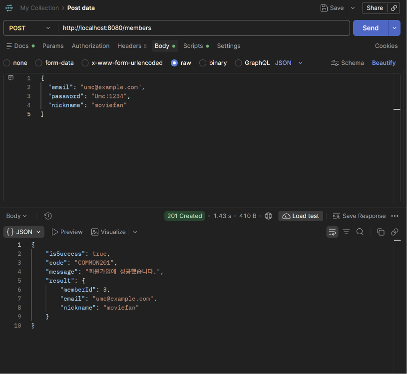

- POST /members → 201, memberId 3. 응답에 password가 없다.

**회원가입 실패**

이메일 형식 오류

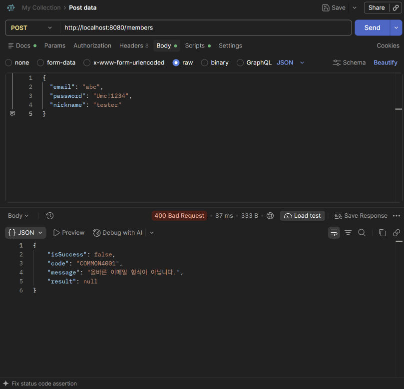

- email을 "abc"로 보내면 400, COMMON4001, "올바른 이메일 형식이 아닙니다."

이메일 중복

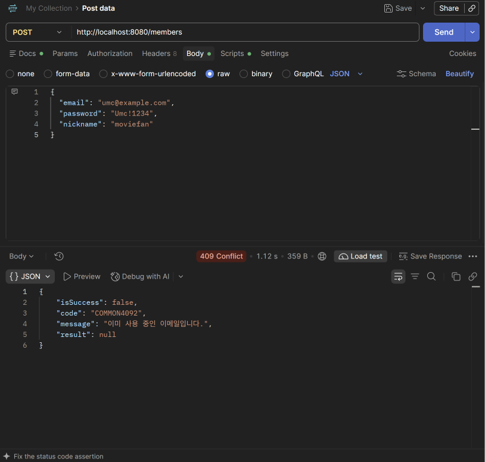

- 이미 가입한 이메일로 다시 보내면 409, COMMON4092, "이미 사용 중인 이메일입니다."

**없는 회원 조회**

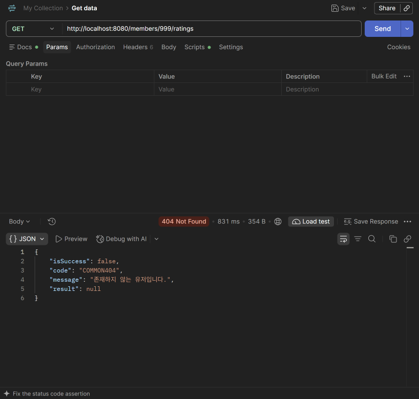

- GET /members/999/ratings → 404, "존재하지 않는 유저입니다."

**평점 등록**

평점 등록

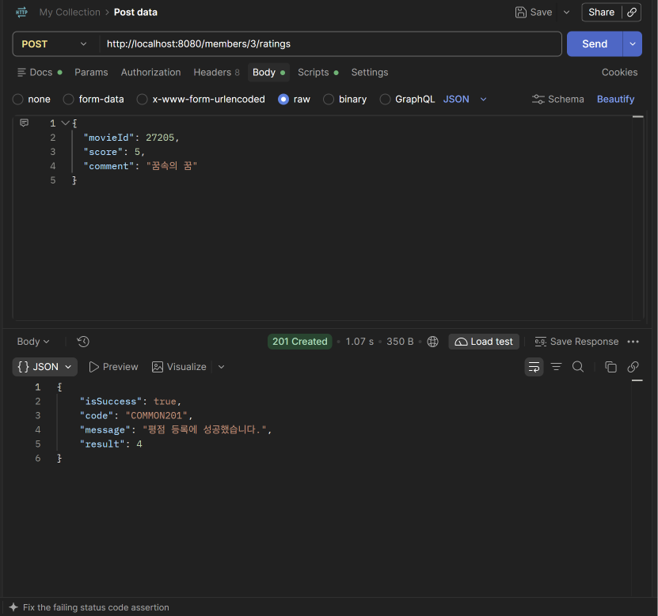

- POST /members/3/ratings → 201, result에 ratingId

중복 평점

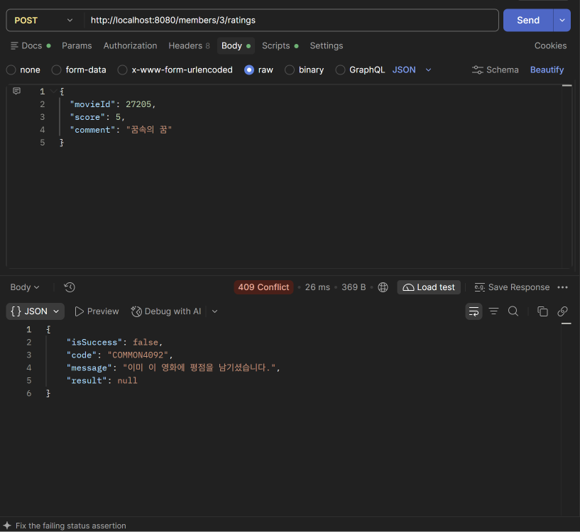

- 같은 영화로 한 번 더 등록하면 409, "이미 이 영화에 평점을 남기셨습니다." 중복 평점은 저장되지 않는다.

별점 범위 오류

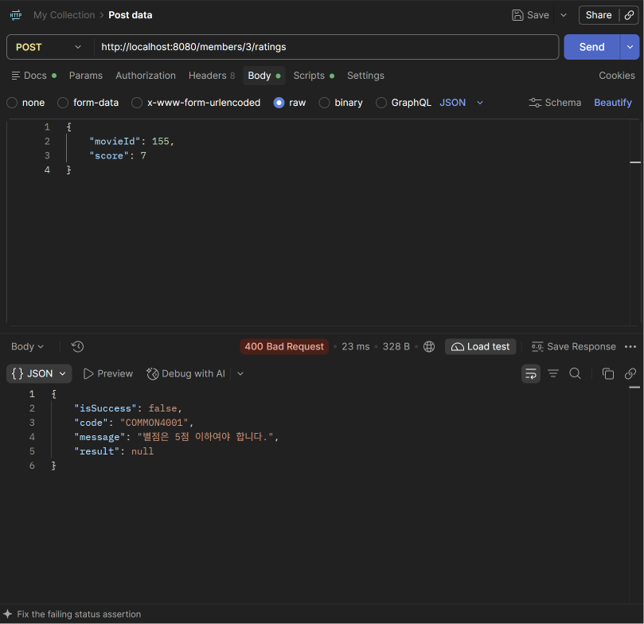

- score를 7로 보내면 400, "별점은 5점 이하여야 합니다."

**평점 수정**

평점 수정

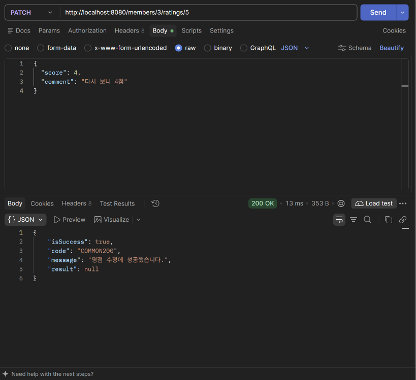

- PATCH /members/3/ratings/5 → 200, "평점 수정에 성공했습니다."

남의 평점 수정

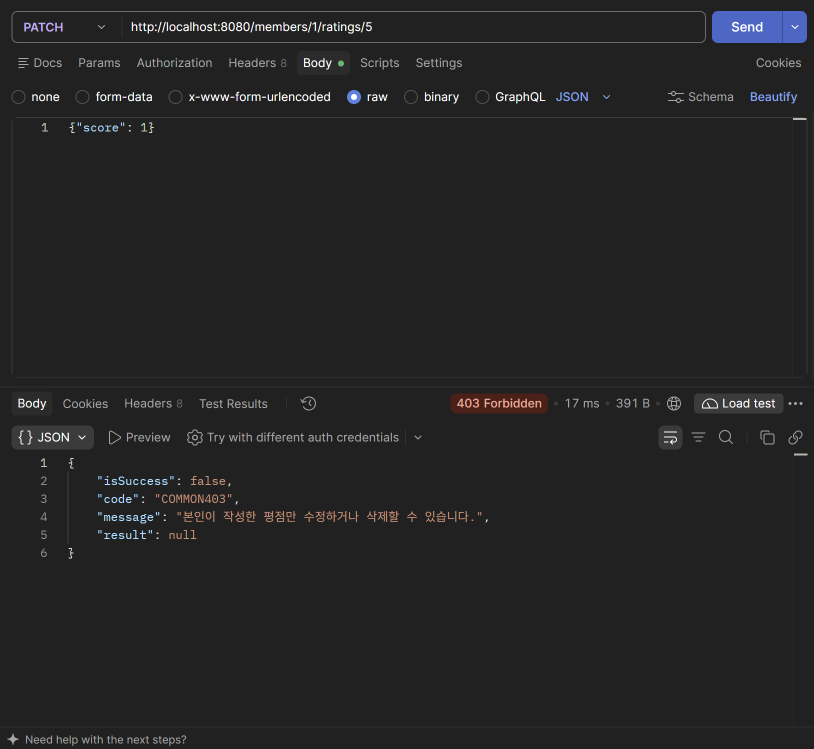

- 1번 회원이 3번 회원의 평점을 수정하면 403, "본인이 작성한 평점만 수정하거나 삭제할 수 있습니다."

**평점 삭제**

없는 평점 삭제

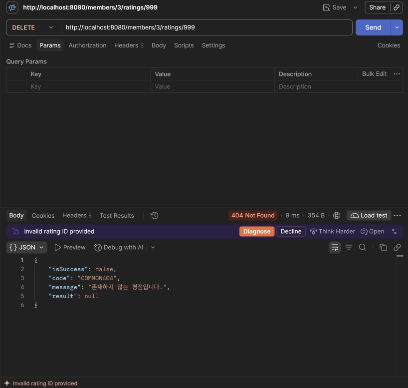

- DELETE /members/3/ratings/999 → 404, "존재하지 않는 평점입니다."

평점 삭제

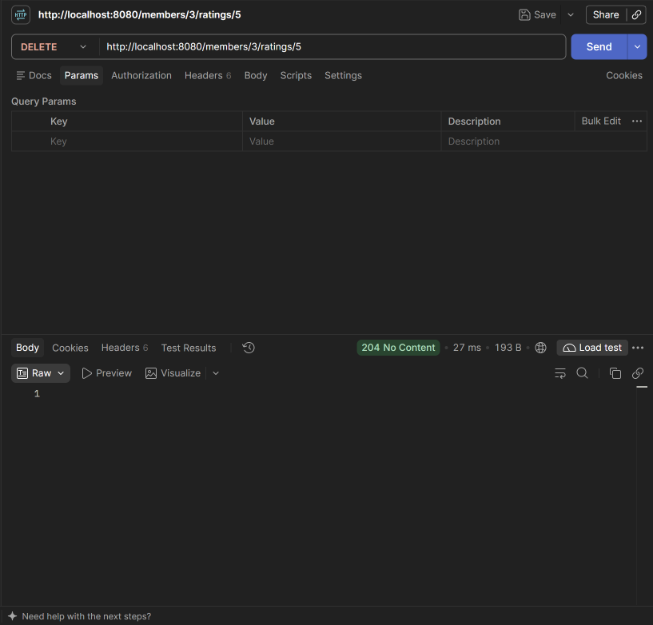

- DELETE /members/3/ratings/5 → 204, 응답 body 없음