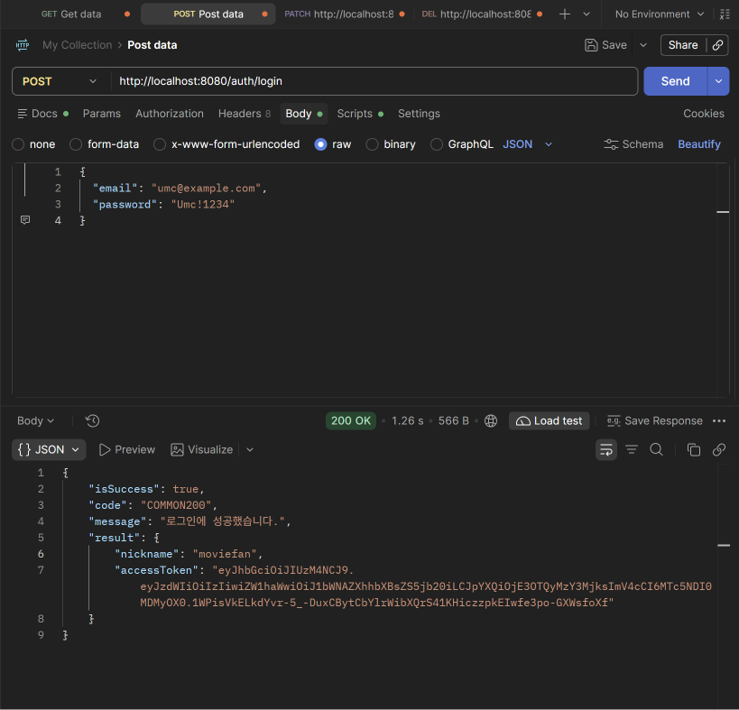
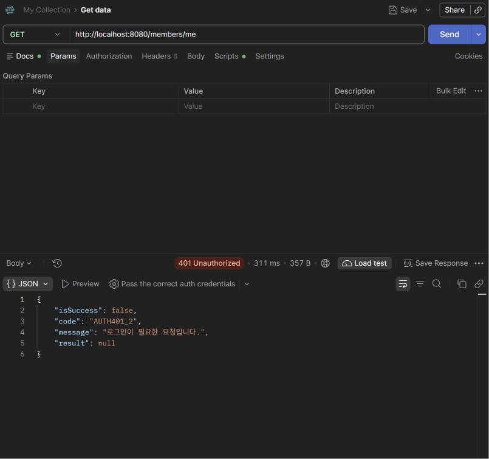
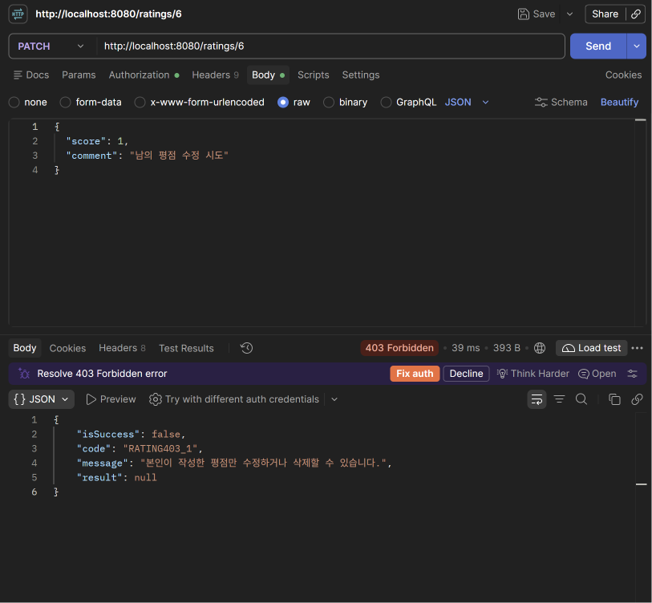
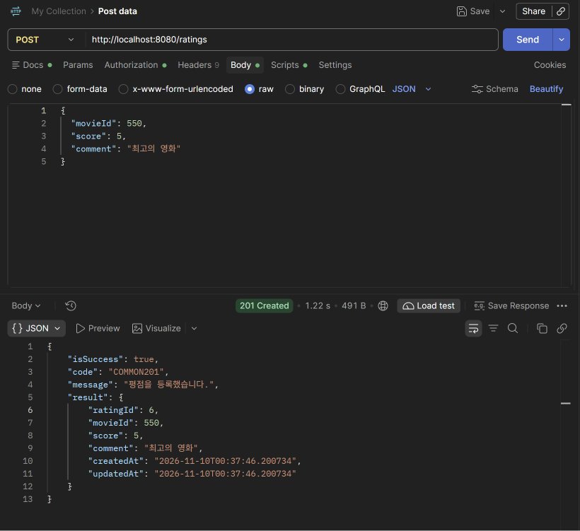

**1. 로그인 성공**

- POST /auth/login → 200, COMMON200. result에 accessToken이 온다.

**2. 토큰 없이 내 정보 조회 (401)**

- Authorization 헤더 없이 GET /members/me → 401, AUTH401_2

**3. 다른 회원의 토큰으로 평점 수정 (403)**

- 회원 A의 평점(6번)을 회원 B의 토큰으로 PATCH /ratings/6 → 403, RATING403_1

**4. 본인 토큰으로 평점 등록 (201)**

- 토큰 A로 POST /ratings → 201, COMMON201. 요청 Body에 memberId가 없다.

**확인 포인트**

- 평점 등록 요청 Body에 memberId가 없다. 서버가 토큰에서 알아낸다.
- 401은 AUTH401_2, 403은 RATING403_1로 code가 서로 다르다.