### **즐겨찾기 API**

**1. 즐겨찾기 등록 (201)**

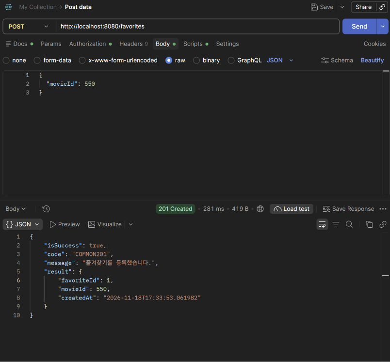

- POST /favorites, Body는 movieId만 → 201, COMMON201. 회원은 토큰에서 알아낸다.

**2. 같은 영화 중복 등록 (409)**

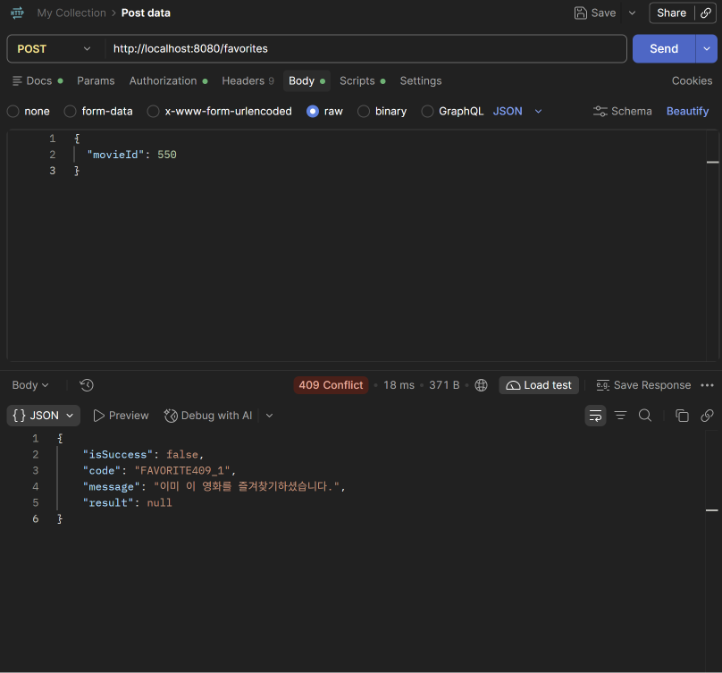

- 같은 요청을 한 번 더 → 409, FAVORITE409_1

**3. 내 즐겨찾기 목록 (200)**

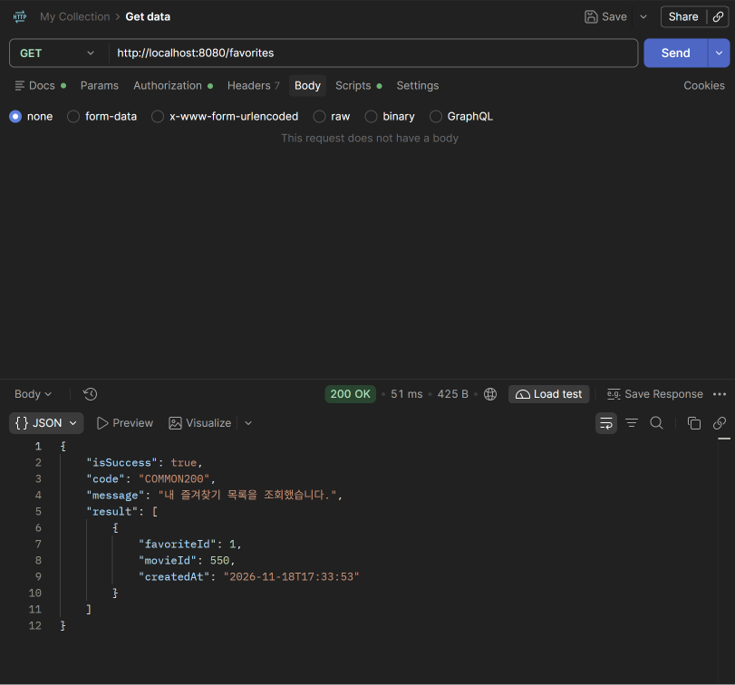

- GET /favorites → 내 즐겨찾기만 최근 등록 순 배열

**4. 즐겨찾기 여부 (200)**

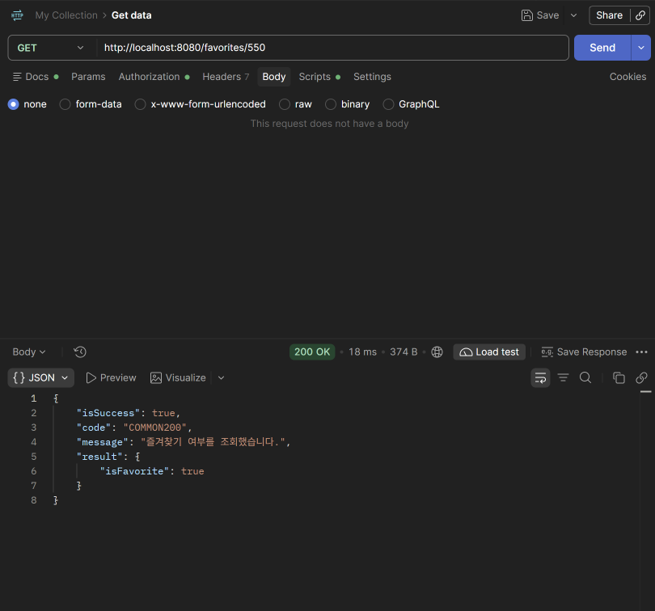

- GET /favorites/550 → isFavorite: true

**5. 즐겨찾기 해제 (200)**

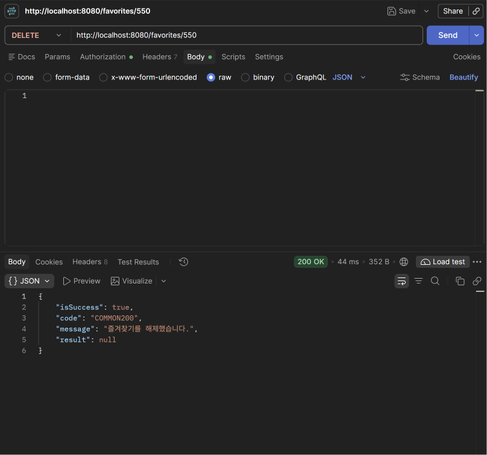

- DELETE /favorites/550 → 200, COMMON200, result: null. 다시 여부를 조회하면 false, 목록은 []

### **영화 기록 저장 (트랜잭션)**

**6. 평점과 즐겨찾기 함께 저장 (201)**

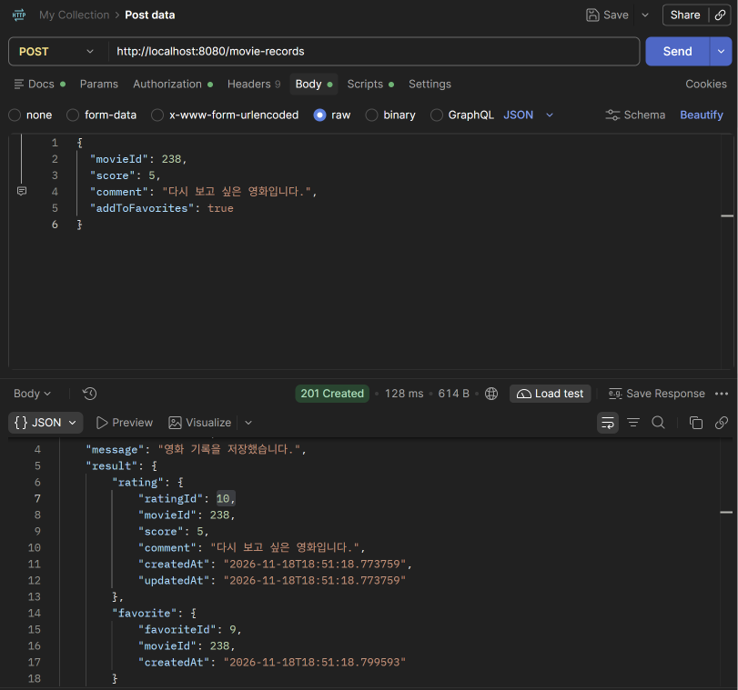

- POST /movie-records, addToFavorites: true → 201. result에 rating과 favorite이 함께 있다.

**7. 같은 요청 다시 (409)**

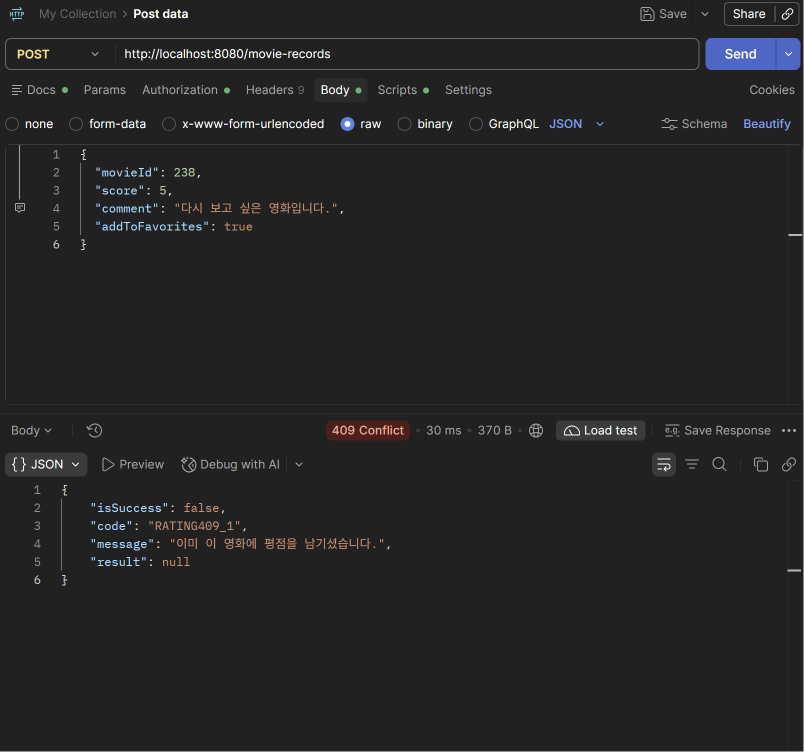

- 409, RATING409_1. 이후 DB에서 238번 rating과 favorite이 각각 한 줄씩만 있어서, 실패한 요청은 아무것도 남기지 않았다.

### **실패 상황**

**8. 토큰 없이 등록 (401)**

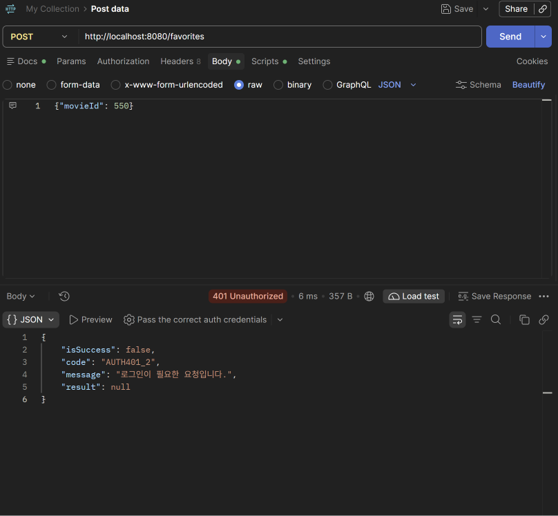

- 토큰 없이 POST /favorites → 401, AUTH401_2

**9. 즐겨찾기 안 한 영화의 여부 (200)**

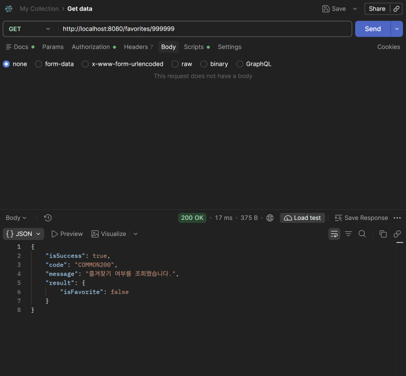

- GET /favorites/999999 → 200, isFavorite: false. 즐겨찾기하지 않음은 오류가 아니다.

**10. 없는 즐겨찾기 해제 (404)**

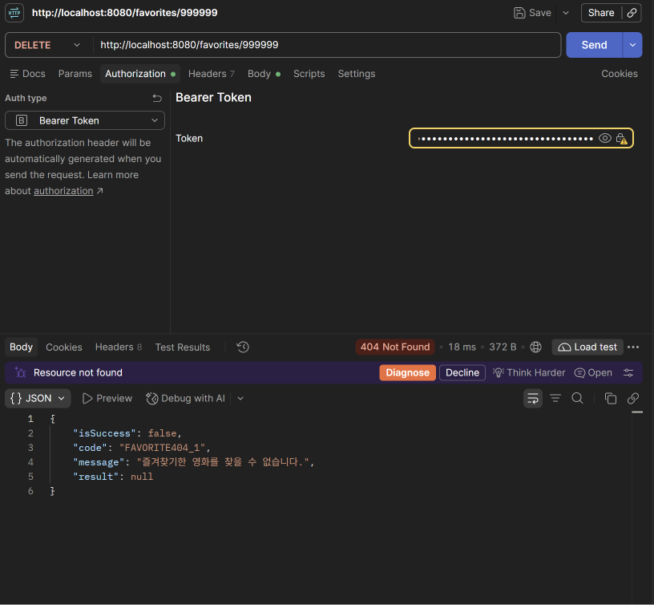

- DELETE /favorites/999999 → 404, FAVORITE404_1. 같은 영화라도 여부 조회는 정상, 해제는 지울 대상이 없어 실패다.

**11. movieId에 0 (400)**

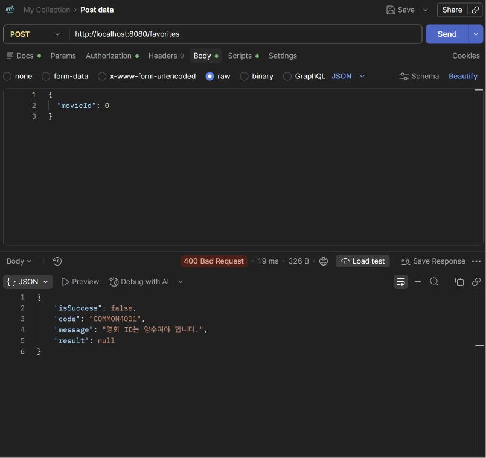

- POST /favorites, movieId 0 → 400, COMMON4001 "영화 ID는 양수여야 합니다."