- **미션 기록**

  ### **1. 남은 API 문서화**

  워크북 최소 목록 9개 API에 한 줄 설명(`@Operation`), 토큰 필요 여부(`@SecurityRequirement`), 성공·실패 응답(`@ApiResponses`)을 적었다.

  | **묶음** | **API** | **토큰** | **문서에 적은 응답** |
      | --- | --- | --- | --- |
  | 평점 | 평점 등록 `POST /ratings` | 필요 | 201 COMMON201, 400 COMMON4001, 401, 409 RATING409_1 |
  |  | 평점 수정 `PATCH /ratings/{ratingId}` | 필요 | 200 COMMON200, 400 COMMON4001, 401, 403 RATING403_1, 404 RATING404_1 |
  |  | 평점 삭제 `DELETE /ratings/{ratingId}` | 필요 | 200 COMMON200, 401, 403 RATING403_1, 404 RATING404_1 |
  |  | 유저별 평점 조회 `GET /members/{memberId}/ratings` | 없음 | 200, 404 MEMBER404_1 |
  | 회원 | 내 정보 조회 `GET /members/me` | 필요 | 200 COMMON200, 401 |
  |  | 내 정보 수정 `PATCH /members/me` | 필요 | 200 COMMON200, 400 COMMON4001, 401, 409 MEMBER409_1 |
  | 즐겨찾기 | 내 즐겨찾기 조회 `GET /favorites` | 필요 | 200 COMMON200, 401 |
  |  | 즐겨찾기 여부 조회 `GET /favorites/{movieId}` | 필요 | 200 COMMON200, 401 |
  |  | 즐겨찾기 해제 `DELETE /favorites/{movieId}` | 필요 | 200 COMMON200, 401, 404 FAVORITE404_1 |
    - 401은 세 가지 code를 함께 적었다: AUTH401_2 토큰 없음(인터셉터), AUTH401_3 유효하지 않은 토큰, AUTH401_4 만료된 토큰(JwtUtil).
    - 평점·회원 컨트롤러에는 공개 API(유저별 평점 조회, 회원가입, 닉네임·이메일 중복 확인)가 섞여 있어서, 자물쇠(`@SecurityRequirement`)를 클래스가 아니라 토큰이 필요한 메서드에만 붙였다.
    - 우리 공통 응답 DTO 이름도 `ApiResponse`라서, Swagger 쪽은 `io.swagger.v3.oas.annotations.responses.ApiResponse` 풀네임으로 적었다.

  **1-1. API 목록과 자물쇠**

  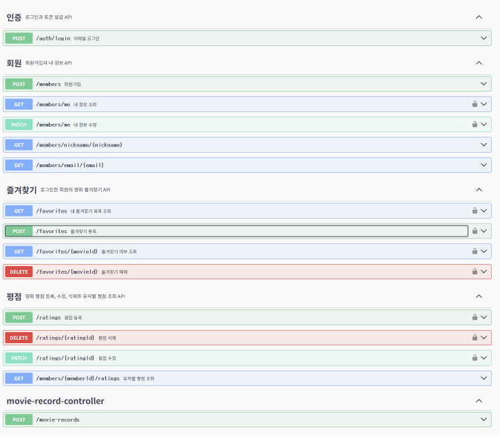

    - "평점", "회원", "즐겨찾기" 묶음으로 나뉘고, 유저별 평점 조회·회원가입에는 자물쇠가 없다.

  **1-2. 평점 등록 응답 문서**

  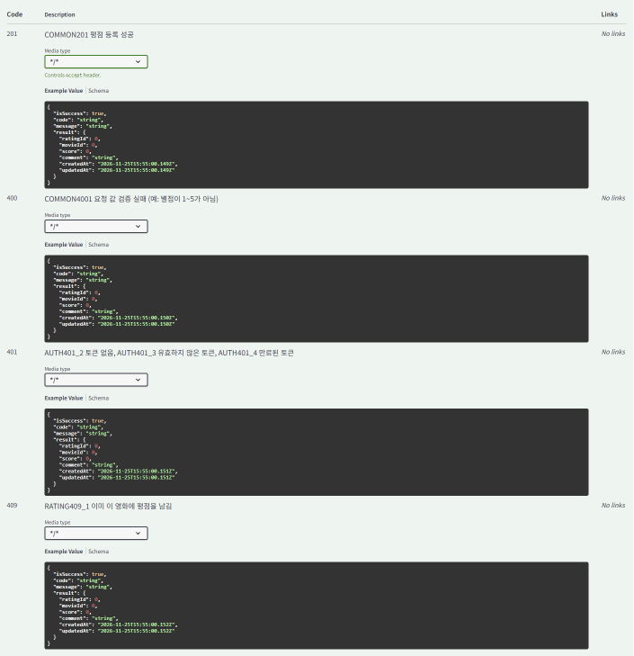

    - `POST /ratings`의 Responses에 201, 400, 401, 409와 각 code가 보인다.

  **1-3. 평점 수정 응답 문서**

  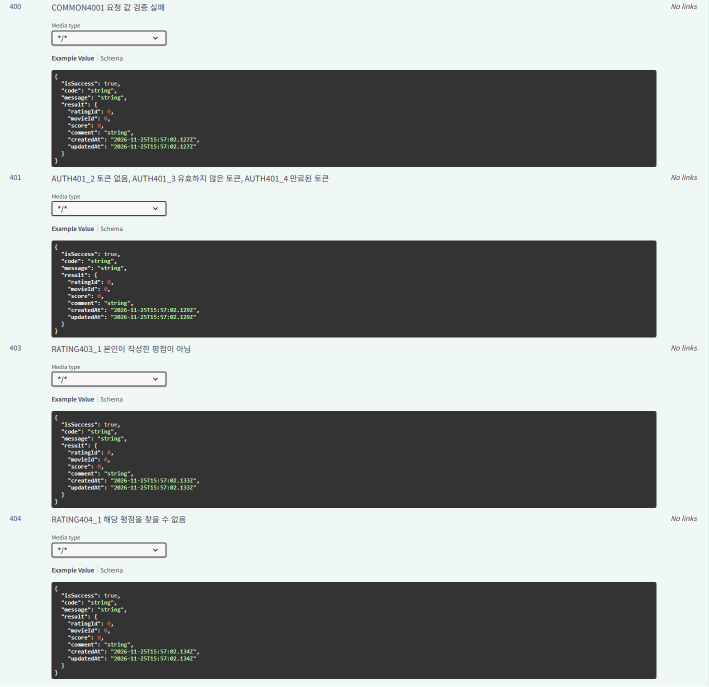

    - `PATCH /ratings/{ratingId}`의 Responses에 403 RATING403_1, 404 RATING404_1이 보인다.

    ---

  ### **2. 평점 단위 테스트 (Mockito)**

  `src/test/java/com/umc/movie/service/RatingServiceTest.java`

    ```java
    package com.umc.movie.service;
    
    import com.umc.movie.dto.CreateRatingRequest;
    import com.umc.movie.dto.UpdateRatingRequest;
    import com.umc.movie.entity.Member;
    import com.umc.movie.entity.Rating;
    import com.umc.movie.exception.ApiException;
    import com.umc.movie.repository.MemberRepository;
    import com.umc.movie.repository.RatingRepository;
    import org.junit.jupiter.api.DisplayName;
    import org.junit.jupiter.api.Test;
    import org.junit.jupiter.api.extension.ExtendWith;
    import org.mockito.InjectMocks;
    import org.mockito.Mock;
    import org.mockito.junit.jupiter.MockitoExtension;
    import org.springframework.test.util.ReflectionTestUtils;
    
    import java.util.Optional;
    
    import static org.assertj.core.api.Assertions.assertThat;
    import static org.assertj.core.api.Assertions.assertThatThrownBy;
    import static org.mockito.ArgumentMatchers.any;
    import static org.mockito.BDDMockito.given;
    import static org.mockito.Mockito.never;
    import static org.mockito.Mockito.verify;
    
    @ExtendWith(MockitoExtension.class)
    class RatingServiceTest {
    
        @Mock
        private RatingRepository ratingRepository; // 진짜 DB 대신 들어가는 가짜 Repository
    
        @Mock
        private MemberRepository memberRepository;
    
        @InjectMocks
        private RatingService ratingService; // 위의 가짜 두 개를 주입받은 진짜 Service
    
        @Test
        @DisplayName("같은 영화에 평점을 다시 등록하면 RATING409_1 예외를 던지고 저장하지 않는다")
        void createRatingWhenDuplicated() {
            // given: 회원은 존재하고, 이미 550번 영화에 평점을 남긴 상황
            Member member = Member.builder()
                    .email("challenger@umc.com")
                    .password("암호화된비밀번호")
                    .nickname("영화조아")
                    .build();
            given(memberRepository.findById(1L)).willReturn(Optional.of(member));
            given(ratingRepository.existsByMember_MemberIdAndMovieId(1L, 550L)).willReturn(true);
    
            // when & then: RATING409_1 예외가 나고, 저장은 시도하지 않음
            assertThatThrownBy(() -> ratingService.create(1L, new CreateRatingRequest(550L, 5, "또 봐도 재밌음")))
                    .isInstanceOf(ApiException.class)
                    .hasFieldOrPropertyWithValue("code", "RATING409_1");
    
            verify(ratingRepository, never()).saveAndFlush(any(Rating.class));
        }
    
        @Test
        @DisplayName("남의 평점을 수정하려 하면 RATING403_1 예외를 던지고 평점은 바뀌지 않는다")
        void updateRatingOfOtherMember() {
            // given: 10번 평점의 주인은 2번 회원
            Member owner = Member.builder()
                    .email("owner@umc.com")
                    .password("암호화된비밀번호")
                    .nickname("평점주인")
                    .build();
            // memberId는 원래 DB가 채우는 값이라, 테스트에서는 직접 넣어 줌
            ReflectionTestUtils.setField(owner, "memberId", 2L);
    
            Rating rating = Rating.builder()
                    .member(owner)
                    .movieId(550L)
                    .score(5)
                    .comment("인생 영화")
                    .build();
            given(ratingRepository.findById(10L)).willReturn(Optional.of(rating));
    
            // when & then: 1번 회원이 2번 회원의 평점을 수정하려 하면 RATING403_1 예외
            assertThatThrownBy(() -> ratingService.update(1L, 10L, new UpdateRatingRequest(1, "별로임")))
                    .isInstanceOf(ApiException.class)
                    .hasFieldOrPropertyWithValue("code", "RATING403_1");
    
            assertThat(rating.getScore()).isEqualTo(5);
            verify(ratingRepository, never()).saveAndFlush(any(Rating.class));
        }
    }
    ```

    - DB 없이 가짜 Repository로 "이미 평점이 있다", "남의 평점이다" 상황을 만들었다.
    - 예외 종류뿐 아니라 `code` 값(RATING409_1, RATING403_1)까지 확인하고, 저장이 호출되지 않았는지와 평점이 바뀌지 않았는지도 확인했다.
    - builder로 만든 회원은 `memberId`가 null이라, `ReflectionTestUtils.setField`로 평점 주인을 2번 회원으로 지정했다.

  **2-1. 단위 테스트 통과**

  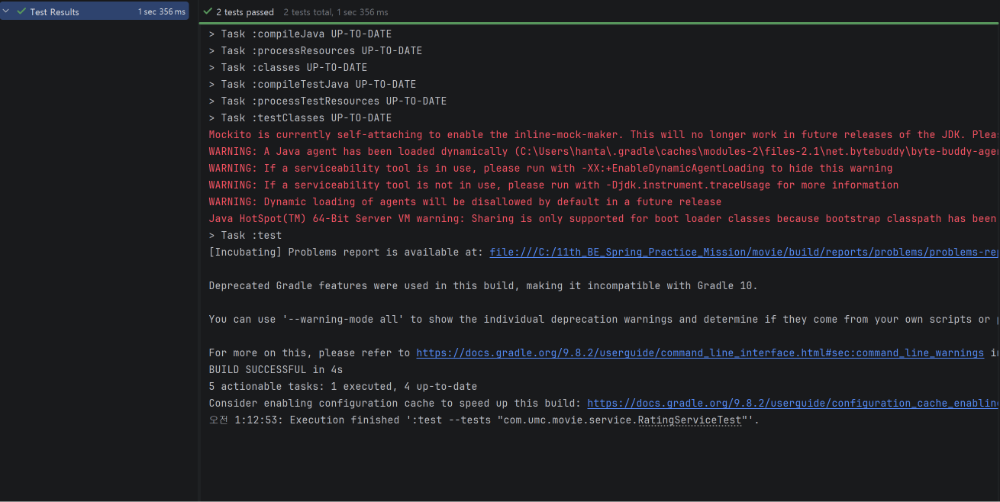
    
  ---

  ### **3. 평점 통합 테스트 (H2 + MockMvc)**

  `src/test/java/com/umc/movie/controller/RatingApiTest.java`

    ```java
    package com.umc.movie.controller;
    
    import com.fasterxml.jackson.databind.ObjectMapper;
    import com.umc.movie.dto.CreateRatingRequest;
    import com.umc.movie.entity.Member;
    import com.umc.movie.repository.MemberRepository;
    import com.umc.movie.util.JwtUtil;
    import org.junit.jupiter.api.BeforeEach;
    import org.junit.jupiter.api.DisplayName;
    import org.junit.jupiter.api.Test;
    import org.springframework.beans.factory.annotation.Autowired;
    import org.springframework.boot.test.autoconfigure.web.servlet.AutoConfigureMockMvc;
    import org.springframework.boot.test.context.SpringBootTest;
    import org.springframework.http.HttpHeaders;
    import org.springframework.http.MediaType;
    import org.springframework.test.web.servlet.MockMvc;
    import org.springframework.transaction.annotation.Transactional;
    
    import static org.springframework.test.web.servlet.request.MockMvcRequestBuilders.post;
    import static org.springframework.test.web.servlet.result.MockMvcResultMatchers.jsonPath;
    import static org.springframework.test.web.servlet.result.MockMvcResultMatchers.status;
    
    @SpringBootTest
    @AutoConfigureMockMvc
    @Transactional // 테스트가 끝나면 저장한 회원과 평점을 되돌림
    class RatingApiTest {
    
        @Autowired
        private MockMvc mockMvc;
    
        @Autowired
        private ObjectMapper objectMapper;
    
        @Autowired
        private MemberRepository memberRepository;
    
        @Autowired
        private JwtUtil jwtUtil;
    
        private String authorizationHeader;
    
        @BeforeEach
        void setUp() {
            // 평점을 남길 회원을 저장하고 그 회원의 토큰을 직접 발급함
            Member member = memberRepository.save(Member.builder()
                    .email("challenger@umc.com")
                    .password("$2a$10$abcdefghijklmnopqrstuv") // 로그인 API를 거치지 않으므로 아무 값이나 괜찮음
                    .nickname("영화조아")
                    .build());
    
            authorizationHeader ="Bearer " + jwtUtil.createAccessToken(member.getMemberId(), member.getEmail());
        }
    
        @Test
        @DisplayName("토큰 없이 평점을 등록하면 401과 AUTH401_2를 응답한다")
        void createRatingWithoutToken() throws Exception {
            mockMvc.perform(post("/ratings")
                            .contentType(MediaType.APPLICATION_JSON)
                            .content(objectMapper.writeValueAsString(new CreateRatingRequest(550L, 5, "인생 영화"))))
                    .andExpect(status().isUnauthorized())
                    .andExpect(jsonPath("$.isSuccess").value(false))
                    .andExpect(jsonPath("$.code").value("AUTH401_2"));
        }
    
        @Test
        @DisplayName("토큰을 담아 평점을 등록하면 201과 저장된 평점을 응답한다")
        void createRating() throws Exception {
            mockMvc.perform(post("/ratings")
                            .header(HttpHeaders.AUTHORIZATION, authorizationHeader)
                            .contentType(MediaType.APPLICATION_JSON)
                            .content(objectMapper.writeValueAsString(new CreateRatingRequest(550L, 5, "인생 영화"))))
                    .andExpect(status().isCreated())
                    .andExpect(jsonPath("$.code").value("COMMON201"))
                    .andExpect(jsonPath("$.result.movieId").value(550))
                    .andExpect(jsonPath("$.result.score").value(5));
        }
    }
    ```

    - 실제 인터셉터 → 검증 → 서비스 → H2 DB까지 연결된 상태로 `POST /ratings`를 호출했다.
    - 토큰이 없으면 401 AUTH401_2, 토큰이 있으면 201 COMMON201과 저장된 movieId·score가 응답된다.

  **3-1. 통합 테스트 통과**

  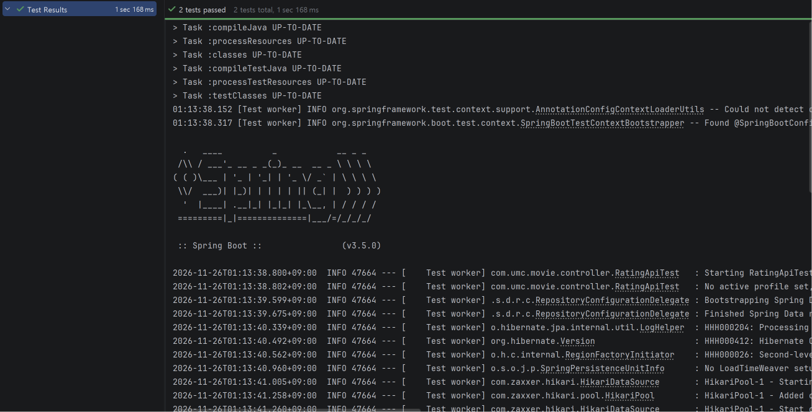
    
  ---

  ### **4. 전체 테스트 통과**

  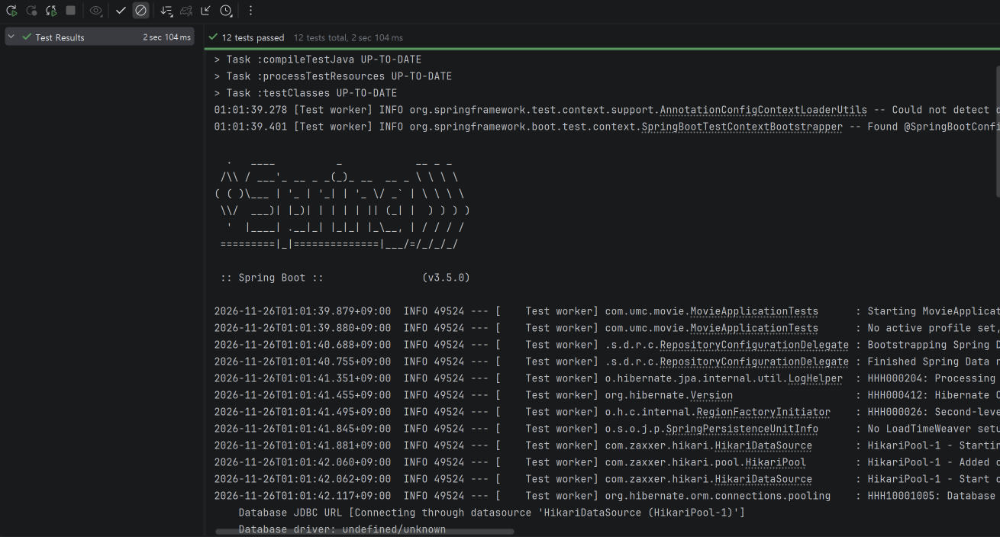

  | **테스트 클래스** | **개수** |
      | --- | --- |
  | MovieApplicationTests | 1 |
  | FavoriteServiceTest (실습 4) | 2 |
  | FavoriteApiTest (실습 5) | 5 |
  | RatingServiceTest (미션) | 2 |
  | RatingApiTest (미션) | 2 |
  | 합계 | 12 |
- **실습 기록**

  ### **실습 1. Swagger 붙이고 문서 화면 열기**

  **Swagger UI 첫 화면**

  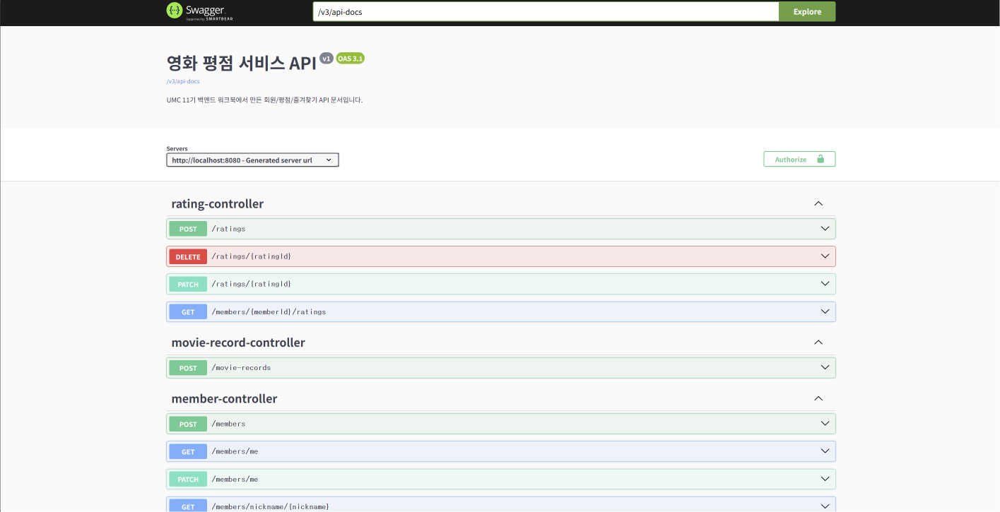

    - 지금까지 만든 API가 컨트롤러별로 자동으로 나열된다.

  ### **실습 2. 공개 API 문서화**

  **묶음과 요약**

  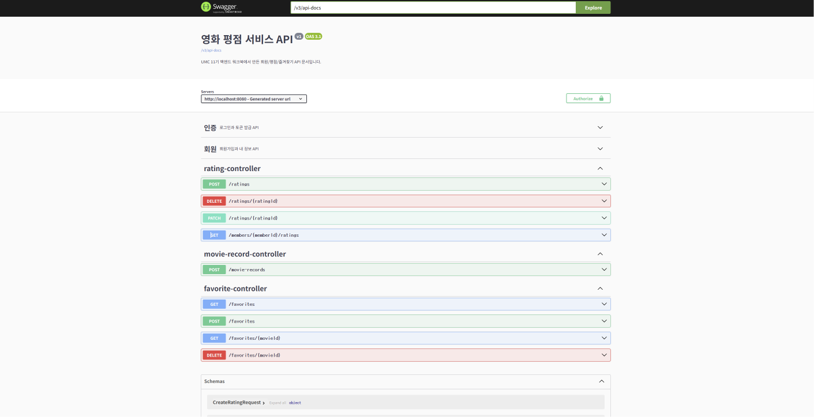

    - `@Tag`로 "인증", "회원" 묶음, `@Operation`으로 "이메일 로그인", "회원가입" 요약을 붙였다.

  **회원가입 Try it out (201)**

  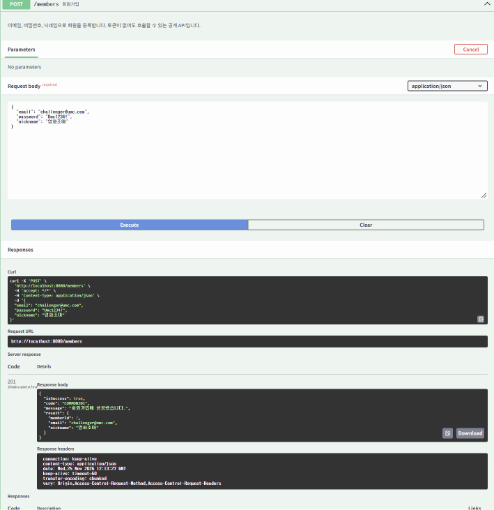

    - `@Schema` 예시 값이 입력창에 채워져 있어 바로 Execute → 201 COMMON201

  **로그인 Try it out (200)**

  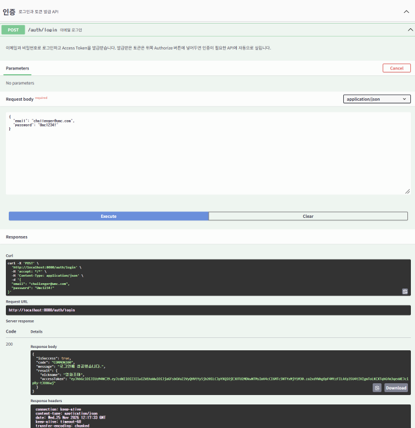

    - 응답의 accessToken을 복사해 실습 3에서 사용했다.

  ### **실습 3. 인증이 필요한 API 문서화**

  **자물쇠와 응답 예시**

  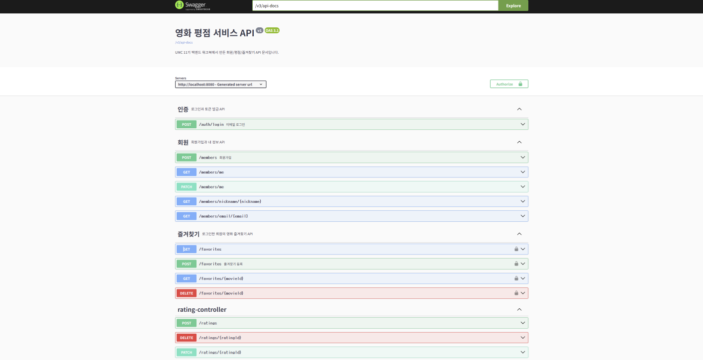

    - `@SecurityRequirement`로 즐겨찾기 API에 자물쇠, `@ApiResponses`로 201/401/409 예시를 적었다.

  **토큰 넣고 등록 (201)**

  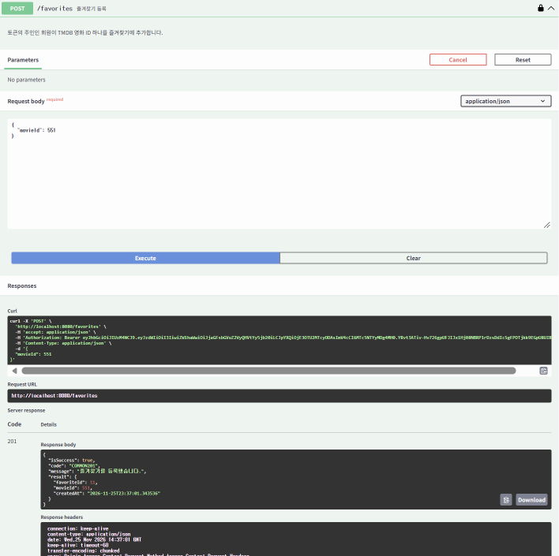

  **같은 요청 다시 (409)**

  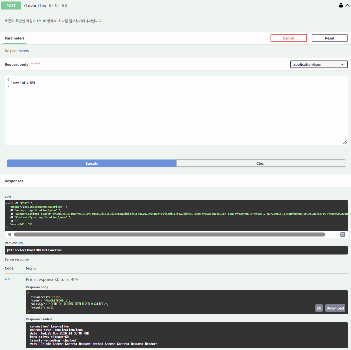

    - 409 FAVORITE409_1. 문서에 적은 409 예시와 같다.

  **Logout 후 호출 (401)**

  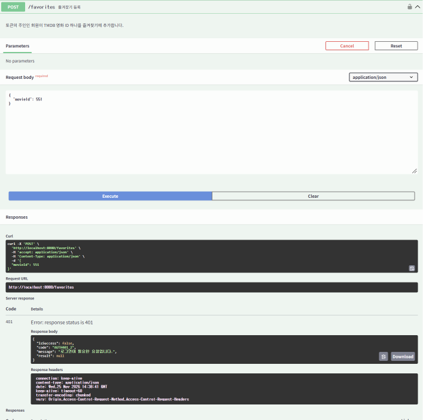

    - 401 AUTH401_2. 문서에 적은 401 예시와 같다.

  ### **실습 4. 단위 테스트 (FavoriteServiceTest)**

  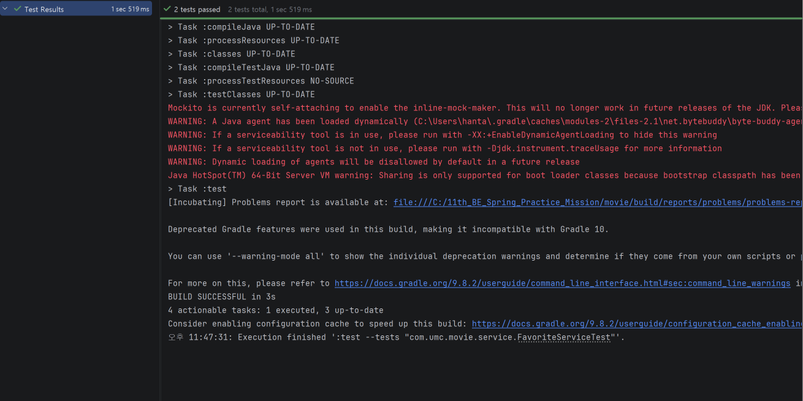

    - Mock Repository로 정상 등록, 중복 등록 2개 통과. MySQL 없이 돈다.

  ### **실습 5. 통합 테스트 (FavoriteApiTest)**

  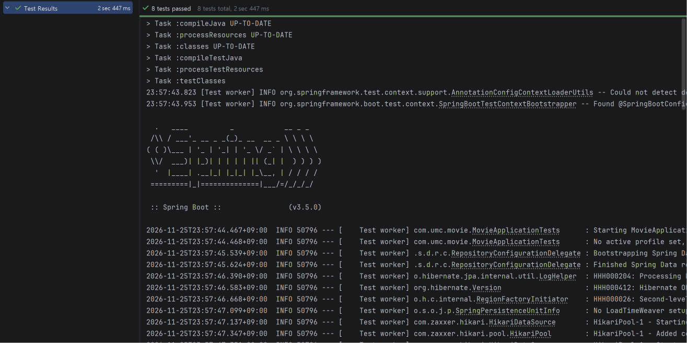

    - H2 메모리 DB와 MockMvc로 5개 통과. 테스트 전용 설정 덕분에 MovieApplicationTests까지 전체 8개 통과.

  ### **실습 6. 일부러 깨뜨려 보기**

  **중복 검사를 주석 처리했을 때**

  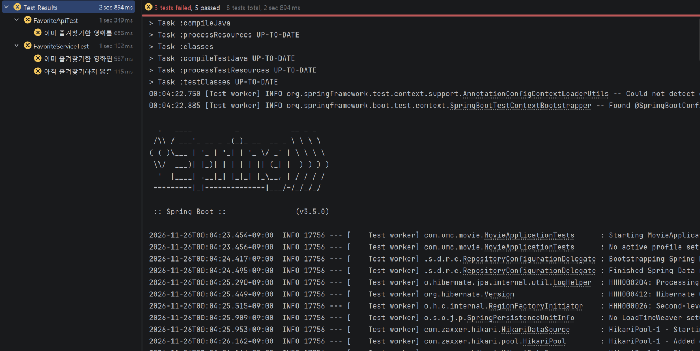

    - 8개 중 3개 실패: 단위 중복(NullPointerException), 단위 정상 등록(UnnecessaryStubbingException), 통합 중복(FAVORITE409_1 대신 COMMON4091).