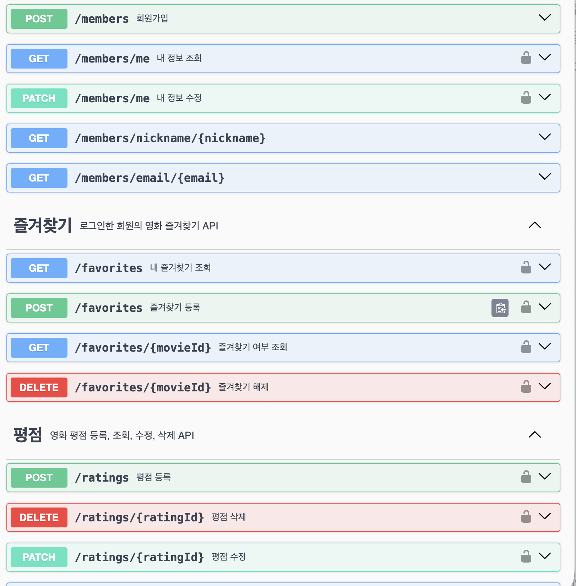
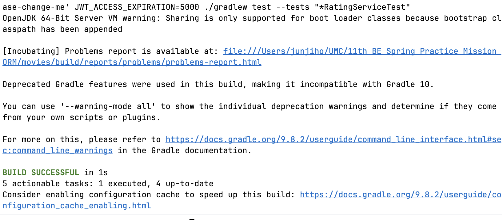
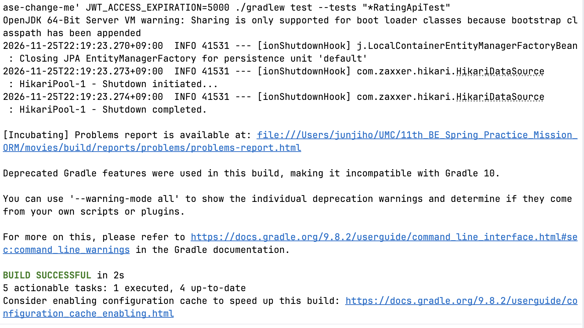

- **미션 기록**

  평점 조회

    ```jsx
    @Tag(name = "평점", description = "영화 평점 등록, 조회, 수정, 삭제 API")
    
    @Operation(
            summary = "유저별 평점 조회",
            description = "특정 회원이 작성한 평점 목록을 조회합니다. 토큰이 필요 없는 공개 API입니다."
    )
    @ApiResponses({
            @io.swagger.v3.oas.annotations.responses.ApiResponse(
                    responseCode = "200",
                    description = "평점 목록 조회 성공"
            ),
            @io.swagger.v3.oas.annotations.responses.ApiResponse(
                    responseCode = "404",
                    description = "회원을 찾을 수 없음 (MEMBER404_1)"
            )
    })
    @GetMapping("/members/{memberId}/ratings")
    public List<RatingResponse> getMemberRatings(
            @PathVariable Long memberId
    ) {
        return ratingService.getRatingsByMember(memberId);
    }
    ```

  내 정보 조회

    ```jsx
    @Operation(
            summary = "내 정보 조회",
            description = "로그인한 회원의 정보를 조회합니다. Bearer 토큰이 필요합니다."
    )
    @SecurityRequirement(name = SwaggerConfig.BEARER_AUTH)
    @ApiResponses({
            @io.swagger.v3.oas.annotations.responses.ApiResponse(
                    responseCode = "200",
                    description = "내 정보 조회 성공"
            ),
            @io.swagger.v3.oas.annotations.responses.ApiResponse(
                    responseCode = "401",
                    description = "토큰이 없거나 유효하지 않음 (AUTH401_2/AUTH401_3/AUTH401_4)"
            ),
            @io.swagger.v3.oas.annotations.responses.ApiResponse(
                    responseCode = "404",
                    description = "회원을 찾을 수 없음 (MEMBER404_1)"
            )
    })
    @GetMapping("/me")
    public ResponseEntity<ApiResponse<MemberInfoResponse>> getMyInfo(
            @RequestAttribute(AuthInterceptor.MEMBER_ID) Long memberId
    ) {
        MemberInfoResponse response = memberService.getMyInfo(memberId);
    
        return ResponseEntity.ok(
                ApiResponse.ok("회원 정보를 조회했습니다.", response)
        );
    }
    ```

  즐겨찾기 목록 조회

    ```jsx
    @Operation(
            summary = "내 즐겨찾기 조회",
            description = "로그인한 회원의 즐겨찾기 목록을 조회합니다. Bearer 토큰이 필요합니다."
    )
    @ApiResponses({
            @io.swagger.v3.oas.annotations.responses.ApiResponse(
                    responseCode = "200",
                    description = "즐겨찾기 목록 조회 성공"
            ),
            @io.swagger.v3.oas.annotations.responses.ApiResponse(
                    responseCode = "401",
                    description = "토큰이 없거나 유효하지 않음 (AUTH401_2/AUTH401_3/AUTH401_4)"
            )
    })
    @GetMapping("/favorites")
    public ResponseEntity<ApiResponse<List<FavoriteResponse>>> getMyFavorites(
            @RequestAttribute(AuthInterceptor.MEMBER_ID) Long memberId
    ) {
        List<FavoriteResponse> response =
                favoriteService.getMyFavorites(memberId);
    
        return ResponseEntity.ok(
                ApiResponse.ok("즐겨찾기 목록을 조회했습니다.", response)
        );
    }
    ```



    ```jsx
    @Test
        @DisplayName("같은 영화에 평점을 중복 등록하면 409와 RATING409_1 예외를 던진다")
        void createRatingWhenDuplicated() {
            given(memberRepository.findById(1L)).willReturn(Optional.of(member));
            given(ratingRepository.existsByMember_MemberIdAndMovieId(1L, 550L))
                    .willReturn(true);
    
            assertThatThrownBy(() -> ratingService.create(
                    1L,
                    new CreateRatingRequest(550L, 5, "재미있어요.")
            ))
                    .isInstanceOfSatisfying(ApiException.class, exception -> {
                        assertThat(exception.getStatus()).isEqualTo(HttpStatus.CONFLICT);
                        assertThat(exception.getCode()).isEqualTo("RATING409_1");
                    });
    
            verify(ratingRepository, never()).saveAndFlush(any(Rating.class));
        }
    
        @Test
        @DisplayName("다른 회원이 작성한 평점을 수정하면 403과 RATING403_1 예외를 던진다")
        void updateRatingOwnedByAnotherMember() {
            Member owner = Member.builder()
                    .email("owner@umc.com")
                    .password("암호화된비밀번호")
                    .nickname("평점주인")
                    .build();
            ReflectionTestUtils.setField(owner, "memberId", 2L);
    
            Rating rating = Rating.builder()
                    .member(owner)
                    .movieId(550L)
                    .score(4)
                    .comment("기존 후기")
                    .build();
            given(ratingRepository.findById(10L)).willReturn(Optional.of(rating));
    
            assertThatThrownBy(() -> ratingService.update(
                    1L,
                    10L,
                    new UpdateRatingRequest(5, "수정 후기")
            ))
                    .isInstanceOfSatisfying(ApiException.class, exception -> {
                        assertThat(exception.getStatus()).isEqualTo(HttpStatus.FORBIDDEN);
                        assertThat(exception.getCode()).isEqualTo("RATING403_1");
                    });
    
            verify(ratingRepository, never()).saveAndFlush(any(Rating.class));
    ```



  단위 테스트

    ```jsx
    @Test
        @DisplayName("토큰 없이 평점을 등록하면 401과 AUTH401_2를 응답한다")
        void createRatingWithoutToken() throws Exception {
            CreateRatingRequest request = new CreateRatingRequest(550L, 5, "재미있어요.");
    
            mockMvc.perform(post("/ratings")
                            .contentType(MediaType.APPLICATION_JSON)
                            .content(objectMapper.writeValueAsString(request)))
                    .andExpect(status().isUnauthorized())
                    .andExpect(jsonPath("$.isSuccess").value(false))
                    .andExpect(jsonPath("$.code").value("AUTH401_2"));
        }
    
        @Test
        @DisplayName("유효한 토큰으로 평점을 등록하면 201과 저장된 평점을 응답한다")
        void createRatingWithToken() throws Exception {
            CreateRatingRequest request = new CreateRatingRequest(550L, 5, "재미있어요.");
    
            mockMvc.perform(post("/ratings")
                            .header(HttpHeaders.AUTHORIZATION, authorizationHeader)
                            .contentType(MediaType.APPLICATION_JSON)
                            .content(objectMapper.writeValueAsString(request)))
                    .andExpect(status().isCreated())
                    .andExpect(jsonPath("$.code").value("COMMON201"))
                    .andExpect(jsonPath("$.result.movieId").value(550))
                    .andExpect(jsonPath("$.result.score").value(5));
        }
    ```



  통합테스트