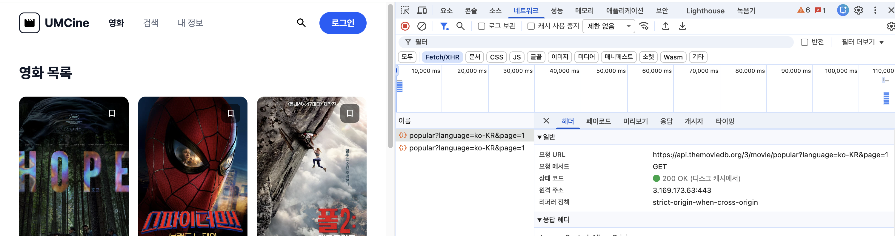
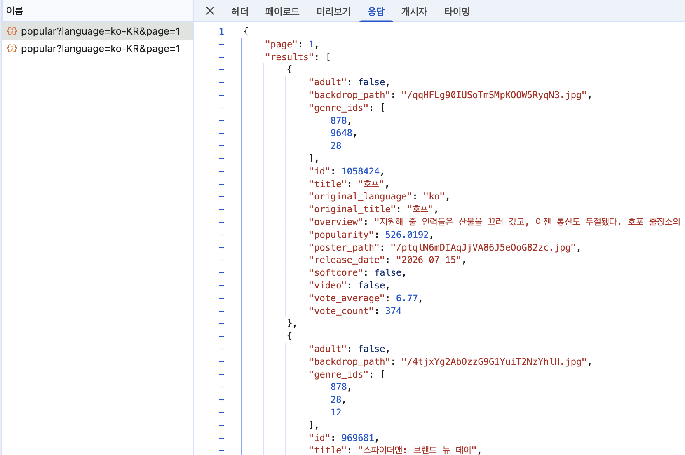
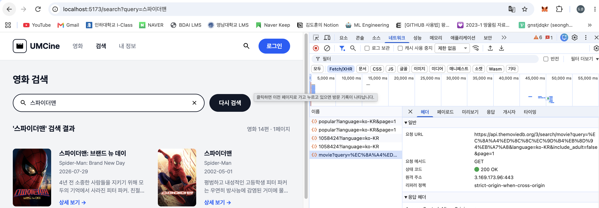
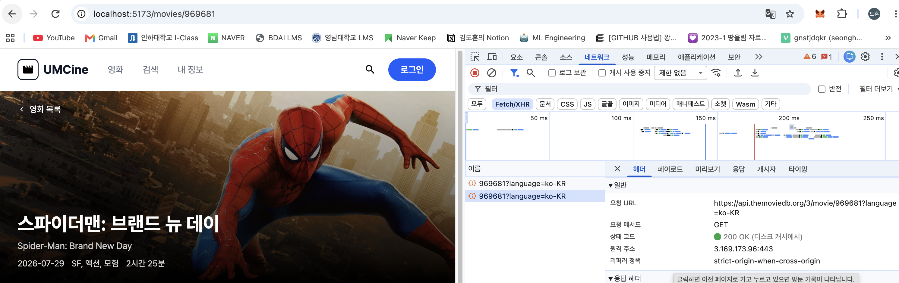
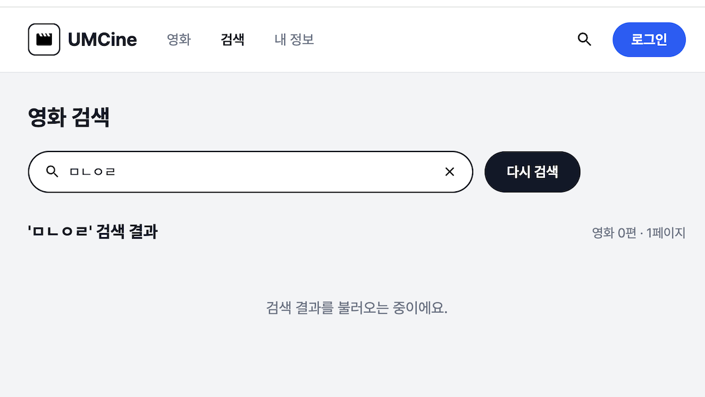
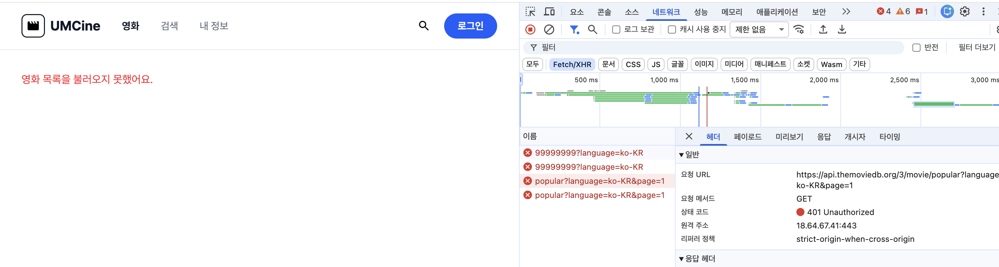
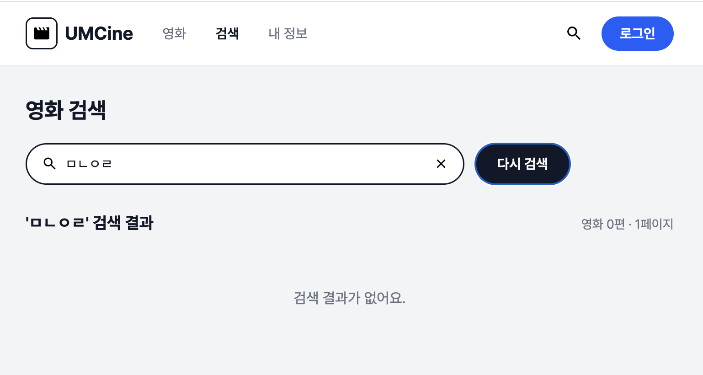
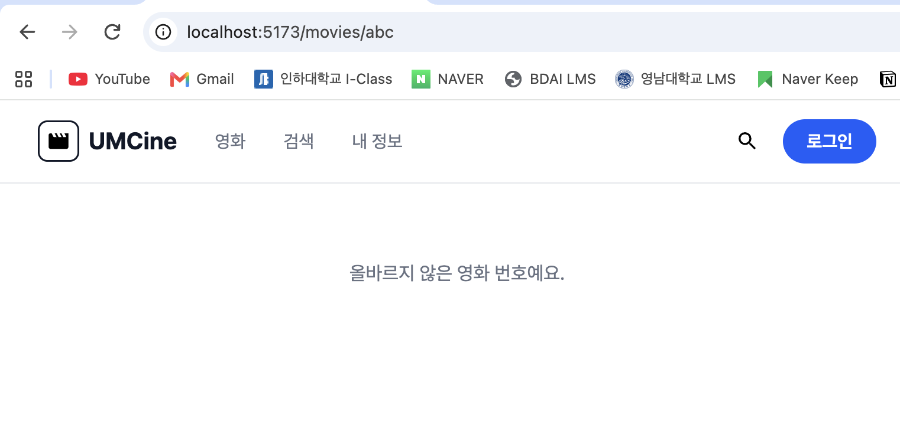
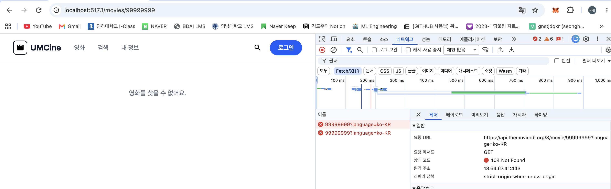
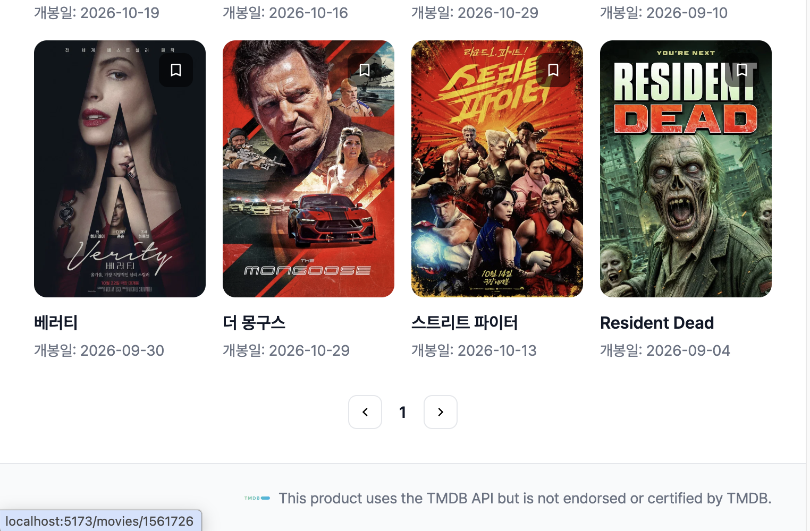

# Frontend Chapter05

## 필수 미션

### 1. 순수 `fetch`로 인기 영화 요청하고 Network 패널에서 확인하기

```tsx
// get-movies-with-fetch.ts
const response = await fetch(`${env.tmdbApiBaseUrl}/movie/popular?${searchParams}`, {
  headers: { Authorization: `Bearer ${env.tmdbAccessToken}` },
});
if (!response.ok) throw new Error(`영화 목록 요청에 실패했어요: ${response.status}`);
return response.json();
```

`fetch`는 404/500 같은 HTTP 오류 응답이 와도 Promise를 reject하지 않기 때문에, `response.ok`를 직접 검사해야 합니다.

#### 결과 확인

DevTools Network 패널에서 `popular?language=ko-KR&page=1` 요청의 헤더(요청 URL, 상태 코드 `200 OK`)를 확인했습니다.



같은 요청의 응답(Response) 탭에서 `page`, `results` 배열이 포함된 JSON이 그대로 내려오는 것도 확인했습니다.



### 2. ky 인스턴스를 만들어 목록·검색·상세 화면을 실제 TMDB 데이터에 연결하기

```tsx
// tmdb-client.ts
export const tmdbClient = ky.create({
  baseUrl: `${env.tmdbApiBaseUrl}/`,
  headers: { Authorization: `Bearer ${env.tmdbAccessToken}` },
});

// get-movies.ts
function getMovies({ page = 1 }: GetMoviesRequest = {}) {
  return tmdbClient.get("movie/popular", { searchParams: { language: "ko-KR", page } }).json<GetMoviesResponse>();
}
```

base URL과 인증 헤더를 `tmdbClient` 한 곳에 두어 매 요청마다 반복 작성하지 않도록 했고, 화면에서는 응답의 `.results`로 영화 배열을 읽습니다.

#### 결과 확인

검색 화면에서 `스파이더맨`을 검색하면 `tmdbClient`가 `movie?query=...`를 호출해 실제 TMDB 검색 결과가 렌더링되는 것을 확인했습니다.



상세 화면도 `movies/{movieId}` 경로로 실제 데이터를 받아와 포스터·줄거리가 정상 렌더링되는 것을 확인했습니다.



### 3. 로딩·오류·빈 결과·성공 상태를 구분하고 각 URL 직접 접근/새로고침 확인하기

```tsx
// movie-list-page.tsx
useEffect(() => {
  let ignore = false;
  async function loadMovies() {
    setIsLoading(true);
    setErrorMessage(null);
    try {
      const response = await getMovies({ page: 1 });
      if (!ignore) setMovies(response.results);
    } catch {
      if (!ignore) setErrorMessage("영화 목록을 불러오지 못했어요.");
    } finally {
      if (!ignore) setIsLoading(false);
    }
  }
  loadMovies();
  return () => {
    ignore = true;
  };
}, []);
```

#### 결과 확인

**로딩:** 요청이 끝나기 전, 로딩 문구가 보이는 순간을 확인했습니다.



**오류:** 토큰을 일부러 틀리게 설정했을 때 모든 요청이 `401 Unauthorized`로 실패하고, 화면에는 "영화 목록을 불러오지 못했어요." 오류 메시지가 뜨는 것을 확인했습니다.



**빈 결과:** 의미 없는 검색어(`ㅁㄴㅇㄹ`)로 검색하면 에러가 아니라 "검색 결과가 없어요." 안내 문구가 뜨는 것을 확인했습니다.



**잘못된 경로 파라미터:** `/movies/abc`처럼 숫자가 아닌 영화 번호로 직접 접근하면 "올바르지 않은 영화 번호예요." 안내가 뜨고,



`/movies/99999999`처럼 존재하지 않는 영화 ID로 접근하면 실제 API가 `404 Not Found`를 반환하고 "영화를 찾을 수 없어요."가 뜨는 것도 확인했습니다.



### 4. 제공된 디자인의 TMDB 출처 표기 구현하고 빌드 확인하기

목록 화면 하단에 TMDB 로고와 함께 "This product uses the TMDB API but is not endorsed or certified by TMDB." 출처 문구를 추가했습니다. Console에 오류가 없는 것을 확인한 뒤 `pnpm build`를 실행해 정상적으로 빌드되는 것까지 확인했습니다.


