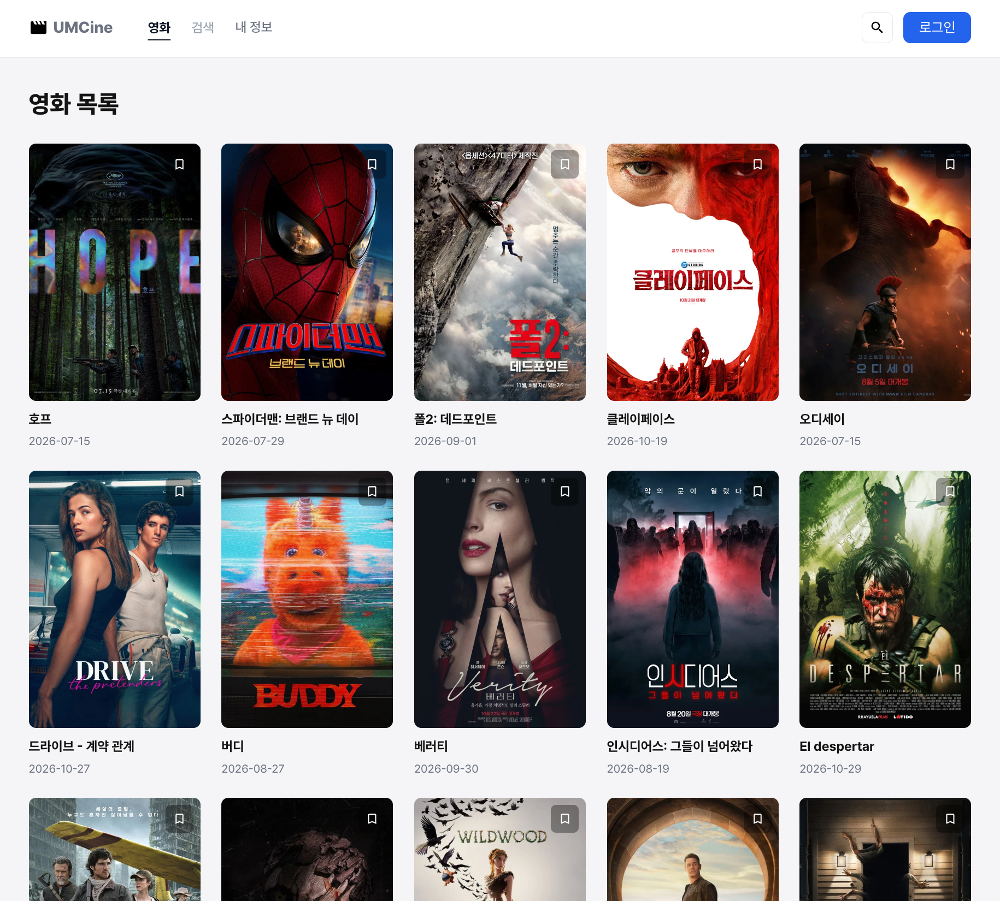
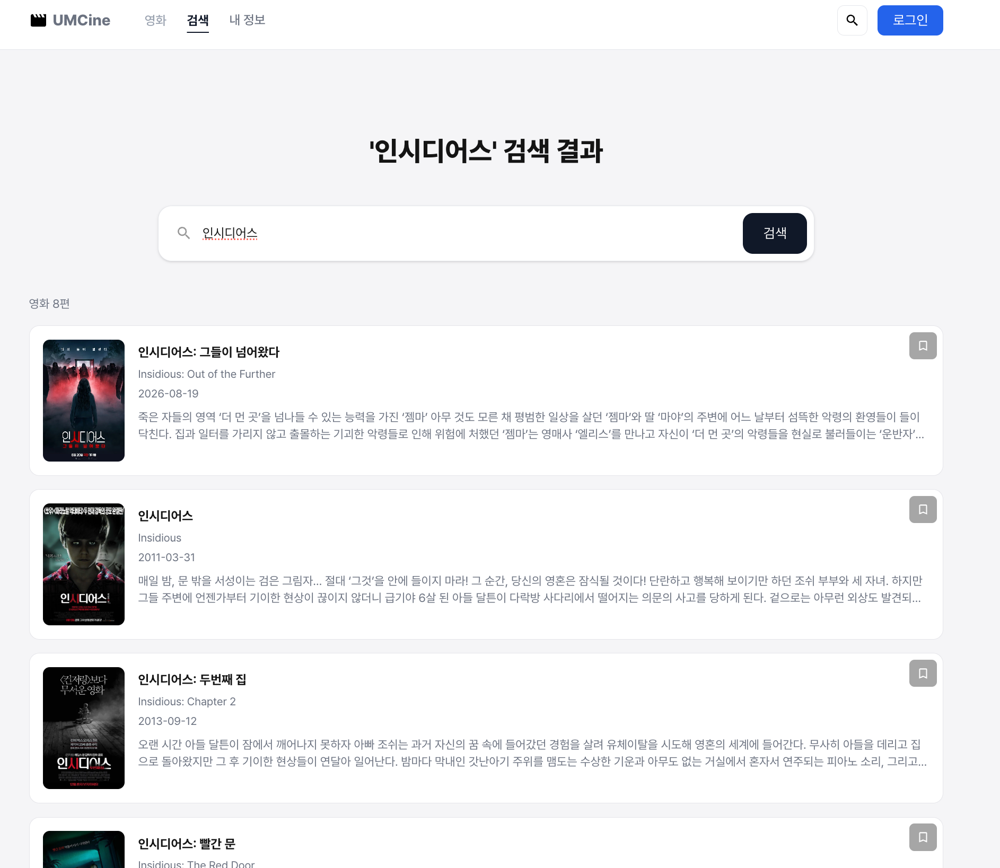
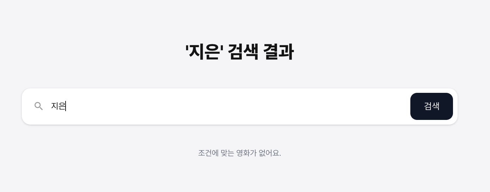
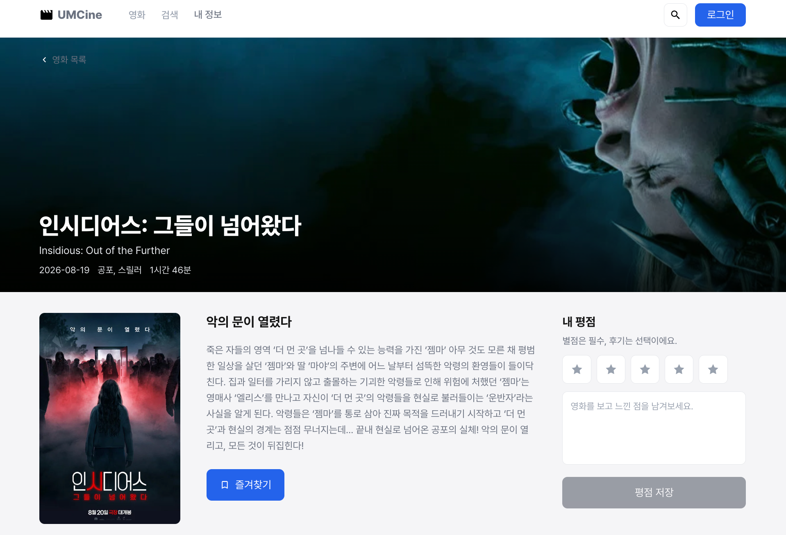
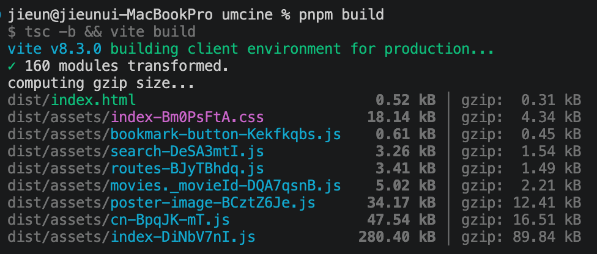

## 1. 환경 변수 (`src/config/env.ts`)

`.env.local`의 base URL과 토큰을 한 곳에서 읽고, 없으면 에러를 던짐.

```
const tmdbApiBaseUrl = import.meta.env.VITE_TMDB_API_BASE_URL;
const tmdbAccessToken = import.meta.env.VITE_TMDB_ACCESS_TOKEN;

if (!tmdbApiBaseUrl || !tmdbAccessToken) {
  throw new Error("TMDB 환경 변수가 필요해요.");
}

export const env = { tmdbApiBaseUrl, tmdbAccessToken };
```

## 2. 응답 타입 (`src/api/movies/models.ts`)

TMDB JSON과 비교하기 쉽게 `snake_case` 그대로 작성했고, 타입은 세 가지로 나눔.

- `TmdbMovie`: 공통 필드
- `TmdbMovieListItem`: 목록·검색용 (`genre_ids` 추가)
- `TmdbMovieDetail`: 상세용 (`genres`, `runtime`, `tagline` 추가)

## 3. 순수 fetch (`get-movies-with-fetch.ts`)

`URLSearchParams`로 query를 만들고 `Authorization` header를 직접 붙임. `fetch`는 404·500에도 reject하지 않아서 `response.ok`를 직접 확인함.

```
const response = await fetch(`${env.tmdbApiBaseUrl}/movie/popular?${searchParams}`, {
  headers: { Authorization: `Bearer ${env.tmdbAccessToken}` },
});
if (!response.ok) throw new Error(`영화 목록 요청에 실패했어요: ${response.status}`);
return response.json();
```

## 4. ky 인스턴스 (`src/api/tmdb-client.ts`)

base URL과 인증 header를 한 번만 설정함.

```
export const tmdbClient = ky.create({
  baseUrl: `${env.tmdbApiBaseUrl}/`,
  headers: { Authorization: `Bearer ${env.tmdbAccessToken}` },
});
```

## 5. API 함수 (`src/api/movies/`)

endpoint마다 파일 하나씩 작성함.

```
// get-movies.ts
tmdbClient.get("movie/popular", { searchParams: { language: "ko-KR", page } }).json<GetMoviesResponse>();

// search-movies.ts
tmdbClient.get("search/movie", { searchParams: { query, language: "ko-KR", include_adult: false, page } }).json<SearchMoviesResponse>();

// get-movie-detail.ts
tmdbClient.get(`movie/${movieId}`, { searchParams: { language: "ko-KR" } }).json<GetMovieDetailResponse>();
```

## 6. 화면 연결

세 페이지 모두 `movies`(또는 `movie`), `isLoading`, `errorMessage` state를 두고 Effect에서 요청함. cleanup에서 `ignore = true`로 바꿔서 이전 요청의 결과가 state를 덮어쓰지 못하게 함.

- **목록** (`movie-list-page.tsx`): `currentPage`가 바뀔 때마다 `getMovies({ page })`를 호출함. 로딩, 오류, 빈 결과, 성공 순서로 구분하고, 페이지 버튼은 현재 페이지 주변 5개만 보여줌(최대 500페이지).
- **검색** (`search-page.tsx`): `query`가 비어 있으면 요청하지 않고 안내만 보여줌. 있으면 `searchMovies({ query })`를 호출함.
- **상세** (`movie-detail-page.tsx`): `Number.isInteger(id) && id > 0`일 때만 `getMovieDetail`을 호출함. 아니면 `올바르지 않은 영화 번호예요.`를 보여줌. 404는 `getMovieDetailErrorMessage`에서 `영화를 찾을 수 없어요.`로 구분함.

워크북은 검색·상세 Effect를 `.then().catch()`로 작성했지만, 그대로 쓰면 `react-hooks/set-state-in-effect` lint 오류가 나서 `async/await`로 변경함.

## 7. 이미지와 유틸 (`src/utils/movies/`, `poster-image.tsx`)

- `getTmdbPosterUrl`, `getTmdbBackdropUrl`: path가 `null`이면 `null`을 반환함.
- `PosterImage`: URL이 있으면 ``를, 없으면 같은 크기의 회색 영역에 `이미지 없음`을 보여줌.
- `formatRuntime`: 분을 `2시간 25분` 형태로 바꾸고, `null`이면 `상영 시간 정보가 없어요.`를 보여줌.

## 8. 정리한 것

- 로컬 목업 데이터(`data/movies.ts`)와 `types/movie.ts`를 삭제함.
- TMDB 출처 표기는 기존 `footer.tsx`에 있어서 그대로 둠.

## 9. 결과 화면

- 영화 목록



- 검색





- 영화 상세



- 빌드


