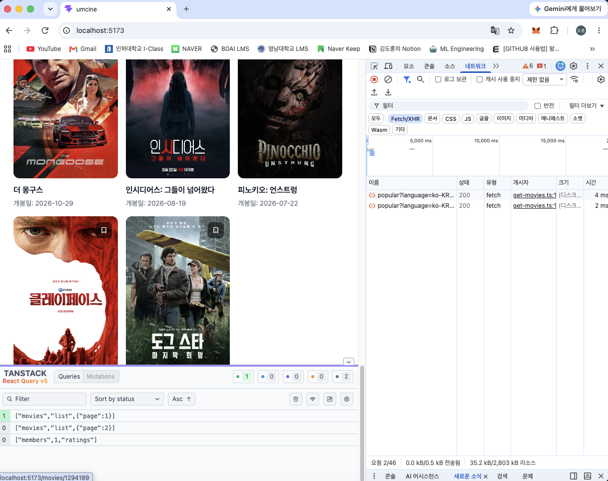
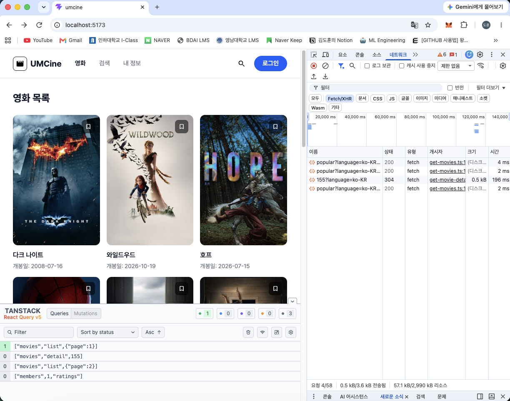

# Frontend Chapter06

## 필수 미션

### 1. 목록·검색·상세 요청을 TanStack Query로 전환하고 query key 구분하기

- 세 화면의 `useEffect`/`useState` 조회 코드를 `useQuery`로 변경했습니다.
- 화면마다 query key 모양을 다르게 해서 캐시가 서로 섞이지 않습니다. 같은 key = 같은 데이터입니다.
- 페이지나 검색어처럼 바뀌는 값은 key에 넣습니다. 값이 바뀌면 다른 캐시 항목이 되어 자동으로 다시 요청됩니다.

```tsx
// movie-list-page.tsx
const moviesQuery = useQuery({
  queryKey: ["movies", "list", { page }],
  queryFn: () => getMovies({ page }),
});
```

`page`가 key 안에 들어있어서 페이지마다 캐시 항목이 따로 생깁니다.

```tsx
// search-page.tsx
const searchQuery = useQuery({
  queryKey: ["movies", "search", { query: normalizedQuery }],
  queryFn: () => searchMovies({ query: normalizedQuery }),
  enabled: normalizedQuery.length > 0,
});
```

검색어가 key에 들어가므로 검색어마다 캐시가 따로 쌓입니다. `enabled`로 빈 검색어일 때는 요청 자체를 보내지 않습니다.

```tsx
// movie-detail-page.tsx
const movieDetailQuery = useQuery({
  queryKey: ["movies", "detail", parsedMovieId],
  queryFn: () => getMovieDetail(parsedMovieId),
  enabled: isValidMovieId,
  staleTime: 30 * 1000,
});
```

영화 번호가 key에 들어갑니다. 잘못된 번호면 `enabled: false`라 요청하지 않고, 상세만 `staleTime`을 30초로 두었습니다.

```tsx
// main.tsx
const ONE_MINUTE = 60 * 1000;
const queryClient = new QueryClient({
  defaultOptions: { queries: { staleTime: ONE_MINUTE } },
});

<QueryClientProvider client={queryClient}>
  <RouterProvider router={router} />
  <ReactQueryDevtools initialIsOpen={false} />
</QueryClientProvider>
```

모든 쿼리의 기본 `staleTime`은 1분입니다.

### 2. 로딩·오류·빈 결과·성공 상태 표시하기

```tsx
// movie-list-page.tsx
{moviesQuery.isPending ? (
  <p className="p-8 text-gray-500">영화 목록을 불러오는 중이에요.</p>
) : moviesQuery.isError ? (
  <p className="p-8 text-red-500">영화 목록을 불러오지 못했어요.</p>
) : movies.length === 0 ? (
  <p className="p-8 text-gray-500">조건에 맞는 영화가 없어요.</p>
) : (
  <MovieGrid
    movies={movies}
    page={page}
    totalPages={totalPages}
    onPageChange={handlePageChange}
  />
)}
```

```tsx
// search-page.tsx
{searchQuery.isLoading ? (
  <p ...>검색 결과를 불러오는 중이에요.</p>
) : searchQuery.isError ? (
  <p ...>검색 결과를 불러오지 못했어요.</p>
) : searchQuery.isSuccess && searchResults.length === 0 ? (
  <p ...>검색 결과가 없어요.</p>
) : (
  <ul ...>{searchResults.map(...)}</ul>
)}
```

```tsx
// movie-detail-page.tsx
if (!isValidMovieId) {
  return (<main ...>올바르지 않은 영화 번호예요.</main>);
}

if (movieDetailQuery.isPending) {
  return (<main ...>영화 정보를 불러오는 중이에요.</main>);
}

if (movieDetailQuery.isError) {
  return (<main ...>{getMovieDetailErrorMessage(movieDetailQuery.error) ...}</main>);
}

const movie = movieDetailQuery.data;
```

### 3. Query 개발자 도구와 Network 패널에서 cache와 요청 흐름 확인하기

목록 화면에서 페이지를 넘나들면 TanStack Query Devtools에 `["movies","list",{"page":1}]`, `["movies","list",{"page":2}]`처럼 페이지별로 캐시 항목이 따로 쌓이는 것을 확인했습니다.



상세 페이지를 재방문하면 Network 패널에서 `155?language=ko-KR` 요청이 `304`로 응답되고, Devtools에는 `["movies","detail",155]` 캐시 항목이 함께 쌓이는 것을 확인했습니다.



1분 안에(상세는 30초 안) 같은 영화를 다시 열면 요청이 나가지 않습니다.
