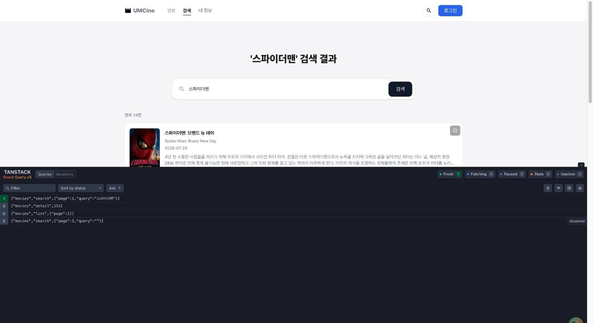
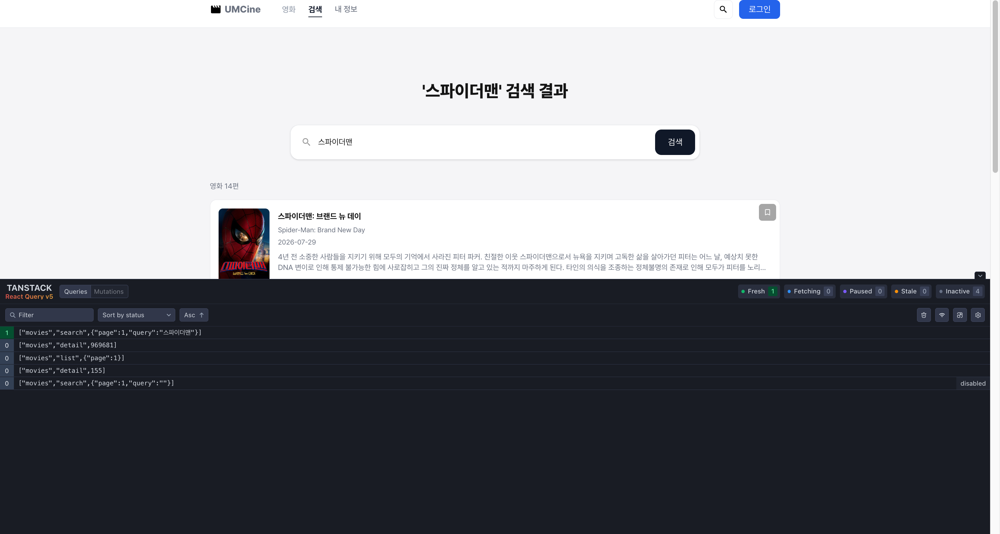
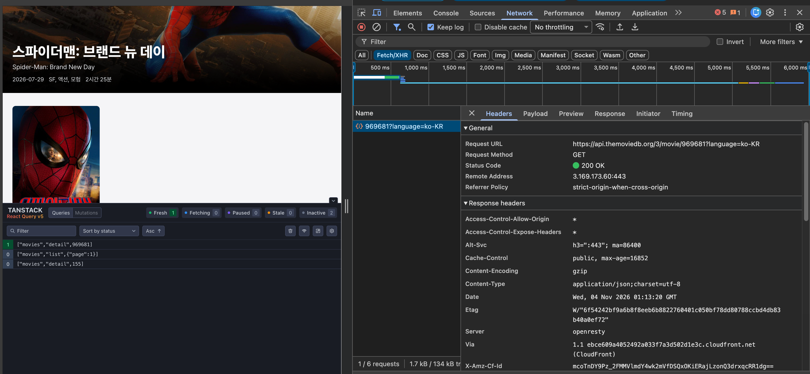
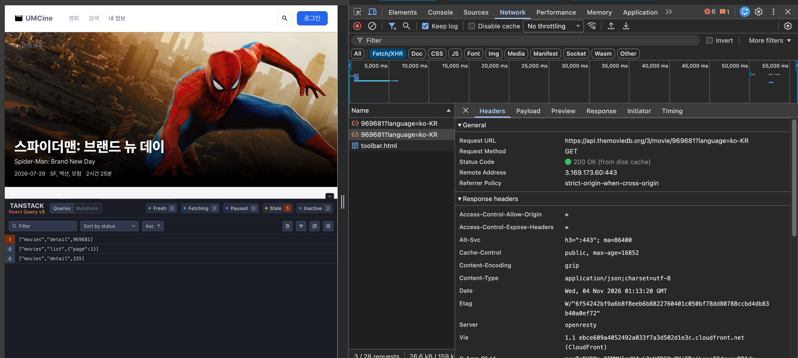

- 필수 미션
    
    ## 1. 설정 (`src/main.tsx`)
    
    - `QueryClientProvider`로 앱을 감싸고 `ReactQueryDevtools`를 추가함.
    - 전역 기본값: `staleTime` 1분, `retry` 1회.
    
    ```tsx
    const queryClient = new QueryClient({
      defaultOptions: {
        queries: { staleTime: 1000 * 60, retry: 1 },
      },
    })
    ```
    
    ## 2. query key 설계 (`src/queries/movie-queries.ts`)
    
    요청 종류와 파라미터를 key에 모두 넣어 서로 다른 요청이 구분되게 함.
    
    | 화면 | query key |
    | --- | --- |
    | 목록 | `["movies", "list", { page }]` |
    | 검색 | `["movies", "search", { query, page }]` |
    | 상세 | `["movies", "detail", id]` |
    
    ```tsx
    const movieKeys = {
      all: ["movies"] as const,
      list: (page: number) => [...movieKeys.all, "list", { page }] as const,
      search: (query: string, page = 1) =>
        [...movieKeys.all, "search", { query, page }] as const,
      detail: (movieId: number) => [...movieKeys.all, "detail", movieId] as const,
    };
    ```
    
    ## 3. 화면별 변경
    
    ### 목록 (`movie-list-page.tsx`)
    
    - `useQuery(movieListQueryOptions(currentPage))` 사용.
    - `keepPreviousData`로 페이지 이동 중에도 이전 목록을 유지해 페이지네이션이 깜빡이지 않음.
    
    ### 검색 (`search-page.tsx`)
    
    - 검색어가 비어 있으면 `enabled: false`로 요청을 보내지 않음.
    
    ### 상세 (`movie-detail-page.tsx`)
    
    - 올바르지 않은 영화 번호는 요청하지 않음.
    - 404 응답은 재시도하지 않도록 `retry`를 설정함.
    
    ### 상태 표시
    
    - 로딩 → `isPending`, 오류 → `isError`, 빈 결과 → 결과 배열 길이 0, 성공 → 데이터 렌더링.
    
    ## 결과 화면
    
    ### Query Devtools — query key 구분
    
    - 존재하는 영화 검색
    
    
    
    목록(`list`), 검색(`search`), 상세(`detail`) 쿼리가 서로 다른 key로 구분되어 캐시에 쌓임.
    
    - 존재하지 않는 영화 검색
    
    
    
    ### Network 패널 — cache 재사용
    
    - 첫 진입 시 `movie/{id}` 요청 1건
    
    
    
    - 재진입 시 200 OK (from disk cache)
    
    