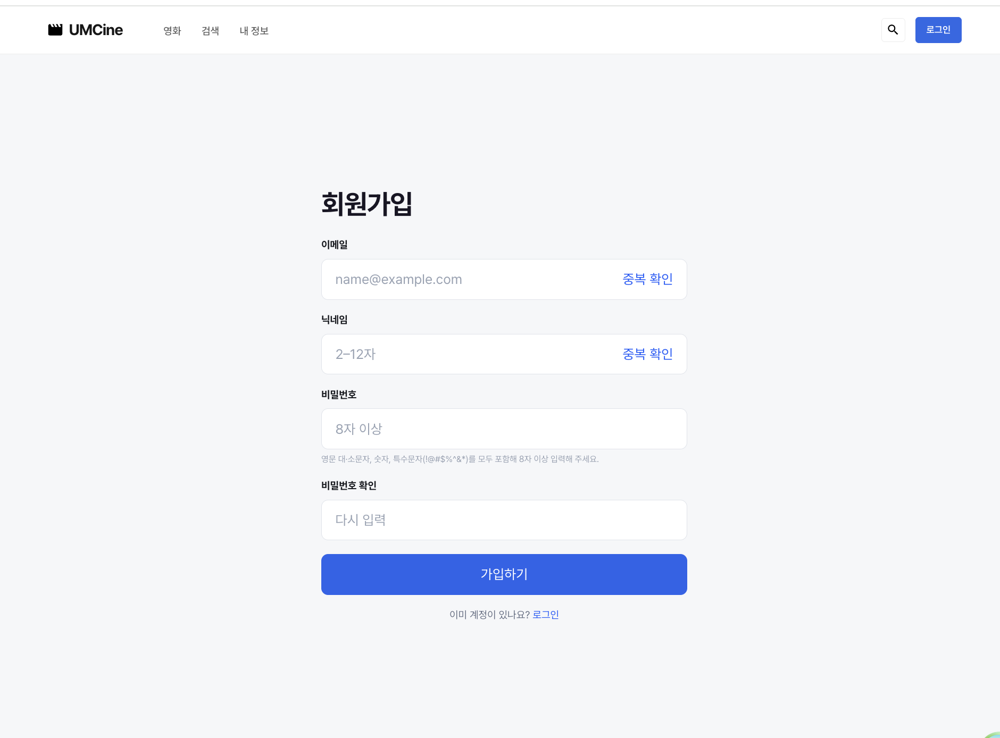
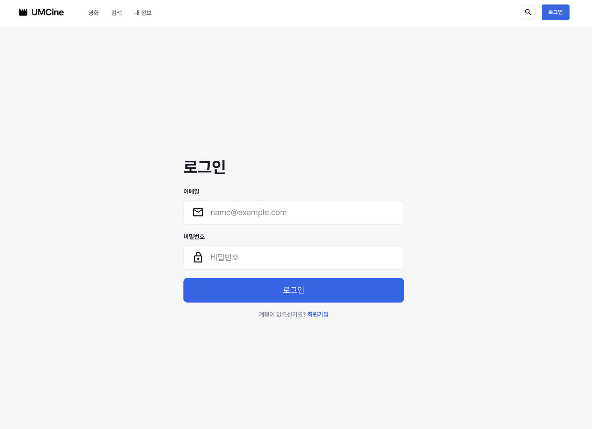
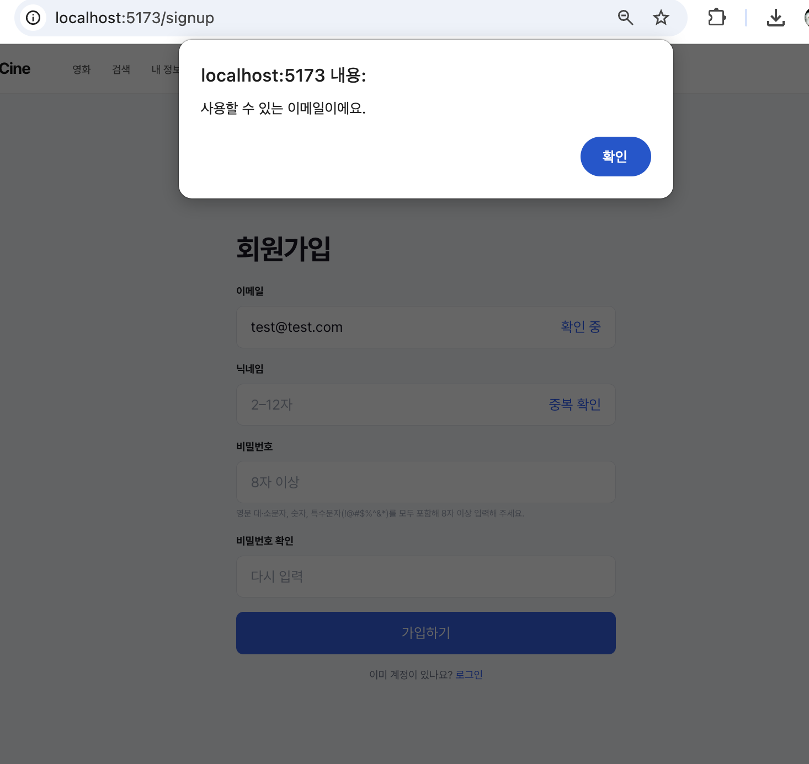
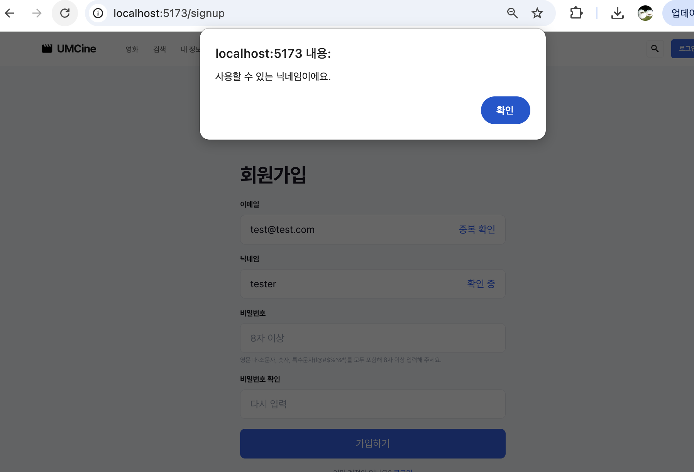
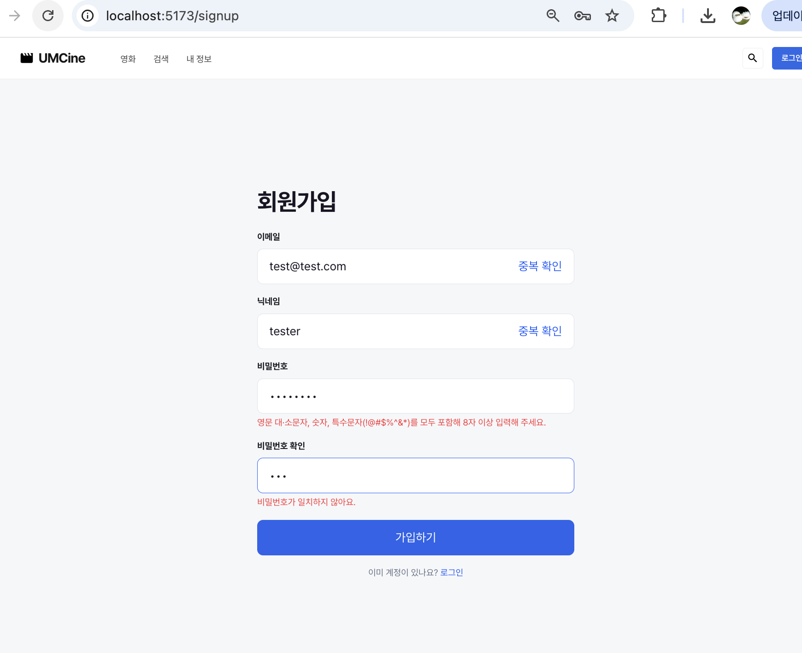
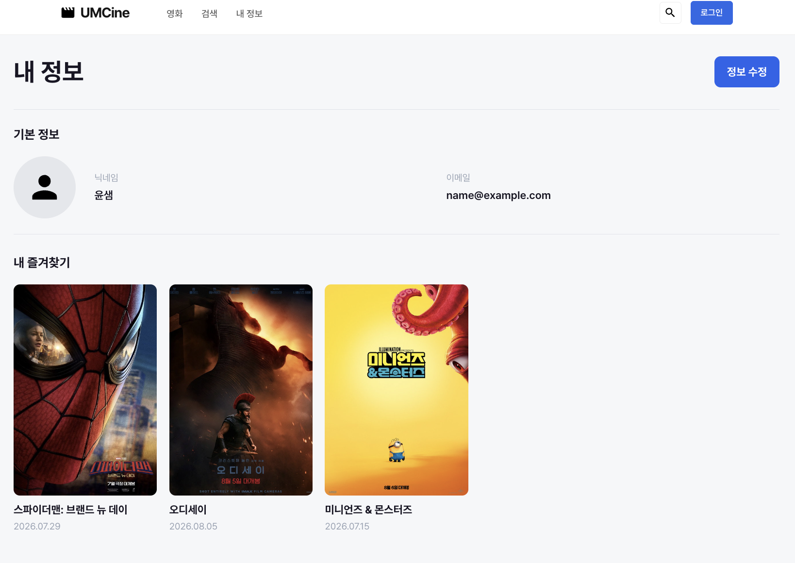
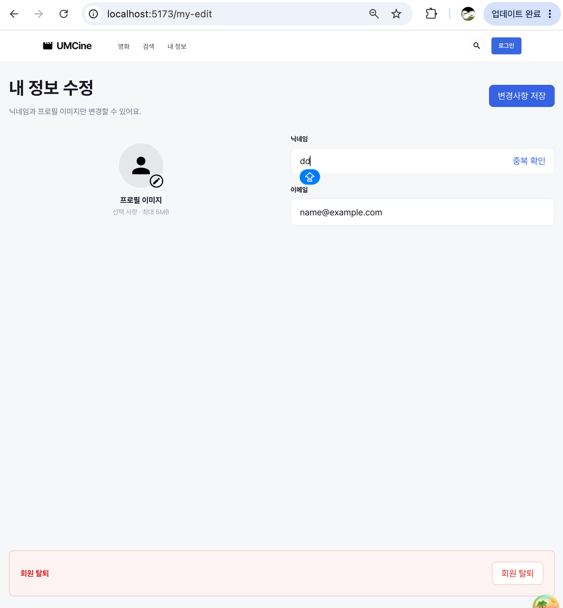

- 필수 미션

  **로그인 화면 퍼블리싱**

    - `src/pages/auth/login-page.tsx`에 로그인 화면 작성. Figma를 참고해 중앙 폼, 이메일·비밀번호 입력창, 아이콘과 파란색 버튼을 Tailwind CSS로 배치.
    - `src/routes/login.tsx`에서 `/login` 경로와 화면 연결.

    ```tsx
    export const Route = createFileRoute("/login")({
      component: LoginPage,
    });
    ```

    - 이메일과 비밀번호는 `useState`로 관리. `value`에 상태를 연결하고, `onChange`에서 갱신 → 입력한 값이 화면에 반영.
    - 두 입력값이 모두 있을 때 로그인 버튼 활성화. 비밀번호는 `type="password"`로 입력 내용 가림.

    ```tsx
    const [email, setEmail] = useState("");
    const [password, setPassword] = useState("");
    
    const canSubmit = email.trim().length > 0 && password.length > 0;
    ```

    ```tsx
    <input
      id="login-email"
      className="min-w-0 flex-1 bg-transparent text-sm outline-none"
      type="email"
      placeholder="name@example.com"
      value={email}
      onChange={(e) => setEmail(e.target.value)}
    />
    ```

    - 폼 제출 시 `preventDefault()`로 새로고침 방지. 하단 회원가입은 `Link`로 `/signup`에 연결.

  **확인 결과**

    - `/login` 직접 접속 시 화면과 메일·자물쇠 아이콘 표시 확인.

  

  

  

  

  

  **내 정보 조회 화면**

    - `src/pages/members/my-page.tsx`에 기본 프로필·닉네임·이메일과 내 즐겨찾기 영역 작성. 기존 사람 아이콘과 로컬 영화 포스터 사용.
    - 임시 회원 정보와 기존 영화 데이터로 화면 구성. 시안에 있는 영화 세 편을 골라 포스터·제목·개봉일 표시.

    ```tsx
    const favoriteMovies = movies.filter((movie) => [1, 2, 5].includes(movie.id));
    ```

    - 기존 `Pagination`을 재사용해 1페이지 표시. 총 한 페이지이므로 이전·다음 버튼 비활성화.
    - `src/routes/my.tsx`에서 `/my` 연결. 정보 수정은 `Link`로 `/my-edit`에 연결.

  **내 정보 수정 화면**

    - `src/pages/members/my-edit-page.tsx`와 `src/routes/my-edit.tsx`를 작성해 `/my-edit` 화면 연결.
    - 닉네임·프로필 미리보기·이미지 오류를 각각 상태로 관리. 닉네임은 입력 즉시 반영하고, 이메일은 `readOnly`로 표시.

    ```tsx
    const [nickname, setNickname] = useState("윤샘");
    const [profileImage, setProfileImage] = useState<string | null>(null);
    const [imageError, setImageError] = useState("");
    const email = "name@example.com";
    
    const isNicknameValid =
      nickname.trim().length >= 2 && nickname.trim().length <= 12;
    ```

    - 닉네임이 2~12자일 때 저장 버튼 활성화. `disabled:opacity-50`으로 비활성 상태를 눈으로 구분.
    - 프로필 영역의 `label`과 파일 input 연결 → 클릭해 이미지 선택. 이미지 형식과 5MB 크기를 검사하고, 오류는 프로필 아래에 표시하도록 작성.
    - `FileReader`로 선택한 파일을 Data URL로 읽어 상태에 저장 → 기본 아이콘 대신 원형 미리보기 표시.

    ```tsx
    const reader = new FileReader();
    
    reader.onload = () => {
      if (typeof reader.result === "string") {
        setProfileImage(reader.result);
      }
    };
    
    reader.onerror = () => {
      setImageError("이미지를 읽지 못했어요. 다시 선택해 주세요.");
    };
    
    reader.readAsDataURL(file);
    ```

    - 폼 제출 시 새로고침을 막아 현재 닉네임과 미리보기 유지. 화면 하단에는 `mt-auto`로 회원 탈퇴 안내 영역과 버튼 배치.

    ```tsx
    <form
      className="mx-auto flex w-full max-w-7xl flex-1 flex-col"
      onSubmit={(e) => e.preventDefault()}
    >
    ```

  **내 정보 화면 확인 결과**

    - `/my`에서 기본 정보와 영화 세 편의 포스터·제목·개봉일 표시 확인.
    - 정보 수정 클릭 → `/my-edit` 이동 확인.
    - 닉네임 입력 반영, 길이에 따른 저장 버튼 활성화·비활성화와 이메일 읽기 전용 확인.
    - 실제 이미지 파일 선택 → 미리보기 표시 확인. 저장 버튼 클릭 후에도 닉네임과 미리보기 유지.
    - 회원 탈퇴 영역 표시 확인. 브라우저 Console 오류·경고 없음, `pnpm build` 성공.

  

  