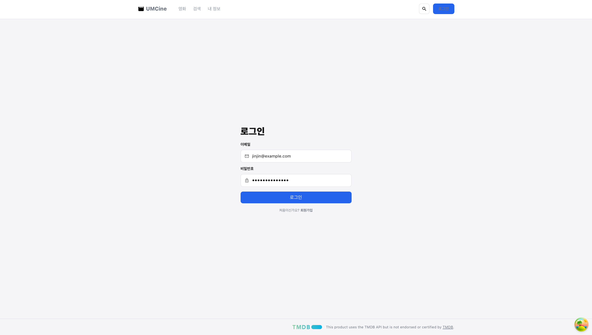
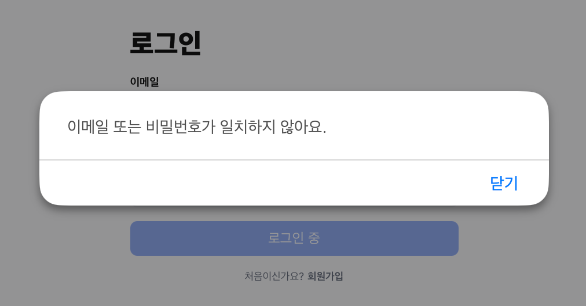
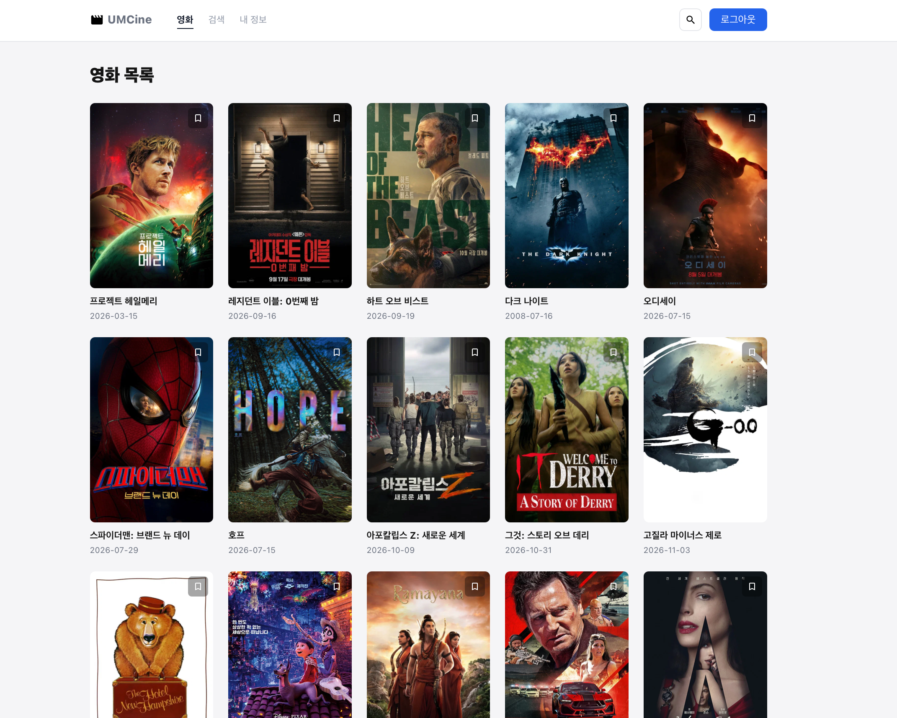
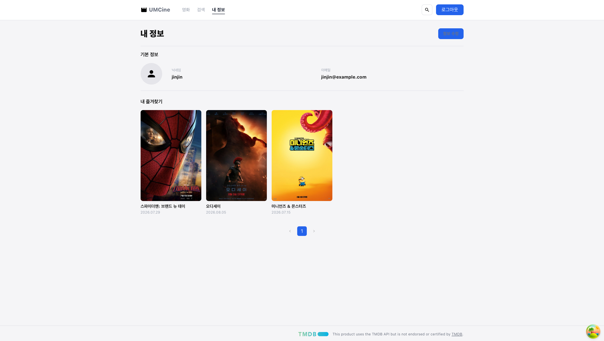
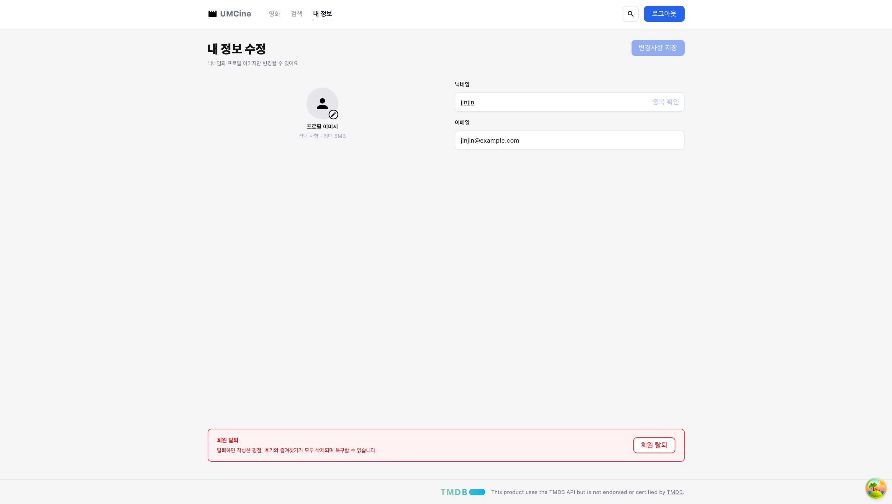

- 필수 미션
    
    ## 1. 환경 변수
    
    회원 서버 주소를 `env` 객체에 추가하고, `.env.local`에 값을 넣음.
    
    ```tsx
    // src/config/env.ts
    export const env = {
      tmdbApiBaseUrl,
      tmdbAccessToken,
      apiBaseUrl: import.meta.env.VITE_API_BASE_URL || '',
    };
    ```
    
    ```
    # .env.local
    VITE_API_BASE_URL=http://localhost:8080
    ```
    
    ## 2. 공통 응답 타입
    
    서버 응답이 `{ isSuccess, code, message, result }` 형태로 감싸져 있어서 제네릭 타입으로 만듦.
    
    ```tsx
    // src/api/models.ts
    export interface ApiResponse<T> {
      isSuccess: boolean;
      code: string;
      message: string;
      result: T;
    }
    ```
    
    ## 3. 로그인 요청 함수
    
    서버의 `LoginResponse(nickname, accessToken)`에 맞춰 `result` 타입을 정의함.
    
    ```tsx
    // src/api/auth/login.ts
    import { apiClient } from "../api-client";
    import type { ApiResponse } from "../models";
    
    export interface LoginRequest {
      email: string;
      password: string;
    }
    
    export interface LoginResult {
      nickname: string;
      accessToken: string;
    }
    
    export function login(body: LoginRequest) {
      return apiClient
        .post("auth/login", { json: body })
        .json<ApiResponse<LoginResult>>();
    }
    ```
    
    ## 4. 토큰 저장소 (zustand)
    
    `persist` 미들웨어로 localStorage에 저장해서 새로고침해도 로그인 상태가 유지됨.
    
    ```tsx
    // src/stores/auth-store.ts
    import { create } from "zustand";
    import { createJSONStorage, persist } from "zustand/middleware";
    
    interface AuthStore {
      accessToken: string | null;
      nickname: string | null;
      login: (accessToken: string, nickname: string) => void;
      setNickname: (nickname: string) => void;
      logout: () => void;
    }
    
    export const useAuthStore = create<AuthStore>()(
      persist(
        (set) => ({
          accessToken: null,
          nickname: null,
          login: (accessToken, nickname) => set({ accessToken, nickname }),
          setNickname: (nickname) => set({ nickname }),
          logout: () => set({ accessToken: null, nickname: null }),
        }),
        {
          name: "umcine-auth-store",
          storage: createJSONStorage(() => localStorage),
          partialize: (state) => ({
            accessToken: state.accessToken,
            nickname: state.nickname,
          }),
        },
      ),
    );
    ```
    
    ## 5. API 클라이언트 (토큰 자동 첨부)
    
    컴포넌트 밖에서도 스토어 값을 읽을 수 있도록 `getState()`를 사용함.
    
    ```tsx
    // src/api/api-client.ts
    import ky from "ky";
    import { env } from "../config/env";
    import { useAuthStore } from "../stores/auth-store";
    
    export const apiClient = ky.create({
      baseUrl: env.apiBaseUrl,
      hooks: {
        beforeRequest: [
          ({ request }) => {
            // 로그인 상태면 모든 요청에 토큰을 실어 보냄
            const { accessToken } = useAuthStore.getState();
            if (accessToken) {
              request.headers.set("Authorization", `Bearer ${accessToken}`);
            }
          },
        ],
      },
    });
    ```
    
    ## 6. 에러 메시지 헬퍼
    
    ky는 에러 응답 본문을 미리 읽어서 `error.data`에 넣어 둠. 그래서 `error.response.json()`은 쓸 수 없고 `error.data`를 읽어야 함.
    
    ```tsx
    // src/utils/get-error-message.ts
    import { HTTPError } from "ky";
    
    export function getErrorMessage(error: unknown, fallback: string) {
      if (error instanceof HTTPError) {
        const data = error.data;
        if (typeof data === "object" && data !== null && "message" in data) {
          const { message } = data as { message?: unknown };
          if (typeof message === "string" && message) return message;
        }
      }
      return fallback;
    }
    ```
    
    ## 7. 로그인 페이지
    
    `useMutation`으로 요청하고, 성공 시 스토어에 저장한 뒤 홈으로 이동함. 이메일/비밀번호가 비어 있거나 요청 중이면 버튼이 비활성화됨.
    
    ```tsx
    // src/pages/auth/login-page.tsx (핵심 로직)
    const [email, setEmail] = useState("");
    const [password, setPassword] = useState("");
    const navigate = useNavigate();
    const setLogin = useAuthStore((state) => state.login);
    
    const { mutate, isPending } = useMutation({
      mutationFn: login,
      onSuccess: ({ result }) => {
        setLogin(result.accessToken, result.nickname);
        navigate({ to: "/" });
      },
      onError: (error) => {
        // 401: 이메일 또는 비밀번호 불일치
        if (error instanceof HTTPError && error.response.status === 401) {
          alert("이메일 또는 비밀번호가 일치하지 않아요.");
          return;
        }
        alert(getErrorMessage(error, "로그인에 실패했어요. 다시 시도해 주세요."));
      },
    });
    
    const canSubmit = email.trim() !== "" && password !== "" && !isPending;
    
    const handleSubmit = (e: SubmitEvent<HTMLFormElement>) => {
      e.preventDefault();
      if (!canSubmit) return;
      mutate({ email: email.trim(), password });
    };
    ```
    
    ```tsx
    <button type="submit" disabled={!canSubmit}>
      {isPending ? "로그인 중" : "로그인"}
    </button>
    ```
    
    ## 8. 로그아웃 (헤더)
    
    로그인 상태면 헤더의 `로그인` 버튼이 `로그아웃`으로 바뀜. 로그아웃하면 토큰을 지우고 `members` 쿼리 캐시도 비워서 이전 사용자 정보가 남지 않게 함.
    
    ```tsx
    // src/components/layout/header.tsx
    const isLoggedIn = useAuthStore((state) => state.accessToken !== null);
    const logout = useAuthStore((state) => state.logout);
    
    const handleLogout = () => {
      logout();
      queryClient.removeQueries({ queryKey: ["members"] });
      navigate({ to: "/" });
    };
    ```
    
    ## 9. 결과 화면
    
    1. 로그인 화면
        
        
        
    2. 로그인 실패
        
        
        
    3. 로그인 성공
        
        
        
    4. 내 정보
        
        
        
    5. 내 정보 수정
        
        
        
    6. 닉네임 변경 후 
        
        