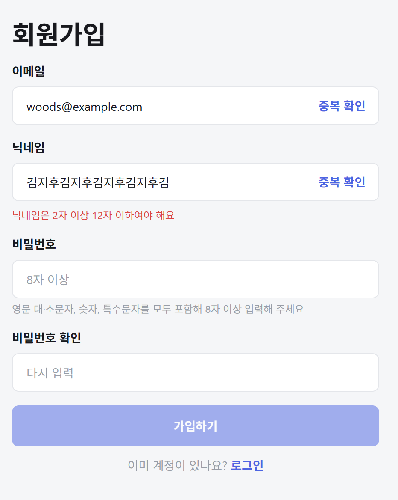
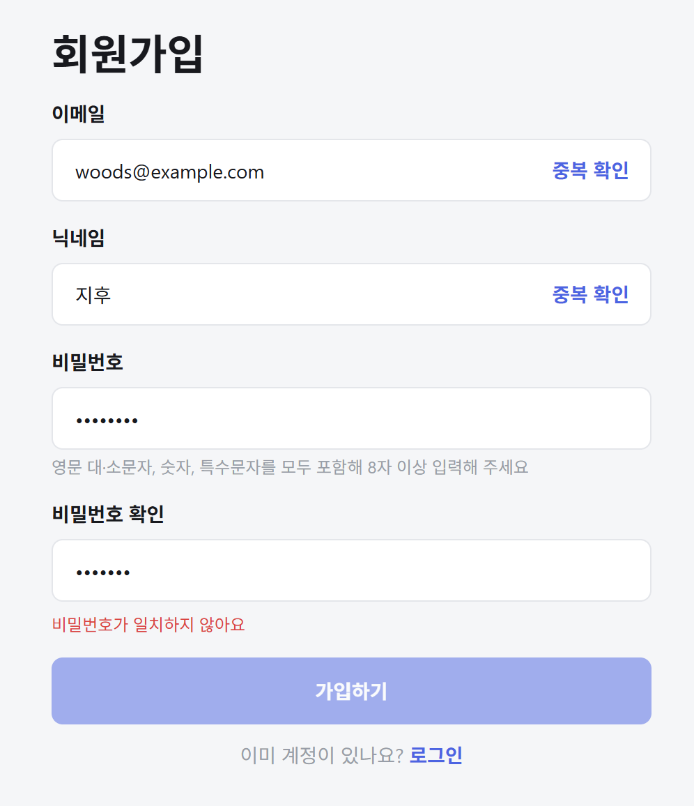
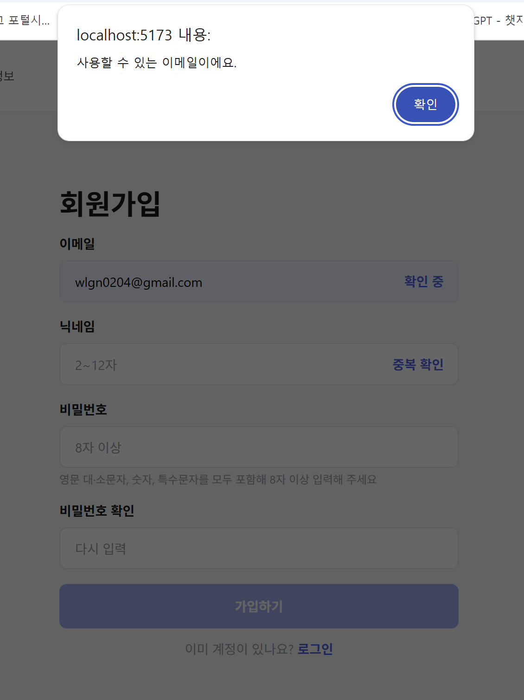
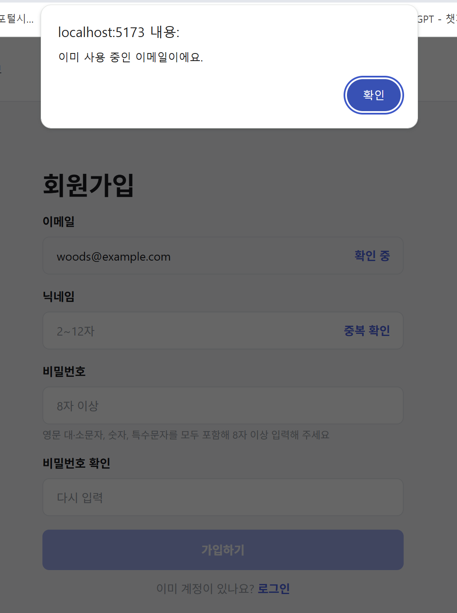
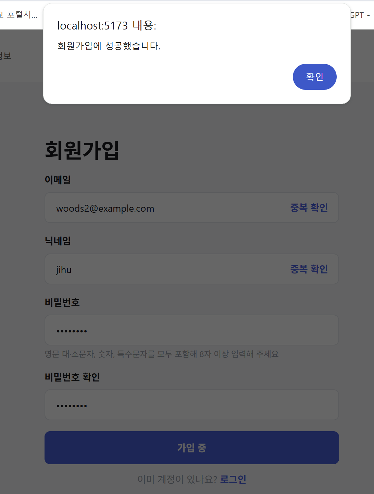
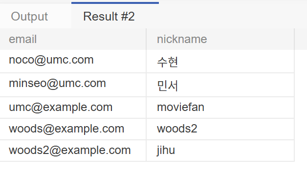

# 7주차 실습 — 회원가입 화면과 API 연동

> [!NOTE]
> UMC 11th Web 파트 워크북 7주차 실습 (3.1 ~ 3.4)

## 1. 입력값 검증

`/signup` 라우트에 `SignupPage`를 연결하고, 네 개의 입력값을 `useState` 하나로 관리했다. 유효성은 상태로 저장하지 않고 렌더링할 때마다 계산한다.

```tsx
const isNicknameValid =
  form.nickname.trim().length >= 2 && form.nickname.trim().length <= 12;

// 입력을 시작한 뒤에만 오류 표시
const showNicknameError = form.nickname.length > 0 && !isNicknameValid;
```

| 닉네임 길이 초과 | 비밀번호 확인 불일치 |
| --- | --- |
|  |  |

## 2. 중복 확인

형식이 맞아도 이미 쓰는 값인지는 서버에 물어봐야 알 수 있다. 5주차 API(`GET /members/email/{email}`)를 연결했다.

```tsx
// 확인한 값을 수정하면 결과를 초기화해, 확인한 값과 제출할 값이 달라지지 않게 함
setDuplicateCheck((prev) => ({ ...prev, [key]: DEFAULT_DUPLICATE_CHECK }));
```

| 사용 가능 | 이미 사용 중 |
| --- | --- |
|  |  |

가입하기 버튼은 입력 조건과 두 중복 확인을 모두 통과해야 활성화된다.

```tsx
const canSubmit =
  isFormValid &&
  duplicateCheck.email.isAvailable &&
  duplicateCheck.nickname.isAvailable;
```

## 3. 회원가입 API

6주차에 만든 `POST /members`에 요청한다. `passwordConfirm`은 화면에서만 쓰는 값이라 보내지 않는다.

```tsx
setIsSubmitting(true);
try {
  const response = await signup({ ... });
  alert(response.message);
} catch {
  alert("회원가입에 실패했어요. 다시 시도해 주세요.");
} finally {
  setIsSubmitting(false);
}
```

요청 중에는 버튼을 비활성화해 중복 제출을 막고, `finally`로 되돌려 실패해도 "가입 중"에 멈추지 않게 했다.

| 회원가입 성공 | DB 확인 |
| --- | --- |
|  |  |
