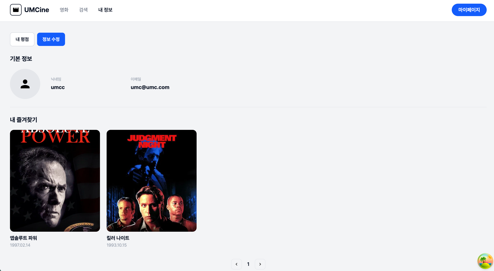

# Frontend Chapter08

## 필수 미션

### 로그인 전용 폴더

**구조**

```
routes/
  _auth.tsx          ← 로그인 검사 + <Outlet />
  _auth/
    me.index.tsx     /me
    me.edit.tsx      /me/edit
    me.ratings.tsx   /me/ratings
```

**가드 코드**

```tsx
export const Route = createFileRoute("/_auth")({
  beforeLoad: () => {
    if (!useAuthStore.getState().accessToken) {
      throw redirect({ to: "/login" });
    }
  },
  component: () => <Outlet />,
});
```

- `_auth`는 URL에 나타나지 않는 pathless layout이고, `_auth/` 안의 페이지는 모두 이 가드를 통과해야 열립니다.
- `beforeLoad`는 화면이 그려지기 전에 실행되어, 비로그인 사용자는 보호 페이지가 잠깐 보이지도 않고 `/login`으로 이동합니다.
- 훅이 아니라서 `useAuthStore.getState()`로 토큰을 직접 읽습니다.



### API 연결 흐름

| 기능 | API | 화면 |
| --- | --- | --- |
| 즐겨찾기 목록 | `GET /favorites` | 마이페이지 목록, 카드 북마크 |
| 즐겨찾기 여부/추가/삭제 | `GET·POST·DELETE /favorites…` | 영화 상세 버튼 |
| 평점 조회/등록/수정/삭제 | `GET /members/{id}/ratings`, `POST·PATCH·DELETE /ratings` | 영화 상세 평점 영역 |
