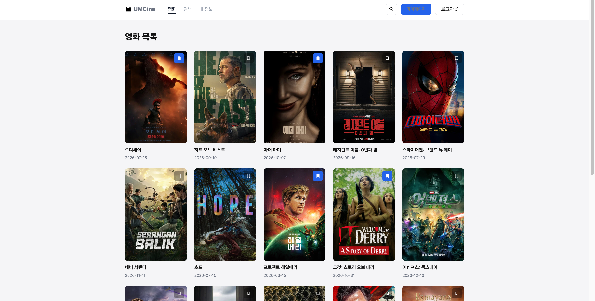
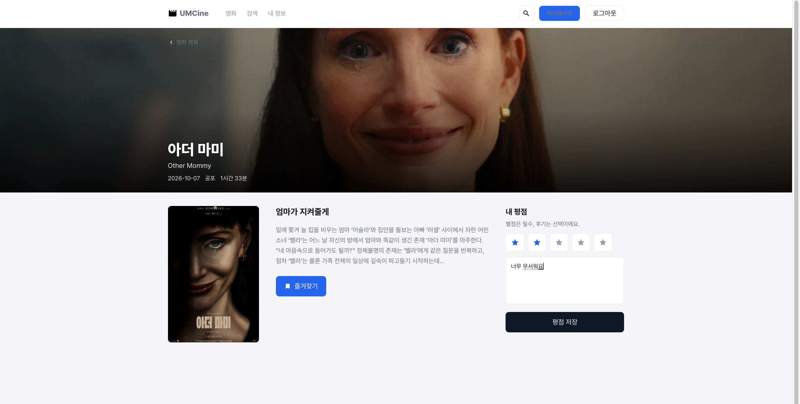
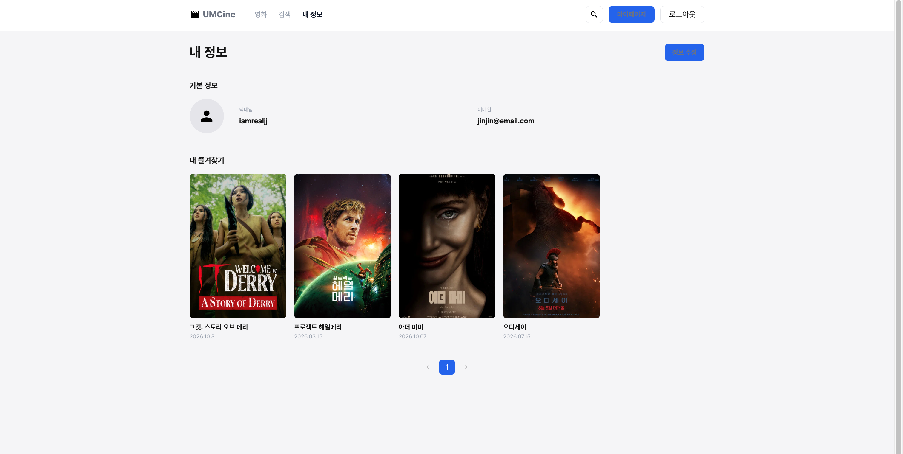

- 1. 로그인 전용 폴더 만들기
    
    로그인 후에만 접근할 수 있는 마이페이지와 내 정보 수정을 같은 폴더로 묶고, 공통 레이아웃 라우트에서 접근을 제한했다.
    
    폴더 구조
    
    ```
    src/routes/
    └── (protected)/              # Route Group: URL에 포함되지 않음
        └── _authenticated/       # 경로 없는 레이아웃 라우트
            ├── route.tsx         # 공통 Layout Route
            └── mypage/
                ├── index.tsx     # /mypage
                └── edit.tsx      # /mypage/edit
    ```
    
    - `(protected)`는 폴더만 묶는 용도라 URL과 라우트 트리에 영향을 주지 않는다.
    - `_authenticated`는 `_` 접두사 덕분에 경로 없이 하위 라우트를 감싸는 레이아웃 역할을 한다.
    - 주소는 이전과 같이 `/mypage`, `/mypage/edit`이다.
    
    ### 공통 Layout Route
    
    ```tsx
    // src/routes/(protected)/_authenticated/route.tsx
    export const Route = createFileRoute("/(protected)/_authenticated")({
      beforeLoad: () => {
        if (!useAuthStore.getState().accessToken) {
          throw redirect({ to: "/login" });
        }
      },
      component: Outlet,
    });
    ```
    
    - `beforeLoad`는 페이지를 보여 주기 전에 실행되며, 토큰이 없으면 `redirect`로 로그인 페이지로 보낸다.
    - `<Outlet />`이 하위 페이지(마이페이지, 내 정보 수정)가 렌더링되는 자리이다.
    - 토큰이 유효한지는 내 정보 API(`GET /members/me`)가 확인하고, 401이면 토큰이 지워진다.
- 2. 남은 API 연결하기
    
    ### 연결한 API
    
    | 구분 | API | 사용하는 곳 |
    | --- | --- | --- |
    | 즐겨찾기 | `GET /favorites` | 마이페이지 목록, 영화 목록 카드의 북마크 버튼 |
    | 즐겨찾기 | `GET /favorites/{movieId}` | 영화 상세의 즐겨찾기 버튼 |
    | 즐겨찾기 | `POST /favorites` | 즐겨찾기 등록 |
    | 즐겨찾기 | `DELETE /favorites/{movieId}` | 즐겨찾기 해제 |
    | 평점 | `GET /members/{memberId}/ratings` | 영화 상세의 내 평점 조회 |
    | 평점 | `POST /ratings` | 평점 등록 |
    | 평점 | `PATCH /ratings/{ratingId}` | 평점 수정 |
    | 평점 | `DELETE /ratings/{ratingId}` | 평점 삭제 |
    
    모두 토큰이 필요해서 `authApi`로 요청한다.
    
    ### 구조
    
    - `api/favorites/*`, `api/ratings/*`: endpoint별 요청 함수
    - `queries/favorite-queries.ts`, `queries/rating-queries.ts`: query key와 `queryOptions`
    - `hooks/use-toggle-favorite-mutation.ts`, `use-create/update/delete-rating-mutation.ts`: 변경 요청과 성공·실패 처리를 담은 `useMutation` 훅
    
    ### 즐겨찾기
    
    - 마이페이지는 응답에 `movieId`만 있어서 현재 페이지의 영화 정보를 TMDB에서 `useQueries`로 가져와 보여 준다. 10개씩 클라이언트에서 나누어 페이지네이션한다.
    - 영화 목록 카드는 카드마다 요청하지 않고 `GET /favorites` 결과 한 번으로 모든 북마크 버튼 상태를 정한다.
    - 영화 상세는 `GET /favorites/{movieId}`로 해당 영화의 여부만 조회한다.
    - 등록과 해제는 하나의 토글 훅으로 처리한다. 성공하면 상세의 여부 캐시는 `setQueryData`로 바로 바꾸고, 목록 캐시는 `invalidateQueries`로 다시 조회한다.
    - 로그인하지 않은 상태에서 누르면 `/login`으로 보낸다.
    - 기존 로컬 `bookmark-store`(zustand)는 서버 데이터로 대체되어 삭제했다.
    
    ### 평점
    
    - 내 평점 목록에서 현재 영화의 평점을 찾아, 있으면 값을 채워 수정과 삭제를, 없으면 등록을 보여 준다.
    - 등록 응답에는 `ratingId`만 있어서 `setQueryData`로 캐시를 만들 수 없다. 그래서 등록, 수정, 삭제 모두 평점 목록을 `invalidateQueries`로 다시 조회한다.
    - 서버 값이 바뀌면 `key`를 바꿔 폼 상태를 서버 값으로 새로 시작한다.
    
    ### 캐시 갱신 방식 정리
    
    | 상황 | 방식 | 이유 |
    | --- | --- | --- |
    | 즐겨찾기 토글 후 상세 여부 | `setQueryData` | 결과(true/false)를 이미 알고 있다 |
    | 즐겨찾기 토글 후 목록 | `invalidateQueries` | 항목이 늘거나 줄어 서버 기준으로 다시 받는다 |
    | 평점 등록, 수정, 삭제 | `invalidateQueries` | 응답에 갱신할 데이터가 충분하지 않다 |
    | 로그아웃 | `removeQueries` | 이전 사용자 정보가 남지 않게 한다 |
- 3. 결과 화면
    
    ### 영화 목록
    
    
    
    ### 평점 등록 화면
    
    
    
    ### 평점 등록 후
    
    
    
    ### 마이페이지
    
    