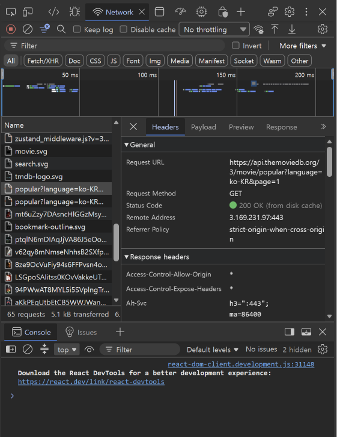
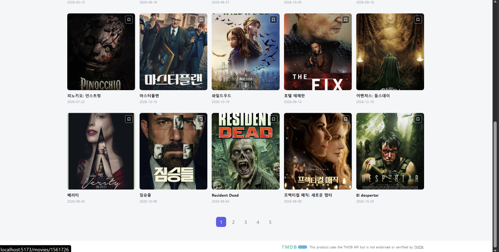
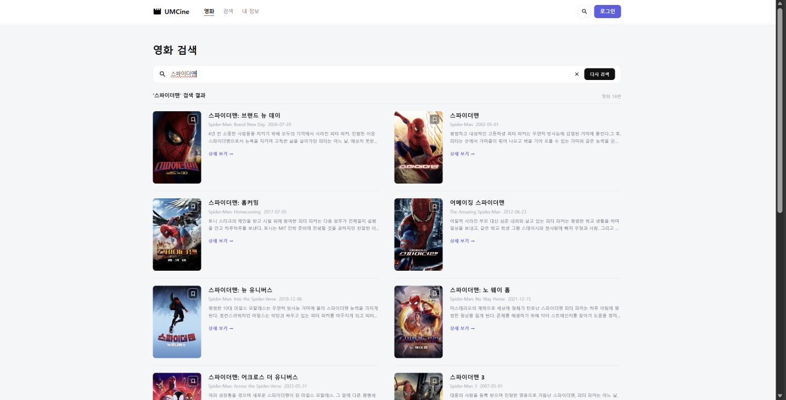
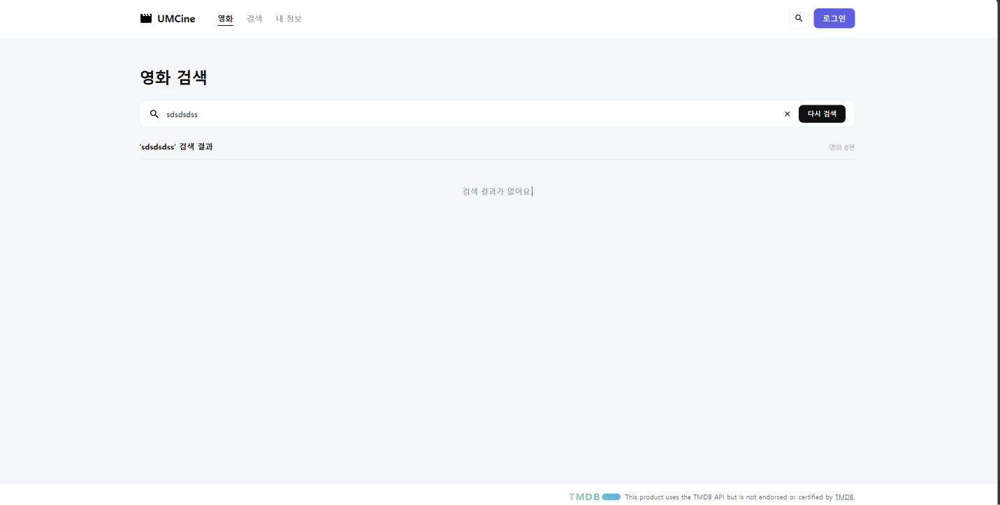
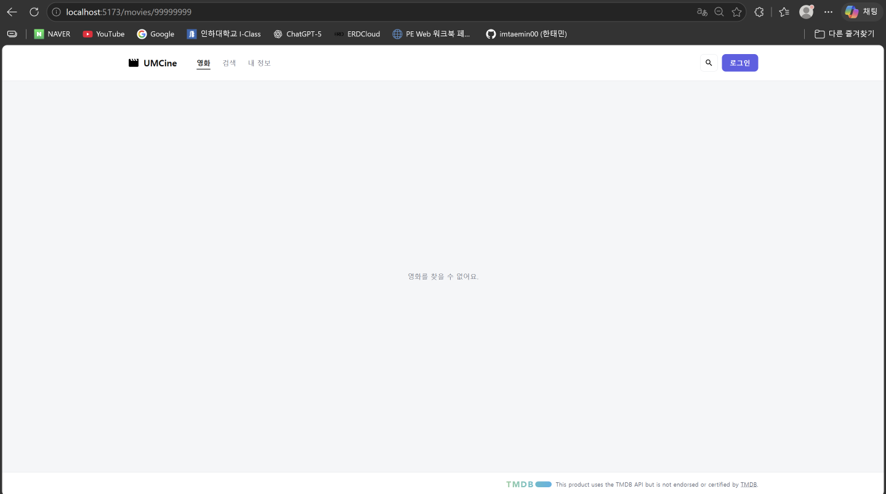
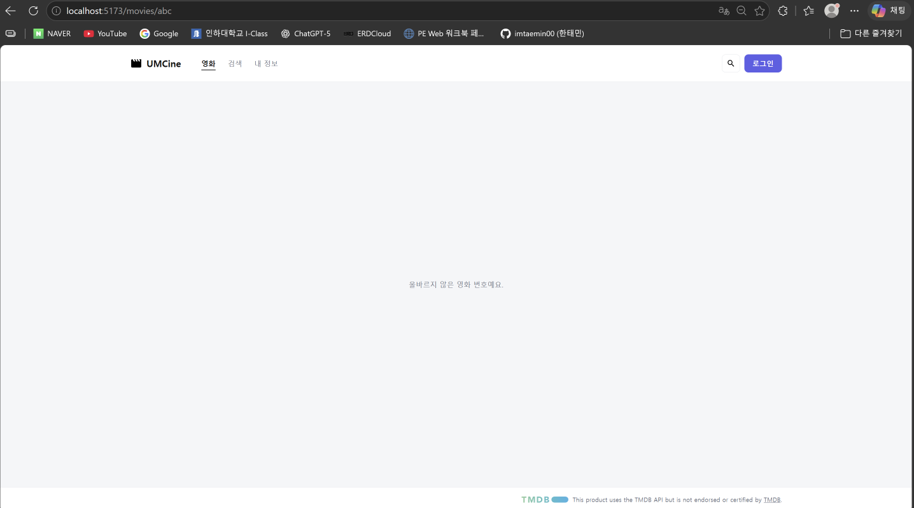

**api/movies/get-movies-with-fetch.ts**

```tsx
const response =await fetch(
  `${env.tmdbApiBaseUrl}/movie/popular?${searchParams}`,
  {
    headers: {
      Authorization: `Bearer${env.tmdbAccessToken}`,
    },
  },
);

if (!response.ok) {
  throw new Error(`영화 목록 요청에 실패했어요:${response.status}`);
}

return response.json();
```

- 순수 fetch로 인기 영화를 한 번 요청했다.
- fetch는 401, 404도 성공으로 처리하기 때문에 response.ok로 HTTP 오류를 직접 검사했다.

**api/tmdb-client.ts, api/movies/get-movies.ts**

```tsx
export const tmdbClient = ky.create({
  baseUrl: `${env.tmdbApiBaseUrl}/`,
  headers: {
    Authorization: `Bearer${env.tmdbAccessToken}`,
  },
});

function getMovies({ page =1 }:GetMoviesRequest ={}) {
  return tmdbClient
    .get("movie/popular", {
      searchParams: { language: "ko-KR", page},
    })
    .json<GetMoviesResponse>();
}
```

- base URL과 인증 헤더를 ky 인스턴스 한 곳에 모았다.
- 목록(getMovies), 검색(searchMovies), 상세(getMovieDetail)가 모두 tmdbClient를 사용한다.
- 토큰은 .env.local에 두고 Git에 올리지 않았다.

**pages/movies/movie-list-page.tsx**

```tsx
{isLoading ?(
  <p>영화 목록을 불러오는 중이에요.</p>
) : errorMessage ?(
  <p>{errorMessage}</p>
) : movies.length ===0 ?(
  <p>조건에 맞는 영화가 없어요.</p>
) :(
  <MovieGrid movies={movies} />
)}
```

- 로딩, 오류, 빈 결과, 성공을 이 순서로 나눠 보여 준다. 검색과 상세 화면도 같은 방식이다.

**utils/movies/get-movie-detail-error-message.ts**

```tsx
export function getMovieDetailErrorMessage(error:unknown) {
  if (isHTTPError(error) && error.response.status ===404) {
    return "영화를 찾을 수 없어요.";
  }

  return "영화 정보를 불러오지 못했어요.";
}
```

- TMDB가 404로 답하면 "영화를 찾을 수 없어요.", 그 외 실패(네트워크, 500 등)는 "영화 정보를 불러오지 못했어요."를 보여 준다.

**pages/movies/movie-detail-page.tsx**

```tsx
const parsedMovieId =Number(movieId);
const isValidMovieId = Number.isInteger(parsedMovieId) && parsedMovieId >0;
```

- 상세 URL이 /movies/abc처럼 양의 정수가 아니면 요청하지 않고 "올바르지 않은 영화 번호예요."를 보여 준다.

---

## **실행 결과**

**fetch 요청 확인**



- popular?language=ko-KR&page=1 요청, Status 200

**목록 화면 (TMDB 데이터)**




**검색 결과와 빈 결과**





**상세 화면과 오류 상태**


없는 영화



- /movies/99999999 → 영화를 찾을 수 없어요.



- /movies/abc → 올바르지 않은 영화 번호예요.