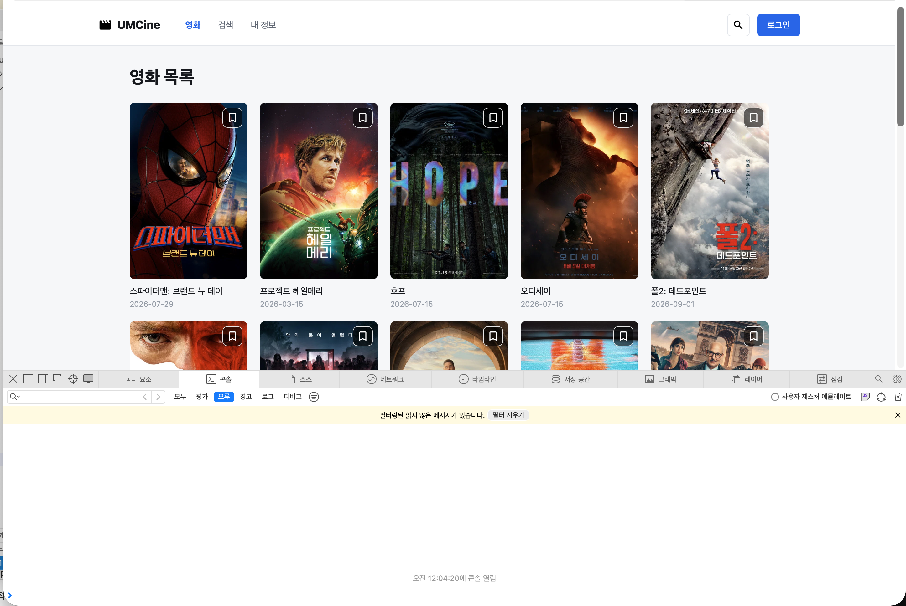

- 필수 미션

    ```jsx
    const response = await fetch(
        `${env.tmdbApiBaseUrl}/movie/popular?${searchParams}`,
        {
          headers: {
            Authorization: `Bearer ${env.tmdbAccessToken}`,
          },
        },
      );
    
      if (!response.ok) {
        throw new Error(`영화 목록 요청에 실패했어요: ${response.status}`);
      }
    ```

  fetch()를 직접 사용해 TMDB의 인기 영화 API를 요청하고 if문으로 응답이 200번대인지 확인한다.

    ```jsx
    export const tmdbClient = ky.create({
      baseUrl: `${env.tmdbApiBaseUrl}/`,
      headers: {
        Authorization: `Bearer ${env.tmdbAccessToken}`,
      },
    });
    ```

  위 클라이언트를 get-movies.ts, search-movies.ts, get-movie-details.ts의 API함수가 공통으로 사용한다.

    ```jsx
    const [tmdbMovies, setTmdbMovies] = useState<TmdbMovieListItem[]>([])
    const [isLoading, setIsLoading] = useState(true)
    const [errorMessage, setErrorMessage] = useState<string | null>(null)
    ```

    ```jsx
    {isLoading ? (
              <p className="py-16 text-center text-sm text-[#606774]">
                검색 결과를 불러오는 중이에요.
              </p>
            ) : errorMessage ? (
              <p className="py-16 text-center text-sm text-[#dc2626]">
                {errorMessage}
              </p>
            ) : movies.length === 0 ? (
              <p className="py-16 text-center text-sm text-[#606774]">
                조건에 맞는 영화가 없어요.
              </p>
            )
    ```

    ```jsx
    if (isLoading) {
        return (
          <main className="mx-auto max-w-[1100px] px-5 py-20 text-center sm:px-10">
            <p className="text-sm text-[#606774]">
              영화 정보를 불러오는 중이에요.
            </p>
          </main>
        )
      }
    
      if (errorMessage || !movie) {
        return (
          <main className="mx-auto max-w-[1100px] px-5 py-20 text-center sm:px-10">
            <h1 className="text-2xl font-bold text-[#17191e]">
              {errorMessage ?? '영화를 찾을 수 없어요.'}
            </h1>
            <Link
              className="mt-5 inline-block text-sm font-semibold text-[#2563eb]"
              to="/"
            >
              영화 목록으로 돌아가기
            </Link>
          </main>
        )
      }
    ```

  로딩, 오류, 빈 상태 구분

    ```jsx
    <footer className="border-t border-[#e3e6eb] bg-white">
            <div className="mx-auto flex min-h-16 max-w-[1200px] items-center justify-end gap-2 px-5 sm:px-10">
              
              <p className="text-[10px] text-[#606774]">
                This product uses the TMDB API but is not endorsed or certified by{' '}
                <a className="underline" href="https://www.themoviedb.org/" target="_blank" rel="noreferrer">
                  TMDB.
                </a>
              </p>
            </div>
          </footer>
    ```

  출처 표기

