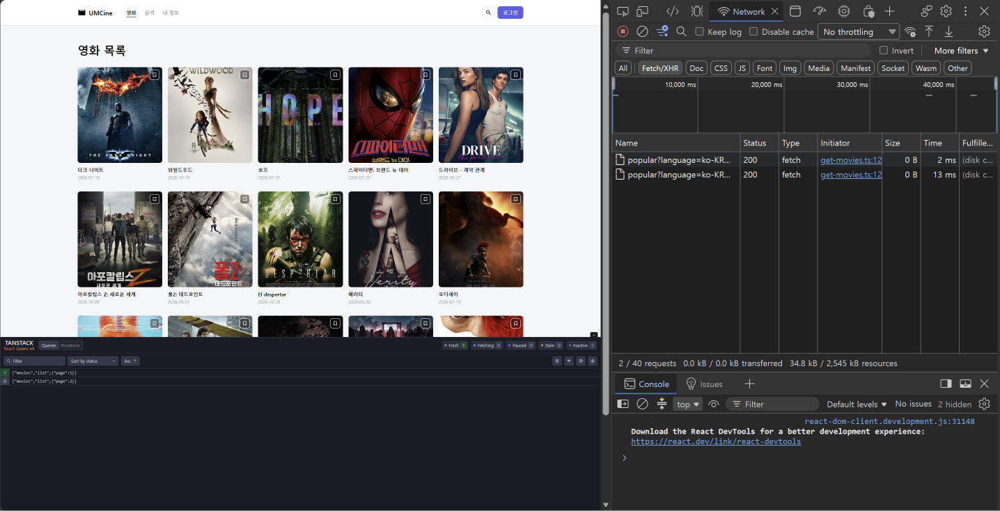
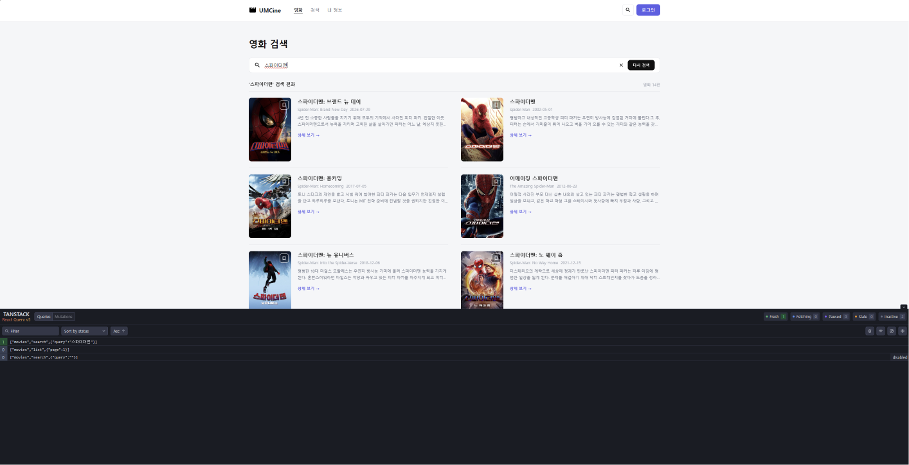
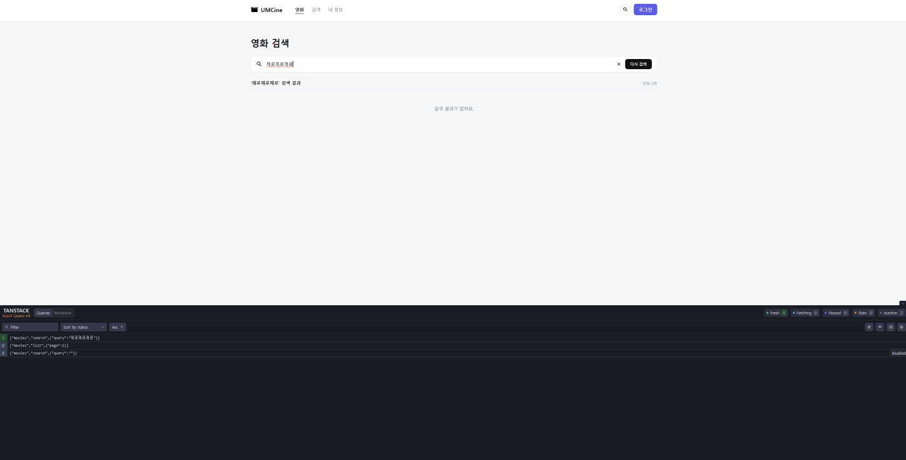
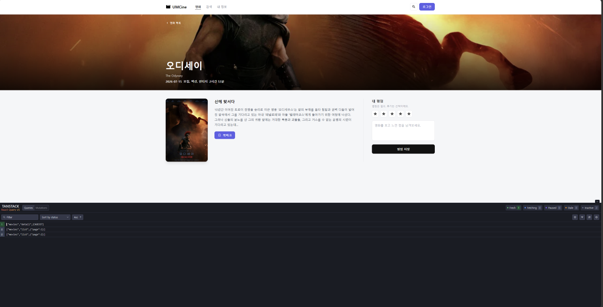
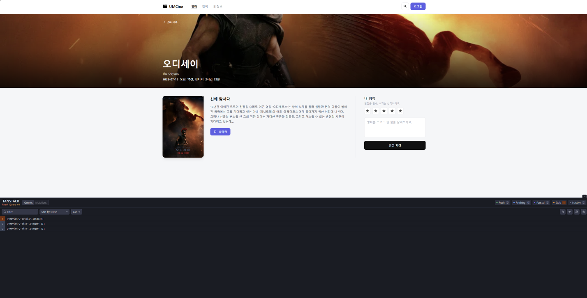

**main.tsx**

```tsx
const ONE_MINUTE =60 *1000;
const queryClient =new QueryClient({
  defaultOptions: { queries: { staleTime: ONE_MINUTE} },
});

createRoot(document.getElementById("root")!).render(
  <StrictMode>
    <QueryClientProvider client={queryClient}>
      <RouterProvider router={router} />
      <ReactQueryDevtools initialIsOpen={false} />
    </QueryClientProvider>
  </StrictMode>,
);
```

- QueryClientProvider로 앱 전체를 감싸서 모든 화면이 같은 캐시를 쓰게 했다.
- 모든 useQuery의 staleTime 기본값을 1분으로 정했다. 1분 안에 같은 데이터를 다시 열면 요청하지 않는다.

**pages/movies/movie-list-page.tsx**

```tsx
const [page, setPage] =useState(1);

const moviesQuery =useQuery({
  queryKey: ["movies", "list", { page}],
  queryFn: () => getMovies({ page}),
});

const movies = moviesQuery.data?.results ??[];
const totalPages = moviesQuery.data?.total_pages ??0;
```

```tsx
{moviesQuery.isPending ?(
  <p>영화 목록을 불러오는 중이에요.</p>
) : moviesQuery.isError ?(
  <p>영화 목록을 불러오지 못했어요.</p>
) : movies.length ===0 ?(
  <p>조건에 맞는 영화가 없어요.</p>
) :(
  <>
    <MovieGrid movies={movies} />
    <Pagination page={page} totalPages={totalPages} onPageChange={setPage} />
  </>
)}
```

- 5주차의 useEffect와 movies, isLoading, errorMessage 상태를 useQuery 하나로 바꿨다.
- query key에 page를 넣어서 페이지마다 캐시를 따로 저장한다.
- 로딩, 오류, 빈 목록, 성공 순서로 화면을 나눴다.

**pages/movies/search-page.tsx**

```tsx
const normalizedQuery = query?.trim() ??"";

const searchQuery =useQuery({
  queryKey: ["movies", "search", { query: normalizedQuery}],
  queryFn: () => searchMovies({ query: normalizedQuery}),
  enabled: normalizedQuery.length >0,
});

const movies = searchQuery.data?.results ??[];
```

```tsx
{searchQuery.isLoading ?(
  <p>검색 결과를 불러오는 중이에요.</p>
) : searchQuery.isError ?(
  <p>검색 결과를 불러오지 못했어요.</p>
) : movies.length ===0 ?(
  <p>검색 결과가 없어요.</p>
) :(
  <ul>{/* 검색 결과 목록 */}</ul>
)}
```

- query key에 검색어를 넣어서 검색어마다 캐시를 따로 저장한다.
- enabled로 검색어가 있을 때만 요청한다. 검색어가 없으면 "검색어를 입력해 주세요." 화면을 먼저 보여 준다.
- 검색은 요청을 안 할 때도 isPending이 true라서, 실제로 요청 중일 때만 true인 isLoading으로 로딩을 판단했다.

**pages/movies/movie-detail-page.tsx**

```tsx
const parsedMovieId =Number(movieId);
const isValidMovieId = Number.isInteger(parsedMovieId) && parsedMovieId >0;

const movieDetailQuery =useQuery({
  queryKey: ["movies", "detail", parsedMovieId],
  queryFn: () => getMovieDetail(parsedMovieId),
  enabled: isValidMovieId,
  staleTime: 30 *1000,
});

if (!isValidMovieId) return <main>올바르지 않은 영화 번호예요.</main>;
if (movieDetailQuery.isPending) return <main>영화 정보를 불러오는 중이에요.</main>;
if (movieDetailQuery.isError) return <main>{getMovieDetailErrorMessage(movieDetailQuery.error)}</main>;

const movie = movieDetailQuery.data;
```

- query key에 영화 번호를 넣어서 영화마다 캐시를 따로 저장한다.
- 번호가 0보다 큰 정수일 때만 요청한다. 잘못된 번호는 요청을 안 해도 isPending이 true라서 잘못된 번호 검사를 로딩보다 먼저 둔다.
- 상세만 staleTime을 30초로 따로 정했다. 개별 useQuery에 쓴 값이 전역 1분보다 우선한다.

---

## **실행 결과**

**목록 화면과 캐시 재사용 (Network 패널)**

목록 캐시 재사용



- 목록에서 1 → 2 → 1페이지로 이동했다. popular 요청은 1페이지, 2페이지 2개뿐이고, 1분 안에 돌아온 1페이지는 다시 요청하지 않았다.
- Query 개발자 도구에 ["movies","list",{"page":1}], ["movies","list",{"page":2}]가 따로 저장되어 있다.

**검색 결과와 빈 결과**

검색 결과



- "스파이더맨" 검색 → 결과 14편, 개발자 도구에 ["movies","search",{"query":"스파이더맨"}]가 생겼다.
- 검색어가 없을 때의 ["movies","search",{"query":""}]는 enabled가 false라서 disabled로 표시되고 요청하지 않았다.

빈 결과



- "제로제로제로" 검색 → "검색 결과가 없어요."와 영화 0편

**상세 화면과 staleTime 30초**

상세 fresh



- 상세를 연 직후 ["movies","detail",1368337]은 fresh(초록)이다.

상세 stale



- 30초가 지나자 같은 줄이 stale(주황)로 바뀌었다. 목록 query는 1분 기준이라 상세가 먼저 stale이 된다.