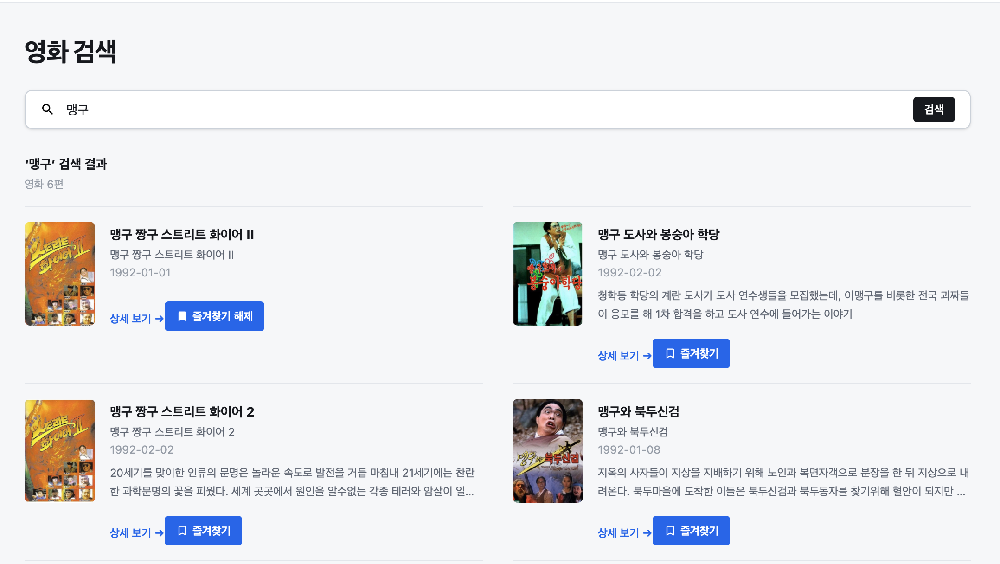
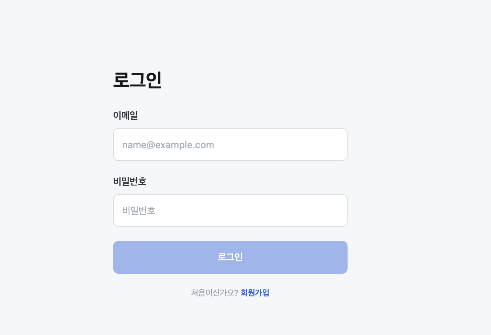

- 필수 미션

    ```jsx
    const [email, setEmail] = useState("");
      const [password, setPassword] = useState("");
    
      const canLogin = email.trim().length > 0 && password.length > 0;
    
      function handleSubmit(event: FormEvent<HTMLFormElement>) {
        event.preventDefault();
    
        if (!canLogin) return;
    
        alert(`${email}로 로그인했어요.`);
      }
    ```

  로그인 입력,제출 처리

    ```jsx
    import { create } from "zustand";
    
    interface ProfileStore {
      nickname: string;
      email: string;
      updateProfile: (nickname: string) => void;
    }
    
    export const useProfileStore = create<ProfileStore>((set) => ({
      nickname: "riooo",
      email: "jiho@naver.com",
      updateProfile: (nickname) => set({ nickname }),
    }));
    ```

  내 정보 저장

    ```jsx
    const nickname = useProfileStore((state) => state.nickname);
      const email = useProfileStore((state) => state.email);
      const bookmarkedMovieIds = useBookmarkStore(
      (state) => state.bookmarkedMovieIds,
        );
    
      const favoriteQueries = useQueries({
        queries: bookmarkedMovieIds.map((movieId) =>
          movieDetailQueryOptions(movieId, true),
        ),
      });
    
    const favoriteMovies = favoriteQueries.flatMap((query) =>
      query.data ? [query.data] : [],
    );
    ```

  내 정보 조회, 즐겨찾기 표시

    ```jsx
    const savedNickname = useProfileStore((state) => state.nickname);
      const email = useProfileStore((state) => state.email);
      const updateProfile = useProfileStore((state) => state.updateProfile);
      const navigate = useNavigate();
    
      const [nickname, setNickname] = useState(savedNickname);
    
      function handleSubmit(event: FormEvent<HTMLFormElement>) {
        event.preventDefault();
    
   [..](../..)     if (nickname.trim().length < 2 || nickname.trim().length > 12) {
          alert("닉네임은 2~12자로 입력해 주세요.");
          return;
        }
    
        updateProfile(nickname.trim());
        alert("변경사항을 저장했어요.");
        navigate({ to: "/me" });
      }
    ```

  내 정보 수정, 저장 처리




