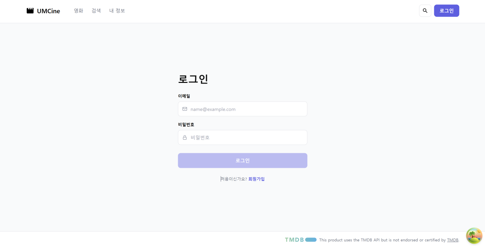
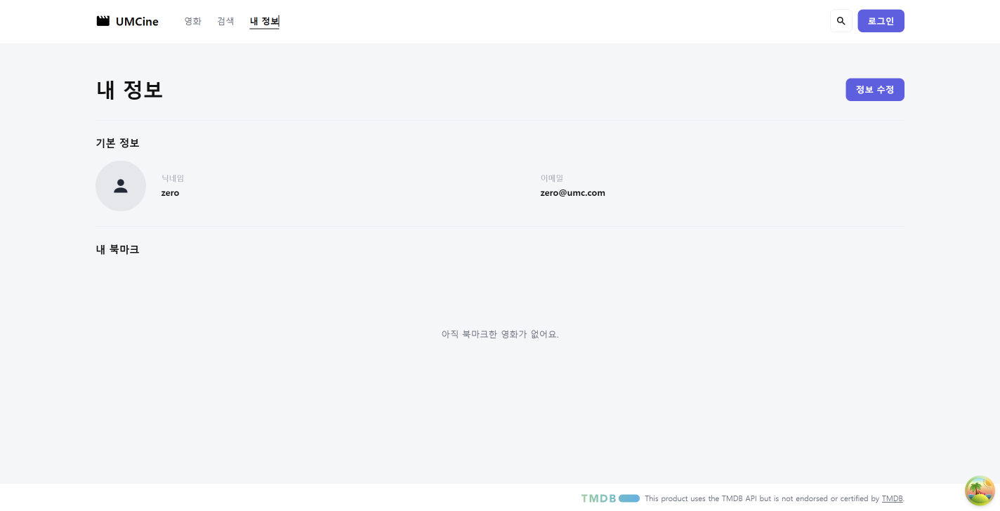
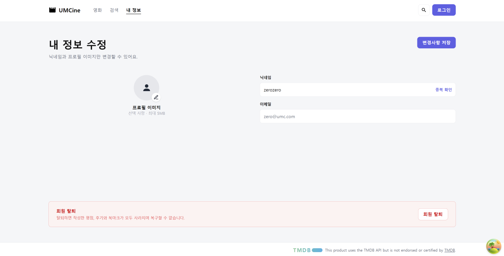
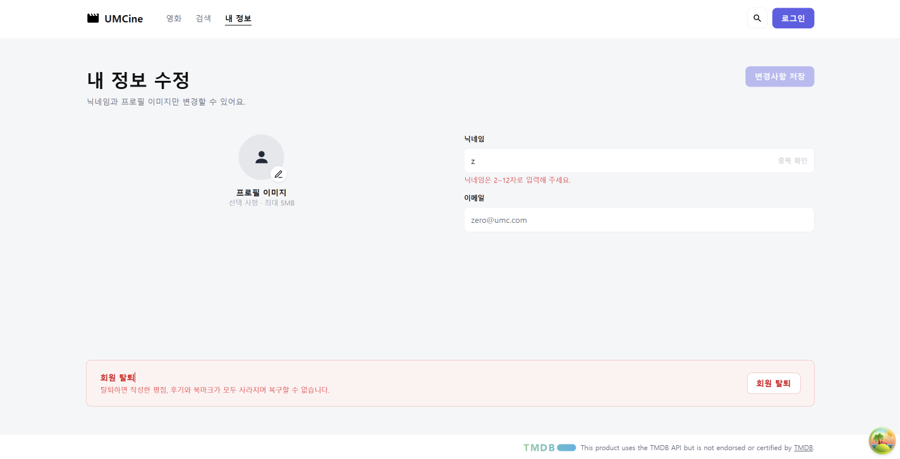

- 필수 미션

  **1. 로그인 화면**

  

    - /login. 이메일과 비밀번호를 둘 다 입력하기 전에는 로그인 버튼이 비활성화된다.

  **2. 내 정보 화면**

  

    - /my. 기본 정보(닉네임, 이메일)와 내 북마크 목록을 보여 준다. 북마크가 없으면 안내 문구가 나온다.

  **3. 내 정보 수정 화면**

  

    - /my/edit. 닉네임을 바꾸면 변경사항 저장 버튼이 활성화된다. 이메일은 수정할 수 없다.

  **4. 닉네임 입력 오류**

  

    - 닉네임을 1글자로 줄이면 "닉네임은 2~12자로 입력해 주세요."가 나오고 저장 버튼이 비활성화된다.

- 선택 미션

  **로그인이 필요한 페이지를 묶는 폴더 구조**

    ```
    src/
    ├─ routes/
    │  ├─ index.tsx          /
    │  ├─ search.tsx         /search
    │  ├─ signup.tsx         /signup
    │  ├─ login.tsx          /login
    │  ├─ movies.$movieId.tsx
    │  └─ my/                로그인이 필요한 페이지
    │     ├─ index.tsx       /my (내 정보 조회)
    │     └─ edit.tsx        /my/edit (내 정보 수정)
    └─ pages/
       ├─ auth/              login-page.tsx, signup-page.tsx
       ├─ movies/
       └─ my/                my-page.tsx, my-edit-page.tsx
    ```

    - 내 정보 조회와 수정은 둘 다 로그인해야 쓸 수 있어서 routes/my 폴더 하나에 묶었다. 주소도 /my로 시작해서 한눈에 구분된다.
    - 로그인, 회원가입처럼 로그인 없이 들어가는 페이지는 my 폴더 밖에 둔다.
    - 화면 코드도 pages/my에 같은 기준으로 모았다.