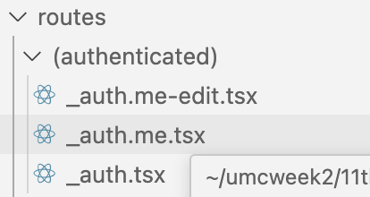

- 필수 미션
    1. 로그인 전용 폴더 만들기



  기존의 me.tsx → _auth.me.tsx

  me-edit.tsx → _auth.me-edit.tsx

    ```jsx
    import {
      createFileRoute,
      Outlet,
      redirect,
    } from "@tanstack/react-router";
    import { useAuthStore } from "../../stores/auth-store";
    
    export const Route = createFileRoute("/(authenticated)/_auth")({
      beforeLoad: () => {
        const accessToken = useAuthStore.getState().accessToken;
    
        if (!accessToken) {
          throw redirect({ to: "/login" });
        }
      },
      component: AuthLayout,
    });
    
    function AuthLayout() {
      return <Outlet />;
    }
    ```

  로그인한 사용자만 들어갈 수 있게 beforeLoad로 페이지를 보여주기 전에 실행되어 auth-store로 토큰을 받고 토큰이 없으면 login창, 있으면 허용된다.

1. 남은 API 연결하기

    ```jsx
    export interface ApiResponse<T> {
      isSuccess: boolean;
      code: string;
      message: string;
      result: T;
    }
    
    export interface Favorite {
      favoriteId: number;
      movieId: number;
      createdAt: string;
    }
    
    export interface FavoriteStatus {
      isFavorite: boolean;
    }
    
    export function getFavorites() {
      return authApi.get("favorites").json<ApiResponse<Favorite[]>>();
    }
    
    export function getFavoriteStatus(movieId: number) {
      return authApi
        .get(`favorites/${movieId}`)
        .json<ApiResponse<FavoriteStatus>>();
    }
    
    export function createFavorite(movieId: number) {
      return authApi
        .post("favorites", { json: { movieId } })
        .json<ApiResponse<Favorite>>();
    }
    
    export function deleteFavorite(movieId: number) {
      return authApi.delete(`favorites/${movieId}`).json<ApiResponse<null>>();
    }
    ```

   즐겨찾기 API 요청 추가

    ```jsx
    const isFavorite = favoriteStatusQuery.data?.result.isFavorite ?? false;
    
    if (isFavorite) {
          deleteMutation.mutate(movieId);
          return;
        }
    
        createMutation.mutate(movieId);
        }
    ```

   Bookmark button에서 useMutation으로 등록, 삭제 API 호출

    ```jsx
    const bookmarkedMovieIds =
        favoritesQuery.data?.result.map((favorite) => favorite.movieId) ?? [];
    
      const favoriteQueries = useQueries({
        queries: bookmarkedMovieIds.map((movieId) =>
          movieDetailQueryOptions(movieId, true),
        ),
      });
    ```

   즐겨찾기 목록 교체

   +스프링에서 MemberInfoResponse에 memberId 추가