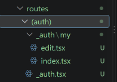
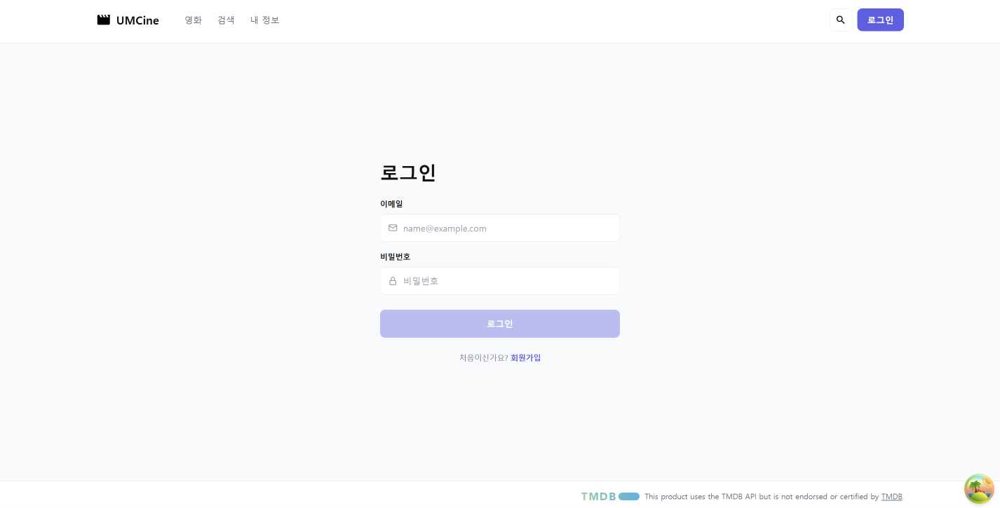
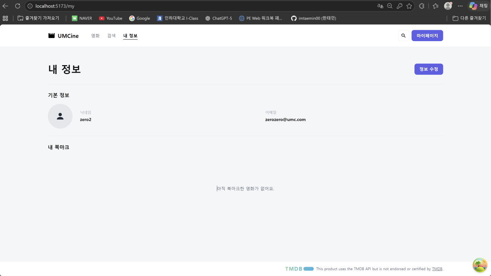
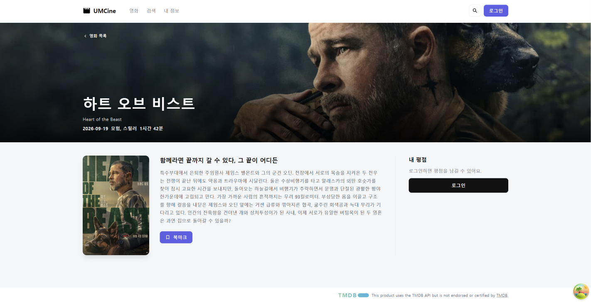
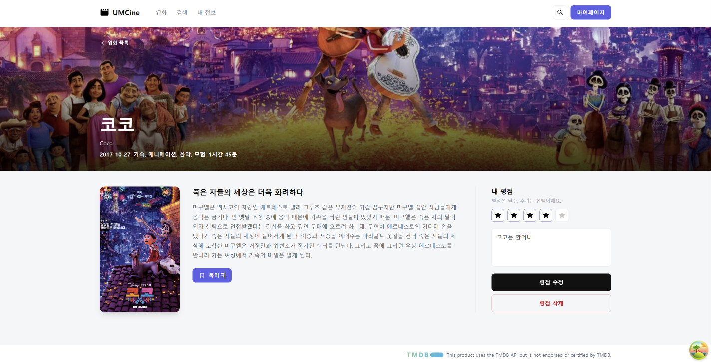
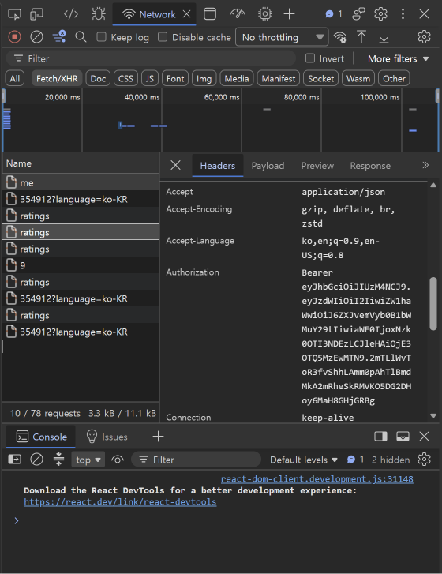
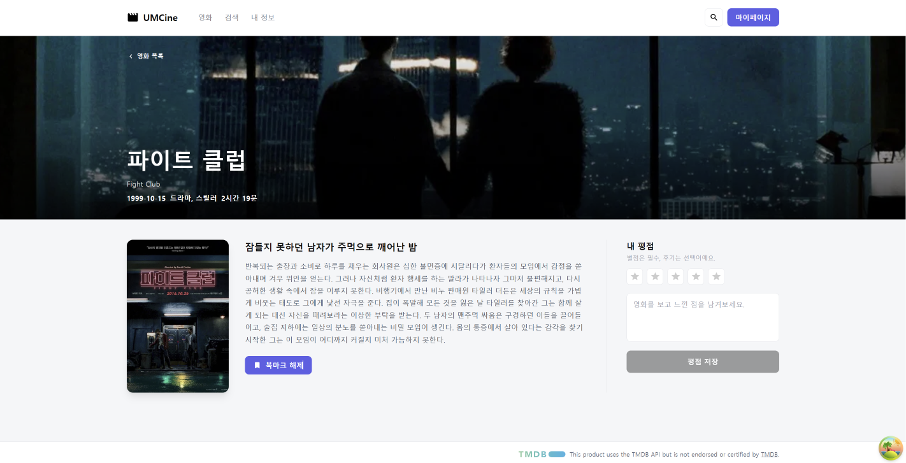
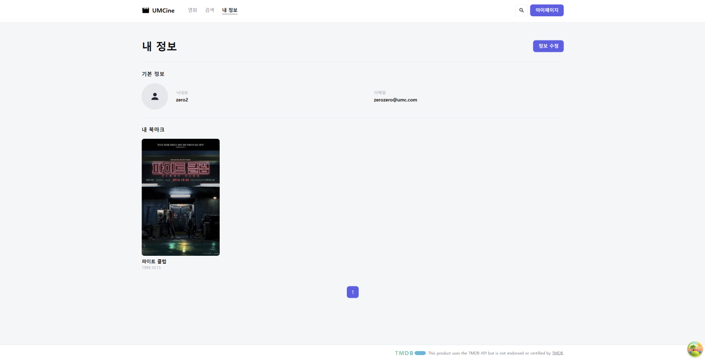
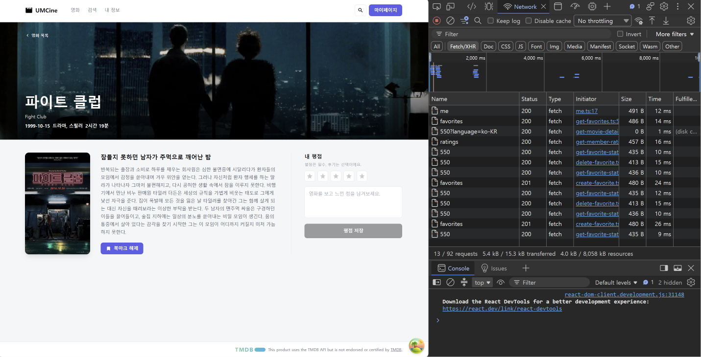

## **필수 미션 1. 로그인 전용 폴더 만들기**

**1. 폴더 구조**

- routes/(auth)는 Route Group이라 주소에 안 나온다. 그 안의 _auth.tsx는 Pathless Layout이고, _auth/ 폴더 안의 my/index.tsx(/my), my/edit.tsx(/my/edit)를 감싼다.
- 토큰 검사는 _auth.tsx의 beforeLoad 한 곳에만 있고, Outlet 자리에 안쪽 페이지가 그려진다.

**2. 로그아웃 상태에서 /my 접근**

- 토큰이 없으면 beforeLoad가 redirect를 던져 /login으로 보낸다. /my/edit, 헤더의 "내 정보" 링크도 같다.

**3. 로그인 후 /my**

- 주소는 그대로 /my이고, 닉네임과 이메일은 GET /members/me로 받아 온 실제 값이다.

## **필수 미션 2. 남은 API 연결하기**

### **평점 (영화 상세)**

**1. 로그아웃 상태**

- 로그인하지 않으면 평점 입력 대신 로그인 안내가 보인다.

**2. 평점 저장**

- POST /ratings로 저장한 뒤 내 평점 목록(["ratings", "member"])을 invalidateQueries로 다시 받아 와서 별점, 후기와 수정, 삭제 버튼이 보인다.

**3. 요청에 토큰이 붙는지**

- authApi가 Authorization: Bearer 토큰을 붙이고, Payload에는 movieId, score, comment만 있고 memberId는 없다.

### **북마크 (영화 상세, 마이페이지)**

**1. 상세 화면 북마크**

- 상세 화면을 열면 GET /favorites/{movieId}로 북마크 여부를 받아 버튼 모양을 정한다. 누르면 POST /favorites, 다시 누르면 DELETE /favorites/{movieId}를 보낸다.

**2. 마이페이지 내 북마크**

- GET /favorites로 받은 목록을 최근 순으로 보여 준다. 북마크 원본이 localStorage가 아니라 서버 DB라서 다른 브라우저에서 로그인해도 같다.

**3. 캐시 갱신**

- 등록, 해제 응답에는 목록 전체가 없어서 invalidateQueries({ queryKey: [“favorites”] })로 목록과 여부를 함께 낡음 표시한다. 캡처에서 favorites(201, 등록)와 550(DELETE, 해제) 바로 뒤에 상세 화면이 쓰는 여부 조회(GET 550)가 다시 나간다. 상세 화면에서 안 쓰는 목록(GET favorites)은 이때 나가지 않고, /my를 열 때 다시 요청된다.