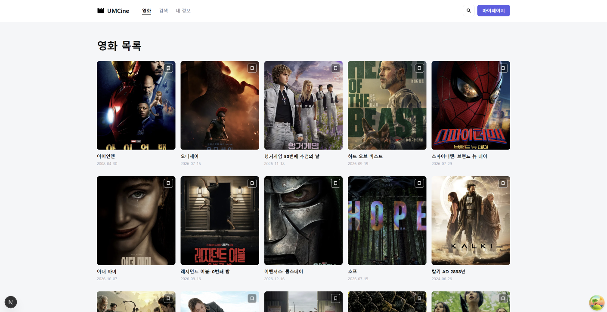
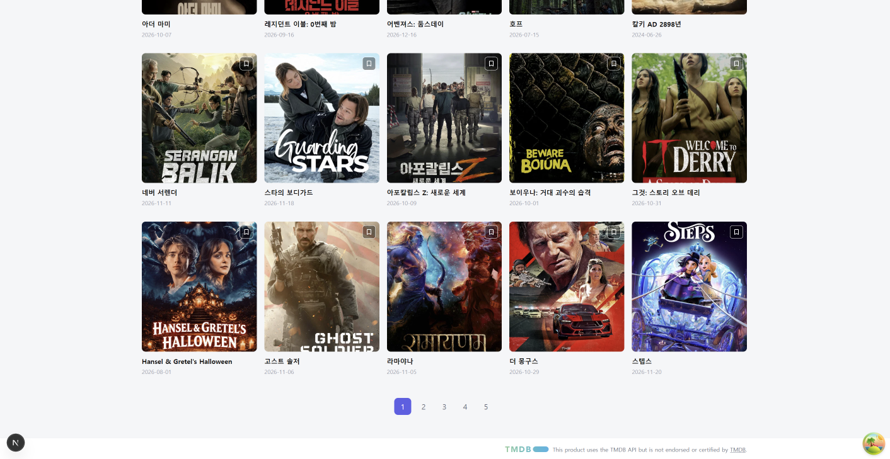
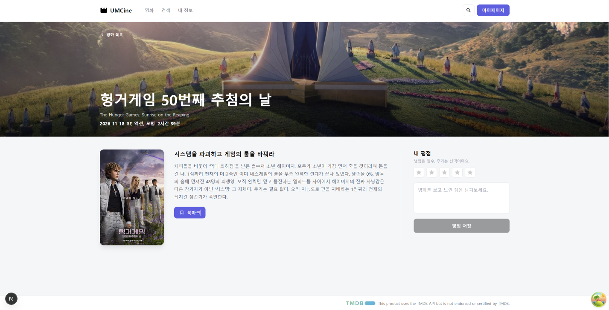
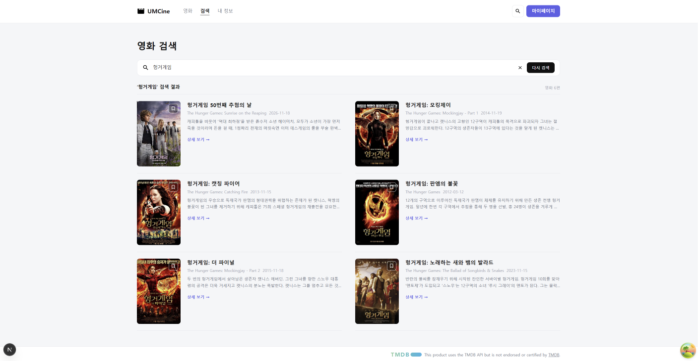
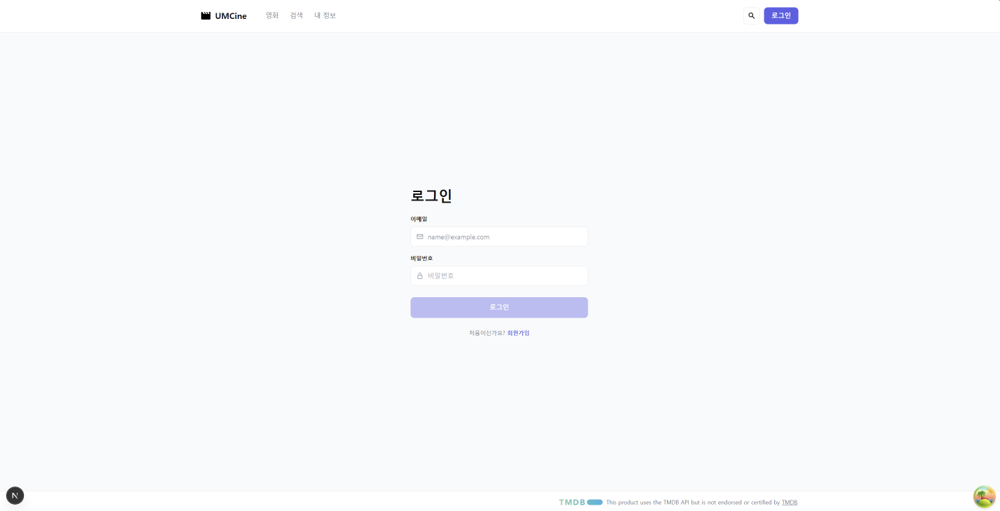
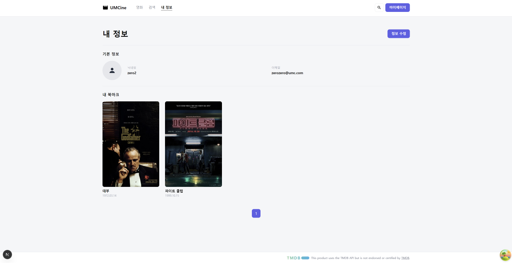
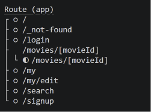

- 필수 미션

  기존 `umcine/`(Vite + TanStack Router)는 그대로 두고, 레포 최상위에 `umcine-next/`를 새로 만들어 옮겼다.

  ### **핵심 코드**

  **1. 라우트 파일 → app 폴더**

  | **기존 (TanStack Router)** | **Next.js (App Router)** |
      | --- | --- |
  | `routes/__root.tsx` | `app/layout.tsx` |
  | `routes/index.tsx` | `app/page.tsx` |
  | `routes/movies.$movieId.tsx` | `app/movies/[movieId]/page.tsx` |
  | `routes/search.tsx` | `app/search/page.tsx` |
  | `routes/login.tsx`, `signup.tsx` | `app/login/page.tsx`, `app/signup/page.tsx` |
  | `routes/(auth)/_auth.tsx` | `app/(auth)/layout.tsx` |
  | `routes/(auth)/_auth/my/index.tsx`, `edit.tsx` | `app/(auth)/my/page.tsx`, `app/(auth)/my/edit/page.tsx` |
    - 화면 코드가 있던 `src/pages/`는 Next.js Pages Router 예약 폴더라 `src/screens/`로 이름을 바꿨다.

  **2. TanStack Router 전용 API → Next.js API**

  | **기존** | **변경** |
      | --- | --- |
  | `Link to="/movies/$movieId" params={...}` | `Link href={`/movies/${id}`}` (`next/link`) |
  | `useNavigate()` | `useRouter().push()` (`next/navigation`) |
  | `useParams({ from: ... })` | `useParams<{ movieId: string }>()` |
  | `useSearch({ from: ... })` | `useSearchParams().get("query")` |
  | `Link`의 `activeProps`로 현재 메뉴 표시 | `usePathname()`으로 비교해 className 지정 |
  | `beforeLoad` + `redirect` | Client Component의 `useEffect` + `router.replace` |
  | `import.meta.env.VITE_*` | `process.env.NEXT_PUBLIC_*` |

  **3. 라이브러리 설정 (QueryClient)**

    ```tsx
    // src/app/providers.tsx
    "use client";
    
    export default function Providers({ children }:{ children:ReactNode }) {
      const [queryClient] =useState(
        () => new QueryClient({ defaultOptions: { queries: { staleTime: ONE_MINUTE} } }),
      );
    
      return <QueryClientProvider client={queryClient}>{children}</QueryClientProvider>;
    }
    ```

    - 기존 `main.tsx`에서 만들던 QueryClient를 Client Component로 옮기고, `layout.tsx`에서 감쌌다.
    - `useState`로 만들어서 다시 렌더링돼도 같은 QueryClient를 쓴다.

  **4. Server / Client Component 경계**

    - `layout.tsx`, `page.tsx`는 Server Component로 두고 `metadata`를 export했다.
    - 클릭, 상태, 훅을 쓰는 `screens/*`, `header.tsx`, `providers.tsx`, `components/auth/*`에만 `"use client"`를 붙였다.
    - `usePathname`, `useParams`, `useSearchParams`를 쓰는 컴포넌트는 `Suspense`로 감쌌다. (Cache Components가 켜져 있어서 감싸지 않으면 빌드 오류)

  **5. 브라우저 API가 서버에서 실행되지 않게**

    ```tsx
    // src/components/auth/require-auth.tsx
    "use client";
    
    export function RequireAuth({ children }:{ children:ReactNode }) {
      const router =useRouter();
      const accessToken =useAuthStore((state) => state.accessToken);
    
      // 브라우저에 저장된 실제 토큰을 확인하고, 없으면 로그인 페이지로 보냄
      useEffect(() => {
        if (!useAuthStore.getState().accessToken) {
          router.replace("/login");
        }
      }, [accessToken, router]);
    
      return <div className={accessToken ?"contents" :"hidden"}>{children}</div>;
    }
    ```

    - 토큰은 localStorage(Zustand persist)에 있고 서버에는 localStorage가 없어서, 브라우저에서만 실행되는 `useEffect` 안에서 확인한다.
    - 확인 전에는 화면을 숨겨서 로그아웃 상태에서 `/my`가 잠깐 보이지 않게 했다.

    ---

  ## **실행 결과**

  **1. 홈 영화 목록**

  

  

    - TMDB 목록이 기존과 똑같이 나온다.

  **2. 영화 상세**

  

    - 주소의 `[movieId]`를 `useParams`로 읽어 상세를 불러온다. 탭 제목은 "영화 상세 | UMCine".

  **3. 검색**

  

    - 검색어가 `?query=`로 주소에 들어가고 `useSearchParams`로 읽는다.

  **4. 로그아웃 상태에서 /my 접근**

  

    - `(auth)/layout.tsx`가 토큰이 없으면 `/login`으로 보낸다.

  **5. 로그인 후 내 정보**

  

    - 백엔드 CORS에 `http://localhost:3000`을 추가한 뒤 로그인과 내 정보 조회가 된다.

  **6. 빌드 결과**

  

    - `○`는 빌드 때 미리 만든 페이지(SSG), `◐ /movies/[movieId]`는 껍데기는 미리 만들고 `movieId` 부분만 요청 때 채우는 부분 사전 렌더링이다.