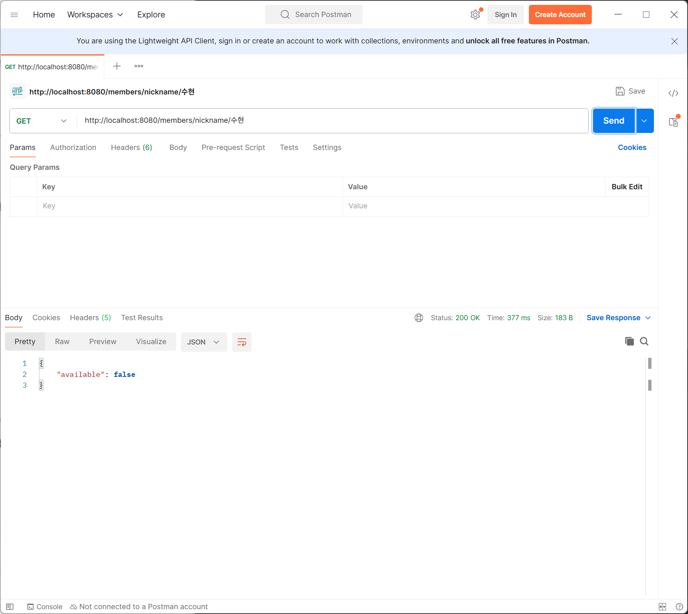
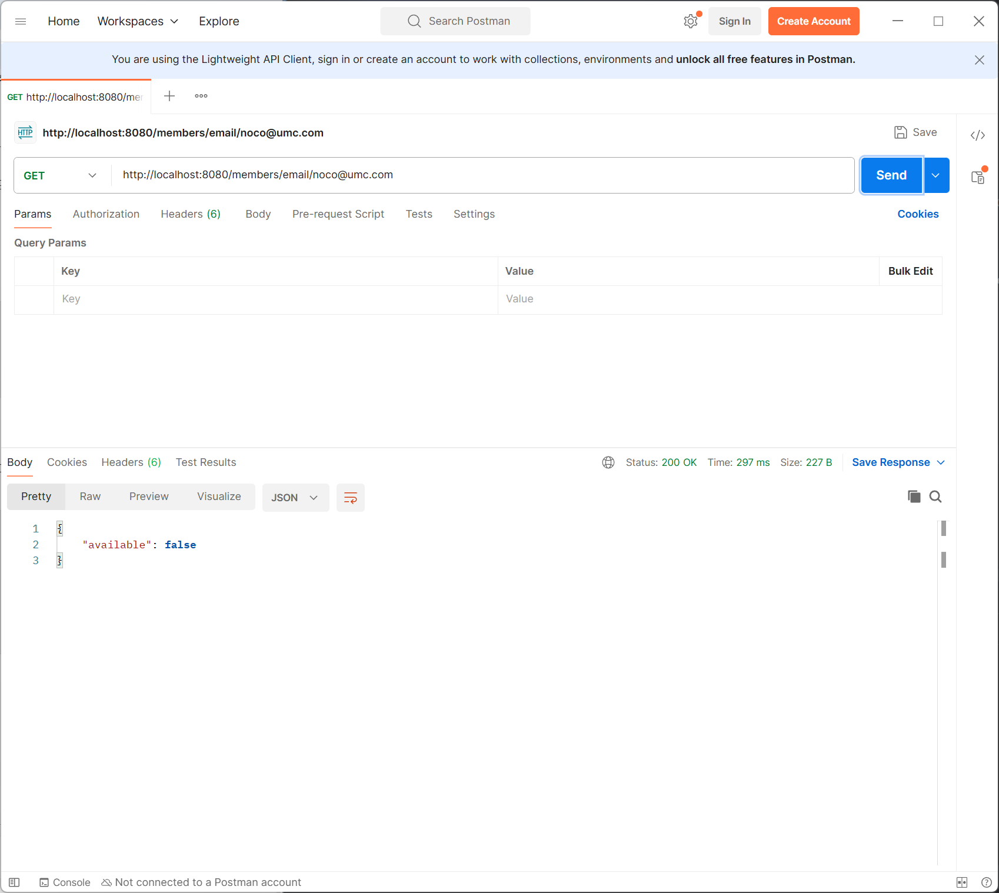
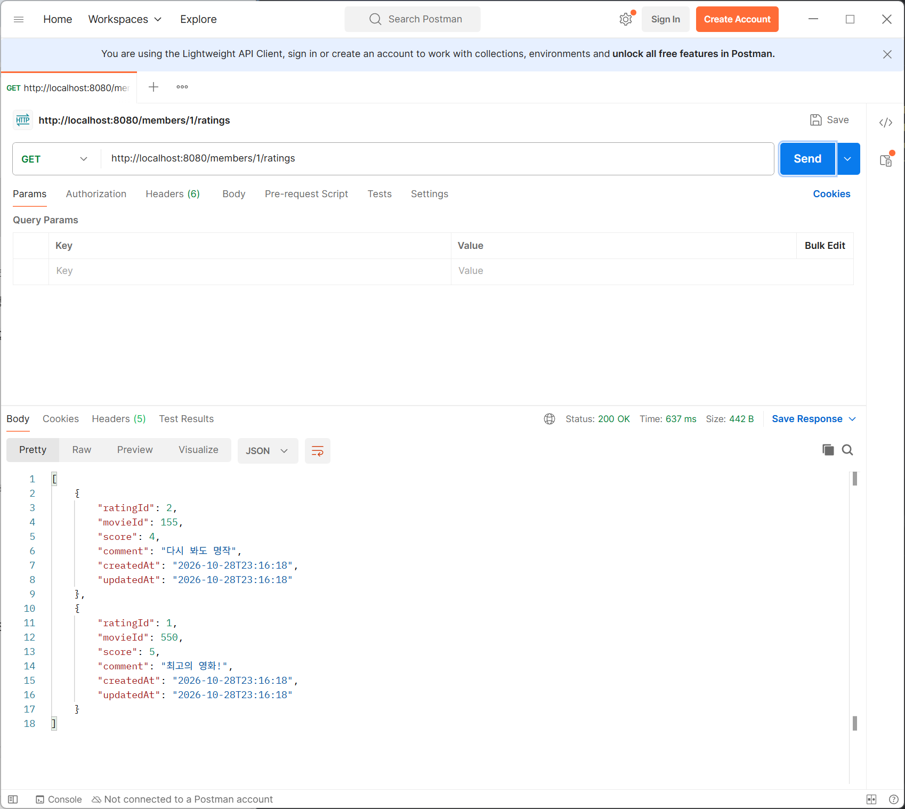
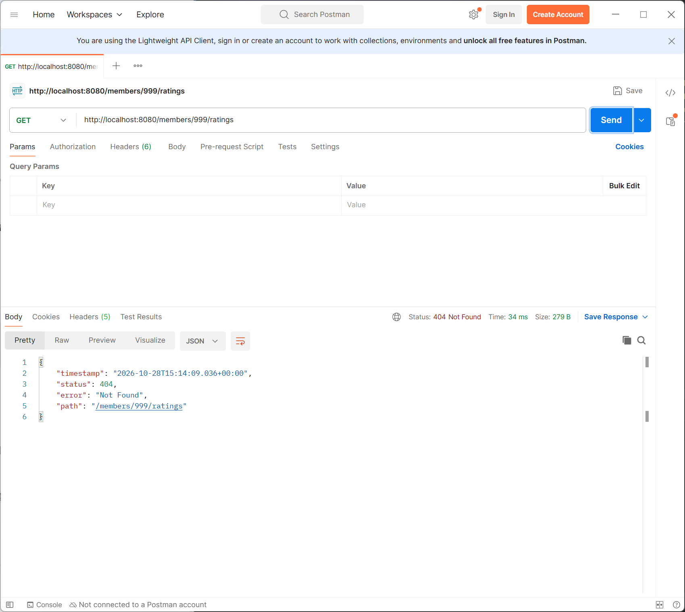
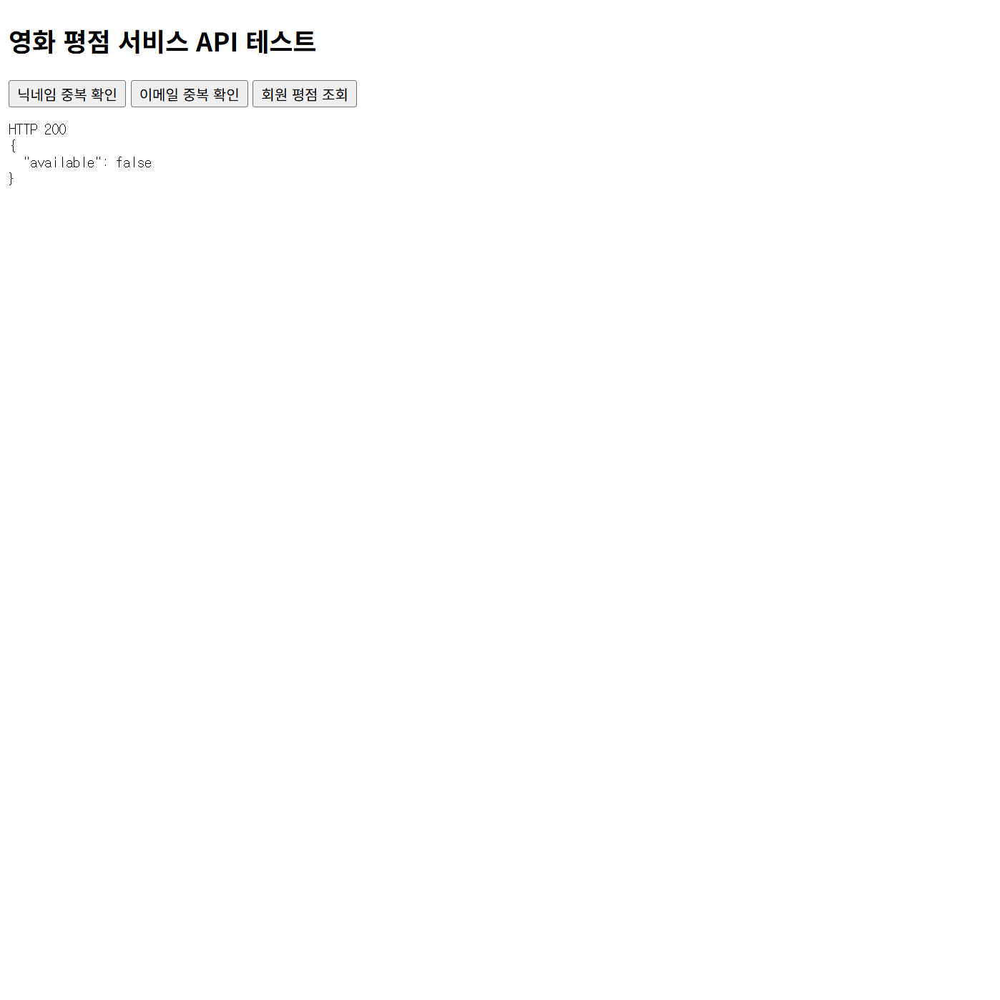
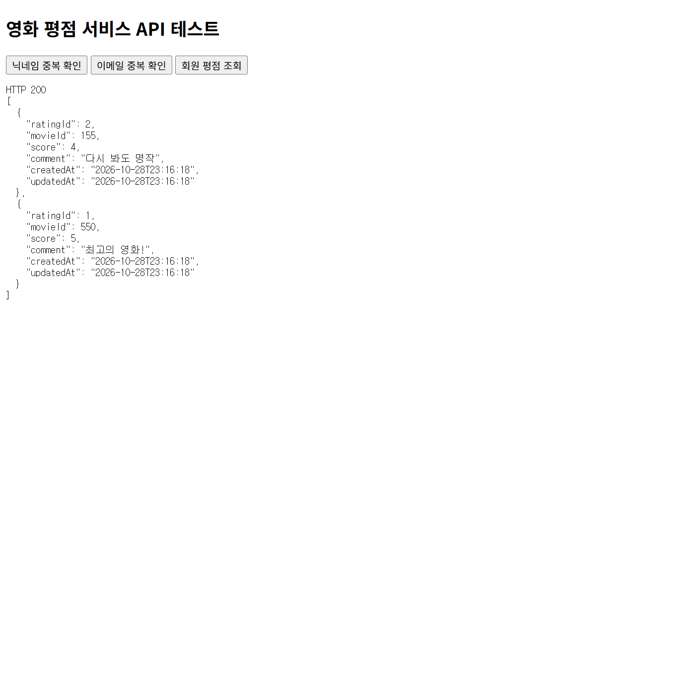

# chapter05

## 1. 구현 내용

5주차 실습에서 구현한 닉네임 중복 체크, 이메일 중복 체크, 회원별 영화 평점 목록 조회 API를 간이 프론트엔드와 연동하였다.

JavaScript의 `fetch()`를 통해 백엔드 API를 호출하고, Spring Boot에 CORS 설정을 추가하여 서로 다른 출처에서 정상적으로 통신할 수 있도록 구현하였다.

## 2. Entity 및 Repository

`Member`와 `Rating`을 JPA Entity로 구현하고, `Rating`에서 `@ManyToOne`을 사용하여 회원과 평점의 다대일 관계를 설정하였다.

**Rating Entity - 회원과 평점의 연관관계**

```java
@ManyToOne(fetch = FetchType.LAZY)
@JoinColumn(name = "member_id", nullable = false)
private Member member;
```

Spring Data JPA의 `JpaRepository`를 사용하여 데이터베이스에 접근하도록 구현하였다.

- `existsByNickname()` : 닉네임 중복 여부 확인
- `existsByEmail()` : 이메일 중복 여부 확인
- `findByMember_MemberIdOrderByRatingIdDesc()` : 회원별 평점 목록 내림차순 조회

**MemberRepository - 닉네임 및 이메일 중복 확인**

```java
public interface MemberRepository extends JpaRepository<Member, Long> {
    boolean existsByNickname(String nickname);
    boolean existsByEmail(String email);
}
```

**RatingRepository - 회원별 평점 목록 조회**

```java
public interface RatingRepository extends JpaRepository<Rating, Long> {
    List<Rating> findByMember_MemberIdOrderByRatingIdDesc(Long memberId);
}
```

## 3. DTO 및 Service

닉네임과 이메일의 사용 가능 여부를 반환하기 위해 `NicknameCheckResponse`, `EmailCheckResponse`를 사용하였다.

평점 조회 결과는 `RatingResponse`를 통해 반환하도록 구현하였다.

**DTO - 중복 확인 및 평점 조회 응답**

```java
public record NicknameCheckResponse(boolean available) {
}

public record EmailCheckResponse(boolean available) {
}
```

```java
public record RatingResponse(
        Long ratingId,
        Long movieId,
        Integer score,
        String comment,
        LocalDateTime createdAt,
        LocalDateTime updatedAt
) {
    public static RatingResponse from(Rating rating) {
        return new RatingResponse(
                rating.getRatingId(),
                rating.getMovieId(),
                rating.getScore(),
                rating.getComment(),
                rating.getCreatedAt(),
                rating.getUpdatedAt()
        );
    }
}
```

Service에서는 Repository를 통해 데이터를 조회하고, 조회 결과를 응답 DTO로 변환하도록 구현하였다.

또한 존재하지 않는 회원을 조회한 경우 `404 Not Found`를 반환하도록 처리하였다.

**MemberService - 닉네임 및 이메일 중복 확인**

```java
public NicknameCheckResponse checkNickname(String nickname) {
    return new NicknameCheckResponse(
            !memberRepository.existsByNickname(nickname)
    );
}

public EmailCheckResponse checkEmail(String email) {
    return new EmailCheckResponse(
            !memberRepository.existsByEmail(email)
    );
}
```

**RatingService - 회원별 평점 목록 조회**

```java
public List<RatingResponse> getRatings(Long memberId) {
    if (!memberRepository.existsById(memberId)) {
        throw new ResponseStatusException(
                HttpStatus.NOT_FOUND,
                "존재하지 않는 유저입니다."
        );
    }

    return ratingRepository
            .findByMember_MemberIdOrderByRatingIdDesc(memberId)
            .stream()
            .map(RatingResponse::from)
            .toList();
}
```

## 4. Controller

다음 세 가지 API를 구현하였다.

| HTTP Method | API | 기능 |
| --- | --- | --- |
| GET | `/members/nickname/{nickname}` | 닉네임 중복 확인 |
| GET | `/members/email/{email}` | 이메일 중복 확인 |
| GET | `/members/{memberId}/ratings` | 회원별 영화 평점 목록 조회 |

Controller에서는 요청을 받아 Service에 전달하고 처리 결과를 반환하도록 구성하였다.

**MemberController - 닉네임 및 이메일 중복 체크**

```java
@GetMapping("/nickname/{nickname}")
public NicknameCheckResponse checkNickname(
        @PathVariable String nickname
) {
    return memberService.checkNickname(nickname);
}

@GetMapping("/email/{email}")
public EmailCheckResponse checkEmail(
        @PathVariable String email
) {
    return memberService.checkEmail(email);
}
```

**RatingController - 회원별 평점 목록 조회**

```java
@GetMapping("/{memberId}/ratings")
public List<RatingResponse> getRatings(
        @PathVariable Long memberId
) {
    return ratingService.getRatings(memberId);
}
```

## 5. 프론트엔드 연동 및 CORS 설정

간이 HTML 페이지에 API 호출 버튼을 구성하고, JavaScript의 `fetch()`를 사용하여 백엔드 API를 호출하도록 구현하였다.

프론트엔드와 백엔드의 출처가 달라 CORS 오류가 발생하여, Spring Boot의 `WebConfig`에 허용 출처를 설정하였다.

기존 5173 포트가 다른 프로젝트에서 사용 중이어서 프론트엔드는 `localhost:5500`으로 실행하였다.

**WebConfig - CORS 허용 설정**

```java
registry.addMapping("/**")
        .allowedOrigins("http://localhost:5500")
        .allowedMethods("GET", "POST", "PATCH", "DELETE")
        .allowedHeaders("*");
```

설정 변경 후 Spring Boot를 재실행하여 정상적으로 API가 호출되는 것을 확인하였다.

## 6. 실행 결과

### 6-1. Postman API 테스트

**GET /members/nickname/수현 - 닉네임 중복 확인 (200 OK)**

이미 등록된 닉네임에 대해 `available: false`가 반환되는 것을 확인하였다.



**GET /members/email/noco@umc.com - 이메일 중복 확인 (200 OK)**

이미 등록된 이메일에 대해 `available: false`가 반환되는 것을 확인하였다.



**GET /members/1/ratings - 회원별 평점 목록 조회 (200 OK)**

회원 1번의 평점 목록이 `ratingId` 기준 내림차순으로 반환되는 것을 확인하였다.



**GET /members/999/ratings - 존재하지 않는 회원 조회 (404 Not Found)**

존재하지 않는 회원 ID로 요청한 경우 `404 Not Found`가 반환되는 것을 확인하였다.



### 6-2. 프론트엔드 API 연동 테스트

**닉네임 중복 체크 - 정상 응답 (200 OK)**

이미 등록된 닉네임에 대해 `available: false`가 반환되는 것을 확인하였다.



**이메일 중복 체크 - 정상 응답 (200 OK)**

이미 등록된 이메일에 대해 `available: false`가 반환되는 것을 확인하였다.


**회원별 영화 평점 목록 조회 - 정상 응답 (200 OK)**

회원 1번이 작성한 평점 2개가 `ratingId` 기준 내림차순으로 반환되는 것을 확인하였다.


