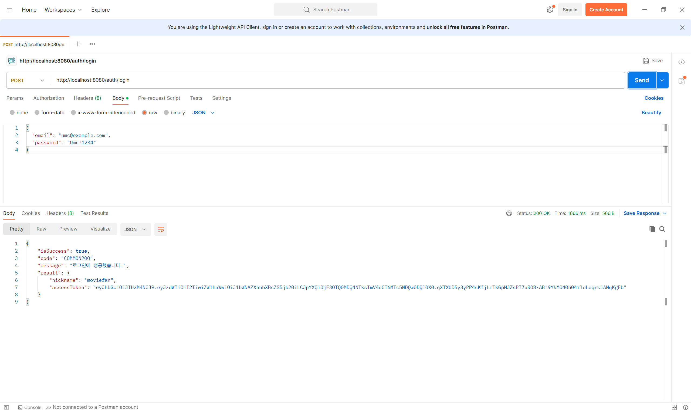
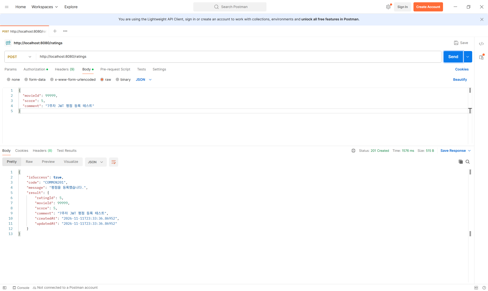
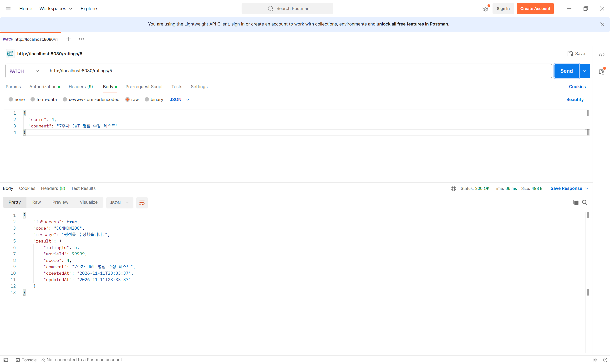
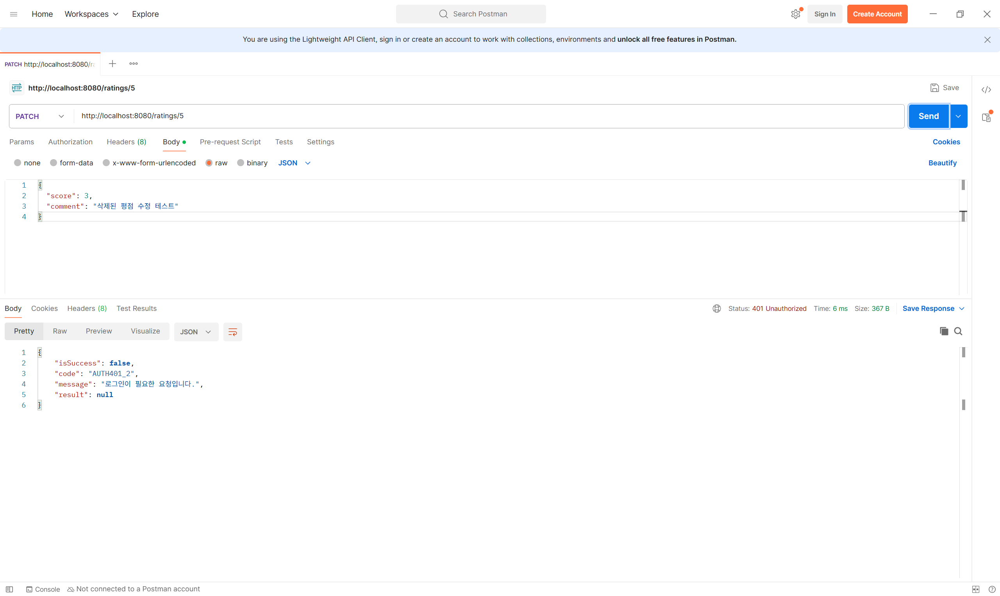
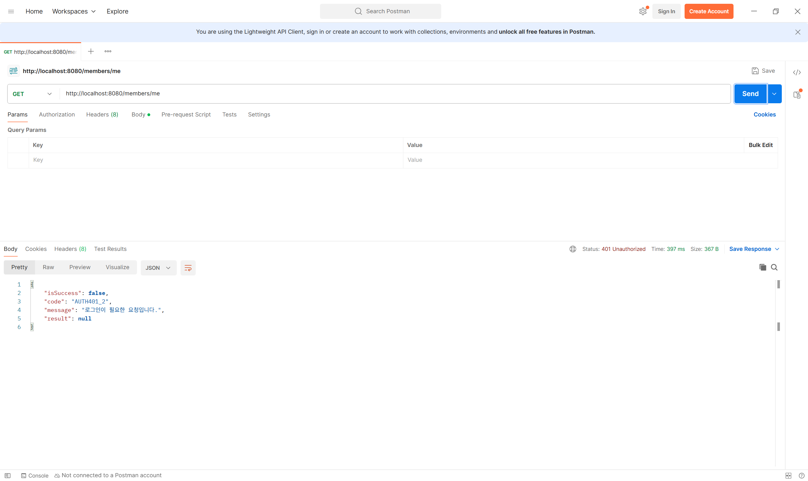
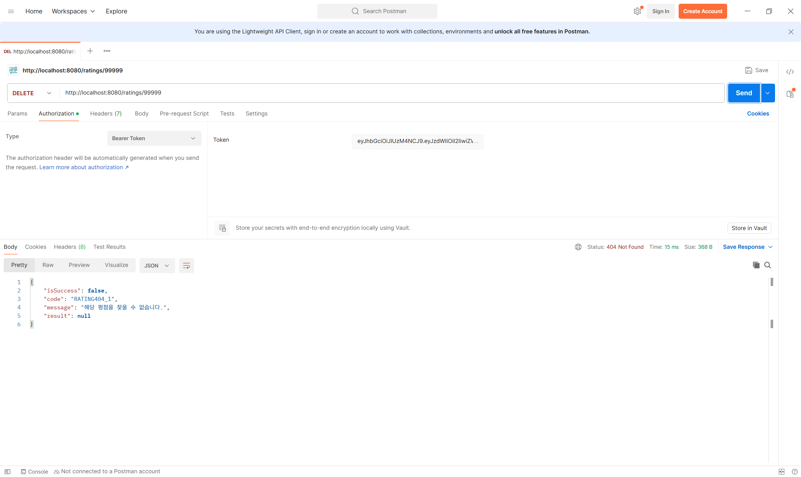
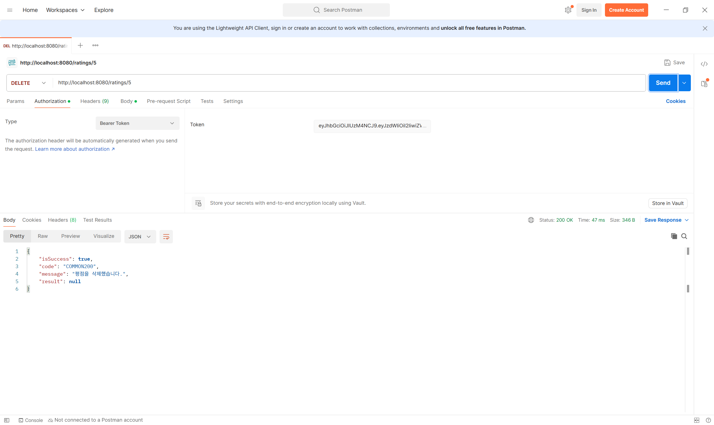

# chapter07

## **1. 실행 결과**

### **1-1. 회원가입 및 로그인 테스트**

**POST /members - 회원 A, B 준비 (201 Created)**

JWT 인증과 평점 소유자 검증을 위해 서로 다른 회원 계정 두 개를 준비하였다.

**POST /auth/login - 회원 A 로그인 성공 (200 OK)**

회원 A의 계정으로 로그인하여 JWT Access Token을 발급받았다. 로그인 성공 시 `200 OK`와 `COMMON200`이 반환되었으며, 응답에 `accessToken`이 포함된 것을 확인하였다.

**POST /auth/login - 회원 B 로그인 성공 (200 OK)**

회원 B의 계정으로 로그인하여 JWT Access Token을 발급받았다. 로그인 성공 시 `200 OK`와 `COMMON200`이 반환되었으며, 응답에 `accessToken`이 포함된 것을 확인하였다.

### **1-2. 평점 등록 테스트**

**POST /ratings - 본인 토큰으로 평점 등록 (201 Created)**

회원 A의 JWT를 사용하여 영화 평점을 등록하였다.

요청 본문에는 `movieId`, `score`, `comment`만 포함하였으며, `memberId`를 전달하지 않아도 정상적으로 등록되는 것을 확인하였다.

요청 결과 `201 Created`와 `COMMON201`이 반환되었으며, 생성된 평점 ID를 확인하였다.

### **1-3. 중복 평점 등록 테스트**

**POST /ratings - 동일 영화 중복 등록 (409 Conflict)**

회원 A의 JWT로 이미 평점을 등록한 영화에 동일한 요청을 다시 전송하였다.

그 결과 `409 Conflict`와 `RATING409_1`이 반환되었으며, 동일한 회원이 같은 영화에 평점을 중복 등록할 수 없음을 확인하였다.

### **1-4. 본인 평점 수정 테스트**

**PATCH /ratings/{ratingId} - 본인 평점 수정 (200 OK)**

회원 A의 JWT를 사용하여 자신이 등록한 평점의 별점과 후기를 수정하였다.

요청 결과 `200 OK`와 `COMMON200`이 반환되었으며, 수정한 별점과 후기 내용이 정상적으로 반영된 것을 확인하였다.

### **1-5. 다른 회원의 평점 수정 테스트**

**PATCH /ratings/{ratingId} - 다른 회원의 평점 수정 시도 (403 Forbidden)**

회원 A가 작성한 평점에 대해 회원 B의 유효한 JWT를 사용하여 수정 요청을 전송하였다.

그 결과 `403 Forbidden`과 `RATING403_1`이 반환되었으며, 로그인한 회원이라도 다른 회원이 작성한 평점은 수정할 수 없음을 확인하였다.

### **1-6. 토큰 없이 API 요청 테스트**

**PATCH /ratings/{ratingId} - 토큰 없이 평점 수정 (401 Unauthorized)**

Authorization 헤더를 제거한 상태에서 평점 수정 API를 호출하였다.

그 결과 `401 Unauthorized`와 `AUTH401_2`가 반환되었으며, JWT가 없는 요청은 인증 단계에서 차단되는 것을 확인하였다.

**GET /members/me - 토큰 없이 내 정보 조회 (401 Unauthorized)**

Authorization 헤더 없이 내 정보 조회 API를 호출하였다.

그 결과 `401 Unauthorized`와 `AUTH401_2`가 반환되었으며, 로그인하지 않은 사용자는 자신의 정보를 조회할 수 없음을 확인하였다.

### **1-7. 존재하지 않는 평점 삭제 테스트**

**DELETE /ratings/99999 - 존재하지 않는 평점 삭제 (404 Not Found)**

유효한 JWT를 사용하여 존재하지 않는 평점 ID에 삭제 요청을 전송하였다.

그 결과 `404 Not Found`와 `RATING404_1`이 반환되었으며, 삭제 대상 평점이 존재하지 않는 경우 오류가 정상적으로 처리되는 것을 확인하였다.

### **1-8. 본인 평점 삭제 테스트**

**DELETE /ratings/{ratingId} - 본인 평점 삭제 (200 OK)**

회원 A의 JWT를 사용하여 자신이 등록한 평점을 삭제하였다.

요청 결과 `200 OK`와 `COMMON200`이 반환되었으며, 평점 삭제가 정상적으로 처리된 것을 확인하였다.

## **2. 검증 결과**

Postman을 통해 JWT 기반 로그인과 평점 등록·수정·삭제 API가 정상적으로 동작하는 것을 확인하였다.

평점 등록 요청 본문에 `memberId`를 포함하지 않고도 JWT에서 추출한 회원 ID를 사용하여 평점이 등록되는 것을 확인하였다.

또한 토큰 없이 요청한 경우에는 `401 Unauthorized`와 `AUTH401_2`가 반환되었으며, 다른 회원의 유효한 토큰으로 평점 수정을 시도한 경우에는 `403 Forbidden`과 `RATING403_1`이 반환되었다.

이를 통해 JWT 인증과 평점 소유자에 대한 인가 검증이 구분되어 정상적으로 동작하는 것을 확인하였다.
