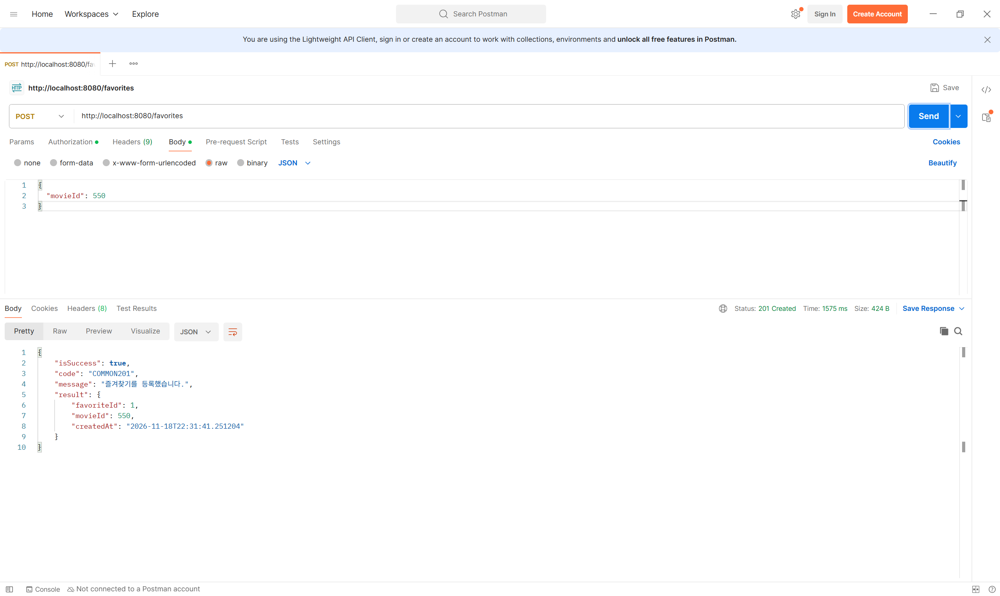
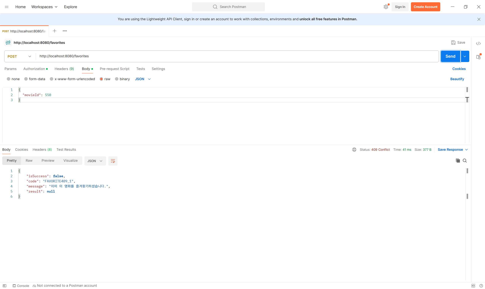
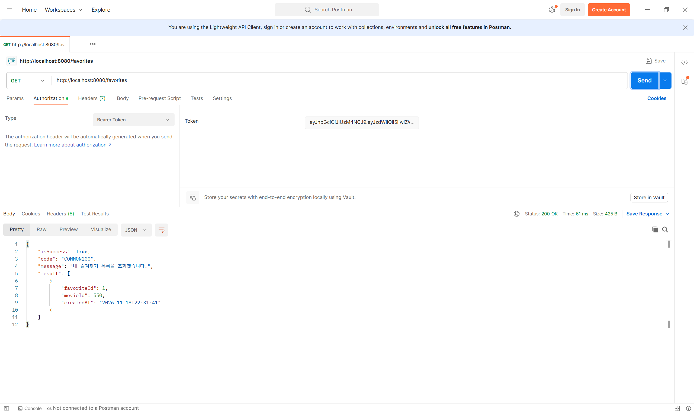
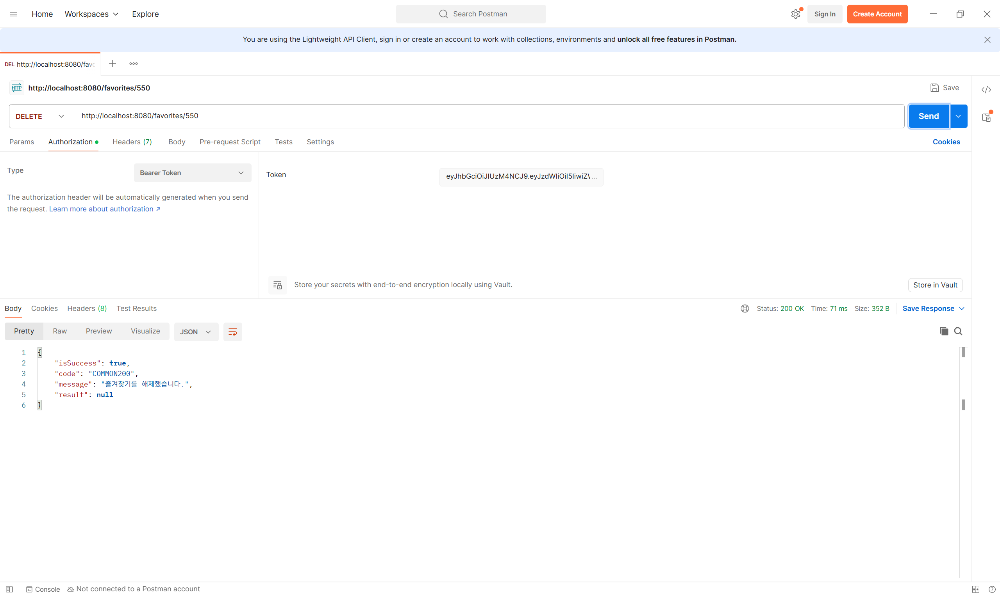

# chapter08

## **1. 구현 내용**

JWT 인증을 기반으로 즐겨찾기 CRUD API와 영화 기록 저장 API를 구현하였다.

`Favorite` 엔티티가 `BaseTimeEntity`를 상속하도록 구성하고, 회원 정보와 영화 ID를 저장하도록 구현하였다. 또한 `FavoriteRepository`, `FavoriteService`, `FavoriteController`를 분리하여 즐겨찾기 등록, 목록 조회, 여부 확인, 해제 기능을 구현하였다.

모든 API는 JWT 토큰에서 회원 ID를 추출하여 사용하므로 요청 URL이나 Body에 `memberId`를 전달하지 않도록 구성하였다.

추가로 `POST /movie-records` API를 구현하여 평점 등록 시 `addToFavorites`가 `true`이면 즐겨찾기도 함께 저장하도록 하였다. `MovieRecordService`의 `create()` 메서드에 `@Transactional`을 적용하여 두 저장 작업을 하나의 트랜잭션으로 처리하였다.

## **2. API 테스트 결과**

### **2-1. 즐겨찾기 등록**

**POST /favorites - 즐겨찾기 등록 성공 (201 Created)**



**POST /favorites - 중복 등록 오류 (409 Conflict)**



동일한 영화에 즐겨찾기를 중복 등록하면 `FAVORITE409_1` 오류가 반환되는 것을 확인하였다.

### **2-2. 즐겨찾기 조회**

**GET /favorites - 내 즐겨찾기 목록 조회 (200 OK)**



**GET /favorites/{movieId} - 즐겨찾기 여부 조회 (200 OK)**


즐겨찾기 등록 여부에 따라 `isFavorite` 값이 `true` 또는 `false`로 반환되는 것을 확인하였다.

### **2-3. 즐겨찾기 해제**

**DELETE /favorites/{movieId} - 즐겨찾기 해제 성공 (200 OK)**


즐겨찾기 해제 후 공통 응답 형식으로 `200 OK`가 반환되는 것을 확인하였다.

### **2-4. 영화 기록 저장**

**POST /movie-records - 평점 및 즐겨찾기 동시 저장 (201 Created)**



`addToFavorites: true`로 요청했을 때 응답의 `rating`과 `favorite`에 각각 저장된 정보가 포함되는 것을 확인하였다.

## **3. 트랜잭션 처리**

**MovieRecordService - @Transactional을 이용한 동시 저장**

```java
@Transactional
public MovieRecordResponse create(Long memberId, CreateMovieRecordRequest request) {

    // 평점 저장
    Rating savedRating = ratingRepository.save(rating);

    FavoriteResponse favoriteResponse = null;

    // 즐겨찾기 저장
    if (request.addToFavorites()) {
        Favorite favorite = Favorite.builder()
                .member(member)
                .movieId(request.movieId())
                .build();

        Favorite savedFavorite = favoriteRepository.save(favorite);
        favoriteResponse = FavoriteResponse.from(savedFavorite);
    }

    return new MovieRecordResponse(
            RatingResponse.from(savedRating),
            favoriteResponse
    );
}
```

평점과 즐겨찾기 저장을 하나의 트랜잭션으로 묶어, 두 작업 중 하나라도 실패하면 전체 작업을 롤백하여 데이터의 일관성을 유지하도록 하였다.

## **4. 핵심 코드 링크**

- `Favorite.java` - 즐겨찾기 엔티티
- `FavoriteRepository.java` - 즐겨찾기 데이터 접근
- `FavoriteService.java` - 즐겨찾기 비즈니스 로직
- `FavoriteController.java` - 즐겨찾기 CRUD API
- `MovieRecordService.java` - 평점 및 즐겨찾기 트랜잭션 처리
- `MovieRecordController.java` - 영화 기록 저장 API
