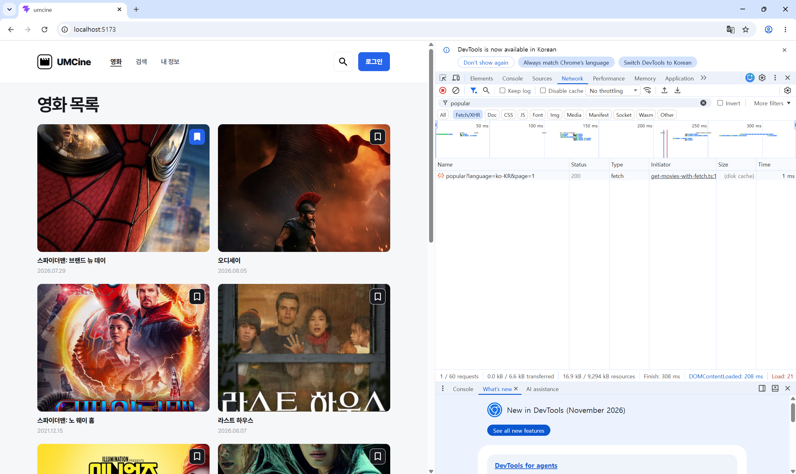
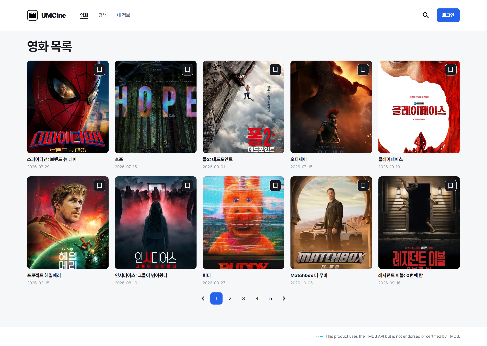
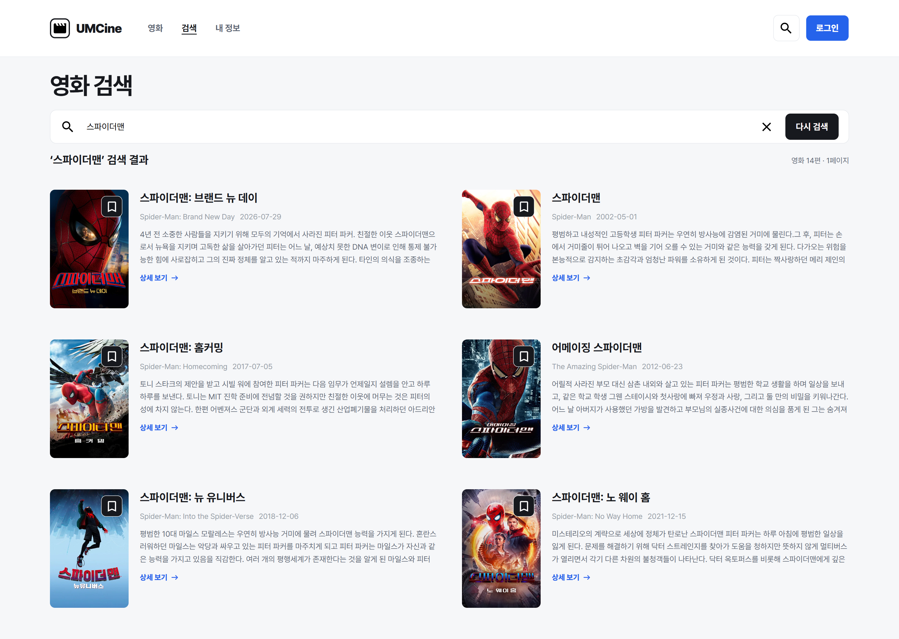
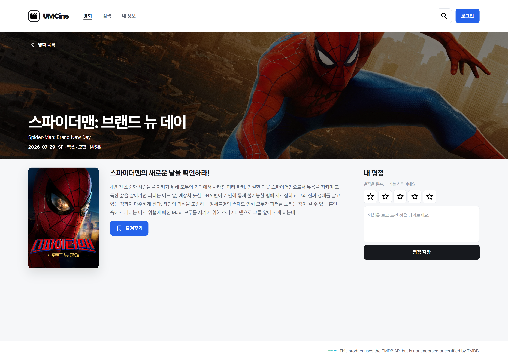
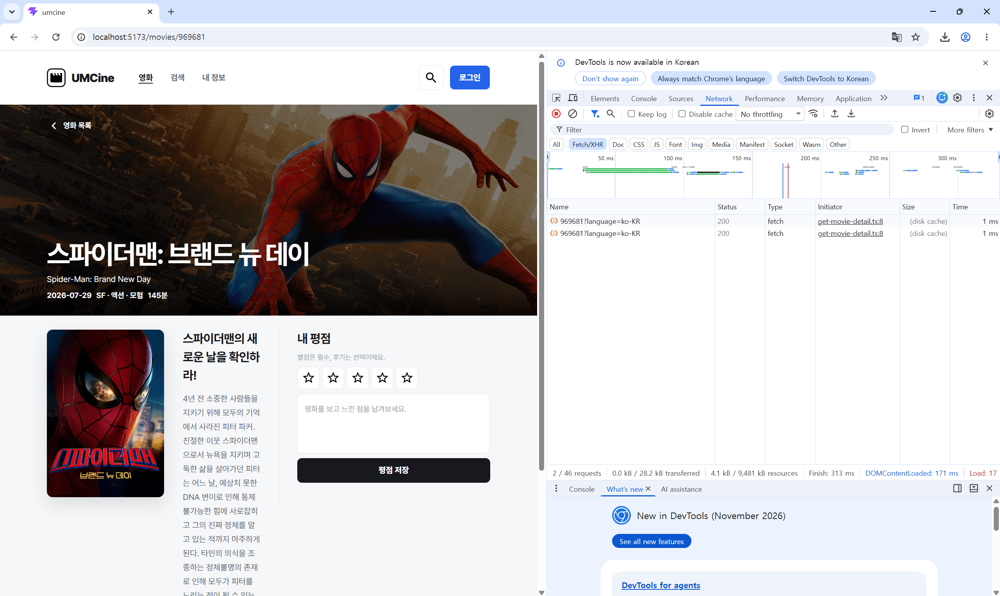

# chapter05

## 1. 구현 방법

### 순수 fetch를 이용한 TMDB 인기 영화 요청

기존 로컬 영화 데이터를 TMDB API 데이터로 변경하기 위해 `.env.local`에 TMDB API 기본 URL과 Access Token을 설정하고, `src/config/env.ts`에서 환경 변수를 관리하도록 구성했다.

먼저 순수 `fetch`를 사용하여 TMDB 인기 영화 목록을 요청하는 `getMoviesWithFetch` 함수를 구현했다.

`URLSearchParams`로 언어와 페이지 번호를 설정하고, 요청 헤더에 Bearer 토큰을 포함하도록 구현했다. 응답 상태가 정상적이지 않으면 오류를 발생시키고, 정상 응답은 JSON으로 변환하여 반환하도록 했다.

```tsx
async function getMoviesWithFetch(page = 1): Promise<GetMoviesWithFetchResponse> {
  const searchParams = new URLSearchParams({
    language: "ko-KR",
    page: String(page),
  });

  const response = await fetch(
    `${env.tmdbApiBaseUrl}/movie/popular?${searchParams}`,
    {
      headers: {
        Authorization: `Bearer ${env.tmdbAccessToken}`,
      },
    },
  );

  if (!response.ok) {
    throw new Error(`영화 목록 요청에 실패했어요: ${response.status}`);
  }

  return response.json();
}
```

작성한 함수를 실행한 뒤 Chrome 개발자 도구의 Network 패널에서 인기 영화 요청이 정상적으로 전송되고, 응답 데이터의 `results` 배열에 영화 정보가 포함되어 있는 것을 확인했다.

### ky 인스턴스를 이용한 공통 API 요청 구성

목록, 검색, 상세 화면에서 동일한 API 설정을 사용하도록 `ky` 라이브러리를 설치하고 `src/api/tmdb-client.ts`에 공통 인스턴스를 생성했다.

API 기본 URL과 인증 헤더를 공통으로 설정하여 각 API 요청 함수에서 중복 코드를 작성하지 않도록 구현했다.

```tsx
export const tmdbClient = ky.create({
  baseUrl: `${env.tmdbApiBaseUrl}/`,
  headers: {
    Authorization: `Bearer ${env.tmdbAccessToken}`,
  },
});
```

### 영화 목록 화면 TMDB API 연결

기존 `src/data/movies.ts`의 로컬 데이터를 사용하는 대신, `getMovies` 함수를 통해 TMDB 인기 영화 목록을 가져오도록 변경했다.

```tsx
function getMovies({ page = 1 }: GetMoviesRequest = {}) {
  return tmdbClient
    .get("movie/popular", {
      searchParams: {
        language: "ko-KR",
        page,
      },
    })
    .json<GetMoviesResponse>();
}
```

`MovieListPage`에서는 `useEffect`를 사용하여 API 요청을 실행하고, 응답받은 영화 목록을 `useState`로 관리하도록 구현했다.

또한 TMDB API가 한 페이지에 반환하는 영화 20개를 화면에서 10개씩 표시하도록 구성하고, 기존 페이지네이션 버튼을 이용하여 1~5페이지까지 이동할 수 있도록 구현했다.

```tsx
const [currentPage, setCurrentPage] = useState(1);

// 화면 페이지 2개당 TMDB API 페이지 1개 사용
const apiPage = Math.ceil(currentPage / 2);

// 받아온 영화 20개 중 현재 화면에 표시할 10개 선택
const startIndex = ((currentPage - 1) % 2) * 10;
const visibleMovies = movies.slice(startIndex, startIndex + 10);
```

TMDB 응답의 `poster_path`, `release_date` 등을 사용하여 기존 영화 카드 디자인에 실제 영화 정보를 표시하도록 변경했다.

### 영화 검색 화면 TMDB API 연결

기존에는 로컬 영화 배열에서 `filter()`를 사용하여 검색했지만, 이번 미션에서는 `searchMovies` 함수를 통해 TMDB 검색 API를 호출하도록 변경했다.

```tsx
function searchMovies({ query, page = 1 }: SearchMoviesRequest) {
  return tmdbClient
    .get("search/movie", {
      searchParams: {
        query,
        language: "ko-KR",
        include_adult: false,
        page,
      },
    })
    .json<SearchMoviesResponse>();
}
```

검색어가 변경되면 `useEffect`에서 API 요청을 실행하고, 응답받은 영화 목록과 전체 검색 결과 수를 상태로 관리하도록 구현했다.

```tsx
searchMovies({ query: normalizedQuery })
  .then((response) => {
    if (!ignore) {
      setSearchResults(response.results);
      setTotalResults(response.total_results);
    }
  })
  .catch(() => {
    if (!ignore) {
      setErrorMessage("검색 결과를 불러오지 못했어요.");
    }
  })
  .finally(() => {
    if (!ignore) {
      setIsLoading(false);
    }
  });
```

기존 검색 화면의 2열 레이아웃과 북마크 버튼, 상세 보기 링크는 유지하면서 TMDB의 영화 제목, 포스터, 개봉일, 줄거리를 표시하도록 변경했다.

### 영화 상세 화면 TMDB API 연결

영화 상세 화면에서는 기존 `movies.find()` 대신 URL의 영화 ID를 이용하여 TMDB 상세 API를 호출하도록 변경했다.

```tsx
function getMovieDetail(movieId: number) {
  return tmdbClient
    .get(`movie/${movieId}`, {
      searchParams: { language: "ko-KR" },
    })
    .json<GetMovieDetailResponse>();
}
```

`useParams`로 URL의 영화 ID를 가져오고, `useEffect`에서 해당 영화의 상세 정보를 요청하도록 구현했다.

```tsx
const { movieId } = useParams({ from: "/movies/$movieId" });

useEffect(() => {
  let ignore = false;

  async function loadMovie() {
    try {
      setIsLoading(true);
      setErrorMessage("");
      setMovie(null);

      const response = await getMovieDetail(Number(movieId));

      if (!ignore) {
        setMovie(response);
      }
    } catch {
      if (!ignore) {
        setErrorMessage("영화 정보를 불러오지 못했어요.");
      }
    } finally {
      if (!ignore) {
        setIsLoading(false);
      }
    }
  }

  loadMovie();

  return () => {
    ignore = true;
  };
}, [movieId]);
```

TMDB 상세 응답의 배경 이미지, 포스터, 장르, 상영 시간, 줄거리 등을 기존 상세 페이지 디자인에 맞게 표시했다. 기존 Zustand 북마크 기능과 평점 입력 UI도 유지했다.

### API 요청 상태 처리 및 TMDB 출처 표시

목록, 검색, 상세 화면에서 API 요청 중에는 로딩 메시지를 표시하고, 요청 실패 시에는 오류 메시지를 표시하도록 구현했다.

또한 영화 목록이나 검색 결과가 비어 있는 경우 별도의 안내 문구가 표시되도록 구성했다.

이전 요청 결과가 새로운 화면에 반영되지 않도록 `useEffect`의 정리 함수에서 `ignore` 값을 변경하여 비동기 요청 결과를 구분했다.

기존 Footer의 TMDB 출처 표기는 그대로 유지했다.

## 2. 실행 결과

### 순수 fetch 요청 및 Network 응답 확인

순수 `fetch`로 TMDB 인기 영화 목록을 요청한 뒤, Chrome 개발자 도구의 Network 패널에서 `movie/popular` 요청의 HTTP 상태 코드가 `200`으로 표시되는 것을 확인했다.

응답 JSON의 `results` 배열에 실제 영화 정보가 포함되어 있는 것도 확인했다.



### TMDB 인기 영화 목록 화면

기존 로컬 데이터 대신 TMDB API에서 가져온 실제 영화 포스터, 제목, 개봉일이 목록 화면에 표시되는 것을 확인했다.

기존 5열 카드 디자인을 유지하면서 한 화면에 영화 10개를 표시하도록 구현했으며, 페이지네이션을 통해 다른 영화 목록으로 이동할 수 있도록 했다.



### TMDB 영화 검색 화면

검색창에 `스파이더맨`을 입력한 결과, TMDB 검색 API를 통해 관련 영화가 표시되는 것을 확인했다.

검색 결과에는 영화 제목, 영문 제목, 개봉일, 줄거리, 포스터가 표시되었으며, 전체 검색 결과가 14편으로 나타나는 것을 확인했다.



또한 존재하지 않는 영화 제목을 검색했을 때 `검색 결과가 없어요.`라는 안내 문구가 정상적으로 표시되는 것을 확인했다.

### TMDB 영화 상세 화면

`스파이더맨: 브랜드 뉴 데이`의 상세 화면에서 TMDB API를 통해 가져온 영화 제목, 배경 이미지, 포스터, 장르, 상영 시간, 줄거리가 정상적으로 표시되는 것을 확인했다.

기존 즐겨찾기 버튼과 평점 입력 UI도 유지되었다.



### 상세 페이지 직접 접근 및 새로고침 확인

영화 상세 페이지 주소인 `/movies/969681`에서 새로고침한 뒤에도 영화 정보가 정상적으로 표시되는 것을 확인했다.

Chrome 개발자 도구의 Network 패널에서 `969681?language=ko-KR` 요청의 HTTP 상태 코드가 `200`으로 나타나는 것을 확인했다.



### Console 오류 및 빌드 확인

Chrome 개발자 도구의 Console 패널에서 오류가 발생하지 않는 것을 확인했으며, `pnpm build` 실행 결과 TypeScript 검사와 Vite 프로덕션 빌드가 정상적으로 완료되었다.
