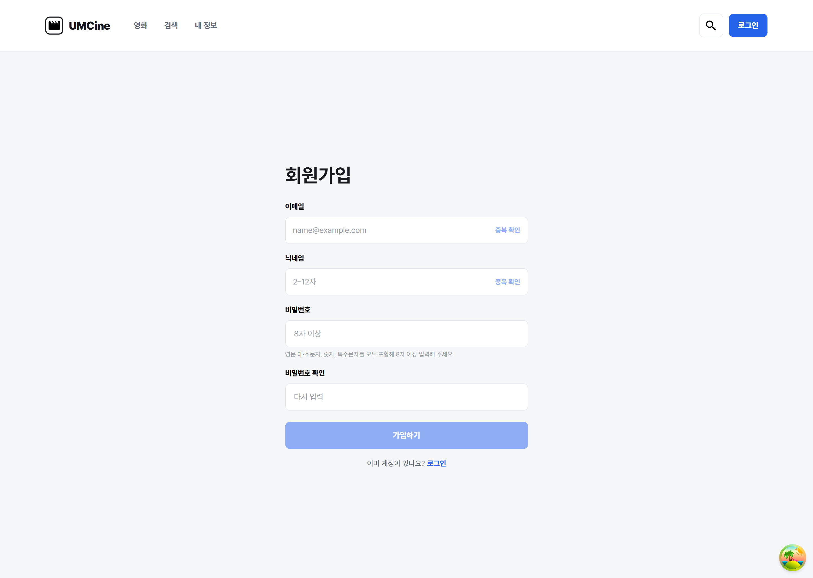
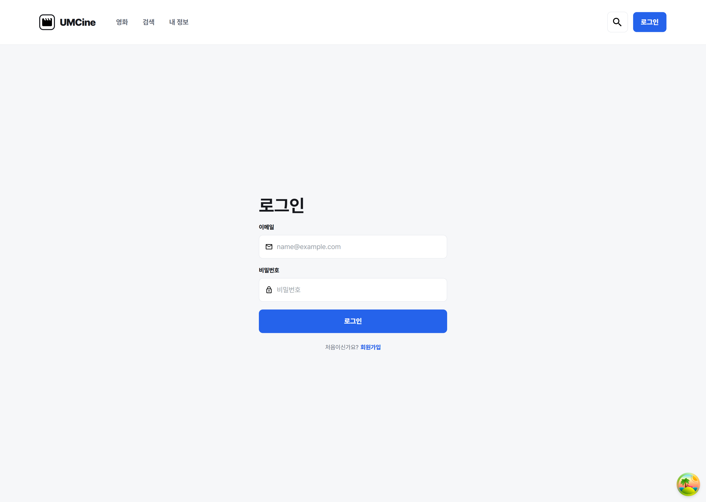
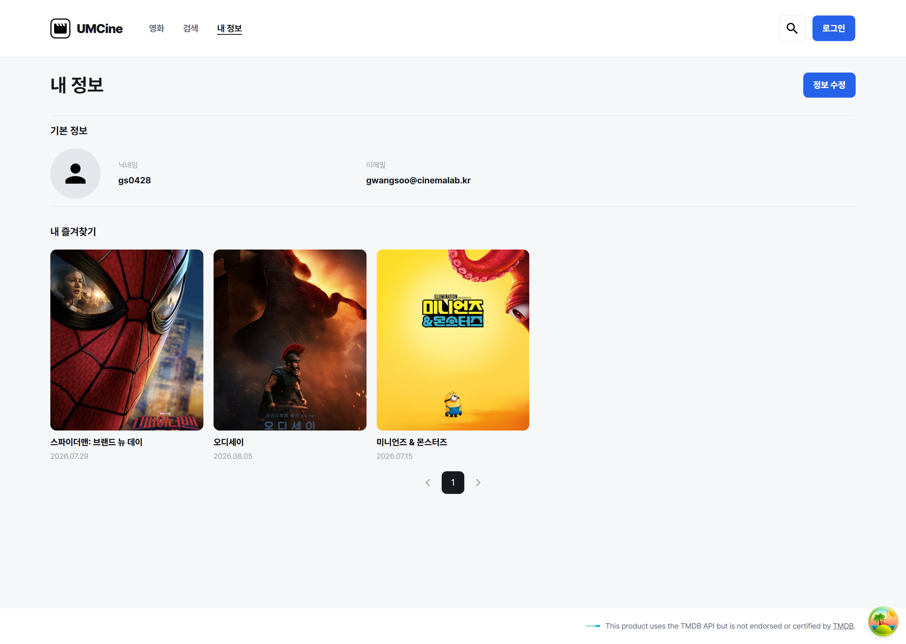
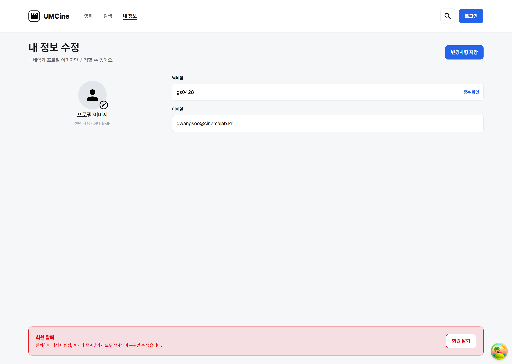
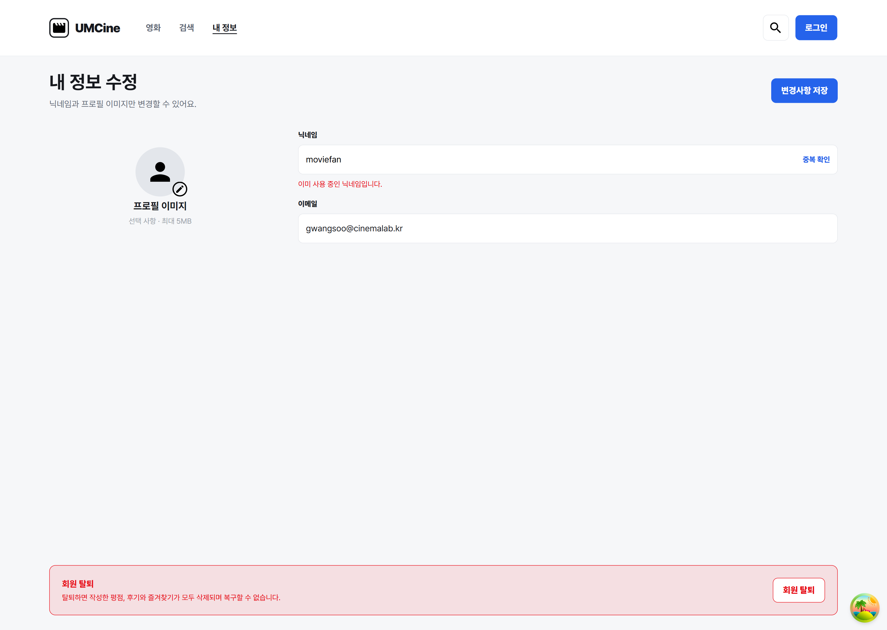

# chapter07

## 1. 구현 방법

### 로그인 화면 퍼블리싱

Figma 디자인을 참고하여 이메일과 비밀번호를 입력할 수 있는 로그인 화면을 구현했다.

`useState`를 사용하여 이메일과 비밀번호 입력값을 각각 관리하고, `onChange` 이벤트를 통해 사용자가 입력한 값이 상태에 반영되도록 구성했다.

또한 `form`의 `onSubmit`에 `handleSubmit`을 연결하고, `preventDefault()`를 사용하여 제출 시 페이지가 새로고침되지 않도록 처리했다.

```tsx
const [email, setEmail] = useState("");
const [password, setPassword] = useState("");

const handleSubmit = (e: SubmitEvent<HTMLFormElement>) => {
  e.preventDefault();
};
```

```tsx
<input
  id="email"
  type="email"
  placeholder="name@example.com"
  value={email}
  onChange={(e) => setEmail(e.target.value)}
/>

<input
  id="password"
  type="password"
  placeholder="비밀번호"
  value={password}
  onChange={(e) => setPassword(e.target.value)}
/>
```

로그인 화면 하단에는 TanStack Router의 `Link`를 사용하여 회원가입 페이지로 이동할 수 있도록 연결했다.

```tsx
<Link
  to="/signup"
  className="ml-1 font-extrabold text-[#2563EB]"
>
  회원가입
</Link>
```

### 내 정보 조회 화면 퍼블리싱

사용자의 기본 정보와 즐겨찾기 영화 목록을 확인할 수 있는 내 정보 조회 화면을 구현했다.

현재는 더미 데이터를 사용하여 닉네임과 이메일을 표시하고, 즐겨찾기 영화 목록은 배열의 `map()`을 사용하여 렌더링하도록 구성했다.

```tsx
const nickname = "gs0428";
const email = "gwangsoo@cinemalab.kr";
```

```tsx
{favoriteMovies.map((movie) => (
  <div key={movie.id} className="flex flex-col gap-1">
    

    <p className="pt-[5px] text-sm font-extrabold text-[#17191E]">
      {movie.title}
    </p>

    <p className="text-xs text-[#969DA8]">
      {movie.releaseDate}
    </p>
  </div>
))}
```

즐겨찾기 목록 하단에는 기존 `Pagination` 컴포넌트를 재사용했다.

또한 `Link`를 사용하여 정보 수정 버튼을 클릭하면 `/mypage/edit` 페이지로 이동하도록 연결했다.

```tsx
<Link
  to="/mypage/edit"
  className="flex h-10 items-center justify-center rounded-lg bg-[#2563EB] px-4 text-sm font-extrabold text-white"
>
  정보 수정
</Link>
```

### 내 정보 수정 화면 퍼블리싱

닉네임과 프로필 이미지 수정 영역, 이메일 정보 및 회원 탈퇴 영역을 포함한 내 정보 수정 화면을 구현했다.

닉네임 입력값은 `useState`로 관리하고, 입력값이 변경되면 기존 중복 확인 결과를 초기화하도록 구성했다.

또한 7주차에서 구현한 닉네임 중복 확인 API를 재사용하여 중복 확인 버튼을 클릭하면 사용 가능 여부가 화면에 표시되도록 했다.

```tsx
const [nickname, setNickname] = useState("gs0428");
const [isNicknameAvailable, setIsNicknameAvailable] =
  useState<boolean | null>(null);

const handleCheckNickname = async () => {
  try {
    const response = await checkNicknameDuplicate(nickname);
    setIsNicknameAvailable(response.available);
  } catch {
    alert("닉네임 중복 확인에 실패했습니다.");
  }
};
```

```tsx
<input
  id="nickname"
  type="text"
  value={nickname}
  onChange={(e) => {
    setNickname(e.target.value);
    setIsNicknameAvailable(null);
  }}
/>

<button
  type="button"
  onClick={handleCheckNickname}
>
  중복 확인
</button>
```

중복 확인 결과에 따라 안내 문구를 조건부 렌더링하도록 구성했다.

```tsx
{isNicknameAvailable === true && (
  <p className="text-xs text-[#2563EB]">
    사용 가능한 닉네임입니다.
  </p>
)}

{isNicknameAvailable === false && (
  <p className="text-xs text-red-600">
    이미 사용 중인 닉네임입니다.
  </p>
)}
```

이메일은 수정할 수 없도록 `readOnly` 속성을 적용했으며, 프로필 이미지 수정 버튼과 회원 탈퇴 버튼은 디자인에 맞춰 UI를 구성했다.

## 2. 실행 결과

### 회원가입 화면

회원가입 페이지에 접속하여 이메일, 닉네임, 비밀번호 등의 입력란이 정상적으로 표시되는지 확인하였다. 각 입력란에 값을 입력했을 때 화면에 정상적으로 반영되는 것도 확인하였다.



### 로그인 화면

로그인 페이지에 접속하여 이메일과 비밀번호 입력란이 정상적으로 표시되는지 확인하였다. 각 입력란에 값을 입력했을 때 입력값이 정상적으로 반영되는 것을 확인하였다.



### 내 정보 조회 화면

내 정보 페이지에 접속하여 프로필 이미지, 닉네임, 이메일 및 즐겨찾기 영화 목록이 정상적으로 표시되는지 확인하였다.



### 내 정보 수정 화면

정보 수정 버튼을 통해 수정 페이지로 이동할 수 있음을 확인하였다. 닉네임 입력란의 값을 변경했을 때 변경된 값이 정상적으로 표시되는 것도 확인하였다.



### 닉네임 중복 확인

내 정보 수정 페이지에서 닉네임 중복 확인 버튼을 클릭하여 API 응답에 따라 사용 가능 여부가 표시되는지 확인하였다.


